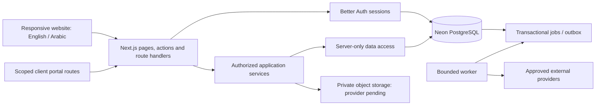

# Website architecture

Updated 29 October 2026. Target architecture for the SoloDesk website. Current implementation is a minimal Next.js App Router starter; database, auth, design-system components and business services remain to be implemented.

## Binding technology and priorities

shadcn/ui is the primary component foundation. Design-system consistency, scalability, security and appropriate design patterns are first-class requirements. Neon supplies authoritative PostgreSQL. Better Auth supplies authentication/session management. Tailwind and React support the Next.js website. The [decision register](../planning/decisions.md) supersedes earlier desktop and backend choices.

## Boundaries and design patterns

Start with one modular application and one repository. Route handlers and Server Actions are thin entry points into application services. Each service validates input, authenticates the Better Auth session, checks current workspace/resource/action grants, applies domain rules and owns transaction boundaries. Server Components use the same authorized data-access layer for reads. Redirects, layouts, proxy checks and disabled buttons never replace service authorization.

Domain modules own pure money/time rules and explicit state transitions. Server-only data access owns Neon connections and scoped queries; provider adapters own external protocol details. UI composition reuses shadcn/ui primitives, semantic tokens and business composites. Apply [design patterns](design-patterns.md) to these concrete boundaries without imposing a repository interface, factory or microservice on every operation.

The server is authoritative for accepted revisions, memberships, financial postings, document numbers and allocations. Browser draft storage is a limited capture mechanism; all submitted operations are revalidated. Financial mutation, command receipt, audit and outbox insertion commit atomically. External calls execute after commit through leased jobs, with reconciliation of uncertain outcomes.

## Scalability

Render on the server by default; isolate Client Components to interactive controls. Keep private data out of shared caches and client bundles. Paginate and bound queries, index measured workspace/scope paths, prevent N+1 loading and review query plans. Use a pooled Neon runtime connection; preserve transaction semantics and use an appropriate direct connection for migrations/backups. Avoid request-scoped connection storms and session-level tenant state on transaction-pooled connections.

Move slow PDF/import/provider work to bounded durable jobs. Rate limits and shared job leases must work across application instances. Measure latency, query cost, cache correctness, job backlog and resource use before adding services or read replicas. Database/client/runtime compatibility and project-specific budgets need evidence; choosing a service does not prove scale.

## Browser storage and collaboration

Use normal HTTPS navigation and same-origin APIs. No privileged native bridge, local SQLite file, operating-system key store or background process is part of the website. Offline drafting remains gated by [browser storage and collaboration](sync-and-collaboration.md); protected persistence requires a reviewed key/recovery and eviction policy. Do not promise a closed tab keeps running JavaScript or that downloaded data can be remotely erased.

## Deployment and status

Separate development, preview/staging and production secrets, databases, auth origins and private files. Use synthetic preview data; a production-derived Neon branch is sensitive production data. Expand schema before new writes, support stale open tabs and remove old contracts only after a declared compatibility window. [Security](security-and-privacy.md), [data lifecycle](data-lifecycle.md), [backend](backend-stack.md) and [release operations](../operations/release-and-support.md) define release gates, not passed implementation evidence.
