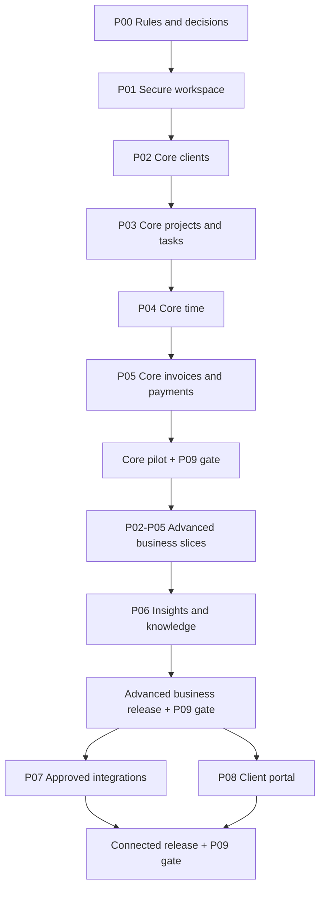

# SoloDesk Full Application Implementation Plan

> **For agentic workers:** Use the required `executing-plans` workflow, one reviewed work package at a time. This document plans the application; it does not authorize deployments, production changes, paid services or delegation. Unchecked items are pending, including items that have partial starter implementations.

**Goal:** Deliver the complete SoloDesk website for freelancers and small teams, from client acquisition through delivery, time capture, billing, collections and reporting, with controlled integrations and a client portal.

**Architecture:** Extend the existing Next.js application as a modular monolith. Thin routes and Server Actions call authorized application services; pure domain rules and server-only scoped Neon queries own calculations and persistence. Reuse Neon Managed Better Auth, existing shared UI and the current localization/theme infrastructure.

**Tech stack:** Next.js App Router, React, TypeScript, shadcn/ui with Base UI, semantic Tailwind tokens, next-intl, Neon PostgreSQL with the existing `pg` pool, Neon Managed Better Auth and the existing Neon Realtime integration where suitable. Hosting, private object storage, email, workers and business providers require the decisions below.

**Specification:** [Product](PRODUCT.md), [requirements](docs/product/requirements.md), [coverage register](docs/planning/coverage.md), [roadmap](docs/planning/roadmap.md), [architecture](docs/architecture/overview.md), [design system](DESIGN.md), and the linked domain specifications. These retain authority over detailed fields and rules. This plan adds implementation order and reviewable work packages while preserving P00–P09 and all 143 requirement IDs.

**Updated:** 1 November 2026; implementation status refreshed from current source and local checks. No business phase is complete. Estimates require confirmed capacity and decisions; this document makes no delivery-date commitment.

**Feature scope:** This is the full product plan, including existing specified functionality and relevant expansion options, with one stable tracked feature ID per leaf. Start with the [feature tree](#9-complete-feature-catalogue), then use the [phase sequence](#2-release-sequence-and-dependencies) and [implementation packages](#4-phased-implementation) to build it. The 143 existing requirements are the baseline; proposed extensions below broaden that baseline without silently changing confirmed product decisions.

**Quick navigation:** [What is built](#inspected-implementation-inventory--1-november-2026) · [Done features](#implementation-completion-ledger--1-november-2026) · [Compatibility rules](#tree-and-compatibility-contract) · [Build sequence](#2-release-sequence-and-dependencies) · [Next six tasks](#81-immediate-continuation-from-the-inspected-checkout) · [Full feature tree](#9-complete-feature-catalogue) · [Open decisions](#5-decisions-and-external-prerequisites) · [Release gates](#6-security-and-verification-matrix).

## 1. Current baseline and scope

The current repository already has public/account pages, English/Arabic catalogs, Light/Dark/System preferences, shared UI primitives, Google/GitHub sign-in initiation, server-authorized personal profile updates and a profile Realtime subscription. These are inspected source capabilities, not a claim that production or end-to-end acceptance passed. Reuse these foundations. [Neon integration evidence](docs/development/neon-setup.md) records prior checks and limitations; they need revalidation for the release being built.

Workspace authorization, business schemas/migrations, clients, projects, tasks, time, billing, reports, jobs and the portal remain to be built. Personal-profile isolation is useful evidence for that slice, not proof of workspace isolation. Some older architecture/phase documents still describe a bare starter; use inspected source and dated evidence to establish implementation status.

Previously recorded release gaps to revalidate include the privileged database connection role, development Google credentials, production email/recovery setup, interactive GitHub return verification, tenant policy, comprehensive accessibility, load and restore evidence. Dependency findings also need fresh exact-version assessment; earlier scan counts are dated results.

This status review preserves current uncommitted profile/account/callback/header/loading changes and all 550 stable feature IDs. Only `plan.md` is edited; unrelated application work is retained.

### Inspected implementation inventory — 1 November 2026

Status is based on current source inspection plus the local tests recorded below. `CODE` means implementation exists; `PARTIAL` means only a slice exists; `GATED` means required remote/policy evidence is unresolved; `PLANNED` means no business implementation was found. A checked feature means its stated implementation is complete for the current checkout; it does not certify deployment or security acceptance. Partial features stay open with checked implemented subtasks and an explicit remaining item. Future consumers must still satisfy the same feature contracts.

| Area                                             | Observed files                                                                                                                                  | Status and work remaining                                                                                                                                                                                                     |
| ------------------------------------------------ | ----------------------------------------------------------------------------------------------------------------------------------------------- | ----------------------------------------------------------------------------------------------------------------------------------------------------------------------------------------------------------------------------- |
| Public landing, tour, navigation and disclosure  | `components/landing-page.tsx`, `components/landing/`, `components/product-tour.tsx`, `components/site-header.tsx`, `lib/site-content.ts`        | CODE/PARTIAL: synthetic demonstrations exist; no clients/time/invoice engine behind them. Status strings such as “inDevelopment” are marketing metadata, not implementation evidence.                                         |
| English/Arabic and theme preferences             | `messages/en.json`, `messages/ar.json`, `lib/site.ts`, `proxy.ts`, `app/api/preferences/route.ts`, `app/globals.css`                            | CODE: localized site and preferences exist; every future screen/email/artifact still needs parity, RTL and accessibility review.                                                                                              |
| Shared component system                          | `components/ui/`, `components.json`, `DESIGN.md`, `app/(utility)/design-system/page.tsx`                                                        | CODE/PARTIAL: shared primitives/showcase exist; business tables, navigation, editors and their acceptance remain pending.                                                                                                     |
| Google/GitHub auth and callback                  | `components/sign-in.tsx`, `lib/auth/client.ts`, `lib/auth/server.ts`, `app/api/auth/[...path]/route.ts`, `app/(utility)/auth/callback/page.tsx` | CODE/GATED: preserve Managed Better Auth; actual provider returns, managed versions/policy and environment evidence require revalidation.                                                                                     |
| Email signup, verification, sign-in and recovery | `components/auth-email-form.tsx`, `components/auth-interactive-panel.tsx`, localized sign-in/sign-up routes/loading states                      | CODE/GATED: forms and SDK calls exist, but isolated end-to-end managed behavior, approved Q-08 and reset/session invariants remain open. Do not equate visible forms with activation approval or assume a server gate exists. |
| Account/profile and Realtime                     | `app/(site)/[locale]/[theme]/app/page.tsx`, `app/actions.ts`, `app/api/profile/route.ts`, `lib/profile.ts`, `components/live-profile.tsx`       | CODE: `/app` is a personal profile slice, not a workspace dashboard. Own verified, nonbanned, unexpired session checks and a scoped sealed query exist; workspace/resource authorization does not.                            |
| Contact and transactional email                  | `app/api/contact/route.ts`, `lib/contact.ts`, `lib/request-body.ts`, `lib/email.tsx`, `emails/`                                                 | CODE/GATED: contact route checks `SOLODESK_CONTACT_ENABLED`; transport/production ingress and distributed abuse controls need proof. Current in-memory limiting is not cross-instance protection.                             |
| Auth email webhook and receipt schema            | `app/api/webhooks/neon-auth/route.tsx`, `lib/auth/email-webhook.ts`, `migrations/001-email-deliveries.sql`                                      | CODE/GATED: deduplication/signature handlers and one migration exist; isolated migration application, callback registration and real inbox delivery remain unverified here. No business schema was found.                     |
| Footer newsletter                                | `components/footer-newsletter-form.tsx`                                                                                                         | MOCK: uses `setTimeout` to simulate success, with no subscription backend. It must be removed, clearly labeled or connected with truthful consent/delivery before being advertised as working.                                |
| Local and integration test harnesses             | `scripts/*.test.mjs`, `scripts/test-auth-flows.mjs`, `scripts/test-neon.mjs`, `scripts/test-site-http.mjs`, `tests/email.test.mjs`              | CODE: `npm test` passed (four Node test-file results and six synthetic email tests); `node scripts/check-translations.mjs` passed (324 matching key/structure entries). Hosted/database/browser/human acceptance was not rerun. A refused production target remains a GAP.                                |
| Workspace/business platform                      | No workspace/client/project/task/time/invoice business service or schema in `app/`, `lib/` or `migrations/`                                     | PLANNED: all corresponding business features below remain unchecked. Earlier native/Electron/Supabase records do not count.                                                                                                   |

The `003` evidence file contains conflicting gate labels and broad browser/human/performance claims alongside open isolated-environment gates. Reconcile raw artifacts and actual execution before carrying any claim forward; task checkmarks and written summaries alone do not establish acceptance.

### Implementation completion ledger — 1 November 2026

The feature tree now records **3 complete implemented features, 27 completed implementation subtasks inside 23 partial features, and 547 open feature parents**. Completed subtasks do not inflate the 550-feature total. No P00–P09 business phase or security release gate is marked complete by this review.

| Done feature | Inspected implementation | Remaining release checks |
| --- | --- | --- |
| [x] [F01.01 — Public landing page](#f01-01) | Composed localized public site, status/disclosure copy, public account links | Actual browser/layout/accessibility acceptance |
| [x] [F01.02 — Account entry pages](#f01-02) | Responsive account entry, loading skeletons, generic failure/retry and return navigation | Hosted identity and Q-08 activation remain under F02.01–F02.04 |
| [x] [F04.05 — Theme and language preferences](#f04-05) | Existing English/Arabic/RTL and Light/Dark/System controls plus bounded preference handling | Visual/browser acceptance and integration into future workspace screens |

**Local evidence:** `npm test` exited 0: four Node test-file results and six synthetic email tests passed. `node scripts/check-translations.mjs` exited 0: 324 key/structure entries matched. The suites use mocked SDK/session/database/mail behavior where applicable; these results do not establish real hosted integration, full browser behavior or a clean security release. Current source also contains hardcoded labels and documented contrast gaps, so the complete localization/accessibility gates remain open.

The full-feature parent stays unchecked where only client UI/SDK code, a provider avatar, one email migration or one auth webhook exists. Check its nested progress items to reuse that finished work; do not rebuild it. Workspace/client/project/task/time/finance modules still have no business implementation in the inspected application paths.

### Tree and compatibility contract

This is a comprehensive, expandable catalogue for the current freelance/small-team product: 40 branches and 550 feature leaves, including compatible optional extensions. No finite file can enumerate every future invention. New in-scope ideas get appended stable IDs, dependencies, policy gates and an acceptance test; excluded product directions remain excluded until explicitly reconsidered.

Each branch contains feature leaves; every leaf has `Requires`, scope, deliverable, flow, constraints, acceptance and specification links. `S` is an existing specified requirement or supporting contract; `E` is an optional proposed extension. Neither means shipped. Feature numbers are permanent identifiers, not a mandatory numeric build order. Prerequisites form a directed acyclic graph: build a ready leaf after its prerequisites, independently of optional siblings.

The explicit per-leaf `Requires` list governs execution; old category summaries supply context and policy gates, not additional hidden feature edges. Cross-links mentioned in a flow identify conditional integrations. For example, basic project creation does not require an accepted proposal; manual acceptance can hand off without a portal; fixed-fee invoices do not wait for time billing; product subscriptions do not depend on customer service-subscriptions. Optional source adapters activate only when their own feature passes.

All leaves inherit these compatibility rules:

1. One canonical workspace/client/project/task/source identity; every relationship stays in its tenant. Contacts, staff memberships and portal identities remain distinct.
2. One server-side authorization policy for routes, actions, reads, search/counts, exports, files, subscriptions and jobs. Grants are current at execution; UI visibility is never authority.
3. One transactional command/receipt/audit/outbox foundation. Same operation and digest replays one result; changed intent under the same key fails. Realtime is a refresh mechanism, not acceptance authority.
4. One exact finance calculator, source-allocation authority and posting history. Quotes, invoices, reports and integrations consume them; no parallel totals or floating-point money engines.
5. One time evidence model: integer seconds, explicit timezone/work date, reviewed uncertainty and conserved source ranges. Tasks, commits, meetings and focus sessions cannot silently become billable work.
6. Customer-visible documents and publications bind immutable versions, original parties, calculation policy and rendering metadata. Later profile/template/translation/rate edits do not rewrite history.
7. Feature switches and commercial entitlements can restrict new actions but never widen permissions, erase history, strand corrections or block required export on cancellation.
8. Shared shadcn primitives/composites, semantic tokens and English/Arabic RTL apply everywhere, including new error/empty/recovery states, PDFs and emails.
9. Expand/contract migrations support declared stale-tab/API/schema windows. Imports, restores, provider callbacks and replay use the same validation and never resurrect authority or reuse financial numbers.
10. Every included feature supplies query/input/job bounds, privacy classification, failure/recovery behavior and applicable release evidence. Cross-cutting F37–F39 controls are gates on included features, not a reason to build the whole catalogue first.

**Runtime support gate:** Beta/managed SDK capabilities, MFA/passkeys/SSO/provisioning, storage providers, custom domains and connector actions require verification against actual installed and hosted versions before commitment. Listing a provider or security feature does not assert that the selected managed service supports it today.

### Global constraints

- "shadcn/ui is the primary UI foundation." Reuse `components/ui` and semantic tokens; extend shared composites before duplicating screens.
- "Neon PostgreSQL is the selected database. Better Auth is the selected authentication/session system." Preserve the selected managed account integration; do not replace it with a second identity system.
- "English and Arabic in the first release, including full RTL." Apply this to forms, validation, emails, PDFs and errors as well as navigation.
- "invoice finalization requires online service access (D-13)"; financial postings, grants and publication also require current online authority.
- "Binary floating-point is prohibited for authoritative amounts." Preserve integer source seconds and versioned exact money policies.
- "No AI features for now." Native apps, surveillance, raw-card handling, unrestricted scripts and a complete general ledger/payroll are outside scope.
- Read relevant installed guides under `node_modules/next/dist/docs/` before code changes. Match actual package/runtime versions rather than remembered framework APIs.
- Enforce current tenant/resource/action grants inside every protected service entry point, including direct actions, reads, files, counts, search, exports, jobs and subscriptions.
- Protected persistent browser drafts remain disabled until encryption/key custody, expiry, quota, eviction and recovery gates pass. In-memory editing must disclose reload-loss limits.
- Add migrations, indexes, services, adapters and dependencies only when an included capability needs them. Preserve validation and error handling when moving existing code.

### Review focus

These failure cases require explicit tests in their owning packages:

1. A member loses access while a tab or subscription is open: subsequent requests and jobs must reject stale authority without leaking fields. Owner: P01.2/P01.4.
2. A commit succeeds but its reply is lost: the same operation ID returns one result; changed payload under that ID is rejected. Owner: P01.3/P05.2.
3. A browser sleeps, loses its draft key or evicts storage: show uncertainty/failure without inventing durable work or billable time. Owner: P01.4/P04.1.
4. A saved party/rate/tax changes after issuance: historic snapshots remain exact; credits/refunds cannot silently release consumed work. Owner: P05.2/P05.4.
5. An old backup is restored after later invoices/payments/sends: reconcile external history, invalidate restored auth and block unsafe number reuse before reopening writes. Owner: P01.6/P09.3.

## 2. Release sequence and dependencies

| Phase | Working outcome                                                      | Prerequisites                                   | Release role                                           |
| ----- | -------------------------------------------------------------------- | ----------------------------------------------- | ------------------------------------------------------ |
| P00   | Approved rules, policy fixtures, UX and execution baseline           | Existing docs/source                            | Foundation                                             |
| P01   | Secure two-member workspace, design system, persistence and recovery | P00 foundation decisions                        | Required for every usable release                      |
| P02   | Clients, sales, proposals, agreements and onboarding                 | P01; shared finance rules for priced documents  | Basic clients in pilot; full commercial workflow later |
| P03   | Projects, tasks, planning and controlled delivery                    | P01 and P02 client identity                     | Basic delivery in pilot; advanced planning later       |
| P04   | Recoverable time, rates, review and billable evidence                | P01/P03; approved time policy                   | Core timer/manual time in pilot                        |
| P05   | Exact invoices, payments and advanced commercial finance             | P01/P02/P03; P04 for time billing               | Core billing in pilot; advanced money later            |
| P06   | Reconciled insights, knowledge and global search                     | Accepted P02–P05 source contracts               | Advanced business release                              |
| P07   | Approved connectors, automation and job operations                   | P01 job foundation and relevant domain services | Connected release                                      |
| P08   | Scoped client review and exact-version responses                     | P01/P02/P03/P05; P07 for provider actions       | Connected release                                      |
| P09   | Evidence-backed rollout, recovery, support and operations            | Every included capability                       | Starts during P01; gates every external release        |



Sequence details prevent circular dependencies:

- Establish exact money types and approved calculation fixtures in P00/P01.3; implement the shared calculator with P05.1 before advanced P02 estimates/proposals need it. Basic client CRUD needs no billing engine.
- Deliver P03 project creation before P02.4 engagement-to-project handoff. Both use one project service.
- P04 defines time/source identity; P05 owns financial reservations, consumption and correction. Do not implement two allocation authorities.
- P01 supplies the minimum durable job/outbox foundation. P05 recurrence uses it; general rule builders and connectors wait for P07.
- P08 can provide authenticated review without payment/signature providers. Those provider actions depend on accepted P07 adapters.
- Operational work begins with the first persisted records. P09 is a repeating release gate, not cleanup after shipping.

### Release scope

**Core pilot:** P00, P01 foundations, P02.1 clients, P03.1–P03.2 basic projects/tasks, core P04 timer/manual-time/rates, and P05.1–P05.3 basic invoicing/PDF/manual settlement. Include immutable history, a safe correction path for enabled postings, current team isolation, basic source-linked home/search, English/Arabic, eligible protected drafts and recovery. Unproven draft storage blocks the advertised pilot offline capability; an online-only internal test may proceed with honest limits. Disable advanced finance profiles, providers and portal routes until their gates pass.

**Advanced business release:** Finish advanced P02–P05 packages and P06, including commercial documents, planning, approvals, configured finance, reconciliation and explainable reports. Each enabled financial profile has approved fixtures and market review.

**Connected release:** Enable the approved P07 providers and P08 portal with distinct authority, data-sharing and support evidence. Completion of the baseline requires all 143 requirements to pass applicable acceptance. The broader full-feature edition also includes the approved expansion options in section 9, delivered in the delivery waves in section 10. A disabled/gated provider is recorded as pending, never counted as implemented. Commercial sales of SoloDesk additionally require Q-12 product billing/terms decisions.

## 3. Source and change map

Paths below are existing reuse points or proposed locations; create proposed files only with the owning work package. Final task plans name exact files, interfaces and tests before coding. Avoid reorganizing working account code merely to match this map.

| Area                       | Existing files to reuse or extend                                                                                                                | Proposed additions and responsibility                                                                                                                  |
| -------------------------- | ------------------------------------------------------------------------------------------------------------------------------------------------ | ------------------------------------------------------------------------------------------------------------------------------------------------------ |
| Routes and presentation    | `app/(site)/[locale]/[theme]/`, `proxy.ts`, `lib/site.ts`, `lib/site-content.ts`, `messages/en.json`, `messages/ar.json`                         | Workspace routes beneath the current localized app area; explicit workspace/resource URLs; portal route group within the same site                     |
| Shared design system       | `components/ui/`, `components/site-header.tsx`, `app/globals.css`, `DESIGN.md`, `/design-system`                                                 | Shared application shell, workspace switcher, data lists, forms, confirmation, state/error and permission-aware composites                             |
| Identity/profile           | `lib/auth/server.ts`, `lib/auth/client.ts`, `lib/profile.ts`, `app/actions.ts`, `app/api/auth/[...path]/route.ts`, `components/live-profile.tsx` | `server/workspaces/` services and policy; preserve fresh-session checks and the current personal profile contract                                      |
| Persistence                | `lib/db.ts`, existing Neon configuration                                                                                                         | `db/migrations/` for application tables/constraints; restricted runtime role and separate migration access; `server/<domain>/` scoped queries/services |
| Domain behavior            | Existing domain specifications                                                                                                                   | `features/<domain>/` pure rules and feature UI for clients, work, time, finance, insights and portal; ordinary functions before generic frameworks     |
| Recovery and external work | Existing profile Realtime integration                                                                                                            | Eligible draft storage, conflict handling, private-file adapter, receipts, audit and leased jobs; provider adapters under server-only modules          |
| Verification               | `scripts/test-profile.test.mjs`, `scripts/test-site.test.mjs`, `scripts/test-site-http.mjs`, `scripts/test-neon.mjs`                             | `tests/domain/`, `tests/integration/`, `tests/e2e/`, synthetic fixtures and CI added with the behavior they verify                                     |
| Planning/evidence          | `docs/planning/`, `docs/quality/`, `docs/security/`, `docs/operations/`                                                                          | Current phase/task status, migration/runbooks, findings and build-specific evidence; retain historical evidence dates                                  |

Every package checks all callers: route/action/query, UI, locale catalogs, fixtures, API/result types, exports, feature switches, migrations, jobs and docs. Preserve existing routes through deliberate redirects/compatibility if navigation changes. Business migrations must respect Neon's ownership of managed auth tables; do not apply a self-managed Better Auth schema over them.

## 4. Phased implementation

### P00 — Confirm product rules and delivery contracts

**Owner:** Product, with engineering, design, security and finance reviewers. **Authority:** [P00](docs/planning/phases/P00-product-decisions.md), [decisions](docs/planning/decisions.md), [requirements](docs/product/requirements.md).

- [ ] **P00.1 Baseline and release ledger:** Reconcile current source, existing landing-page work and dated integration evidence. Give all 143 requirement IDs a delivery package, owner, status and acceptance reference; use the existing coverage register rather than another competing requirement list. Record core/advanced/connected feature switches and release scope.
- [ ] **P00.2 Decisions and financial fixtures:** Resolve the first dependent decisions from section 5. Approve the member/action/resource matrix, allowed offline classes and browser-loss limits. Finance reviewers approve actual currency, rounding, tax/discount, number-series and correction examples before those policies can issue documents.
- [ ] **P00.3 Journeys and screen contracts:** Review onboarding → invite → client → project/task → timer → invoice → payment; include revocation, uncertain timer recovery, offline conflict and failed billing. Map navigation to existing localized routes, shared components and [screen contracts](docs/product/screens.md). Define bilingual terminology and accessible keyboard equivalents.
- [ ] **P00.4 Evidence and operations contracts:** Approve supported browsers/devices, benchmark fixtures, defect blockers, privacy/retention, recovery objectives and evidence format. Select feature-specific SEC controls with named owners; document hosting/provider prerequisites without provisioning them.

**Outputs:** Reviewed decision records, phase/package ledger, permission matrix, critical screen/state designs, policy fixtures, threat boundaries and initial operational responsibilities.

**Exit proof:** Every unresolved decision names exactly which action/profile/release it blocks. Walk the full core journey with both a permitted and denied actor. No legal compliance, offline durability or fixed delivery estimate is inferred from a draft specification.

### P01 — Secure platform, team workspace and recovery

**Owner:** Engineering, design and security; operations owns recovery. **Coverage:** PLT-001–018 and all NFR foundations. **Authority:** [platform](docs/specs/platform-and-workspaces.md), [P01](docs/planning/phases/P01-platform-and-cloud.md), [browser contract](docs/architecture/sync-and-collaboration.md).

- [ ] **P01.1 Shared application shell:** Extend the existing localized site with visible workspace context, accessible navigation, minimum home view, profile/settings and persistent timer/sync locations. Add required shadcn composites incrementally. Include true empty, filtered-empty, loading, restricted, failed, stale, conflict and read-only states. Preserve monochrome tokens, heading fonts, both languages and all theme modes. Covers PLT-015 and presentation portions of PLT-011/012.
- [ ] **P01.2 Identity and workspace authorization:** Complete selected verification/recovery/MFA/session/reauth flows around Managed Better Auth; verify SDK/managed-service support before promising a control. Add workspaces, memberships, project/action grants, recipient-bound expiring single-use invitations, ownership transfer and last-owner protection. Check current grants inside each service. Replace privileged application DB access with a reviewed restricted runtime role and isolate environments. Covers PLT-001–006.
- [ ] **P01.3 Authoritative persistence and command contracts:** Add reviewed migrations for workspace policy, entity revisions, command receipts/digests, audit, tombstones and minimum outbox/jobs. Preserve `lib/db.ts` pooling; use one checked-out connection for each transaction and an appropriate migration connection. Establish exact numeric/date representations, bounded query/payload contracts and localized stable error codes. A write commits effect + receipt + audit + outbox atomically; same-key/different-payload fails. Covers PLT-012/014 and shared API invariants.
- [ ] **P01.4 Browser drafts and collaboration proof:** Prototype one eligible synthetic draft through locked/unlocked storage, draft+pending-operation atomic save, expiry, account switching, quota/eviction/key loss and reload. Approve key custody/recovery before activation. Submit under current authority/revision; show saved in browser versus accepted by server. Add conflict review and tombstone handling. Extend Realtime only with tenant/grant-safe queries; refresh hints never replace receipts. Test stale tabs and revoke any applicable capability within the approved window. Covers PLT-007–010/012.
- [ ] **P01.5 Settings, notifications and feature policies:** Separate personal presentation/notification preferences from workspace finance/policy settings. Add in-app read/snooze/source links and quiet hours with consent-based browser notices. Enforce feature dependencies on the server as well as in UI; disabling preserves history and obligations. Covers PLT-011/013/017.
- [ ] **P01.6 Private files, portability and recovery:** Select an approved private-file adapter; stage bounded uploads, verify bytes/hash, then commit references. Add permitted export manifests and minimal safe import staging; each domain adds its mappings later. Establish DB-plus-files backups, isolated restore, auth invalidation and unsafe-job/numbering safeguards. Implement reauthenticated account/workspace closure with ownership/obligation/export/retention preview under approved policy. Covers PLT-016/018 and shared attachment/recovery contracts.

**Exit proof:** Two identities in an authorized team and another workspace pass allow/deny cases for direct pages/actions, reads/counts, search, files, export and subscriptions. Reject CSRF/hostile origins, expired/revoked sessions, role promotion and cross-tenant relationships; test pool reuse. Lost reply/retry has one effect, parallel last-owner removals fail safely, storage denial never reports durable success, and a restore cannot reopen stale authority. Record responsive bilingual keyboard/screen-reader evidence and initial bounded-load results.

### P02 — Clients, sales and agreements

**Owner:** Client/commercial engineering with product/design; finance/legal reviewers own commercial policy. **Coverage:** CRM-001–010; CRM-011 completes in P08. **Authority:** [client lifecycle](docs/specs/client-lifecycle.md), [P02](docs/planning/phases/P02-client-lifecycle.md).

- [ ] **P02.1 Core clients/contacts:** Implement scoped CRUD, billing/delivery contacts, archive/restore, duplicate suggestions, relationship links and activity history. Require a preview and recovery journal before enabling atomic merge; shared email/name is never automatic identity or membership. Add client list/detail and basic search. This is the pilot client slice. Covers CRM-001.
- [ ] **P02.2 Pipeline and relationship operations:** Add stage semantics, owner/next action, probability/value/date assumptions, follow-ups, catch-up notifications, loss/reopen and currency-grouped forecasts. Record communication provenance separately from actual sending. Covers CRM-002/003/010.
- [ ] **P02.3 Catalog, estimates and revisioned proposals:** Use the shared P05.1 calculator for service prices, scenario selection, estimate snapshots and proposals. Freeze shared revisions, distinguish export/shared/verified delivery and retain exact acceptance evidence. Stale/expired/withdrawn versions require review; manual phone/email records never display as authenticated signatures. Covers CRM-004–006 and shared FIN-002.
- [ ] **P02.4 Agreements, onboarding and handoff:** Add agreement/SOW/amendment/obligation records, dates/renewals, versioned templates, questionnaires and onboarding/access checklists. Avoid storing client credentials. Convert one accepted engagement revision into one project through the P03 service with deduplication and source links. Connected signatures remain gated by Q-01/Q-10/P07. Covers CRM-007–009 and handoff portions of CRM-010.

**Exit proof:** Renaming or merging a client leaves issued/accepted snapshots unchanged; failed merges leave links intact. A repeated accepted-version handoff creates one project with correctly mapped tasks. Private costs/notes never appear in customer exports. Pipeline figures remain assumptions and never become booked revenue. CRM-011 is pending until the P08 gate passes.

### P03 — Projects, tasks and controlled delivery

**Owner:** Work-management engineering and design. **Coverage:** WRK-001–014. **Authority:** [work management](docs/specs/work-management.md), [P03](docs/planning/phases/P03-work-management.md).

- [ ] **P03.1 Core project lifecycle:** Add project identity, client/members/scopes, lifecycle, permitted budget/rate references, archive/restore/transfer and source-linked overview. Distinguish lifecycle state from archive. Preserve financial/time references during moves and closure. Covers WRK-001/012/014.
- [ ] **P03.2 Core tasks and views:** Add tasks/subtasks/checklists, assignees, semantic statuses, priority/dates, list/Kanban and bounded filters. Validate eligible assignees, same-project parents and graph cycles in services/imports/draft submissions. Provide keyboard movement and explicit partial failures for bulk changes. Covers WRK-002/004.
- [ ] **P03.3 Planning and templates:** Add dependencies/milestones, timeline/calendar, cycles/recurrence, capacity/leave, project/task templates and validated custom fields. Recurrence uses durable occurrence IDs and jobs, not browser uptime. Covers WRK-003/005–007.
- [ ] **P03.4 Scope, collaboration and delivery:** Add versioned baselines/change requests, comments/mentions, verified files, notes and exact-version deliverables/internal review. Capture acceptance evidence with published-client interaction supplied by P08. Add portfolio risks/health/decisions and handover. Private costs remain separately scoped. Covers WRK-008–011/013 and advanced WRK-012/014.

**Exit proof:** Concurrent dependency/hierarchy edits cannot create cycles; archived/moved tasks preserve allocated time and visible recovery for active timers. Same-field conflicts retain authorized candidates. Template copies remap IDs and cannot copy another client's private content. New deliverable revisions do not inherit earlier approval. Phone/RTL boards remain usable without dragging.

### P04 — Recoverable time, rates and review

**Owner:** Time-domain engineering with finance policy and design reviewers. **Coverage:** TIM-001–024; allocation authority joins P05. **Authority:** [time specification](docs/specs/time-and-productivity.md), [P04](docs/planning/phases/P04-time-and-productivity.md).

- [ ] **P04.1 Timer state and recovery:** Implement start/pause/resume/switch/stop with server revisions and one authoritative online timer per workspace user. Switch closes/starts atomically; stop/retry yields one entry. Persist before acknowledgment, show the keyboard-accessible timer across routes and review sleep/clock/network gaps before billing. Eligible offline capture remains provisional; browser signals are advisory. Covers TIM-001–004/015/016/022/024.
- [ ] **P04.2 Manual entries and exact transformations:** Add duration/interval input, work date/UTC/timezone, billable flag, edits/split/merge/duplicate/move, overlaps, undo/recovery and bounded imports/exports. Transformations conserve integer seconds; billed facts are locked. Covers TIM-005–008/020/023.
- [ ] **P04.3 Rates and billable-source contract:** Add effective-dated selling/cost rates under approved precedence, display versus billing rounding, raw segment provenance, eligible/approved/unallocated status and preview quantities. Missing rate is a repair state, never zero. Integrate P05 reservations/locks rather than a parallel ledger. Covers TIM-009–013.
- [ ] **P04.4 Review and productivity:** Add list/calendar/saved filters, timesheet submission/review, budget threshold alerts, optional focus/breaks/goals and weekly review. Add source-linked utilization/effective-rate metrics with explicit denominators, expanded in P06. No surveillance or hidden-tab attendance inference. Covers TIM-014/017–019/021.

**Exit proof:** Concurrent tabs cannot create two authoritative online timers. Duplicate stop, reload and switch failures preserve consistent state. DST/midnight splits sum exactly to source duration; uncertain intervals are excluded pending review. Offline overlaps reconcile before allocation. Rate changes leave billed history unchanged, cost-rate projections remain private, and splits/merges reject consumed sources.

### P05 — Exact billing, collections and advanced finance

**Owner:** Finance-domain engineering with finance/security reviewers. **Coverage:** FIN-001–035, TIM-012/013 financial locks. **Authority:** [finance](docs/specs/finance.md), [P05](docs/planning/phases/P05-finance.md), [data integrity](docs/architecture/data-model.md).

- [ ] **P05.1 Approved calculation and draft engine:** Implement seller profiles, versioned currency/rounding/tax/discount policies and pure exact arithmetic. Support hourly/fixed/milestone/mixed lines, estimates, accepted-estimate conversion and create/edit/preview/duplicate/discard draft flows. Duplicate never copies numbers/payments/source ownership. Share calculation rules with P02; keep policy alternatives disabled until approved. Covers FIN-001–005/016–018 and validation portions of FIN-034.
- [ ] **P05.2 Atomic issuance and source ownership:** Implement online issue with expected revision/preview digest, permission and source rechecks. In one transaction allocate unique seller/type/series/period number, freeze parties/lines/components, consume source ranges/amounts, and write receipt/audit/outbox. Reject concurrent overconsumption and never recycle issued/voided numbers. Add immutable read and permitted correction paths. Covers FIN-006/007/029/030 and TIM-012/013.
- [ ] **P05.3 Documents and collections baseline:** Render/export from saved snapshots with reviewed local assets/fonts, Arabic shaping, multipage layout and private-field exclusion. Track manual delivery independently. Record immutable manual payments, invoice allocations, unpaid/partial/settled/overdue balances, explicit unapplied credit and compensating correction of mistakes. Pilot enables only reviewed payment/allocation behavior. Covers FIN-008–012/015/031/033 and document-job portions of FIN-034.
- [ ] **P05.4 Credits, refunds and collection adjustments:** Add partial/full credit notes, refunds, settlement/client-credit transfers and reversals, disputes/promised dates/write-offs with action-specific approval. Preserve original net/tax/discount entitlements. Distinguish recording a refund from initiating provider money movement; display whether it reopens debt. Covers FIN-013–015/028 and advanced FIN-012/029/030.
- [ ] **P05.5 Expenses and reconciliation:** Add receipts, expense approvals/project splits, reimbursement at cost/markup and exact portion consumption. Add staged bank/provider CSV matching, split/combined matches, fee/FX components and portable accounting exports with provenance and duplicate prevention. Covers FIN-021–024/026/033. Live providers complete through P07.
- [ ] **P05.6 Recurrence and service agreements:** Add deposits/milestone schedules, monetary versus service-unit retainers, recurring drafts and client service subscriptions with approved period/rollover/overage/proration rules. Use the P01 durable scheduler, stable occurrence identity, month-end/DST fixtures and visible missed-run decisions. Auto-issue/send are separate gated controls. Covers FIN-019/020/032/035.
- [ ] **P05.7 Financial visibility and reminders:** Provide source-linked balances/aging and finance exports; P06 owns full report definitions. Add reminder schedules, preview/suppression/history using jobs; actual provider sending waits for P07. Recheck balance/dispute/recipient immediately before delivery. Covers FIN-025/027 and connected FIN-009/023.

**Arithmetic checks:** After Q-03 approval, pin the selected policy with fixtures such as 90 seconds at 120.00/hour = 3.00; 3 × 19.99, 10% line discount and 15% exclusive tax = 62.07 under the proposed half-up order; and exact 0/2/3-decimal currencies. If the approved policy differs, update fixtures/specs together before implementation. Include deterministic largest-remainder allocation, ties, bounds, tiny lines and partial credits.

**Exit proof:** Real PostgreSQL races, transaction fault injection, double click/lost response and same-key/changed-payload tests yield one financial effect. For every invoice, obligation = issued − credits − write-offs; settlement, outstanding and surplus follow the canonical equations. Payments conserve allocated + unapplied cash after reversals/refunds. Credits/refunds never silently enable rebilling. Test final remaining credit components, deposit double-count prevention, expense/time overconsumption, month-end/leap-year recurrence and restore after later issuance. PDF failure preserves the issued number and exact snapshot.

### P06 — Insights, knowledge and search

**Owner:** Insights engineering with finance, design and security reviewers. **Coverage:** INS-001–010; completes advanced FIN-025 and TIM-021 reporting. **Authority:** [insights](docs/specs/insights-and-knowledge.md), [P06](docs/planning/phases/P06-insights-and-knowledge.md).

- [ ] **P06.1 Home, saved views and knowledge:** Expand source-linked personal/shared dashboards, safe versioned notes/Markdown/code snippets, decisions/runbooks/templates and scoped links. Add configured goals/health/threshold alerts without changing authoritative business facts. Covers INS-001/007/010.
- [ ] **P06.2 Report definitions and finance reconciliation:** Version date basis/timezone/filter/formula/as-of definitions for revenue, collected cash, receivables/aging, margins, effective rates and forecasts. Preserve original currencies; consolidation requires approved frozen FX provenance. Missing cost/rates/denominators show incomplete/no data. Covers INS-002–004/006.
- [ ] **P06.3 Capacity and delivery reports:** Add accepted-versus-done work, estimates/actuals, throughput, blocked aging, milestone/capacity/scope metrics with explicit coverage. Respect Q-14 and scoped cost visibility. Covers INS-005.
- [ ] **P06.4 Search, palette and report artifacts:** Implement bounded permission-filtered global search, safe highlights and index-only Arabic normalization preserving original text. Palette commands call the same services. Export consistent report snapshots with exact source IDs and version metadata; schedule delivery through P07. Covers INS-008/009.

**Exit proof:** All aging buckets reconcile to outstanding balance; unlike currencies cannot silently sum. Revoke access and confirm snippets/counts/tooltips/files/exports disappear as well as pages. An exported report remains reproducible after source/default/report-definition changes. Mixed Arabic/English searches and safe CSV/multipage PDF artifacts pass. Measure representative plans/latency before adding a separate search service.

### P07 — Integrations and deterministic automation

**Owner:** Integration engineering and operations with security/product review. **Coverage:** INT-001–012; completes provider behavior in FIN-009/023/024/026/027 and scheduled INS-009. **Authority:** [integrations](docs/specs/integrations-and-automation.md), [P07](docs/planning/phases/P07-integrations-and-automation.md).

- [ ] **P07.1 Connector lifecycle and authority:** Implement configured/degraded/reauth/disconnected states, scope/account/data-sharing preview, server-only credential custody/rotation, health and revoke. Approve the first actual providers under Q-09; social login does not grant business connector access. Covers INT-001/002.
- [ ] **P07.2 Worker and verified event inbox:** Extend P01 jobs with leases/checkpoints, bounded backoff/retry-after, inbox signature/timestamp/event-ID verification, dead letters, unknown-outcome reconciliation and stop controls. Recheck actor/grants/target/recipient before effects. Add cross-instance quotas and monitoring. Covers INT-010/012.
- [ ] **P07.3 Engineering and calendar adapters:** Deliver approved repository link/read-only metadata and selected calendar availability/event mappings first; add explicit bidirectional actions only after conflict policy. Deduplicate IDs/revisions, test account mapping and DST exceptions. Never infer billable time or client acceptance from a commit/calendar event. Covers INT-003/004.
- [ ] **P07.4 Email, hosted payments and accounting:** Configure verified business sender/delivery evidence separately from auth emails. Add approved hosted checkout, amount/currency/customer validation, fees/refunds/chargebacks/payout reconciliation and versioned accounting/bank mappings. Keep raw card data outside SoloDesk. Covers INT-005–007.
- [ ] **P07.5 Rules, notifications and developer interface:** Add typed allowlisted trigger/condition/action rules with dry-run, scope/owner, quiet hours, cooldown/run/loop caps and separately enabled issue/send authority. Extend notification channels and scheduled reports. Deliver scoped revocable developer tokens/versioned API and signed outgoing webhooks with SSRF guards when enabled. Covers INT-008/009/011.

**Exit proof:** Duplicate/out-of-order/forged callbacks, provider acceptance with lost reply, disabled rule during execution, removed owner, revoked token, wrong account, private-network redirects and quota exhaustion fail safely. A server outage produces visible idempotent catch-up, not duplicate invoices/sends. Exercise PDF runtime/fonts under real worker limits. Each approved connector has sandbox fixtures, operational owner and evidence; unselected adapters remain explicitly pending.

### P08 — Client portal and external collaboration

**Owner:** Portal engineering/design with security and legal/evidence reviewers. **Coverage:** CRM-011; completes connected CRM-006/007 and WRK-009/010 behavior. **Authority:** [portal contract](docs/architecture/sync-and-collaboration.md), [P08](docs/planning/phases/P08-client-portal.md).

- [ ] **P08.1 Guest identity and publication model:** Implement the Q-10 approved login or recipient-verified expiring-link policy within the same website. Model explicit client/recipient/action scope, expiry/revocation and exact immutable publication/version/file projections. Default every internal record to unpublished.
- [ ] **P08.2 Portal workspace:** Add responsive bilingual review of permitted proposal/agreement/deliverable/invoice snapshots, safe attachments, scoped balances and comments/change requests. Keep internal notes, drafts, costs, member lists and sibling records outside serialized output.
- [ ] **P08.3 Decisions and provider actions:** Accept only the exact eligible published version with idempotent response evidence. Handle expired/superseded/withdrawn versions and disputes explicitly. Integrate P07 hosted payment/signature actions only where provider, identity and market gates pass; manual evidence keeps its actual verification level.

**Exit proof:** Client A cannot enumerate Client B through any route/ID/count/file. New internal drafts remain invisible until explicitly published. Two acceptance clicks create one event; stale consent cannot accept a newer document. Revoke access and deny future reads/actions without claiming recall of downloads. Verify keyboard, screen readers, RTL, mixed-direction identifiers and PDF behavior as client users.

### P09 — Release, operations and long-term support

**Owner:** Engineering/release operations with product, security, design and finance sign-off for their controls. **Coverage:** All included NFRs and the release acceptance matrix. **Authority:** [operations](docs/operations/release-and-support.md), [release gate](docs/security/release-checklist.md), [P09](docs/planning/phases/P09-release-and-operations.md).

- [ ] **P09.1 Reproducible verification pipeline, starting in P01:** Add scoped lint/type/build/domain/DB/browser checks, exact lock/runtime advisory review and isolated synthetic preview data. Keep untrusted PR execution away from secrets. Preserve existing account/site checks; define a usable lint boundary for application versus bundled skill scripts rather than reporting a partial lint as repository-wide success.
- [ ] **P09.2 Deployment readiness and compatibility:** Select hosting/region/limits, production auth origins/provider credentials, email/files/worker configuration and distributed rate limits. Verify actual ingress HTTPS/headers/CSP/cookies/cache/redirects. Use expand/backfill/contract migrations, a declared stale-tab compatibility window and observable staged rollout. Deployment itself requires separate authorization.
- [ ] **P09.3 Disaster recovery and incidents:** Rehearse encrypted DB-plus-files/key-reference recovery in isolation, current memberships/session invalidation, later provider-event reconciliation and numbering review. Measure RPO/RTO. Test corrupt/missing archives/blobs, interrupted migrations and unavailable dependencies. Define responder, alert delivery, credential rotation and scoped audited support.
- [ ] **P09.4 Capacity, privacy and commercial operations:** Measure connection/query/job/client budgets on declared fixtures, cost/quota alerts, retention/legal holds/closure/backups and vendor-exit exports. If SoloDesk is sold, resolve Q-12 and deliver separate product-plan/seat entitlements and trial/grace/cancellation workflows; client service subscriptions do not implement SoloDesk billing. Downgrade must preserve the approved read/export/history path.
- [ ] **P09.5 Release evidence and support:** Run the end-to-end release matrix; publish enabled features, unsupported/disabled capabilities, browser/device support, draft limits and bilingual recovery/billing guidance. Record exact source/build/lock/runtime, policies/fixtures, results, findings and accountable owners. Repeat for core, advanced and connected releases.

**Exit proof:** Every included feature passes its domain, auth/tenant/security, bilingual accessibility, bounded-load and recovery gates. No unresolved release-blocking financial/security/data-loss defect remains. Failed or unavailable checks remain owned gaps. Demonstrate compatible code rollback or forward repair with accepted records intact, alert receipt by the responsible operator and a usable support/export path.

## 5. Decisions and external prerequisites

Use the existing [decision register](docs/planning/decisions.md). Ask for the dependent decision before implementing its consequential behavior; keep progressing on independent work. Do not silently turn a provisional recommendation into policy.

| Gate      | Required answer/artifact                                                                         | Needed before                                       | Responsible reviewer           |
| --------- | ------------------------------------------------------------------------------------------------ | --------------------------------------------------- | ------------------------------ |
| Q-01      | Launch jurisdictions, seller registrations, mandatory document/retention/e-invoice rules         | Enabling legal finance/signature profiles           | Product + local finance/legal  |
| Q-02      | Region/residency, budget ceiling, expected users/volume/support                                  | Paid provisioning and operational commitments       | Product + operations           |
| Q-03      | Rate/time rounding, tax/discount order, currencies, number series and fixtures                   | Accepted pricing engine/issuance                    | Product + finance              |
| Q-04      | Timer suspension/gap/idle/manual-duration policy                                                 | Final P04 recovery behavior                         | Product + design               |
| Q-05      | Roles/scopes, reviewer rules and dual approvals                                                  | P01 grant matrix; domain approvals                  | Product + security/finance     |
| Q-06/Q-07 | Eligible browser draft classes, expiry, encryption/key custody and quota/eviction/recovery proof | Protected persistent drafts and offline pilot claim | Product + security/engineering |
| Q-08      | Provider/MFA/recovery/session/invite-expiry policy and managed support                           | Identity release                                    | Product + security             |
| Q-09      | Actual connector/provider/country/scope/sender list and credentials                              | P07 adapter activation                              | Product + provider owner       |
| Q-10      | Portal identity/link expiry and signature/evidence policy                                        | External acceptance and P08                         | Product + security/legal       |
| Q-11      | Browser/device/assistive support and deployment host                                             | Final support claims and P09                        | Engineering + product          |
| Q-12      | SoloDesk pricing, plans/seats/trials/grace/export on cancellation                                | Commercial launch                                   | Product                        |
| Q-13      | Draft/tombstone/closure/backup expiry and deletion policy                                        | P01 closure/storage; production retention           | Product + operations/legal     |
| Q-14      | Capacity calendars, cost visibility, report basis and FX                                         | Advanced planning/reporting                         | Product + finance              |
| Q-15      | Import systems, historical numbers and opening balances                                          | Import launch/data migration                        | Product + finance              |
| Q-16      | Availability/support, incident ownership, RPO/RTO and independent file backups                   | Production readiness                                | Product + operations           |

Hosting/private storage/email/worker selections must include runtime support, region, quotas, recovery and current pricing/advisories at selection time. Prefer existing compatible facilities when proven; do not assume free-tier durability, managed-auth feature support or unattended PDF capacity.

## 6. Security and verification matrix

This is planned control selection, not completed security evidence. Read the detailed [64-control catalogue](docs/security/vulnerability-catalogue.md) and select any additional controls introduced by the specific implementation.

| Boundary                             | Initial applicable controls                        | Concrete proof                                                                                                                                        |
| ------------------------------------ | -------------------------------------------------- | ----------------------------------------------------------------------------------------------------------------------------------------------------- |
| P01 identity/workspaces              | SEC-001–015, 017, 023, 025–032, 041–048, 063/064   | Current-session direct invocation, invitation/last-owner races, private caches, least privilege, cross-tenant pool reuse, recovery and reauth denials |
| P01 drafts/collaboration             | SEC-014/028/031/045/046/056/057/064                | Atomic browser save, key/expiry/account isolation, quota/eviction, changed payload, stale revisions/tombstones and revoked submission                 |
| P01 files; P02/P03 documents/content | SEC-009–014, 018, 020–025, 033–040, 043, 048/059   | Safe content, bounded parsers/uploads, verified references, scoped files/exports, inert CSV and exact published versions                              |
| P04 time                             | SEC-009–014, 023/043/057–059/064                   | One online timer, atomic switch/stop, uncertain/overlap review, immutable allocated evidence and private rates                                        |
| P05 finance                          | SEC-008–014, 023, 037–040, 043/046, 057–059/064    | Real PostgreSQL rollback/concurrency, number/source uniqueness, exact balances, immutable snapshots and safe restore                                  |
| P06 reporting/search                 | SEC-009–014, 017/023/025/028, 037–040/048/063      | Revocation-filtered counts/snippets/export, reconciled sources, safe rendering and bounded queries                                                    |
| P07 providers/jobs/API               | SEC-004/005/008–014, 018–024/027, 044/045, 057–064 | OAuth account mapping, signature/replay protection, SSRF, least scopes, leases, limits and unknown-outcome reconciliation                             |
| P08 portal                           | SEC-002–016, 025–029, 035/040/048/057/059          | Recipient/action/version scope, revoked links, no sibling/internal projection leakage and duplicate acceptance                                        |
| Every change and P09                 | SEC-032/041–056/062–064                            | Exact lock/build/managed runtime advisory review, CI secret isolation, deployed ingress/role checks, migration/restore and alerts                     |

For each package:

1. Select owned SEC controls and versioned ASVS requirements; name the positive, denied, race/retry and recovery cases that matter.
2. Add pure rule tests for new nontrivial logic; verify transactional/security behavior against real PostgreSQL. Adapter mocks cannot prove tenant isolation or transaction correctness.
3. Exercise actual browser flows in English/Arabic and Light/Dark/System, including mixed script/digits, keyboard/focus, reduced motion, touch, 320px reflow and 200% zoom. Include fluent Arabic/document and supported assistive-technology review.
4. Match exact dependencies and deployed/managed versions to fresh primary advisories when implementing/releasing; date findings and assess reachability. A failed scan or unknown managed-service version is a gap, not a pass.
5. Record build/environment/browser/fixture/policy identity and actual results; update requirement status and recovery docs. Scope fixes to failed invariants rather than adding redundant test scaffolding.

Use the [test strategy](docs/quality/test-strategy.md) proposed representative fixture: 50 members, 500 clients/projects, 10,000 tasks, 100,000 time entries and 10,000 documents. Treat these as benchmark inputs, not plan entitlements. Validate proposed p75 LCP ≤2.5s, INP ≤200ms, CLS ≤0.1 and p95 ordinary command ≤1s on the declared network/region. Establish measured query/batch/connection/job budgets before accepting scale claims.

## 7. Requirements completion ledger

The [coverage register](docs/planning/coverage.md) remains the per-ID ledger. Update it with package, status, build/evidence and owner as implementation proceeds. Shared requirements finish only when every relevant phase contribution is accepted.

| Requirement family  | Owning packages                                                         | Completion condition                                                                                         |
| ------------------- | ----------------------------------------------------------------------- | ------------------------------------------------------------------------------------------------------------ |
| PLT-001–018         | P01.1–P01.6, P09 operations                                             | Identity/team policy, eligible draft/conflict proof, settings/audit, files/data lifecycle and safe closure   |
| CRM-001–010         | P02.1–P02.4; P03 project handoff; P05 pricing; P07 connected signatures | Complete manual commercial journey and approved connected behaviors                                          |
| CRM-011             | P08.1–P08.3                                                             | Client-scoped publications, actions and revocation                                                           |
| WRK-001–014         | P03.1–P03.4; P08 external review                                        | Core/advanced delivery, plans, collaboration and reference-safe archive                                      |
| TIM-001–024         | P04.1–P04.4; P05.2 source locks; P06 reports                            | Recoverable exact evidence, approval/rates/imports and no double billing                                     |
| FIN-001–035         | P05.1–P05.7; P02 commercial versions; P06 reports; P07 providers        | Enabled policy profiles, allocations/corrections, recurrence/retainers/subscriptions and reconciled delivery |
| INS-001–010         | P06.1–P06.4; P07 scheduled delivery                                     | Explainable source-reconciled reports, safe knowledge/search and goals                                       |
| INT-001–012         | P07.1–P07.5                                                             | Approved connector classes, API/rules/jobs, notification and quota/reconciliation proof                      |
| NFR-001             | P04/P05                                                                 | Exact financial/source invariants and atomic commands                                                        |
| NFR-002/005/010     | P01/P09 and every draft consumer                                        | Protected durable draft proof, honest limits and compatible schema/protocols                                 |
| NFR-003/011         | P01/P05/P09                                                             | DB-plus-files recovery, numbering/provider reconciliation and controlled rollout                             |
| NFR-004/012/018/019 | All protected services, P01/P09                                         | Current authority, privacy, selected stack and reviewed patterns/security                                    |
| NFR-006/007/015/016 | Every UI/artifact package                                               | Bilingual accessible shared design system with browser/document evidence                                     |
| NFR-008/009/017     | Every query/job package, P09                                            | Measured bounded workloads, scale/cost/quota/degraded behavior                                               |
| NFR-013/014         | P01 plus domain imports/exports and P09                                 | Exact portable provenance and traceable acceptance/operations                                                |

No document-only checkbox, historical QA record or disabled feature counts as accepted implementation. Any scope retirement requires an explicit product decision and updates to the canonical requirement/specification.

## 8. Execution, estimation and immediate next work

Work in vertical packages that include schema/service/UI/locale/tests/recovery together. Before each package, write a small task plan naming exact files, service interfaces, policy values, fixtures, commands and expected results. Add the smallest meaningful failing regression or invariant check for new logic, implement it, verify it, then review the complete diff and record evidence. Avoid planning hundreds of speculative function signatures before policies and the first schema are settled.

Accountability is required even when one person fills several roles: product decides scope/policy; engineering owns implementation/contracts/migrations; design owns shared interaction and bilingual accessibility; security owns trust-boundary review; finance/legal reviewers approve applicable financial/jurisdiction profiles; operations owns jobs, backup and incident readiness.

Do not set calendar dates from documentation size. At P00 completion, estimate each included package from actual capacity and resolved dependencies, time-box the browser-key/auth/PDF/recovery proofs, and record ranges/confidence plus decision wait time. Re-estimate after the first client-to-payment journey; reserve capacity for verification and operational gaps. Unknown legal/provider gates remain explicit blockers, not optimistic dates.

Start in this order:

1. **P00.1:** Reconcile current changes and evidence; add package/status/owner/evidence fields to the existing coverage workflow.
2. **P00.2:** Obtain foundation policy decisions Q-05/Q-06/Q-07/Q-08/Q-11/Q-13; identify Q-02/Q-16 operational constraints and finance decision owners.
3. **P01.3 then P01.1/P01.2:** Establish isolated application schemas, restricted roles and transactional receipt/audit primitives, then write the workspace/invitation/permission task plan using existing session/UI code. Prove an Owner invites a Contributor, while a different workspace cannot read or mutate its records.
4. **P01.3/P01.4:** Reuse the revision/receipt/audit foundation and add browser-draft proof. Demonstrate lost-response replay and revoked-member denial before feature breadth.
5. **P02.1 → P03.1/2 → P04 core → P05 core:** Deliver the first real client-to-payment journey, with P09 evidence and restore work progressing throughout.

This expansion modifies only `plan.md`; existing roadmap/docs links already point here. It introduces no application code, dependencies, database changes or external actions. Verification for this status review includes source/feature mapping, local `npm test`, translation parity, feature/dependency/link coverage and diff hygiene. Hosted/runtime acceptance and fresh advisory scans remain unperformed.

### 8.1 Immediate continuation from the inspected checkout

The next implementation starts here; do not rebuild the landing/profile slice or begin all 550 features at once. This document is the requested deliverable. The checklist below records the concrete continuation, with dependencies and reviewable outputs.

- [ ] **NEXT-01 — Reconcile current auth and evidence (P00.1/P01.2).** Read `specs/003-enhance-auth-pages/{spec,plan,tasks,evidence}.md`, `lib/auth/{client,server}.ts`, `lib/profile.ts`, `components/auth-email-form.tsx`, `components/auth-interactive-panel.tsx`, `app/actions.ts` and the matching auth/profile/email harnesses. Compare actual calls and exposed forms with G1–G6/Q-08; retain existing edits. Output: accurate capability/gate ledger, owned findings, isolation prerequisites and a concrete server-enforced activation/rollback plan if provider behavior is unproven. Test same-account verified access, unverified/revoked denial, reset purpose/replay and both-session revocation on an authorized isolated target only. A refused target leaves the live gate open; do not create a misleading “all passed” record.
- [ ] **NEXT-02 — Establish isolated migrations and runtime roles (P01.3).** Depends on NEXT-01 inventory. Reuse `lib/db.ts` and `migrations/001-email-deliveries.sql`; inspect the database state before choosing the next unused migration filename. Add application-owned workspace/membership/grant tables plus the minimal command receipt/digest/revision/audit/outbox foundation through reviewed SQL in `migrations/`; preserve Neon's managed auth schema. Propose `lib/workspaces.ts` for the first small server-only workspace service rather than precreating every module. Output: reviewed migration/rollback notes, restricted runtime and migration-role policy, synthetic two-workspace fixtures and real PostgreSQL constraint/pool tests. Provisioning/credentials remain separately gated by Q-02 and environment authorization.
- [ ] **NEXT-03 — Prove create/join/switch and authorization (P01.2).** Depends on NEXT-02 and approved Q-05/Q-08 invitation/role policy. Extend the existing localized app area with workspace creation/switching and recipient-bound expiring invitations; add server service checks, final-owner protection and audit in the same transaction. Keep `app/actions.ts` profile behavior working; add only needed workspace actions. Proposed focused test: `scripts/test-workspaces.test.mjs`, supplemented by isolated PostgreSQL race/negative cases. Output: two authorized members plus a separate tenant; cross-tenant IDs, revoked grants, concurrent owner-removal and direct calls fail with no forbidden data/effects. Preserve existing `/app` entry through an intentional profile/dashboard transition.
- [ ] **NEXT-04 — Add shell, commands and one recovery proof (P01.1/P01.3/P01.4).** Depends on NEXT-03. Reuse `components/ui/`, locale/theme layouts and `messages/{en,ar}.json`; add only the current workspace navigation, honest home/empty/error states and needed server services. Reuse NEXT-02 operation ID/digest, expected revision, receipt, audit and outbox primitives; transaction helpers stay beside existing server code until reuse warrants a split. Prove duplicate/lost-reply behavior and one revision conflict. Evaluate one synthetic protected browser draft only after Q-06/Q-07; otherwise expose online/memory limits and keep persistence off. Output: bilingual two-member vertical slice and documented recovery, without premature broad caching or a generic CRUD framework.
- [ ] **NEXT-05 — Deliver first work records (P02.1/P03.1/P03.2).** Depends on NEXT-04. Add `lib/clients.ts` for CRM-001 and `lib/projects.ts` for WRK-001/002 services when needed; add localized workspace client/project/task pages under the existing app route hierarchy, with exact URL shape settled in the small implementation plan. Reuse grants, revisions, shared components and translations; include migrations, direct service/API callers, counts/search, fixtures and archive recovery. Output: create client → active project → assigned task, visible only to allowed members. Acceptance checks valid references, wrong-workspace IDs, archived records and failed-save input preservation.
- [ ] **NEXT-06 — Complete first billable journey (P04/P05).** Depends on NEXT-05 and approved Q-01/Q-03/Q-04 policies. Add pure integer-second/exact-money rules to `lib/time.ts` and `lib/finance.ts` only as needed, keeping DB/auth imports in adjacent server-only services. First implement timer/manual time and whole-entry reservation; then online issue, saved snapshot/PDF, manual partial payment, safe credit/reversal and balance. Include source/number uniqueness, concurrent issue, lost reply, uncertain time, stale preview and Arabic artifact fixtures. Output: one reproducible client → task → reviewed time → issued invoice → recorded payment journey; no automatic sends, charges or statutory compliance claim.

For each NEXT task: map its real files/callers/exports/config/fixtures first; pin one meaningful failure scenario, implement the smallest complete slice, run the relevant checks, attach exact evidence and then advance. The later tree leaves remain backlog. Do not overwrite unrelated changes or stage a broad working tree.

### 8.2 Ready-feature selection and shared contracts

A feature is ready when its explicit prerequisites have accepted contracts, its applicable Q decisions are resolved for the chosen profile, and its own runtime/provider evidence exists. Features may be implemented locally while activation is gated; preserve the distinction. A source prerequisite already present needs verification and any missing contract, not automatic reimplementation. Quality/security tasks run alongside the feature they verify rather than waiting for their catalogue position.

Shared command shape: server-derived actor/session, explicit workspace, stable operation ID, expected revision and bounded validated payload → permitted projection, committed revision and scoped receipt, or a localized stable error code. Never accept a caller-supplied actor as authority. Shared record links, private files, query bounds and errors follow `docs/architecture/{data-model,api-contracts}.md`. Money/time and external publication follow their canonical specifications, not an invented generic API.

When implementing a node, record its forward impact: which dependent leaves consume its fields, event/version, source identity and error semantics. Add additive fields first; preserve historic readers and exact issued snapshots; version a breaking contract and migrate consumers before removal. Siblings interact only through these shared contracts. Compatibility is a design and test obligation, not a promise that unbuilt features have been proven together.

## 9. Complete feature catalogue

Read this as `SoloDesk → product area → feature → deliverable/flow/constraints/acceptance`. The top-level outline is followed by the complete nested tree, with 550 stable leaf IDs retained from the prior plan. `Requires` links are explicit implementation prerequisites and were checked for missing references and cycles. They do not prove runtime interoperability. Feature checkboxes track complete current implementation; partial features retain open parents and checked implemented subtasks. Hosted/policy/accessibility/release gates remain separately open where noted; see the source inventory and completion ledger.

**Scope:** `S` = existing specified/supporting capability; `E` = proposed optional expansion, requiring a focused specification and product decision before commitment. Parent and child IDs never overwrite the existing PLT/CRM/WRK/TIM/FIN/INS/INT/NFR requirements. No budget, timeline, service purchase or deployment is approved by this inventory.

```text
SoloDesk
├── Reach and onboard customers: F01, F07–F11, F31–F32
├── Secure accounts and teams: F02–F03, F40
├── Run daily work: F04–F06, F12–F18, F33
├── Bill and collect: F19–F24
├── Understand and reuse knowledge: F25–F26
├── Connect and collaborate externally: F27–F30
└── Operate the service: F34–F39
```

**Shared release gates:** Every enabled leaf inherits the compatibility contract, its branch acceptance, applicable SEC-001–064 controls, NFR-001–019, current dependency/hosted-version review, and the security release checklist. Missing tests/feeds/artifacts stay GAP. Optional extensions cannot bypass these gates. See sections 2, 5–7 and 10 for release/policy/requirement mapping.

| Branch                                                                      | Feature leaves |
| --------------------------------------------------------------------------- | -------------- |
| [F01 — Public website, discovery and conversion](#category-01)              | 13             |
| [F02 — Registration, identity and personal security](#category-02)          | 15             |
| [F03 — Workspaces, members and permissions](#category-03)                   | 16             |
| [F04 — Application shell, personal workspace and interaction](#category-04) | 13             |
| [F05 — Browser drafts, sync and conflicts](#category-05)                    | 15             |
| [F06 — Notifications, inbox and reminders](#category-06)                    | 10             |
| [F07 — Clients, contacts and relationship records](#category-07)            | 14             |
| [F08 — Lead pipeline and sales opportunities](#category-08)                 | 12             |
| [F09 — Service catalog, estimates and quoting](#category-09)                | 12             |
| [F10 — Proposals, contracts and acceptance](#category-10)                   | 15             |
| [F11 — Onboarding, engagement handoff and renewals](#category-11)           | 10             |
| [F12 — Projects, portfolios and commercial scope](#category-12)             | 13             |
| [F13 — Tasks, checklists and personal work](#category-13)                   | 15             |
| [F14 — Scheduling, capacity and delivery planning](#category-14)            | 12             |
| [F15 — Collaboration, reviews, files and knowledge links](#category-15)     | 14             |
| [F16 — Timers, work evidence and recovery](#category-16)                    | 16             |
| [F17 — Rates, timesheets and billing evidence](#category-17)                | 14             |
| [F18 — Personal focus and sustainable work](#category-18)                   | 8              |
| [F19 — Invoice configuration, arithmetic and drafts](#category-19)          | 18             |
| [F20 — Issuance, documents and immutable history](#category-20)             | 15             |
| [F21 — Payments, credits and collections](#category-21)                     | 18             |
| [F22 — Recurring services, retainers and subscriptions](#category-22)       | 12             |
| [F23 — Expenses and subcontractor costs](#category-23)                      | 13             |
| [F24 — Reconciliation and accounting handoff](#category-24)                 | 12             |
| [F25 — Dashboards, reports and forecasts](#category-25)                     | 24             |
| [F26 — Knowledge, search and reusable work](#category-26)                   | 14             |
| [F27 — Provider connections and communication](#category-27)                | 15             |
| [F28 — Engineering and calendar connectors](#category-28)                   | 14             |
| [F29 — Client portal and external collaboration](#category-29)              | 18             |
| [F30 — Developer API, jobs and deterministic automation](#category-30)      | 17             |
| [F31 — Forms, intake and service requests](#category-31)                    | 10             |
| [F32 — Meeting booking and availability](#category-32)                      | 10             |
| [F33 — Software delivery and ongoing maintenance](#category-33)             | 12             |
| [F34 — Migration, portability and recovery tools](#category-34)             | 12             |
| [F35 — SoloDesk plans and subscription administration](#category-35)        | 12             |
| [F36 — Support, feedback and service administration](#category-36)          | 12             |
| [F37 — Privacy, retention and governance](#category-37)                     | 12             |
| [F38 — Infrastructure, reliability and security delivery](#category-38)     | 20             |
| [F39 — Accessibility, localization and release evidence](#category-39)      | 14             |
| [F40 — Advanced identity and organizational controls](#category-40)         | 9              |

<a id="category-01"></a>

### 9.1 Public website, discovery and conversion

**Owner/package:** P01/P09. **Original branch context (specific Requires below governs feature order):** P00.1/P00.3; existing shared public layout. **Optional extension wave:** X1.

**Packages:** P01.1, P09.4/P09.5. **Baseline links:** PLT-001/015, NFR-006/007/011/015/016. Marketing expansion belongs to wave X1.

**Required group acceptance:** Check accurate copy in English/Arabic, keyboard use at 320px, and failure/consent behavior without real customer data.

- **F01 — Public website, discovery and conversion**

  - [x] <a id="f01-01"></a>**F01.01 — Public landing page** · `S`

    **Requires:** Existing repository and the common planning/release gates; no feature prerequisite.

    **Deliver:** Public product landing page with accurate capability descriptions, language/theme controls and account entry points.

    **Inspected source status:** DONE — implemented: the composed landing page, localized capability/status copy, synthetic preview disclosure and public account links exist in `components/landing-page.tsx`, `components/landing/`, `lib/site-content.ts` and the two message catalogs. Browser/layout and production acceptance remain separate.

    **Flow and records:** Visitors read truthful capability descriptions and reach localized account entry; synthetic previews are labeled separately from real workspace content.

    **Documented constraints:** Distinguish unsaved/local/queued/accepted/conflict/failure, preserve valid input and use real empty/no-match/error states rather than fictional data.

    **Accept:** A visitor can navigate both languages without seeing private records or claims that planned billing already exists.

    **Docs basis:** Documented parent requirement/contract: [Editor and status rules](docs/product/ux-and-localization.md#editor-and-status-rules).

  - [x] <a id="f01-02"></a>**F01.02 — Account entry pages** · `S`

    **Requires:** [F02.01](#f02-01)

    **Deliver:** Responsive sign-in/sign-up entry pages, authentication-error states and clear return navigation.

    **Inspected source status:** DONE — implemented: sign-in/sign-up routes, loading skeletons, bounded error normalization, retry/home links and account-entry navigation exist in `components/auth-entry-page.tsx`, `components/auth-interactive-panel.tsx`, `components/auth-skeleton.tsx` and the localized account routes. Hosted identity activation remains gated under F02.01–F02.04.

    **Flow and records:** Account entry preserves the allowed destination and displays provider/callback failures with an actionable recovery path.

    **Documented constraints:** Use reviewed Better Auth flows, trusted origins/redirects, bounded single-use challenges and current grants; exact factor/recovery policy remains Q-08.

    **Accept:** A failed login leaves the user at a usable entry screen without a false empty account.

    **Docs basis:** Documented parent requirement/contract: [Better Auth and sessions](docs/architecture/security-and-privacy.md#better-auth-and-sessions).

  - [ ] <a id="f01-03"></a>**F01.03 — Feature pages** · `E`

    **Requires:** [F01.01](#f01-01)

    **Deliver:** Feature detail pages for CRM, projects, time, billing, reporting and the client portal.

    **Proposed flow and records:** Feature pages may explain only the current documented capability and its implementation status; publication of each page remains an extension.

    **Documented constraints:** Keep workspace/search/timer/notices/save/language discoverable; deep links authenticate and every drag/shortcut action has a visible accessible alternative.

    **Accept:** A planned connector is described as planned and links to the relevant workflow rather than implying activation.

    **Docs basis:** Supporting contract; feature-specific extension remains unapproved: [Navigation and interaction](docs/product/ux-and-localization.md#navigation-and-interaction).

  - [ ] <a id="f01-04"></a>**F01.04 — Persona pages** · `E`

    **Requires:** [F01.01](#f01-01)

    **Deliver:** Persona/use-case pages for independent developers, consultants and boutique teams.

    **Proposed flow and records:** Persona content must retain the same freelancer/small-team scope and required cloud account; no alternative stack or unapproved product edition is introduced.

    **Documented constraints:** Keep workspace/search/timer/notices/save/language discoverable; deep links authenticate and every drag/shortcut action has a visible accessible alternative.

    **Accept:** Each persona page retains equivalent Arabic navigation and accurate account requirements.

    **Docs basis:** Supporting contract; feature-specific extension remains unapproved: [Navigation and interaction](docs/product/ux-and-localization.md#navigation-and-interaction).

  - [ ] <a id="f01-05"></a>**F01.05 — Synthetic product tour** · `E`

    **Requires:** [F01.01](#f01-01)

    **Deliver:** Product tour and synthetic sample workspace that never exposes a real customer's data.

    **Inspected source status:** PARTIAL: synthetic landing tour exists; a standalone interactive sample workspace does not.

    **Proposed flow and records:** An isolated demo presents invented records as examples and keeps its state separate from signed-in customer data.

    **Documented constraints:** Distinguish unsaved/local/queued/accepted/conflict/failure, preserve valid input and use real empty/no-match/error states rather than fictional data.

    **Accept:** Moving from demo to account cannot carry sample invoices into the customer's workspace.

    **Implementation progress — 1 November 2026:**

    - [x] Localized synthetic tour tabs and sample work previews are implemented in `components/product-tour.tsx`, `components/landing/tour-section.tsx` and `components/landing/work-preview.tsx`.
    - [ ] A separate interactive sample workspace/demo remains unbuilt; landing previews do not complete that scope.

    **Docs basis:** Supporting contract; feature-specific extension remains unapproved: [Editor and status rules](docs/product/ux-and-localization.md#editor-and-status-rules).

  - [ ] <a id="f01-06"></a>**F01.06 — Pricing comparison** · `E`

    **Requires:** [F35.01](#f35-01)

    **Deliver:** Pricing/plan comparison, monthly/annual presentation and clearly defined limits after Q-12.

    **Proposed flow and records:** Plan comparison awaits Q-12 definitions for prices, seats, limits and cancellation; the roadmap supplies no numeric commercial defaults.

    **Documented constraints:** Q decisions are unresolved gates, not implicit defaults; select policy, provider, budget and legal treatment before the dependent feature is activated.

    **Accept:** Unselected prices or quotas are never rendered as confirmed offers.

    **Docs basis:** Supporting contract; feature-specific extension remains unapproved: [Complex decisions still open](docs/planning/decisions.md#complex-decisions-still-open).

  - [ ] <a id="f01-07"></a>**F01.07 — Help and getting-started content** · `E`

    **Requires:** [F01.01](#f01-01)

    **Deliver:** FAQ, getting-started guides, documentation search and contact/support entry points.

    **Inspected source status:** PARTIAL: landing FAQ exists; complete getting-started/help/search is pending.

    **Proposed flow and records:** Help explains sessions, invitations, timer recovery, exact billing and exports with consistent English/Arabic terminology.

    **Documented constraints:** Support access needs tenant approval, purpose, expiry, least scope and audit; guidance/export/cancellation policies preserve accepted financial history.

    **Accept:** Guidance distinguishes browser save, server acceptance and recovery-required states.

    **Implementation progress — 1 November 2026:**

    - [x] Public FAQ and contact/help entry points are implemented in `components/landing/faq-section.tsx`, `components/landing/contact-section.tsx` and `components/landing/footer-section.tsx`.
    - [ ] Getting-started guides, documentation search and full in-app help remain unbuilt.

    **Docs basis:** Supporting contract; feature-specific extension remains unapproved: [User support, retention and portability](docs/operations/release-and-support.md#user-support-retention-and-portability).

  - [ ] <a id="f01-08"></a>**F01.08 — Public changelog** · `E`

    **Requires:** [F39.11](#f39-11)

    **Deliver:** Public changelog, release notes and service-status link with real operational ownership.

    **Proposed flow and records:** Release information separates documented plans from features verified in a named build and links service incidents to operational ownership.

    **Documented constraints:** Support access needs tenant approval, purpose, expiry, least scope and audit; guidance/export/cancellation policies preserve accepted financial history.

    **Accept:** A draft release note cannot report an unchecked phase as shipped.

    **Docs basis:** Supporting contract; feature-specific extension remains unapproved: [User support, retention and portability](docs/operations/release-and-support.md#user-support-retention-and-portability).

  - [ ] <a id="f01-09"></a>**F01.09 — Customer stories** · `E`

    **Requires:** [F37.02](#f37-02)

    **Deliver:** Customer stories/testimonials published only with the necessary consent and permissions.

    **Proposed flow and records:** Customer evidence requires permission to publish and must omit protected client/business details; testimonial collection is not a defined baseline workflow.

    **Documented constraints:** Minimize/redact diagnostics and keep analytics opt-in; support is temporary/scoped and retention/recovery follow reviewed lifecycle decisions.

    **Accept:** Revoking publication permission prevents new publication without erasing required private audit history.

    **Docs basis:** Supporting contract; feature-specific extension remains unapproved: [Privacy, recovery and operations](docs/architecture/security-and-privacy.md#privacy-recovery-and-operations).

  - [ ] <a id="f01-10"></a>**F01.10 — Public search metadata** · `E`

    **Requires:** [F01.01](#f01-01)

    **Deliver:** Share metadata, canonical URLs, sitemap, robots policy and localized page metadata for public content; exclude private routes from discovery.

    **Inspected source status:** PARTIAL: route metadata exists; full public discovery/canonical/sitemap audit is pending.

    **Proposed flow and records:** Public metadata describes only intentionally public content; authenticated pages, exported files and private record identifiers are excluded from public discovery.

    **Documented constraints:** Use allowlisted filters and stable bounded cursors; scope counts/files/exports and expose revision/as-of rather than mixing pending and committed totals.

    **Accept:** A public sitemap or page preview contains no tenant-specific title or URL.

    **Implementation progress — 1 November 2026:**

    - [x] Localized page titles/metadata are implemented by the existing site/account route metadata exports.
    - [ ] The complete canonical/share-metadata, sitemap and robots policy remains unbuilt or unverified.

    **Docs basis:** Supporting contract; feature-specific extension remains unapproved: [Queries, search and files](docs/architecture/api-contracts.md#queries-search-and-files).

  - [ ] <a id="f01-11"></a>**F01.11 — Contact and waitlist forms** · `E`

    **Requires:** [F38.06](#f38-06)

    **Deliver:** Accessible contact/demo/waitlist forms with abuse controls and explicit communication consent.

    **Inspected source status:** PARTIAL/MOCK: contact handler exists behind a server switch; footer newsletter simulates success and does not subscribe anyone.

    **Proposed flow and records:** Submissions preserve valid input on failure and separate an inquiry from any permission to send unrelated communications.

    **Documented constraints:** Distinguish unsaved/local/queued/accepted/conflict/failure, preserve valid input and use real empty/no-match/error states rather than fictional data.

    **Accept:** Invalid or failed submission shows a recovery action without falsely recording successful delivery.

    **Implementation progress — 1 November 2026:**

    - [x] Contact form, consent fields, validation, bounded request handling and switched server delivery path are implemented in `components/contact-form.tsx`, `app/api/contact/route.ts`, `lib/contact.ts` and `lib/email.tsx`; synthetic email tests passed.
    - [ ] Demo/waitlist subscription persistence and cross-instance abuse protection remain pending. `components/footer-newsletter-form.tsx` still simulates subscription success.

    **Docs basis:** Supporting contract; feature-specific extension remains unapproved: [Editor and status rules](docs/product/ux-and-localization.md#editor-and-status-rules).

  - [ ] <a id="f01-12"></a>**F01.12 — Legal information pages** · `E`

    **Requires:** [F37.01](#f37-01)

    **Deliver:** Editable privacy/terms/acceptable-use and data-processing information reviewed for the chosen service and markets.

    **Proposed flow and records:** Legal pages reflect reviewed operating regions, retention, subprocessors and commercial policies; missing legal decisions stay visible rather than receiving generated terms.

    **Documented constraints:** Q decisions are unresolved gates, not implicit defaults; select policy, provider, budget and legal treatment before the dependent feature is activated.

    **Accept:** Published claims can be traced to an approved policy version and named market.

    **Docs basis:** Supporting contract; feature-specific extension remains unapproved: [Complex decisions still open](docs/planning/decisions.md#complex-decisions-still-open).

  - [ ] <a id="f01-13"></a>**F01.13 — Consent-based acquisition analytics** · `E`

    **Requires:** [F37.02](#f37-02)

    **Deliver:** Opt-in acquisition analytics and campaign attribution with declared retention; avoid private record content.

    **Proposed flow and records:** Optional acquisition measurements use the documented opt-in privacy model and exclude customer records, credential-bearing URLs and raw form content.

    **Documented constraints:** Minimize/redact diagnostics and keep analytics opt-in; support is temporary/scoped and retention/recovery follow reviewed lifecycle decisions.

    **Accept:** Declining optional analytics leaves account entry and public navigation usable.

    **Docs basis:** Supporting contract; feature-specific extension remains unapproved: [Privacy, recovery and operations](docs/architecture/security-and-privacy.md#privacy-recovery-and-operations).

<a id="category-02"></a>

### 9.2 Registration, identity and personal security

**Owner/package:** P01. **Original branch context (specific Requires below governs feature order):** P00.2 and the existing managed Better Auth integration; Q-08. **Optional extension wave:** X5 for enterprise identity; basic avatar/profile/security-alert extensions belong to X1/X2.

**Package:** P01.2. **Baseline links:** PLT-001/002/006, Q-08. Enterprise identity extensions belong to X5.

**Required group acceptance:** Exercise valid, expired, replayed and wrong-account proof; no protected state or credential leaks on failure.

- **F02 — Registration, identity and personal security**

  - [ ] <a id="f02-01"></a>**F02.01 — Email and social sign-in** · `S`

    **Requires:** [F38.01](#f38-01), [F38.07](#f38-07)

    **Deliver:** Email registration/sign-in under the approved verification policy, plus approved Google/GitHub social sign-in.

    **Inspected source status:** CODE/GATED: Google/GitHub and email SDK paths exist; isolated hosted acceptance and approved policy remain open.

    **Flow and records:** Use the selected managed Better Auth identity flow; email/password availability and required verification follow Q-08 rather than assuming another auth system.

    **Documented constraints:** Use reviewed Better Auth flows, trusted origins/redirects, bounded single-use challenges and current grants; exact factor/recovery policy remains Q-08.

    **Accept:** A successful approved sign-in yields the intended account; an unverified disallowed identity cannot enter protected services.

    **Implementation progress — 1 November 2026:**

    - [x] Email registration/password sign-in UI and Managed Better Auth SDK calls are implemented in `components/auth-email-form.tsx`; mocked transport contract tests passed.
    - [x] Google/GitHub initiation and shared in-flight controls are implemented in `components/sign-in.tsx` and `components/auth-interactive-panel.tsx`; mocked initiation contracts passed.
    - [ ] Q-08 policy approval and isolated hosted registration/sign-in/provider-return acceptance remain open; client calls alone do not complete that gate.

    **Docs basis:** Documented parent requirement/contract: [Better Auth and sessions](docs/architecture/security-and-privacy.md#better-auth-and-sessions).

  - [ ] <a id="f02-02"></a>**F02.02 — Identity verification** · `S`

    **Requires:** [F38.01](#f38-01), [F38.07](#f38-07), [F02.01](#f02-01)

    **Deliver:** Verification resend, expiration, already-used challenge and wrong-account recovery states.

    **Inspected source status:** CODE/GATED: email challenge UI and verified-session checks exist; real managed verification/recovery evidence is incomplete.

    **Flow and records:** Show resend, expiry and consumed-proof outcomes without turning a public verification response into an account-existence disclosure.

    **Documented constraints:** Use reviewed Better Auth flows, trusted origins/redirects, bounded single-use challenges and current grants; exact factor/recovery policy remains Q-08.

    **Accept:** Wrong-account, expired and reused verification proof all fail without changing the active identity.

    **Implementation progress — 1 November 2026:**

    - [x] Six-digit verification entry, resend/cooldown/error handling and SDK requests are implemented in `components/auth-email-form.tsx`; leading-zero transport checks passed.
    - [x] Verified, fresh, unexpired own-session checks are implemented in `lib/auth/server.ts` and `lib/profile.ts`; mocked denied-session/profile tests passed.
    - [ ] Real hosted expiry, consumed-code, wrong-account and delivery invariants remain unverified.

    **Docs basis:** Documented parent requirement/contract: [Better Auth and sessions](docs/architecture/security-and-privacy.md#better-auth-and-sessions).

  - [ ] <a id="f02-03"></a>**F02.03 — Password recovery** · `S`

    **Requires:** [F38.01](#f38-01), [F38.07](#f38-07), [F02.01](#f02-01)

    **Deliver:** Password reset/recovery with expiring single-use proof and anti-enumeration responses where password sign-in is enabled.

    **Inspected source status:** CODE/GATED: request/reset forms exist; real reset, social-only account invariants and session revocation remain gated.

    **Flow and records:** Recovery uses purpose-bound expiring proof only where password access is enabled; retain an understandable route back to normal account entry.

    **Documented constraints:** Use reviewed Better Auth flows, trusted origins/redirects, bounded single-use challenges and current grants; exact factor/recovery policy remains Q-08.

    **Accept:** A consumed reset cannot be reused and reset responses disclose no account membership.

    **Implementation progress — 1 November 2026:**

    - [x] Forgot-password request, resend and code-plus-new-password submission are implemented in `components/auth-email-form.tsx`; mocked SDK transport tests passed.
    - [ ] Real single-use reset, anti-enumeration, social-only identity behavior, all-session revocation and Q-08 policy approval remain open.

    **Docs basis:** Documented parent requirement/contract: [Better Auth and sessions](docs/architecture/security-and-privacy.md#better-auth-and-sessions).

  - [ ] <a id="f02-04"></a>**F02.04 — OAuth callbacks and failure recovery** · `S`

    **Requires:** [F38.01](#f38-01), [F38.07](#f38-07), [F02.01](#f02-01)

    **Deliver:** Complete OAuth cancellation, provider failure, callback, trusted-origin and safe-redirect behavior.

    **Inspected source status:** CODE/GATED: callback/return handling exists; revalidate provider returns and hostile destinations.

    **Flow and records:** Handle provider cancellation, error and callback return using validated origins/destinations; no business integration is enabled by social login.

    **Documented constraints:** Use reviewed Better Auth flows, trusted origins/redirects, bounded single-use challenges and current grants; exact factor/recovery policy remains Q-08.

    **Accept:** A hostile return URL is rejected and provider cancellation does not strand the user.

    **Implementation progress — 1 November 2026:**

    - [x] Fixed same-origin callback/error destinations, query normalization, callback-session checks and generic retry markers are implemented in `components/sign-in.tsx`, `lib/site.ts` and `app/(utility)/auth/callback/page.tsx`; local destination/transport tests passed.
    - [ ] Live Google/GitHub cancellation/return and actual managed trusted-origin configuration still need isolated/deployed acceptance.

    **Docs basis:** Documented parent requirement/contract: [Better Auth and sessions](docs/architecture/security-and-privacy.md#better-auth-and-sessions).

  - [ ] <a id="f02-05"></a>**F02.05 — Multi-factor authentication** · `S`

    **Requires:** [F38.01](#f38-01), [F38.07](#f38-07), [F02.02](#f02-02)

    **Deliver:** Approved MFA enrollment/challenge/recovery policy, with tested managed-auth support before activation.

    **Flow and records:** Enrollment, challenge and recovery use only supported reviewed factors; mandatory-factor and recovery requirements remain Q-08.

    **Documented constraints:** Use reviewed Better Auth flows, trusted origins/redirects, bounded single-use challenges and current grants; exact factor/recovery policy remains Q-08.

    **Accept:** Recovery cannot bypass the selected mandatory-factor policy or reactivate a revoked session.

    **Docs basis:** Documented parent requirement/contract: [Better Auth and sessions](docs/architecture/security-and-privacy.md#better-auth-and-sessions).

  - [ ] <a id="f02-06"></a>**F02.06 — Session management** · `S`

    **Requires:** [F38.01](#f38-01), [F38.07](#f38-07), [F02.01](#f02-01)

    **Deliver:** Session/device list, current-session identification, individual revoke and revoke-other-sessions controls where supported.

    **Inspected source status:** PARTIAL: server session checks exist; complete member-facing session list/revoke management is pending.

    **Flow and records:** Display the current session distinctly and expose supported per-session/other-session revocation with safe device labels.

    **Documented constraints:** PLT-001–018 require current online identity/authority; contacts and presentation settings cannot grant workspace membership.

    **Accept:** A revoked session cannot perform a new protected mutation from an already-open tab.

    **Implementation progress — 1 November 2026:**

    - [x] Fresh server session validation, expiry denial and own-profile session-bound query sealing are implemented in `lib/auth/server.ts` and `lib/profile.ts`; mocked authority tests passed.
    - [ ] A session/device list and individual/other-session revocation controls are not implemented.

    **Docs basis:** Documented parent requirement/contract: [Capability requirements](docs/specs/platform-and-workspaces.md#capability-requirements).

  - [ ] <a id="f02-07"></a>**F02.07 — Sensitive-action reauthentication** · `S`

    **Requires:** [F38.01](#f38-01), [F38.07](#f38-07), [F02.06](#f02-06)

    **Deliver:** Reauthentication for protected credential/ownership/export/closure actions.

    **Flow and records:** Before protected credential, transfer, closure or sensitive-export actions, request the reauthentication required by the approved policy.

    **Documented constraints:** Use reviewed Better Auth flows, trusted origins/redirects, bounded single-use challenges and current grants; exact factor/recovery policy remains Q-08.

    **Accept:** A stale proof cannot authorize a different sensitive action or account.

    **Docs basis:** Documented parent requirement/contract: [Better Auth and sessions](docs/architecture/security-and-privacy.md#better-auth-and-sessions).

  - [ ] <a id="f02-08"></a>**F02.08 — Sign-out and account switching** · `S`

    **Requires:** [F38.01](#f38-01), [F38.07](#f38-07), [F02.06](#f02-06)

    **Deliver:** Safe sign-out, expired-session recovery and account switching that clear protected views/subscriptions.

    **Inspected source status:** PARTIAL: sign-out exists; full account/workspace switching and future draft isolation remain pending.

    **Flow and records:** Sign-out/account switching disposes private subscriptions/views and follows the explicit draft-key retention policy without changing draft ownership.

    **Documented constraints:** Session expiry and pending draft state can coexist; protected actions require current server authority and honest recovery states.

    **Accept:** Switching identities never unlocks the previous identity's protected draft or cached record.

    **Implementation progress — 1 November 2026:**

    - [x] Current account/profile sign-out, private-view concealment and Realtime subtree disposal/revalidation are implemented in `components/live-profile.tsx`; desktop/mobile account controls exist in `components/site-header-auth.tsx`.
    - [ ] Cross-account browser acceptance and the future protected-draft key/retention/account-switch contract remain pending; no workspace switcher exists.

    **Docs basis:** Documented parent requirement/contract: [Browser connectivity and state contract](docs/specs/platform-and-workspaces.md#browser-connectivity-and-state-contract).

  - [ ] <a id="f02-09"></a>**F02.09 — Personal profile and preferences** · `S`

    **Requires:** [F38.01](#f38-01), [F38.07](#f38-07), [F02.01](#f02-01)

    **Deliver:** Profile/name and personal language/timezone/notification preferences with validated updates.

    **Inspected source status:** PARTIAL: own live name/profile and presentation preferences exist; wider personal settings remain pending.

    **Flow and records:** Keep personal name, locale, timezone and notice preferences separate from workspace defaults and issued-document language.

    **Documented constraints:** PLT-001–018 require current online identity/authority; contacts and presentation settings cannot grant workspace membership.

    **Accept:** Changing a personal language cannot reprice an invoice or alter a teammate's preferences.

    **Implementation progress — 1 November 2026:**

    - [x] Own name read/update and live profile projection are implemented in `lib/profile.ts`, `app/actions.ts`, `app/api/profile/route.ts` and `components/live-profile.tsx`.
    - [x] Browser presentation preferences are implemented by F04.05.
    - [ ] Personal timezone and notification preference settings/storage remain unbuilt.

    **Docs basis:** Documented parent requirement/contract: [Capability requirements](docs/specs/platform-and-workspaces.md#capability-requirements).

  - [ ] <a id="f02-10"></a>**F02.10 — Authentication abuse controls** · `S`

    **Requires:** [F38.01](#f38-01), [F38.07](#f38-07), [F38.06](#f38-06)

    **Deliver:** Bounded login/reset/invite attempts, security-event audit and actionable account-lock/recovery states.

    **Inspected source status:** PARTIAL/GATED: local in-flight/cooldown handling exists; actual hosted limits and cross-instance abuse resistance need evidence.

    **Flow and records:** Bound public auth/invite/recovery attempts and record redacted security events; thresholds and recovery policy need explicit selection.

    **Documented constraints:** Use reviewed Better Auth flows, trusted origins/redirects, bounded single-use challenges and current grants; exact factor/recovery policy remains Q-08.

    **Accept:** Repeated attempts are bounded without exposing whether a target belongs to a workspace.

    **Implementation progress — 1 November 2026:**

    - [x] Client-side duplicate-submit locks, pending states and resend cooldowns are implemented in the auth form/panel/social controls.
    - [ ] Hosted challenge/attempt limits, enumeration resistance and shared cross-instance abuse controls still need implementation or verified managed support.

    **Docs basis:** Documented parent requirement/contract: [Better Auth and sessions](docs/architecture/security-and-privacy.md#better-auth-and-sessions).

  - [ ] <a id="f02-11"></a>**F02.11 — Profile avatar** · `E`

    **Requires:** [F38.01](#f38-01), [F38.07](#f38-07), [F02.09](#f02-09), [F38.05](#f38-05)

    **Deliver:** Avatar upload/crop/removal using the private-file rules and controlled public projection if desired.

    **Proposed flow and records:** If selected, avatar handling reuses verified file upload/reference rules; public exposure needs an explicit allowed projection rather than an unrestricted object URL.

    **Documented constraints:** Attachments retain hash/type/size/version and upload state; incomplete uploads are not final files and conflicting note bodies preserve revisions.

    **Accept:** A failed upload leaves the previous profile reference intact and unsafe bytes cannot become a public avatar.

    **Implementation progress — 1 November 2026:**

    - [x] Existing provider-image display and initial-letter fallback are implemented in `components/site-header-auth.tsx` and `components/ui/avatar.tsx`; header rendering tests passed.
    - [ ] Private avatar upload, crop, replacement/removal and file-validation flows are not implemented; display alone does not complete this feature.

    **Docs basis:** Supporting contract; feature-specific extension remains unapproved: [WRK-011 — Files, notes and knowledge links](docs/specs/work-management.md#wrk-011--files-notes-and-knowledge-links).

  - [ ] <a id="f02-12"></a>**F02.12 — Verified identity changes** · `E`

    **Requires:** [F38.01](#f38-01), [F38.07](#f38-07), [F02.02](#f02-02), [F02.07](#f02-07)

    **Deliver:** Verified email changes and social-account linking/unlinking without duplicate-account takeover or lockout.

    **Proposed flow and records:** Identity-change and account-linking behavior needs a reviewed managed-auth contract; matching a contact email never proves account ownership.

    **Documented constraints:** Use reviewed Better Auth flows, trusted origins/redirects, bounded single-use challenges and current grants; exact factor/recovery policy remains Q-08.

    **Accept:** Linking from the wrong verified account cannot transfer existing sessions or business ownership.

    **Docs basis:** Supporting contract; feature-specific extension remains unapproved: [Better Auth and sessions](docs/architecture/security-and-privacy.md#better-auth-and-sessions).

  - [ ] <a id="f02-13"></a>**F02.13 — Passkey and passwordless sign-in** · `E`

    **Requires:** [F38.01](#f38-01), [F38.07](#f38-07), [F02.02](#f02-02), [F02.07](#f02-07)

    **Deliver:** Passkey/passwordless login and hardware-backed factor options if supported by the selected managed integration.

    **Proposed flow and records:** Passkey/passwordless support is conditional on the selected managed integration and Q-08 recovery policy; no new factor guarantee is inferred.

    **Documented constraints:** Use reviewed Better Auth flows, trusted origins/redirects, bounded single-use challenges and current grants; exact factor/recovery policy remains Q-08.

    **Accept:** An unsupported factor remains unavailable and never removes the last valid recovery route.

    **Docs basis:** Supporting contract; feature-specific extension remains unapproved: [Better Auth and sessions](docs/architecture/security-and-privacy.md#better-auth-and-sessions).

  - [ ] <a id="f02-14"></a>**F02.14 — Security-event alerts** · `E`

    **Requires:** [F38.01](#f38-01), [F38.07](#f38-07), [F02.06](#f02-06), [F06.07](#f06-07)

    **Deliver:** New-session/security-change alerts, personal security history and session risk review without location-tracking promises.

    **Proposed flow and records:** Security notices use minimal metadata, scoped recipients and the documented exception policy for required alerts; avoid location or risk claims without evidence.

    **Documented constraints:** Minimize/redact diagnostics and keep analytics opt-in; support is temporary/scoped and retention/recovery follow reviewed lifecycle decisions.

    **Accept:** A notice payload contains neither session secrets nor private tenant content.

    **Docs basis:** Supporting contract; feature-specific extension remains unapproved: [Privacy, recovery and operations](docs/architecture/security-and-privacy.md#privacy-recovery-and-operations).

  - [ ] <a id="f02-15"></a>**F02.15 — Enterprise identity** · `E`

    **Requires:** [F38.01](#f38-01), [F38.07](#f38-07), [F40.02](#f40-02)

    **Deliver:** Business SSO/domain verification and managed user provisioning after enterprise requirements and compatibility review.

    **Proposed flow and records:** Treat enterprise identity as a compatibility/policy assessment first; F40 separates domain, SSO and provisioning candidates that have no approved implementation contract.

    **Documented constraints:** Q decisions are unresolved gates, not implicit defaults; select policy, provider, budget and legal treatment before the dependent feature is activated.

    **Accept:** No enterprise login path is activated solely because its name appears in this roadmap.

    **Docs basis:** Supporting contract; feature-specific extension remains unapproved: [Complex decisions still open](docs/planning/decisions.md#complex-decisions-still-open).

<a id="category-03"></a>

### 9.3 Workspaces, members and permissions

**Owner/package:** P01. **Original branch context (specific Requires below governs feature order):** F02.01 and P01 server-only data foundation; Q-05/Q-13. **Optional extension wave:** X5.

**Packages:** P01.2/P01.5/P01.6. **Baseline links:** PLT-003–006/011/014/017/018.

**Required group acceptance:** Use two workspaces and a revoked member; deny direct calls and preserve the final owner and historical references.

- **F03 — Workspaces, members and permissions**

  - [ ] <a id="f03-01"></a>**F03.01 — Workspace creation** · `S`

    **Requires:** [F38.04](#f38-04), [F02.01](#f02-01), [F38.06](#f38-06)

    **Deliver:** Create personal/team workspaces with stable IDs, name, timezone, locales, currency and legal-profile readiness.

    **Flow and records:** Create a workspace with immutable identity and scoped legal/presentation defaults; account identity remains owned by Better Auth.

    **Documented constraints:** PLT-001–018 require current online identity/authority; contacts and presentation settings cannot grant workspace membership.

    **Accept:** A newly created workspace cannot reference another workspace's client or membership.

    **Docs basis:** Documented parent requirement/contract: [Capability requirements](docs/specs/platform-and-workspaces.md#capability-requirements).

  - [ ] <a id="f03-02"></a>**F03.02 — Workspace switching** · `S`

    **Requires:** [F38.04](#f38-04), [F03.01](#f03-01), [F03.06](#f03-06)

    **Deliver:** Switch among authorized workspaces with visible context on consequential actions.

    **Flow and records:** Show the active workspace on consequential screens and refresh its current grants before loading records or applying actions.

    **Documented constraints:** Session expiry and pending draft state can coexist; protected actions require current server authority and honest recovery states.

    **Accept:** Switching workspace clears prior subscriptions and cannot reuse stale cost projections.

    **Docs basis:** Documented parent requirement/contract: [Browser connectivity and state contract](docs/specs/platform-and-workspaces.md#browser-connectivity-and-state-contract).

  - [ ] <a id="f03-03"></a>**F03.03 — Recipient-bound invitations** · `S`

    **Requires:** [F38.04](#f38-04), [F03.06](#f03-06), [F02.02](#f02-02)

    **Deliver:** Invite a named recipient with role, resource scope and expiry; accept only with the intended identity.

    **Flow and records:** Bind each invitation to its intended recipient, scope, expiry and one-time acceptance; a client contact is never implicitly a member.

    **Documented constraints:** PLT-001–018 require current online identity/authority; contacts and presentation settings cannot grant workspace membership.

    **Accept:** A different account or a second acceptance cannot acquire the invitation's grants.

    **Docs basis:** Documented parent requirement/contract: [Capability requirements](docs/specs/platform-and-workspaces.md#capability-requirements).

  - [ ] <a id="f03-04"></a>**F03.04 — Invitation management** · `S`

    **Requires:** [F38.04](#f38-04), [F03.03](#f03-03)

    **Deliver:** Pending-invite list, resend with old-token invalidation, revoke and already-accepted handling.

    **Flow and records:** List pending invitations and support reviewed resend/revoke behavior; replacement proof invalidates the old invitation token.

    **Documented constraints:** PLT-001–018 require current online identity/authority; contacts and presentation settings cannot grant workspace membership.

    **Accept:** A resent or revoked token cannot later create membership.

    **Docs basis:** Documented parent requirement/contract: [Capability requirements](docs/specs/platform-and-workspaces.md#capability-requirements).

  - [ ] <a id="f03-05"></a>**F03.05 — Role templates** · `S`

    **Requires:** [F38.04](#f38-04), [F03.01](#f03-01)

    **Deliver:** Owner/Admin/Manager/Contributor/Finance/Viewer templates refined by approved action/resource grants.

    **Flow and records:** Translate Owner/Admin/Manager/Contributor/Finance/Viewer templates into explicit capabilities with the final matrix approved under Q-05.

    **Documented constraints:** Role templates are proposed; current capability plus resource scope controls access, and bulk actions never widen that scope.

    **Accept:** A Finance actor can issue only when granted and cannot promote themselves through a role payload.

    **Docs basis:** Documented parent requirement/contract: [Access templates](docs/specs/platform-and-workspaces.md#access-templates).

  - [ ] <a id="f03-06"></a>**F03.06 — Resource and field permissions** · `S`

    **Requires:** [F38.04](#f38-04), [F03.05](#f03-05)

    **Deliver:** Project/client scope and separate permissions for costs, finance, exports, integrations and policy changes.

    **Flow and records:** Project/client scope and field-sensitive permissions govern costs, exports, finance, integrations and policy changes independently.

    **Documented constraints:** Role templates are proposed; current capability plus resource scope controls access, and bulk actions never widen that scope.

    **Accept:** A Contributor cannot infer hidden costs from totals, snippets, CSV or attachment access.

    **Docs basis:** Documented parent requirement/contract: [Access templates](docs/specs/platform-and-workspaces.md#access-templates).

  - [ ] <a id="f03-07"></a>**F03.07 — Membership revocation** · `S`

    **Requires:** [F38.04](#f38-04), [F03.06](#f03-06), [F02.06](#f02-06)

    **Deliver:** Member grant changes/removal with immediate current-authority checks and affected-work review.

    **Flow and records:** Review affected work on member removal and invalidate authorized projections/subscriptions; record the permission change as an audited event.

    **Documented constraints:** Role templates are proposed; current capability plus resource scope controls access, and bulk actions never widen that scope.

    **Accept:** A revoked editor's pending write fails without deleting previously accepted records.

    **Docs basis:** Documented parent requirement/contract: [Access templates](docs/specs/platform-and-workspaces.md#access-templates).

  - [ ] <a id="f03-08"></a>**F03.08 — Workspace ownership transfer** · `S`

    **Requires:** [F38.04](#f38-04), [F03.06](#f03-06), [F02.07](#f02-07)

    **Deliver:** Ownership transfer, leave-workspace flow and transaction-safe protection of the final owner.

    **Flow and records:** Transfer ownership online with required reauthentication and prevent the final owner from being removed through concurrent operations.

    **Documented constraints:** Role templates are proposed; current capability plus resource scope controls access, and bulk actions never widen that scope.

    **Accept:** Two simultaneous owner-removal attempts cannot leave an ownerless workspace.

    **Docs basis:** Documented parent requirement/contract: [Access templates](docs/specs/platform-and-workspaces.md#access-templates).

  - [ ] <a id="f03-09"></a>**F03.09 — Permission audit** · `S`

    **Requires:** [F38.04](#f38-04), [F03.06](#f03-06)

    **Deliver:** Membership/grant audit with permitted change summaries and scoped audit export.

    **Flow and records:** Expose actor, target, operation, revision and redacted change summary only to permitted audit readers/exporters.

    **Documented constraints:** PLT-001–018 require current online identity/authority; contacts and presentation settings cannot grant workspace membership.

    **Accept:** An ordinary member cannot edit the grant-change record or export restricted audit fields.

    **Docs basis:** Documented parent requirement/contract: [Capability requirements](docs/specs/platform-and-workspaces.md#capability-requirements).

  - [ ] <a id="f03-10"></a>**F03.10 — Capability configuration** · `S`

    **Requires:** [F38.04](#f38-04), [F03.06](#f03-06)

    **Deliver:** Feature/settings dependency validation; disable new actions while retaining existing obligations/history.

    **Flow and records:** Validate enabled capabilities and their dependencies; disabling future creation must preserve pending obligations, history and export access.

    **Documented constraints:** PLT-001–018 require current online identity/authority; contacts and presentation settings cannot grant workspace membership.

    **Accept:** Turning off recurrence prevents new allowed generation without hiding old issued invoices.

    **Docs basis:** Documented parent requirement/contract: [Capability requirements](docs/specs/platform-and-workspaces.md#capability-requirements).

  - [ ] <a id="f03-11"></a>**F03.11 — Workspace and account closure** · `S`

    **Requires:** [F38.04](#f38-04), [F03.08](#f03-08), [F02.07](#f02-07), [F37.03](#f37-03)

    **Deliver:** Account/workspace closure preview, owner transfer, export path, grace and retention/legal-hold behavior.

    **Flow and records:** Preview ownership, obligations, export, legal hold, grace and retention before closure; do not equate subscription cancellation with deletion.

    **Documented constraints:** Purge respects legal holds, references, auth dependencies and backup expiry; tombstones prevent resurrection and downloaded copies have no remote-wipe guarantee.

    **Accept:** Closing a user cannot silently erase another owner's workspace or retained invoices.

    **Docs basis:** Documented parent requirement/contract: [Retention and evidence](docs/architecture/data-lifecycle.md#retention-and-evidence).

  - [ ] <a id="f03-12"></a>**F03.12 — Member groups** · `E`

    **Requires:** [F38.04](#f38-04), [F03.06](#f03-06)

    **Deliver:** Member groups/project teams for assigning reviewed grant bundles; groups never bypass per-resource policy.

    **Proposed flow and records:** Group-based grant bundles need a separate approved specification; their members still pass current per-resource/action authorization.

    **Documented constraints:** Role templates are proposed; current capability plus resource scope controls access, and bulk actions never widen that scope.

    **Accept:** A group assignment cannot grant a capability the acting administrator cannot delegate.

    **Docs basis:** Supporting contract; feature-specific extension remains unapproved: [Access templates](docs/specs/platform-and-workspaces.md#access-templates).

  - [ ] <a id="f03-13"></a>**F03.13 — Workspace branding** · `E`

    **Requires:** [F38.04](#f38-04), [F03.06](#f03-06)

    **Deliver:** Workspace branding/profile images, invitation branding and reusable onboarding presets.

    **Proposed flow and records:** Branding candidates must reuse current semantic tokens/components and approved file projections; branding cannot change legal seller snapshots.

    **Documented constraints:** Reuse shared shadcn/Base UI components and semantic tokens with keyboard/focus/RTL; the current monochrome design overrides older visual recipes.

    **Accept:** An invitation label or image cannot inject active content or replace required workspace context.

    **Docs basis:** Supporting contract; feature-specific extension remains unapproved: [Components](DESIGN.md#components).

  - [ ] <a id="f03-14"></a>**F03.14 — Temporary contractor access** · `E`

    **Requires:** [F38.04](#f38-04), [F03.03](#f03-03), [F03.07](#f03-07)

    **Deliver:** Temporary contractor access with explicit expiry, review reminders and reassignment/offboarding checklist.

    **Proposed flow and records:** Temporary access needs explicitly approved expiry and reassignment rules rather than a guessed contractor duration.

    **Documented constraints:** Role templates are proposed; current capability plus resource scope controls access, and bulk actions never widen that scope.

    **Accept:** Once the selected expiry is reached, direct protected requests fail and historic time retains its actor.

    **Docs basis:** Supporting contract; feature-specific extension remains unapproved: [Access templates](docs/specs/platform-and-workspaces.md#access-templates).

  - [ ] <a id="f03-15"></a>**F03.15 — Permission simulator** · `E`

    **Requires:** [F38.04](#f38-04), [F03.06](#f03-06)

    **Deliver:** Permission simulator showing the permitted actions of a selected role without impersonating its identity.

    **Proposed flow and records:** A permission preview is a proposed explanatory view, not identity impersonation or a way to execute the selected role's actions.

    **Documented constraints:** Role templates are proposed; current capability plus resource scope controls access, and bulk actions never widen that scope.

    **Accept:** Testing a role in the preview cannot issue an invoice or mutate grants.

    **Docs basis:** Supporting contract; feature-specific extension remains unapproved: [Access templates](docs/specs/platform-and-workspaces.md#access-templates).

  - [ ] <a id="f03-16"></a>**F03.16 — Workspace usage dashboard** · `E`

    **Requires:** [F38.04](#f38-04), [F03.06](#f03-06), [F38.10](#f38-10)

    **Deliver:** Workspace storage/usage dashboards and policy-controlled limits, integrated with product entitlements.

    **Proposed flow and records:** Usage summaries use real measured resources and current access scope; numeric quotas/entitlements remain Q-02/Q-12 decisions.

    **Documented constraints:** Monitor bounded workloads and minimal redacted diagnostics; product analytics/crash uploads are opt-in and provider limits are verified rather than assumed.

    **Accept:** Missing usage telemetry is shown as unavailable rather than a fabricated zero or unlimited guarantee.

    **Docs basis:** Supporting contract; feature-specific extension remains unapproved: [Quotas and observability](docs/operations/release-and-support.md#quotas-and-observability).

<a id="category-04"></a>

### 9.4 Application shell, personal workspace and interaction

**Owner/package:** P01/P06. **Original branch context (specific Requires below governs feature order):** F03.01/F03.06 for protected screens; public primitives can precede them. **Optional extension wave:** X1.

**Packages:** P01.1/P01.5, P06.1/P06.4. **Baseline links:** PLT-011/015, INS-001/008.

**Required group acceptance:** Exercise keyboard, focus, RTL and narrow-screen states; hidden data must not appear in component props or counts.

- **F04 — Application shell, personal workspace and interaction**

  - [ ] <a id="f04-01"></a>**F04.01 — Responsive navigation** · `S`

    **Requires:** [F03.06](#f03-06)

    **Deliver:** Responsive desktop/sidebar and mobile navigation with workspace switcher and clear current location.

    **Flow and records:** Compose shared responsive navigation with discoverable workspace, search, notices and timer controls; preserve ordinary browser navigation.

    **Documented constraints:** Keep workspace/search/timer/notices/save/language discoverable; deep links authenticate and every drag/shortcut action has a visible accessible alternative.

    **Accept:** A keyboard user reaches the same destination on narrow and wide layouts.

    **Docs basis:** Documented parent requirement/contract: [Navigation and interaction](docs/product/ux-and-localization.md#navigation-and-interaction).

  - [ ] <a id="f04-02"></a>**F04.02 — Personal home dashboard** · `S`

    **Requires:** [F03.06](#f03-06), [F04.01](#f04-01)

    **Deliver:** Personal home with assigned tasks, reviews, active timer, pending drafts/conflicts and permitted finance cards.

    **Flow and records:** Show source-linked assigned work, reviews, active timer, draft/conflict state and permitted finance cards with their filters/as-of.

    **Documented constraints:** Widgets expose filters/as-of and source links; missing data is not zero and restricted finance never leaks through counts.

    **Accept:** A user lacking finance grants sees neither restricted amounts nor revealing finance counts.

    **Docs basis:** Documented parent requirement/contract: [INS-001 — Actionable home and saved views](docs/specs/insights-and-knowledge.md#ins-001--actionable-home-and-saved-views).

  - [ ] <a id="f04-03"></a>**F04.03 — Search and command palette** · `S`

    **Requires:** [F03.06](#f03-06), [F04.01](#f04-01)

    **Deliver:** Global search/command palette with resource-scoped results and safe keyboard shortcuts.

    **Flow and records:** Search allowed fields before producing snippets/counts; palette commands invoke the same protected service as ordinary buttons.

    **Documented constraints:** Apply current grants before snippets/counts, preserve original Arabic text and invalidate deleted/revoked index entries; palette actions use ordinary services.

    **Accept:** Revoking a resource removes its searchable snippet and prevents its command action.

    **Docs basis:** Documented parent requirement/contract: [INS-008 — Global search and command palette](docs/specs/insights-and-knowledge.md#ins-008--global-search-and-command-palette).

  - [ ] <a id="f04-04"></a>**F04.04 — Persistent work indicators** · `S`

    **Requires:** [F03.06](#f03-06), [F04.01](#f04-01)

    **Deliver:** Persistent timer and browser/server save indicators across applicable application routes.

    **Flow and records:** Display active timer and truthful unsaved/browser-saved/submitting/accepted/unknown states without treating a refresh hint as commit evidence.

    **Documented constraints:** Distinguish unsaved/local/queued/accepted/conflict/failure, preserve valid input and use real empty/no-match/error states rather than fictional data.

    **Accept:** A lost response displays checking status rather than a second timer or a false save.

    **Docs basis:** Documented parent requirement/contract: [Editor and status rules](docs/product/ux-and-localization.md#editor-and-status-rules).

  - [x] <a id="f04-05"></a>**F04.05 — Theme and language preferences** · `S`

    **Requires:** Existing shared UI tokens and public/account locale routing; workspace authorization/navigation are needed only when future workspace screens consume these preferences.

    **Deliver:** Light/Dark/System themes, English/Arabic switching, logical RTL layout and isolated mixed-direction IDs.

    **Inspected source status:** DONE — implemented for current public/account routes: Light/Dark/System, English/Arabic, RTL direction and isolated mixed-direction fields exist in `lib/site.ts`, `app/api/preferences/route.ts`, `proxy.ts`, the localized layout and `app/globals.css`. Preference/destination and ICU parity tests passed locally; future workspace screens must reuse these controls.

    **Flow and records:** Use the current Light/Dark/System tokens and personal English/Arabic preference; isolate mixed-direction emails, IDs and numeric meaning.

    **Documented constraints:** Personal UI locale and frozen document locale differ; preserve exact IDs/dates/amounts and preview ambiguous Arabic/Latin numeric input.

    **Accept:** Language or theme changes leave stored amounts, identifiers and issued snapshots unchanged.

    **Docs basis:** Documented parent requirement/contract: [Locale and direction contract](docs/product/ux-and-localization.md#locale-and-direction-contract).

  - [ ] <a id="f04-06"></a>**F04.06 — Accessible shared interactions** · `S`

    **Requires:** [F03.06](#f03-06), [F04.01](#f04-01)

    **Deliver:** Accessible tables/lists/forms/dialogs, focus management, touch targets, reduced motion and non-drag alternatives.

    **Inspected source status:** PARTIAL: shared UI primitives exist; full business interaction/a11y acceptance remains open.

    **Flow and records:** Retain shared shadcn semantics for fields/tables/dialogs; provide focus restoration, readable errors and a non-drag path for each action.

    **Documented constraints:** Target WCAG 2.2 AA with keyboard/focus/reader/contrast/reflow/motion checks; automated results alone do not establish conformance.

    **Accept:** Keyboard-only completion, 320 CSS-pixel reflow and 200% zoom retain labels and actions.

    **Implementation progress — 1 November 2026:**

    - [x] Reusable button/field/input/alert/avatar/menu/skeleton primitives and current auth loading states are implemented in `components/ui/` and `components/auth-skeleton.tsx`.
    - [ ] Business tables/dialogs, full non-drag journeys, assistive-technology, zoom/reflow and contrast acceptance remain open.

    **Docs basis:** Documented parent requirement/contract: [Accessibility acceptance](docs/product/ux-and-localization.md#accessibility-acceptance).

  - [ ] <a id="f04-07"></a>**F04.07 — Saved record views** · `S`

    **Requires:** [F03.06](#f03-06), [F04.01](#f04-01)

    **Deliver:** Saved views, explicit filters, stable sort/pagination and distinction between empty data and no matches.

    **Flow and records:** Persist filters, sorting, grouping and presentation rather than duplicating records; distinguish a true empty workspace from zero matches.

    **Documented constraints:** Views contain the same permitted records; saved views store configuration, bulk failures identify exact rows and keyboard alternatives accompany dragging.

    **Accept:** A no-match view retains its filter summary and a clear-reset action.

    **Docs basis:** Documented parent requirement/contract: [WRK-004 — Views and filters](docs/specs/work-management.md#wrk-004--views-and-filters).

  - [ ] <a id="f04-08"></a>**F04.08 — Recoverable error states** · `S`

    **Requires:** [F03.06](#f03-06), [F04.01](#f04-01)

    **Deliver:** Clear validation/read/save/permission/network/quota/unknown-outcome states with recoverable input.

    **Inspected source status:** PARTIAL: auth/profile/contact error handling exists; business error/recovery states remain pending.

    **Flow and records:** Resolve stable redacted error codes into localized field/recovery messages and preserve valid input after rejection or service failure.

    **Documented constraints:** Return stable redacted codes and recovery actions, preserve input, check unknown outcomes and never leak inaccessible objects or raw exceptions.

    **Accept:** A validation failure focuses the relevant field and does not discard the rest of the edit.

    **Implementation progress — 1 November 2026:**

    - [x] Auth validation/pending/retry and profile unavailable/denied/save feedback are implemented in `components/auth-email-form.tsx`, `components/auth-entry-page.tsx`, the account page and `components/live-profile.tsx`.
    - [ ] General workspace/domain conflict, quota and unknown-commit recovery states remain unbuilt.

    **Docs basis:** Documented parent requirement/contract: [Error taxonomy](docs/architecture/api-contracts.md#error-taxonomy).

  - [ ] <a id="f04-09"></a>**F04.09 — Browser navigation and deep links** · `S`

    **Requires:** [F03.06](#f03-06), [F04.01](#f04-01)

    **Deliver:** Standard browser Back/Forward, deep links and refresh recovery with current permission checks.

    **Inspected source status:** PARTIAL: public/account routing exists; protected workspace/resource deep links remain pending.

    **Flow and records:** HTTPS deep links resolve current account/workspace/resource scope and support refresh/Back/Forward without trusting route visibility as authorization.

    **Documented constraints:** Keep workspace/search/timer/notices/save/language discoverable; deep links authenticate and every drag/shortcut action has a visible accessible alternative.

    **Accept:** Reopening an old resource URL after revocation shows no protected data.

    **Implementation progress — 1 November 2026:**

    - [x] Allowed public/account destinations, locale/theme rewriting, callback normalization and protected profile route checks are implemented in `lib/site.ts`, `proxy.ts` and the existing account routes; local destination-denial tests passed.
    - [ ] Workspace/resource deep links and revoked-resource browser-history acceptance remain pending.

    **Docs basis:** Documented parent requirement/contract: [Navigation and interaction](docs/product/ux-and-localization.md#navigation-and-interaction).

  - [ ] <a id="f04-10"></a>**F04.10 — Favorites and recent records** · `E`

    **Requires:** [F03.06](#f03-06), [F04.09](#f04-09)

    **Deliver:** Favorites/pinned projects, recently visited records and personal quick-create shortcuts.

    **Proposed flow and records:** Favorites/recent/quick-create are optional navigation aids; all displayed targets and invoked actions remain current-scope filtered.

    **Documented constraints:** Keep workspace/search/timer/notices/save/language discoverable; deep links authenticate and every drag/shortcut action has a visible accessible alternative.

    **Accept:** A removed project is not exposed through a stale favorite or recent-item label.

    **Docs basis:** Supporting contract; feature-specific extension remains unapproved: [Navigation and interaction](docs/product/ux-and-localization.md#navigation-and-interaction).

  - [ ] <a id="f04-11"></a>**F04.11 — Personal view customization** · `E`

    **Requires:** [F03.06](#f03-06), [F04.02](#f04-02), [F04.07](#f04-07)

    **Deliver:** Configurable table columns/density and per-user widget ordering with accessible defaults.

    **Proposed flow and records:** Column/density/widget preferences affect layout only and cannot request restricted fields through a presentation setting.

    **Documented constraints:** Views contain the same permitted records; saved views store configuration, bulk failures identify exact rows and keyboard alternatives accompany dragging.

    **Accept:** A saved cost column remains unavailable after the user's financial grant is removed.

    **Docs basis:** Supporting contract; feature-specific extension remains unapproved: [WRK-004 — Views and filters](docs/specs/work-management.md#wrk-004--views-and-filters).

  - [ ] <a id="f04-12"></a>**F04.12 — Guided onboarding** · `E`

    **Requires:** [F03.06](#f03-06), [F03.01](#f03-01), [F04.01](#f04-01)

    **Deliver:** Contextual onboarding tips, dismissible checklists and a keyboard-shortcut reference.

    **Proposed flow and records:** Onboarding guidance explains real limits and recoverable states; completion of a tip never acts as a financial approval or policy selection.

    **Documented constraints:** Support access needs tenant approval, purpose, expiry, least scope and audit; guidance/export/cancellation policies preserve accepted financial history.

    **Accept:** Dismissing guidance cannot hide an unresolved storage or permissions error.

    **Docs basis:** Supporting contract; feature-specific extension remains unapproved: [User support, retention and portability](docs/operations/release-and-support.md#user-support-retention-and-portability).

  - [ ] <a id="f04-13"></a>**F04.13 — Installable web shortcuts** · `E`

    **Requires:** [F03.06](#f03-06), [F04.01](#f04-01)

    **Deliver:** Installable web manifest/app shortcuts where supported; offline behavior remains limited to the approved contract.

    **Proposed flow and records:** A web manifest/shortcut is an optional convenience with no native-process, background-job or durable-offline guarantee.

    **Documented constraints:** Refresh identity, grants, revisions and receipts after tab return; suspended/closed pages cannot provide durable jobs or financial authority.

    **Accept:** Installing the shortcut cannot bypass session checks or enable unproved browser persistence.

    **Docs basis:** Supporting contract; feature-specific extension remains unapproved: [Online authority and browser limits](docs/architecture/sync-and-collaboration.md#online-authority-and-browser-limits).

<a id="category-05"></a>

### 9.5 Browser drafts, sync and conflicts

**Owner/package:** P01. **Original branch context (specific Requires below governs feature order):** F03.06/P01.3; Q-06/Q-07 gate protected persistence/offline features only, and Q-13 gates retention/cleanup; server receipts/revisions can proceed without browser persistence. **Optional extension wave:** X2.

**Packages:** P01.3/P01.4; all editing modules. **Baseline links:** PLT-007–010/012, NFR-002/005/010, Q-06/Q-07/Q-13.

**Required group acceptance:** Interrupt save/reconnect, change the server revision and revoke access; never claim an unacknowledged save or replay money.

- **F05 — Browser drafts, sync and conflicts**

  - [ ] <a id="f05-01"></a>**F05.01 — Protected draft eligibility** · `S`

    **Requires:** [F03.06](#f03-06)

    **Deliver:** Explicit eligible draft classes and protected browser-storage enablement only after key-custody review.

    **Flow and records:** Define minimal eligible draft classes and reviewed encryption/key custody before any protected persistent browser data is enabled.

    **Documented constraints:** Protected persistence stays disabled until Q-06/Q-07 proof; atomic IndexedDB save handles denial/eviction/key loss without a fake durable acknowledgement.

    **Accept:** Without Q-06/Q-07 proof, input is memory-only with an explicit reload-loss limit.

    **Docs basis:** Documented parent requirement/contract: [Offline-draft security and persistence gate](docs/architecture/sync-and-collaboration.md#offline-draft-security-and-persistence-gate).

  - [ ] <a id="f05-02"></a>**F05.02 — Atomic local draft save** · `S`

    **Requires:** [F03.06](#f03-06), [F05.01](#f05-01), [F05.08](#f05-08)

    **Deliver:** Atomic draft plus stable pending-operation save; distinct unsaved/browser-saved/submitting/server-accepted labels.

    **Flow and records:** Commit draft content and its stable pending operation together in approved IndexedDB storage, then announce browser save separately from server acceptance.

    **Documented constraints:** Protected persistence stays disabled until Q-06/Q-07 proof; atomic IndexedDB save handles denial/eviction/key loss without a fake durable acknowledgement.

    **Accept:** Interrupting a local save never leaves an acknowledged draft with no associated pending operation.

    **Docs basis:** Documented parent requirement/contract: [Offline-draft security and persistence gate](docs/architecture/sync-and-collaboration.md#offline-draft-security-and-persistence-gate).

  - [ ] <a id="f05-03"></a>**F05.03 — Pending-operation inbox** · `S`

    **Requires:** [F03.06](#f03-06), [F05.02](#f05-02), [F05.05](#f05-05)

    **Deliver:** Pending-operation list with linked records, operation status, retry/repair and current authorization.

    **Flow and records:** List pending operations with target, scope, status and safe retry/repair; derive actor again from the current session on submission.

    **Documented constraints:** Actor derives from verified session; expected revision and workspace/actor/type-scoped operation plus payload digest prevent stale or changed-payload replay.

    **Accept:** A quarantined permission failure is actionable and does not retry forever.

    **Docs basis:** Documented parent requirement/contract: [Common request/result envelope](docs/architecture/api-contracts.md#common-requestresult-envelope).

  - [ ] <a id="f05-04"></a>**F05.04 — Connection recovery** · `S`

    **Requires:** [F03.06](#f03-06), [F05.03](#f05-03), [F05.06](#f05-06)

    **Deliver:** Network interruption/reconnect handling with bounded backoff and receipt lookup after lost replies.

    **Flow and records:** Reconnect with bounded retries and obtain the scoped operation receipt when the original reply is unknown.

    **Documented constraints:** Same-key changed payload is rejected; resolve lost replies through receipts, preserve same-field candidates and never merge financial postings.

    **Accept:** A committed operation with a lost reply returns its original result instead of creating another effect.

    **Docs basis:** Documented parent requirement/contract: [Submission, refresh and conflicts](docs/architecture/sync-and-collaboration.md#submission-refresh-and-conflicts).

  - [ ] <a id="f05-05"></a>**F05.05 — Command receipts and deduplication** · `S`

    **Requires:** [F03.06](#f03-06), [F38.04](#f38-04)

    **Deliver:** Stable operation IDs and digest checks that reject reused IDs with changed payloads.

    **Inspected source status:** PARTIAL: auth-email delivery receipts exist; general domain command receipts do not.

    **Flow and records:** Scope write keys by workspace, actor and operation type and retain a digest of the submitted payload.

    **Documented constraints:** Actor derives from verified session; expected revision and workspace/actor/type-scoped operation plus payload digest prevent stale or changed-payload replay.

    **Accept:** Reusing a key with changed content is rejected without modifying the earlier accepted result.

    **Implementation progress — 1 November 2026:**

    - [x] Auth-email event-ID/hash receipts reject changed payloads and deduplicate matching success in `lib/auth/email-webhook.ts`; mocked receipt/reconciliation tests passed.
    - [ ] Workspace/actor/operation-scoped business command receipts and atomic domain effects are not implemented.

    **Docs basis:** Documented parent requirement/contract: [Common request/result envelope](docs/architecture/api-contracts.md#common-requestresult-envelope).

  - [ ] <a id="f05-06"></a>**F05.06 — Revision conflicts** · `S`

    **Requires:** [F03.06](#f03-06), [F05.05](#f05-05)

    **Deliver:** Revision-checked submissions and authorized local/base/server conflict comparison.

    **Flow and records:** Compare permitted base/local/server values against expected revisions and preserve both same-field candidates for explicit resolution.

    **Documented constraints:** Same-key changed payload is rejected; resolve lost replies through receipts, preserve same-field candidates and never merge financial postings.

    **Accept:** Two edits to one description cannot silently overwrite each other.

    **Docs basis:** Documented parent requirement/contract: [Submission, refresh and conflicts](docs/architecture/sync-and-collaboration.md#submission-refresh-and-conflicts).

  - [ ] <a id="f05-07"></a>**F05.07 — Reviewed field merging** · `S`

    **Requires:** [F03.06](#f03-06), [F05.06](#f05-06)

    **Deliver:** Proven independent-field merging and explicit review for same-field/rich-text conflicts.

    **Flow and records:** Merge independent fields only where the base revision proves independence; rich-text and financial facts do not receive casual last-write-wins merging.

    **Documented constraints:** Same-key changed payload is rejected; resolve lost replies through receipts, preserve same-field candidates and never merge financial postings.

    **Accept:** A proven independent field change survives while a same-field conflict remains reviewable.

    **Docs basis:** Documented parent requirement/contract: [Submission, refresh and conflicts](docs/architecture/sync-and-collaboration.md#submission-refresh-and-conflicts).

  - [ ] <a id="f05-08"></a>**F05.08 — Draft identity and key isolation** · `S`

    **Requires:** [F03.06](#f03-06), [F05.01](#f05-01)

    **Deliver:** Account/workspace isolation, lock/expiry/key-loss states and approved recoverable-draft export.

    **Flow and records:** Tie draft access to the approved account/key/retention policy; expose key-loss or expiry honestly without promising recall of downloaded information.

    **Documented constraints:** Protected persistence stays disabled until Q-06/Q-07 proof; atomic IndexedDB save handles denial/eviction/key loss without a fake durable acknowledgement.

    **Accept:** Account switching cannot reveal another identity's ciphertext contents or unlocked draft.

    **Docs basis:** Documented parent requirement/contract: [Offline-draft security and persistence gate](docs/architecture/sync-and-collaboration.md#offline-draft-security-and-persistence-gate).

  - [ ] <a id="f05-09"></a>**F05.09 — Storage-loss recovery** · `S`

    **Requires:** [F03.06](#f03-06), [F05.02](#f05-02)

    **Deliver:** Quota/eviction/storage-denial handling without unprotected fallback or false save success.

    **Flow and records:** Handle storage permission, quota and eviction failures without falling back to unprotected persistence or announcing a durable save.

    **Documented constraints:** Protected persistence stays disabled until Q-06/Q-07 proof; atomic IndexedDB save handles denial/eviction/key loss without a fake durable acknowledgement.

    **Accept:** Denied persistence keeps current memory input visible with an honest recovery/loss explanation.

    **Docs basis:** Documented parent requirement/contract: [Offline-draft security and persistence gate](docs/architecture/sync-and-collaboration.md#offline-draft-security-and-persistence-gate).

  - [ ] <a id="f05-10"></a>**F05.10 — Multi-tab revisions** · `S`

    **Requires:** [F03.06](#f03-06), [F05.05](#f05-05)

    **Deliver:** Multi-tab coordination through server revisions; local channel hints remain advisory.

    **Flow and records:** Use server revision/uniqueness checks for multiple tabs; local channels only prompt refresh and cannot decide financial or timer ownership.

    **Documented constraints:** Same-key changed payload is rejected; resolve lost replies through receipts, preserve same-field candidates and never merge financial postings.

    **Accept:** Two isolated tabs still cannot create two authoritative timers by missing a local signal.

    **Docs basis:** Documented parent requirement/contract: [Submission, refresh and conflicts](docs/architecture/sync-and-collaboration.md#submission-refresh-and-conflicts).

  - [ ] <a id="f05-11"></a>**F05.11 — Stale schema and tombstones** · `S`

    **Requires:** [F03.06](#f03-06), [F05.05](#f05-05)

    **Deliver:** Tombstone/stale-schema handling that prevents deleted-record resurrection and blind old-command replay.

    **Flow and records:** Tombstones and supported schema windows stop stale edits from recreating deleted records; old formats require reviewed refresh/import.

    **Documented constraints:** Same-key changed payload is rejected; resolve lost replies through receipts, preserve same-field candidates and never merge financial postings.

    **Accept:** An old offline edit cannot silently resurrect a purged or archived financial reference.

    **Docs basis:** Documented parent requirement/contract: [Submission, refresh and conflicts](docs/architecture/sync-and-collaboration.md#submission-refresh-and-conflicts).

  - [ ] <a id="f05-12"></a>**F05.12 — Revocation refresh** · `S`

    **Requires:** [F03.06](#f03-06), [F03.07](#f03-07), [F05.10](#f05-10)

    **Deliver:** Permission downgrade/revocation refresh for views, queries, subscriptions and pending submissions.

    **Flow and records:** Refresh current scope in views, subscriptions and pending commands; redact conflict candidates the member no longer has permission to inspect.

    **Documented constraints:** Deny by default and recheck membership, resource and action at all reads, counts, exports, files, jobs and side effects.

    **Accept:** A downgraded member cannot read a formerly visible private-rate candidate in the conflict inbox.

    **Docs basis:** Documented parent requirement/contract: [Tenant and resource authorization](docs/architecture/security-and-privacy.md#tenant-and-resource-authorization).

  - [ ] <a id="f05-13"></a>**F05.13 — Online financial authority** · `S`

    **Requires:** [F03.06](#f03-06), [F05.05](#f05-05)

    **Deliver:** Financial drafts remain candidates; issuance/posting/publication require current online authority.

    **Flow and records:** Offline document/source selections remain provisional; issue, post, allocate and publish require an online current-authority command.

    **Documented constraints:** Offline selections are candidates only; online issue/post/publish requires current authority and one transactional immutable result.

    **Accept:** A disconnected invoice editor cannot allocate a final number or consume globally billable seconds.

    **Docs basis:** Documented parent requirement/contract: [Time and financial operations](docs/architecture/sync-and-collaboration.md#time-and-financial-operations).

  - [ ] <a id="f05-14"></a>**F05.14 — Draft storage cleanup** · `E`

    **Requires:** [F03.06](#f03-06), [F05.02](#f05-02), [F37.03](#f37-03)

    **Deliver:** User-visible draft-storage usage and a scoped cleanup preview that preserves unresolved work.

    **Proposed flow and records:** Storage cleanup needs Q-13 retention and unresolved-work preview; no numeric limit or automatic purge rule is inferred from this feature.

    **Documented constraints:** Protected persistence stays disabled until Q-06/Q-07 proof; atomic IndexedDB save handles denial/eviction/key loss without a fake durable acknowledgement.

    **Accept:** Cleanup cannot discard an unresolved recoverable operation without the approved policy and explicit impact review.

    **Docs basis:** Supporting contract; feature-specific extension remains unapproved: [Offline-draft security and persistence gate](docs/architecture/sync-and-collaboration.md#offline-draft-security-and-persistence-gate).

  - [ ] <a id="f05-15"></a>**F05.15 — Sync diagnostics** · `E`

    **Requires:** [F03.06](#f03-06), [F05.03](#f05-03), [F38.10](#f38-10)

    **Deliver:** Manual connectivity diagnostics and a redacted sync-health report for support.

    **Proposed flow and records:** Diagnostics expose only redacted build/error/health metadata with a preview; they do not dump tenant content, credentials or encryption keys.

    **Documented constraints:** Support access needs tenant approval, purpose, expiry, least scope and audit; guidance/export/cancellation policies preserve accepted financial history.

    **Accept:** A support export contains no auth token, raw document or other account's pending payload.

    **Docs basis:** Supporting contract; feature-specific extension remains unapproved: [User support, retention and portability](docs/operations/release-and-support.md#user-support-retention-and-portability).

<a id="category-06"></a>

### 9.6 Notifications, inbox and reminders

**Owner/package:** P01/P07. **Original branch context (specific Requires below governs feature order):** F03.06 and relevant source event; external delivery additionally F27.03/F30.05. **Optional extension wave:** X3.

**Packages:** P01.5, P07.5. **Baseline links:** PLT-013, INT-011, TIM-017/018, FIN-027.

**Required group acceptance:** Revoke the recipient, replay an event and pay a reminder balance before dispatch; suppress private or duplicate content.

- **F06 — Notifications, inbox and reminders**

  - [ ] <a id="f06-01"></a>**F06.01 — Notification inbox** · `S`

    **Requires:** [F03.06](#f03-06), [F38.04](#f38-04)

    **Deliver:** In-app notification center with unread/read, dismiss, snooze and source links.

    **Flow and records:** Open an in-app center with personal read/dismiss/snooze state and links checked against current source permissions.

    **Documented constraints:** Topic/channel preferences, quiet hours and security exceptions are explicit; build content after scope check and dedupe source-event/recipient/channel.

    **Accept:** Marking a notice read does not complete the task or settle its invoice.

    **Docs basis:** Documented parent requirement/contract: [INT-011 — Notification delivery and preferences](docs/specs/integrations-and-automation.md#int-011--notification-delivery-and-preferences).

  - [ ] <a id="f06-02"></a>**F06.02 — Domain-event notices** · `S`

    **Requires:** [F03.06](#f03-06), [F06.01](#f06-01)

    **Deliver:** Task assignment, mention, review, milestone, time-approval and billing event categories respecting recipient scope.

    **Flow and records:** Build assignment, mention, review and finance notices only from accepted source events and permitted projections.

    **Documented constraints:** Topic/channel preferences, quiet hours and security exceptions are explicit; build content after scope check and dedupe source-event/recipient/channel.

    **Accept:** A role lacking invoice access receives no revealing invoice title, amount or count.

    **Docs basis:** Documented parent requirement/contract: [INT-011 — Notification delivery and preferences](docs/specs/integrations-and-automation.md#int-011--notification-delivery-and-preferences).

  - [ ] <a id="f06-03"></a>**F06.03 — Notification preferences** · `S`

    **Requires:** [F03.06](#f03-06), [F06.01](#f06-01)

    **Deliver:** Personal topic/channel preferences, timezone and quiet hours; separate documented security-notice policy.

    **Flow and records:** Apply selected topic/channel/quiet-hour preferences in the user's timezone, with documented required-security-notice exceptions.

    **Documented constraints:** Topic/channel preferences, quiet hours and security exceptions are explicit; build content after scope check and dedupe source-event/recipient/channel.

    **Accept:** Quiet hours delay eligible notices without disabling essential in-app access.

    **Docs basis:** Documented parent requirement/contract: [INT-011 — Notification delivery and preferences](docs/specs/integrations-and-automation.md#int-011--notification-delivery-and-preferences).

  - [ ] <a id="f06-04"></a>**F06.04 — Browser notification consent** · `S`

    **Requires:** [F03.06](#f03-06), [F06.03](#f06-03)

    **Deliver:** Opt-in browser notifications with capability detection and in-app fallback after denial.

    **Flow and records:** Request browser notification consent only through a supported capability path and preserve an in-site alternative after denial.

    **Documented constraints:** Topic/channel preferences, quiet hours and security exceptions are explicit; build content after scope check and dedupe source-event/recipient/channel.

    **Accept:** Denying browser permission does not suppress the source notification inside the app.

    **Docs basis:** Documented parent requirement/contract: [INT-011 — Notification delivery and preferences](docs/specs/integrations-and-automation.md#int-011--notification-delivery-and-preferences).

  - [ ] <a id="f06-05"></a>**F06.05 — Notice deduplication** · `S`

    **Requires:** [F03.06](#f03-06), [F06.01](#f06-01), [F05.05](#f05-05)

    **Deliver:** Deduplication by event/recipient/channel and summarized catch-up after downtime.

    **Flow and records:** Identify deliveries by source event, recipient and channel and summarize missed activity rather than replaying an unlimited backlog.

    **Documented constraints:** Topic/channel preferences, quiet hours and security exceptions are explicit; build content after scope check and dedupe source-event/recipient/channel.

    **Accept:** Repeated event ingestion creates one notice per eligible recipient/channel.

    **Docs basis:** Documented parent requirement/contract: [INT-011 — Notification delivery and preferences](docs/specs/integrations-and-automation.md#int-011--notification-delivery-and-preferences).

  - [ ] <a id="f06-06"></a>**F06.06 — Source-based reminders** · `S`

    **Requires:** [F03.06](#f03-06), [F06.05](#f06-05), [F30.05](#f30-05)

    **Deliver:** Follow-up, budget threshold, renewal and overdue reminders with visible source/policy and suppression history.

    **Flow and records:** Reminder content references the actual follow-up, threshold, renewal or overdue source and the policy/version that made it eligible.

    **Documented constraints:** Topic/channel preferences, quiet hours and security exceptions are explicit; build content after scope check and dedupe source-event/recipient/channel.

    **Accept:** A snoozed source does not produce repeated old-date reminders.

    **Docs basis:** Documented parent requirement/contract: [INT-011 — Notification delivery and preferences](docs/specs/integrations-and-automation.md#int-011--notification-delivery-and-preferences).

  - [ ] <a id="f06-07"></a>**F06.07 — Delivery authorization recheck** · `S`

    **Requires:** [F03.06](#f03-06), [F06.03](#f06-03), [F03.07](#f03-07)

    **Deliver:** Recipient/grant/balance recheck before external delivery; paid/disputed/opted-out obligations are suppressed.

    **Flow and records:** Immediately before external dispatch, recheck recipient scope and the relevant balance, dispute and suppression state.

    **Documented constraints:** Verified sender/recipient/template snapshots have distinct queued/accepted/delivered/bounced/unknown states; reconcile uncertain delivery before any resend.

    **Accept:** Paying the final outstanding amount cancels an otherwise queued overdue reminder.

    **Docs basis:** Documented parent requirement/contract: [INT-005 — Email and document delivery](docs/specs/integrations-and-automation.md#int-005--email-and-document-delivery).

  - [ ] <a id="f06-08"></a>**F06.08 — Delivery outcome tracking** · `S`

    **Requires:** [F03.06](#f03-06), [F06.05](#f06-05), [F27.03](#f27-03)

    **Deliver:** Separate queued, accepted, delivered, bounced, failed and unknown delivery states.

    **Flow and records:** Show prepared/queued/provider-accepted/verified-delivered/bounced/failed/unknown independently from the underlying business state.

    **Documented constraints:** Verified sender/recipient/template snapshots have distinct queued/accepted/delivered/bounced/unknown states; reconcile uncertain delivery before any resend.

    **Accept:** A provider timeout never appears as verified client delivery.

    **Docs basis:** Documented parent requirement/contract: [INT-005 — Email and document delivery](docs/specs/integrations-and-automation.md#int-005--email-and-document-delivery).

  - [ ] <a id="f06-09"></a>**F06.09 — Personal and team digests** · `E`

    **Requires:** [F03.06](#f03-06), [F06.06](#f06-06), [F06.07](#f06-07)

    **Deliver:** Daily/weekly personal digests and configurable team summaries through approved delivery jobs.

    **Proposed flow and records:** Digests are proposed scheduled summaries of permitted source events; recipient scope and approved delivery jobs remain prerequisites.

    **Documented constraints:** Topic/channel preferences, quiet hours and security exceptions are explicit; build content after scope check and dedupe source-event/recipient/channel.

    **Accept:** A removed team member receives no old private summary after the schedule fires.

    **Docs basis:** Supporting contract; feature-specific extension remains unapproved: [INT-011 — Notification delivery and preferences](docs/specs/integrations-and-automation.md#int-011--notification-delivery-and-preferences).

  - [ ] <a id="f06-10"></a>**F06.10 — Reviewer escalation** · `E`

    **Requires:** [F03.06](#f03-06), [F06.06](#f06-06), [F06.07](#f06-07)

    **Deliver:** Notification routing/escalation to a delegated reviewer under explicit scope and quiet-hour rules.

    **Proposed flow and records:** Reviewer routing needs an explicit approved delegation/escalation policy and cannot expand either delegate's resource grants.

    **Documented constraints:** Topic/channel preferences, quiet hours and security exceptions are explicit; build content after scope check and dedupe source-event/recipient/channel.

    **Accept:** An escalation never assigns a private review to someone who cannot read the source.

    **Docs basis:** Supporting contract; feature-specific extension remains unapproved: [INT-011 — Notification delivery and preferences](docs/specs/integrations-and-automation.md#int-011--notification-delivery-and-preferences).

<a id="category-07"></a>

### 9.7 Clients, contacts and relationship records

**Owner/package:** P02. **Original branch context (specific Requires below governs feature order):** F03.01/F03.06 and P01.3 revision/audit foundation. **Optional extension wave:** X1.

**Packages:** P02.1/P02.2. **Baseline links:** CRM-001/003/010.

**Required group acceptance:** Create, update and archive a client in two tenants; issued party snapshots and restricted fields must stay unchanged.

- **F07 — Clients, contacts and relationship records**

  - [ ] <a id="f07-01"></a>**F07.01 — Client directory** · `S`

    **Requires:** [F03.06](#f03-06), [F38.04](#f38-04)

    **Deliver:** Organization/individual client records with display/legal/billing names, addresses, country and optional registration IDs.

    **Flow and records:** Create organization/individual records from a nonblank display name, then add legal identity, billing address, country and optional identifiers.

    **Documented constraints:** Referenced parties archive rather than disappear; duplicates are suggestions, and merge needs atomic links plus proven backup or reversible journal.

    **Accept:** Renaming a client updates active pickers while an issued invoice retains its original party snapshot.

    **Docs basis:** Documented parent requirement/contract: [CRM-001 — Clients, contacts, and relationship integrity](docs/specs/client-lifecycle.md#crm-001--clients-contacts-and-relationship-integrity).

  - [ ] <a id="f07-02"></a>**F07.02 — Client business preferences** · `S`

    **Requires:** [F03.06](#f03-06), [F38.04](#f38-04), [F07.01](#f07-01)

    **Deliver:** Currency/language/timezone/payment-term preferences, owner, tags and internal notes.

    **Flow and records:** Store client currency, locale, timezone, payment-term preference, owner, tags and internal notes as defaults for future explicit choices.

    **Documented constraints:** Referenced parties archive rather than disappear; duplicates are suggestions, and merge needs atomic links plus proven backup or reversible journal.

    **Accept:** Changing a default cannot alter an accepted proposal or issued total.

    **Docs basis:** Documented parent requirement/contract: [CRM-001 — Clients, contacts, and relationship integrity](docs/specs/client-lifecycle.md#crm-001--clients-contacts-and-relationship-integrity).

  - [ ] <a id="f07-03"></a>**F07.03 — Client contacts** · `S`

    **Requires:** [F03.06](#f03-06), [F38.04](#f38-04), [F07.01](#f07-01)

    **Deliver:** Multiple contacts and addresses, active/inactive status, and separate billing/delivery/decision-maker roles.

    **Flow and records:** Maintain contact roles and active state, including separate billing, delivery and decision-maker relationships rather than one universal recipient.

    **Documented constraints:** Referenced parties archive rather than disappear; duplicates are suggestions, and merge needs atomic links plus proven backup or reversible journal.

    **Accept:** Inactivating a contact preserves referenced historical decisions and document recipients.

    **Docs basis:** Documented parent requirement/contract: [CRM-001 — Clients, contacts, and relationship integrity](docs/specs/client-lifecycle.md#crm-001--clients-contacts-and-relationship-integrity).

  - [ ] <a id="f07-04"></a>**F07.04 — Shared contact relationships** · `S`

    **Requires:** [F03.06](#f03-06), [F38.04](#f38-04), [F07.03](#f07-03)

    **Deliver:** Contacts shared across client records without treating matching email as membership or identity proof.

    **Flow and records:** Allow a contact to relate to multiple clients without deriving application identity, portal access or membership from an email match.

    **Documented constraints:** Referenced parties archive rather than disappear; duplicates are suggestions, and merge needs atomic links plus proven backup or reversible journal.

    **Accept:** Two clients sharing an email remain separate permitted business records.

    **Docs basis:** Documented parent requirement/contract: [CRM-001 — Clients, contacts, and relationship integrity](docs/specs/client-lifecycle.md#crm-001--clients-contacts-and-relationship-integrity).

  - [ ] <a id="f07-05"></a>**F07.05 — Client duplicate merge** · `S`

    **Requires:** [F03.06](#f03-06), [F38.04](#f38-04), [F07.01](#f07-01), [F07.03](#f07-03)

    **Deliver:** Duplicate suggestions with disambiguation; reviewed atomic merge with alias/history and recovery protection.

    **Flow and records:** Preview conflicts and affected relationships, select a surviving ID and preserve alias/history under the documented recovery prerequisite.

    **Documented constraints:** Referenced parties archive rather than disappear; duplicates are suggestions, and merge needs atomic links plus proven backup or reversible journal.

    **Accept:** A failed merge leaves both originals and all links intact.

    **Docs basis:** Documented parent requirement/contract: [CRM-001 — Clients, contacts, and relationship integrity](docs/specs/client-lifecycle.md#crm-001--clients-contacts-and-relationship-integrity).

  - [ ] <a id="f07-06"></a>**F07.06 — Client archive and restore** · `S`

    **Requires:** [F03.06](#f03-06), [F38.04](#f38-04), [F07.01](#f07-01)

    **Deliver:** Archive/restore with active-work/timer/draft impact preview and preserved historical snapshots.

    **Flow and records:** Archive/restore explicitly with affected projects, timers, drafts and future reminders reviewed; retain original lifecycle state and historical documents.

    **Documented constraints:** Referenced parties archive rather than disappear; duplicates are suggestions, and merge needs atomic links plus proven backup or reversible journal.

    **Accept:** Referenced clients cannot be hard-deleted through the archive action.

    **Docs basis:** Documented parent requirement/contract: [CRM-001 — Clients, contacts, and relationship integrity](docs/specs/client-lifecycle.md#crm-001--clients-contacts-and-relationship-integrity).

  - [ ] <a id="f07-07"></a>**F07.07 — Client relationship summary** · `S`

    **Requires:** [F03.06](#f03-06), [F38.04](#f38-04), [F07.01](#f07-01)

    **Deliver:** Client detail tabs for activity, opportunities, projects, documents and permitted balances.

    **Flow and records:** Client tabs aggregate only permitted linked activity, opportunities, delivery and balances; each total links to its authorized source.

    **Documented constraints:** Referenced parties archive rather than disappear; duplicates are suggestions, and merge needs atomic links plus proven backup or reversible journal.

    **Accept:** Project-only access reveals minimum contact fields and no hidden receivable totals.

    **Docs basis:** Documented parent requirement/contract: [CRM-001 — Clients, contacts, and relationship integrity](docs/specs/client-lifecycle.md#crm-001--clients-contacts-and-relationship-integrity).

  - [ ] <a id="f07-08"></a>**F07.08 — Communication activity records** · `S`

    **Requires:** [F03.06](#f03-06), [F38.04](#f38-04), [F07.03](#f07-03)

    **Deliver:** Manual calls/meetings/email-summary notes with occurred/recorded timestamps and actual provenance.

    **Flow and records:** Log subject, occurred/recorded time, outcome, next action and manual/import/connector provenance; an email summary is an internal activity record.

    **Documented constraints:** Follow-up completion/snooze preserves history; recording communication never implies sending, and overdue catch-up is deduplicated.

    **Accept:** Logging a call or email sends no external message.

    **Docs basis:** Documented parent requirement/contract: [CRM-003 — Activity timeline, follow-ups, and communication records](docs/specs/client-lifecycle.md#crm-003--activity-timeline-follow-ups-and-communication-records).

  - [ ] <a id="f07-09"></a>**F07.09 — Client follow-ups** · `S`

    **Requires:** [F03.06](#f03-06), [F38.04](#f38-04), [F07.08](#f07-08), [F06.06](#f06-06)

    **Deliver:** Follow-up scheduling/completion/snooze/cancel and owner assignment without silently sending a message.

    **Flow and records:** Schedule, complete, snooze or cancel follow-ups while retaining old dates; create the next activity only through an explicit choice.

    **Documented constraints:** Follow-up completion/snooze preserves history; recording communication never implies sending, and overdue catch-up is deduplicated.

    **Accept:** A missed reminder crossed while the browser was closed appears once on return.

    **Docs basis:** Documented parent requirement/contract: [CRM-003 — Activity timeline, follow-ups, and communication records](docs/specs/client-lifecycle.md#crm-003--activity-timeline-follow-ups-and-communication-records).

  - [ ] <a id="f07-10"></a>**F07.10 — Relationship reviews** · `S`

    **Requires:** [F03.06](#f03-06), [F38.04](#f38-04), [F07.09](#f07-09)

    **Deliver:** Relationship review dates, renewal context and explainable health indicators.

    **Flow and records:** Review renewal dates, delivery issues and permitted overdue values with source timestamps; label missing evidence as unknown.

    **Documented constraints:** Health links to dated source evidence; missing history means unknown, and renewal opportunities never renew contracts or charge clients.

    **Accept:** A client with no calls is not automatically labeled dissatisfied.

    **Docs basis:** Documented parent requirement/contract: [CRM-010 — Renewals, account reviews, and explainable health](docs/specs/client-lifecycle.md#crm-010--renewals-account-reviews-and-explainable-health).

  - [ ] <a id="f07-11"></a>**F07.11 — Client data import and export** · `S`

    **Requires:** [F03.06](#f03-06), [F38.04](#f38-04), [F07.01](#f07-01), [F34.01](#f34-01), [F34.05](#f34-05)

    **Deliver:** Filtered search, source-preserving import/export and private-field exclusion.

    **Flow and records:** Preview mapped fields and duplicates before import, retain stable source IDs and export only permitted client/contact projections.

    **Documented constraints:** Preview locale/unit/currency mappings, duplicates and row failures; stable batch/source IDs dedupe imports and consistent exports disclose omissions.

    **Accept:** Reimporting an exact source creates no duplicate and private notes stay out of an ordinary export.

    **Docs basis:** Documented parent requirement/contract: [Import and export](docs/architecture/data-lifecycle.md#import-and-export).

  - [ ] <a id="f07-12"></a>**F07.12 — Client segmentation** · `E`

    **Requires:** [F03.06](#f03-06), [F38.04](#f38-04), [F07.01](#f07-01)

    **Deliver:** Flexible segmentation and saved account lists using approved client custom fields.

    **Proposed flow and records:** Segmentation is an extension over existing tags/fields; any new client custom-field schema needs a reviewed spec before use.

    **Documented constraints:** Referenced parties archive rather than disappear; duplicates are suggestions, and merge needs atomic links plus proven backup or reversible journal.

    **Accept:** A saved segment cannot expose a restricted client through its count.

    **Docs basis:** Supporting contract; feature-specific extension remains unapproved: [CRM-001 — Clients, contacts, and relationship integrity](docs/specs/client-lifecycle.md#crm-001--clients-contacts-and-relationship-integrity).

  - [ ] <a id="f07-13"></a>**F07.13 — Client organization hierarchy** · `E`

    **Requires:** [F03.06](#f03-06), [F38.04](#f38-04), [F07.01](#f07-01)

    **Deliver:** Client hierarchy/parent-company links and separate branch billing profiles without merging legal history.

    **Proposed flow and records:** Parent-company/branch relationships remain proposed; separate legal billing identities must not collapse existing invoices into a new party.

    **Documented constraints:** Referenced parties archive rather than disappear; duplicates are suggestions, and merge needs atomic links plus proven backup or reversible journal.

    **Accept:** Reparenting an account cannot change the seller/customer snapshot of a historic document.

    **Docs basis:** Supporting contract; feature-specific extension remains unapproved: [CRM-001 — Clients, contacts, and relationship integrity](docs/specs/client-lifecycle.md#crm-001--clients-contacts-and-relationship-integrity).

  - [ ] <a id="f07-14"></a>**F07.14 — Contact consent and suppression** · `E`

    **Requires:** [F03.06](#f03-06), [F38.04](#f38-04), [F07.03](#f07-03), [F37.02](#f37-02)

    **Deliver:** Consent/preference evidence and contact suppression lists for explicitly enabled communications.

    **Proposed flow and records:** Activity/contact provenance is not proof of legal marketing consent; any communication suppression model needs explicit policy and delivery enforcement.

    **Documented constraints:** Follow-up completion/snooze preserves history; recording communication never implies sending, and overdue catch-up is deduplicated.

    **Accept:** A suppressed contact cannot receive an optional queued communication merely because they remain a billing contact.

    **Docs basis:** Supporting contract; feature-specific extension remains unapproved: [CRM-003 — Activity timeline, follow-ups, and communication records](docs/specs/client-lifecycle.md#crm-003--activity-timeline-follow-ups-and-communication-records).

<a id="category-08"></a>

### 9.8 Lead pipeline and sales opportunities

**Owner/package:** P02. **Original branch context (specific Requires below governs feature order):** F07.01; priced forecast uses P05.1 exact arithmetic. **Optional extension wave:** X1.

**Package:** P02.2. **Baseline links:** CRM-002/003/010. Lead intake extensions belong to X2.

**Required group acceptance:** Move an opportunity through loss/reopen; separate forecast by currency and reject invalid probabilities.

- **F08 — Lead pipeline and sales opportunities**

  - [ ] <a id="f08-01"></a>**F08.01 — Lead capture** · `S`

    **Requires:** [F07.01](#f07-01)

    **Deliver:** Capture qualified clients or unqualified leads with source, title, problem/outcome, owner and next action.

    **Flow and records:** Capture an unqualified name/client reference, opportunity title, source, intended outcome, owner and next action before complete financial estimation.

    **Documented constraints:** Probability is an explicit 0–100% assumption; missing values stay unestimated and unlike currencies never become one unlabeled total.

    **Accept:** A lead without value saves as not estimated and contributes no invented cash.

    **Docs basis:** Documented parent requirement/contract: [CRM-002 — Opportunities, pipeline, and weighted forecast](docs/specs/client-lifecycle.md#crm-002--opportunities-pipeline-and-weighted-forecast).

  - [ ] <a id="f08-02"></a>**F08.02 — Opportunity pipeline** · `S`

    **Requires:** [F07.01](#f07-01), [F08.01](#f08-01)

    **Deliver:** Pipeline list/Kanban with open/on-hold/won/lost semantics and keyboard stage changes.

    **Flow and records:** Map configurable stages to open/on-hold/won/lost semantics and use the same validated transition for board and form changes.

    **Documented constraints:** Probability is an explicit 0–100% assumption; missing values stay unestimated and unlike currencies never become one unlabeled total.

    **Accept:** A failed board save restores the prior visual stage while keeping recoverable intent.

    **Docs basis:** Documented parent requirement/contract: [CRM-002 — Opportunities, pipeline, and weighted forecast](docs/specs/client-lifecycle.md#crm-002--opportunities-pipeline-and-weighted-forecast).

  - [ ] <a id="f08-03"></a>**F08.03 — Opportunity value and dates** · `S`

    **Requires:** [F07.01](#f07-01), [F08.02](#f08-02), [F19.03](#f19-03)

    **Deliver:** Expected amount/range/currency, probability, decision date and expected work window.

    **Flow and records:** Record amount/range, one currency, explicit confidence and decision/work dates; missing values remain visible instead of defaulting to zero.

    **Documented constraints:** Probability is an explicit 0–100% assumption; missing values stay unestimated and unlike currencies never become one unlabeled total.

    **Accept:** An invalid reversed range cannot enter the monetary forecast.

    **Docs basis:** Documented parent requirement/contract: [CRM-002 — Opportunities, pipeline, and weighted forecast](docs/specs/client-lifecycle.md#crm-002--opportunities-pipeline-and-weighted-forecast).

  - [ ] <a id="f08-04"></a>**F08.04 — Stage probabilities** · `S`

    **Requires:** [F07.01](#f07-01), [F08.02](#f08-02)

    **Deliver:** Stage defaults with visible assumptions and validated 0–100% probability.

    **Flow and records:** Proposed stage probabilities are visible defaults that the user controls, rather than an undisclosed prediction.

    **Documented constraints:** Probability is an explicit 0–100% assumption; missing values stay unestimated and unlike currencies never become one unlabeled total.

    **Accept:** Values below zero or above 100 are rejected through direct and UI mutations.

    **Docs basis:** Documented parent requirement/contract: [CRM-002 — Opportunities, pipeline, and weighted forecast](docs/specs/client-lifecycle.md#crm-002--opportunities-pipeline-and-weighted-forecast).

  - [ ] <a id="f08-05"></a>**F08.05 — Weighted sales forecast** · `S`

    **Requires:** [F07.01](#f07-01), [F08.03](#f08-03), [F08.04](#f08-04)

    **Deliver:** Weighted forecasts grouped by currency and clearly separated from contracted revenue and cash.

    **Flow and records:** Compute weighted open opportunity value separately from signed backlog, invoiced revenue and collected cash, grouped by currency.

    **Documented constraints:** Probability is an explicit 0–100% assumption; missing values stay unestimated and unlike currencies never become one unlabeled total.

    **Accept:** USD 10,000 at 40% contributes USD 4,000 to open forecast and zero to payments.

    **Docs basis:** Documented parent requirement/contract: [CRM-002 — Opportunities, pipeline, and weighted forecast](docs/specs/client-lifecycle.md#crm-002--opportunities-pipeline-and-weighted-forecast).

  - [ ] <a id="f08-06"></a>**F08.06 — Opportunity outcome history** · `S`

    **Requires:** [F07.01](#f07-01), [F08.02](#f08-02)

    **Deliver:** Won engagement/manual reason, lost reason and reopen history without deleting past outcomes.

    **Flow and records:** Won references accepted evidence or a manual reason; lost/reopened cycles retain earlier outcomes and their linked proposals.

    **Documented constraints:** Probability is an explicit 0–100% assumption; missing values stay unestimated and unlike currencies never become one unlabeled total.

    **Accept:** Reopening a lost deal cannot delete its earlier invoice or count two wins for one cycle.

    **Docs basis:** Documented parent requirement/contract: [CRM-002 — Opportunities, pipeline, and weighted forecast](docs/specs/client-lifecycle.md#crm-002--opportunities-pipeline-and-weighted-forecast).

  - [ ] <a id="f08-07"></a>**F08.07 — Sales relationship links** · `S`

    **Requires:** [F07.01](#f07-01), [F08.01](#f08-01), [F07.03](#f07-03)

    **Deliver:** Linked contacts, services, proposals, activities and follow-up reminders.

    **Flow and records:** Link selected contacts, proposed services, commercial versions and follow-up activities while preserving their individual permissions.

    **Documented constraints:** Probability is an explicit 0–100% assumption; missing values stay unestimated and unlike currencies never become one unlabeled total.

    **Accept:** A pipeline link cannot expose internal contact notes to a portal guest.

    **Docs basis:** Documented parent requirement/contract: [CRM-002 — Opportunities, pipeline, and weighted forecast](docs/specs/client-lifecycle.md#crm-002--opportunities-pipeline-and-weighted-forecast).

  - [ ] <a id="f08-08"></a>**F08.08 — Pipeline completeness** · `S`

    **Requires:** [F07.01](#f07-01), [F08.02](#f08-02)

    **Deliver:** Missing value/date coverage and stage-transition history.

    **Flow and records:** Expose missing amounts/dates and stage history so forecasts identify their coverage rather than implying complete certainty.

    **Documented constraints:** Probability is an explicit 0–100% assumption; missing values stay unestimated and unlike currencies never become one unlabeled total.

    **Accept:** A record with no expected decision date is counted as missing, not silently placed in the current period.

    **Docs basis:** Documented parent requirement/contract: [CRM-002 — Opportunities, pipeline, and weighted forecast](docs/specs/client-lifecycle.md#crm-002--opportunities-pipeline-and-weighted-forecast).

  - [ ] <a id="f08-09"></a>**F08.09 — Public intake forms** · `E`

    **Requires:** [F07.01](#f07-01), [F31.01](#f31-01), [F31.05](#f31-05)

    **Deliver:** Public lead/intake form with configurable safe fields, consent, spam protection and routing.

    **Proposed flow and records:** Public intake is a proposed capture path; the client model and abuse/identity rules apply, and submission never automatically grants membership.

    **Documented constraints:** Referenced parties archive rather than disappear; duplicates are suggestions, and merge needs atomic links plus proven backup or reversible journal.

    **Accept:** A forged workspace/owner field cannot route a lead into an unrelated tenant.

    **Docs basis:** Supporting contract; feature-specific extension remains unapproved: [CRM-001 — Clients, contacts, and relationship integrity](docs/specs/client-lifecycle.md#crm-001--clients-contacts-and-relationship-integrity).

  - [ ] <a id="f08-10"></a>**F08.10 — Lead qualification** · `E`

    **Requires:** [F07.01](#f07-01), [F08.01](#f08-01)

    **Deliver:** Source/campaign conversion reports and configurable qualification checklists.

    **Proposed flow and records:** Qualification checklists/source conversion are extensions; existing stages and transition events remain the factual basis for any later metric.

    **Documented constraints:** Probability is an explicit 0–100% assumption; missing values stay unestimated and unlike currencies never become one unlabeled total.

    **Accept:** A qualification answer cannot mark a deal legally accepted or create invoice authority.

    **Docs basis:** Supporting contract; feature-specific extension remains unapproved: [CRM-002 — Opportunities, pipeline, and weighted forecast](docs/specs/client-lifecycle.md#crm-002--opportunities-pipeline-and-weighted-forecast).

  - [ ] <a id="f08-11"></a>**F08.11 — Discovery-call requests** · `E`

    **Requires:** [F07.01](#f07-01), [F08.01](#f08-01), [F32.03](#f32-03)

    **Deliver:** Simple booking/discovery-call requests with availability review, timezone and cancellation rules.

    **Proposed flow and records:** Booking/discovery requests are proposed linked activities with explicit timezone and confirmation policy; they are not confirmed work intervals.

    **Documented constraints:** Follow-up completion/snooze preserves history; recording communication never implies sending, and overdue catch-up is deduplicated.

    **Accept:** Requesting a meeting neither sends an invitation nor creates billable time automatically.

    **Docs basis:** Supporting contract; feature-specific extension remains unapproved: [CRM-003 — Activity timeline, follow-ups, and communication records](docs/specs/client-lifecycle.md#crm-003--activity-timeline-follow-ups-and-communication-records).

  - [ ] <a id="f08-12"></a>**F08.12 — Referral attribution** · `E`

    **Requires:** [F07.01](#f07-01), [F08.01](#f08-01), [F37.02](#f37-02)

    **Deliver:** Referral/source partner attribution without automatically creating commission liabilities.

    **Proposed flow and records:** Referral attribution is proposed source metadata; no commission, payable balance or provider money movement is implied by entering a source.

    **Documented constraints:** Probability is an explicit 0–100% assumption; missing values stay unestimated and unlike currencies never become one unlabeled total.

    **Accept:** Editing the source of a won deal does not alter its contracted value or settlements.

    **Docs basis:** Supporting contract; feature-specific extension remains unapproved: [CRM-002 — Opportunities, pipeline, and weighted forecast](docs/specs/client-lifecycle.md#crm-002--opportunities-pipeline-and-weighted-forecast).

<a id="category-09"></a>

### 9.9 Service catalog, estimates and quoting

**Owner/package:** P02/P05. **Original branch context (specific Requires below governs feature order):** F07.01 plus P05.1 exact arithmetic and approved Q-01/Q-03. **Optional extension wave:** X1.

**Packages:** P02.3, P05.1. **Baseline links:** CRM-004, FIN-002/003.

**Required group acceptance:** Change a catalogue rate after quoting; accepted values stay fixed and repeated conversion creates no extra allocation.

- **F09 — Service catalog, estimates and quoting**

  - [ ] <a id="f09-01"></a>**F09.01 — Service catalogue** · `S`

    **Requires:** [F03.06](#f03-06), [F19.03](#f19-03)

    **Deliver:** Reusable service codes, descriptions, unit, quantity, currency, selling rate and active/archive state.

    **Flow and records:** Maintain catalog code/title/description, unit, quantity, selling rate, currency, active state and revision; historic use archives rather than deletes.

    **Documented constraints:** One currency and exact arithmetic apply; accepted/embedded estimates freeze, alternatives do not double count and missing cost is unavailable margin.

    **Accept:** Archiving a catalog service leaves earlier estimate snapshots reproducible.

    **Docs basis:** Documented parent requirement/contract: [CRM-004 — Service catalog, estimates, and scenario comparison](docs/specs/client-lifecycle.md#crm-004--service-catalog-estimates-and-scenario-comparison).

  - [ ] <a id="f09-02"></a>**F09.02 — Exact estimate lines** · `S`

    **Requires:** [F03.06](#f03-06), [F19.03](#f19-03), [F07.01](#f07-01), [F09.01](#f09-01)

    **Deliver:** Hourly/fixed/unit/milestone estimate lines with exact quantities and approved tax/discount policy.

    **Flow and records:** Author hourly/fixed/unit/milestone lines in one currency using the selected exact pricing/tax/discount profile.

    **Documented constraints:** One currency and exact arithmetic apply; accepted/embedded estimates freeze, alternatives do not double count and missing cost is unavailable margin.

    **Accept:** Unsupported tax policy blocks readiness rather than silently substituting a rate.

    **Docs basis:** Documented parent requirement/contract: [CRM-004 — Service catalog, estimates, and scenario comparison](docs/specs/client-lifecycle.md#crm-004--service-catalog-estimates-and-scenario-comparison).

  - [ ] <a id="f09-03"></a>**F09.03 — Estimate scope and validity** · `S`

    **Requires:** [F03.06](#f03-06), [F19.03](#f19-03), [F09.02](#f09-02)

    **Deliver:** Scope, assumptions, exclusions, dependencies, effort, contingency and validity dates.

    **Flow and records:** Record assumptions, exclusions, dependencies, validity and explicit effort/contingency context alongside the selected commercial scenario.

    **Documented constraints:** One currency and exact arithmetic apply; accepted/embedded estimates freeze, alternatives do not double count and missing cost is unavailable margin.

    **Accept:** Missing scope terms remain incomplete fields instead of generated contractual promises.

    **Docs basis:** Documented parent requirement/contract: [CRM-004 — Service catalog, estimates, and scenario comparison](docs/specs/client-lifecycle.md#crm-004--service-catalog-estimates-and-scenario-comparison).

  - [ ] <a id="f09-04"></a>**F09.04 — Quote alternatives** · `S`

    **Requires:** [F03.06](#f03-06), [F19.03](#f19-03), [F09.02](#f09-02)

    **Deliver:** Alternative/optional lines and scenario comparison that counts only the selected scenario.

    **Flow and records:** Compare alternatives explicitly and select which scenario/options contribute to the commercial snapshot.

    **Documented constraints:** One currency and exact arithmetic apply; accepted/embedded estimates freeze, alternatives do not double count and missing cost is unavailable margin.

    **Accept:** Choosing B removes A from the selected total without deleting either scenario's history.

    **Docs basis:** Documented parent requirement/contract: [CRM-004 — Service catalog, estimates, and scenario comparison](docs/specs/client-lifecycle.md#crm-004--service-catalog-estimates-and-scenario-comparison).

  - [ ] <a id="f09-05"></a>**F09.05 — Private estimate costing** · `S`

    **Requires:** [F03.06](#f03-06), [F19.03](#f19-03), [F09.02](#f09-02), [F17.02](#f17-02)

    **Deliver:** Separate private cost assumptions and incomplete-margin warnings when inputs are missing.

    **Flow and records:** Keep optional cost assumptions behind financial grants and identify incomplete margin when any required input is missing.

    **Documented constraints:** One currency and exact arithmetic apply; accepted/embedded estimates freeze, alternatives do not double count and missing cost is unavailable margin.

    **Accept:** An absent cost is not treated as zero or exported in client output.

    **Docs basis:** Documented parent requirement/contract: [CRM-004 — Service catalog, estimates, and scenario comparison](docs/specs/client-lifecycle.md#crm-004--service-catalog-estimates-and-scenario-comparison).

  - [ ] <a id="f09-06"></a>**F09.06 — Catalogue price snapshots** · `S`

    **Requires:** [F03.06](#f03-06), [F19.03](#f19-03), [F09.01](#f09-01), [F09.02](#f09-02)

    **Deliver:** Versioned catalog-to-estimate snapshots; draft refresh requires a before/after preview.

    **Flow and records:** Save catalog revision references and snapshot values; refreshing an unaccepted draft requires a visible before/after preview.

    **Documented constraints:** One currency and exact arithmetic apply; accepted/embedded estimates freeze, alternatives do not double count and missing cost is unavailable margin.

    **Accept:** Ten hours at USD 100 stays USD 1,000 after the catalog changes to USD 120.

    **Docs basis:** Documented parent requirement/contract: [CRM-004 — Service catalog, estimates, and scenario comparison](docs/specs/client-lifecycle.md#crm-004--service-catalog-estimates-and-scenario-comparison).

  - [ ] <a id="f09-07"></a>**F09.07 — Estimate approval** · `S`

    **Requires:** [F03.06](#f03-06), [F19.03](#f19-03), [F09.03](#f09-03)

    **Deliver:** Quote readiness/approval and immutable embedded or accepted versions.

    **Flow and records:** Move a complete draft to ready under the proposal workflow; embedded/accepted values freeze and later revisions cannot mutate them.

    **Documented constraints:** One currency and exact arithmetic apply; accepted/embedded estimates freeze, alternatives do not double count and missing cost is unavailable margin.

    **Accept:** A stale draft revision cannot overwrite the estimate embedded in shared v1.

    **Docs basis:** Documented parent requirement/contract: [CRM-004 — Service catalog, estimates, and scenario comparison](docs/specs/client-lifecycle.md#crm-004--service-catalog-estimates-and-scenario-comparison).

  - [ ] <a id="f09-08"></a>**F09.08 — Quote conversion** · `S`

    **Requires:** [F03.06](#f03-06), [F19.03](#f19-03), [F09.07](#f09-07), [F19.10](#f19-10)

    **Deliver:** Selected accepted lines convert to milestones/invoice drafts once, with source quantity/amount tracking.

    **Flow and records:** Select accepted source lines/quantities for an invoice/milestone preview and retain consumed conversion identity.

    **Documented constraints:** FIN-001–035 preserve source identities, exact amounts and immutable issue/posting history; configurable policies require approval before activation.

    **Accept:** Retrying the same conversion cannot duplicate the amount already handed off.

    **Docs basis:** Documented parent requirement/contract: [Requirements catalogue](docs/specs/finance.md#requirements-catalogue).

  - [ ] <a id="f09-09"></a>**F09.09 — Localized estimates** · `S`

    **Requires:** [F03.06](#f03-06), [F19.03](#f19-03), [F09.02](#f09-02)

    **Deliver:** English/Arabic output and exact saved calculation policy references.

    **Flow and records:** Render the saved estimate with its document language and calculation policy, without translating legal names or changing amounts.

    **Documented constraints:** One currency and exact arithmetic apply; accepted/embedded estimates freeze, alternatives do not double count and missing cost is unavailable margin.

    **Accept:** English and Arabic versions preserve the identical selected currency components.

    **Docs basis:** Documented parent requirement/contract: [CRM-004 — Service catalog, estimates, and scenario comparison](docs/specs/client-lifecycle.md#crm-004--service-catalog-estimates-and-scenario-comparison).

  - [ ] <a id="f09-10"></a>**F09.10 — Service bundles** · `E`

    **Requires:** [F03.06](#f03-06), [F19.03](#f19-03), [F09.01](#f09-01)

    **Deliver:** Reusable service bundles/packages with explicitly priced included/optional services.

    **Proposed flow and records:** Service packages remain proposed collections of catalog lines; included versus optional options still use explicit scenario selection.

    **Documented constraints:** One currency and exact arithmetic apply; accepted/embedded estimates freeze, alternatives do not double count and missing cost is unavailable margin.

    **Accept:** A package cannot count both alternative offerings in one accepted total.

    **Docs basis:** Supporting contract; feature-specific extension remains unapproved: [CRM-004 — Service catalog, estimates, and scenario comparison](docs/specs/client-lifecycle.md#crm-004--service-catalog-estimates-and-scenario-comparison).

  - [ ] <a id="f09-11"></a>**F09.11 — Dated price books** · `E`

    **Requires:** [F03.06](#f03-06), [F19.03](#f19-03), [F09.01](#f09-01)

    **Deliver:** Volume/tier price books and customer-specific price agreements with approved effective-date rules.

    **Proposed flow and records:** Tier/customer price books require a separate effective-date/quantity policy; they may not silently reprice accepted source snapshots.

    **Documented constraints:** One currency and exact arithmetic apply; accepted/embedded estimates freeze, alternatives do not double count and missing cost is unavailable margin.

    **Accept:** An unselected tier policy stays unavailable and changing a price book cannot affect shared v1.

    **Docs basis:** Supporting contract; feature-specific extension remains unapproved: [CRM-004 — Service catalog, estimates, and scenario comparison](docs/specs/client-lifecycle.md#crm-004--service-catalog-estimates-and-scenario-comparison).

  - [ ] <a id="f09-12"></a>**F09.12 — Quote negotiation history** · `E`

    **Requires:** [F03.06](#f03-06), [F19.03](#f19-03), [F09.03](#f09-03), [F10.06](#f10-06)

    **Deliver:** Quote comparison/negotiation history and validity-expiry reminders.

    **Proposed flow and records:** Negotiation reminders and comparisons remain proposed; source proposal revisions and expiry evidence are retained rather than replacing prior terms.

    **Documented constraints:** Sharing freezes a particular revision; later changes create a new draft and PDF export alone is not proof of sharing.

    **Accept:** An expired quote reminder cannot silently extend validity or accept new prices.

    **Docs basis:** Supporting contract; feature-specific extension remains unapproved: [CRM-005 — Proposals, document revisions, and sharing](docs/specs/client-lifecycle.md#crm-005--proposals-document-revisions-and-sharing).

<a id="category-10"></a>

### 9.10 Proposals, contracts and acceptance

**Owner/package:** P02/P08. **Original branch context (specific Requires below governs feature order):** F09.02 and private artifact foundation P01.6; client actions require F29.01. **Optional extension wave:** X1.

**Packages:** P02.3/P02.4, P07.4, P08.3. **Baseline links:** CRM-005–007, Q-01/Q-10.

**Required group acceptance:** Change a shared version and retry a decision; bind evidence to the exact version and exclude private cost fields.

- **F10 — Proposals, contracts and acceptance**

  - [ ] <a id="f10-01"></a>**F10.01 — Proposal authoring** · `S`

    **Requires:** [F03.06](#f03-06), [F09.02](#f09-02), [F38.05](#f38-05)

    **Deliver:** Proposal authoring with objectives, scope, deliverables, timeline, estimate and payment/acceptance terms.

    **Flow and records:** Author objectives, scope/exclusions, deliverables, dependencies, timeline, estimate and payment/acceptance terms against one client/opportunity version.

    **Documented constraints:** Sharing freezes a particular revision; later changes create a new draft and PDF export alone is not proof of sharing.

    **Accept:** Readiness identifies missing required sections or explicitly labeled nonpriced discovery scope.

    **Docs basis:** Documented parent requirement/contract: [CRM-005 — Proposals, document revisions, and sharing](docs/specs/client-lifecycle.md#crm-005--proposals-document-revisions-and-sharing).

  - [ ] <a id="f10-02"></a>**F10.02 — Proposal lifecycle** · `S`

    **Requires:** [F03.06](#f03-06), [F10.01](#f10-01)

    **Deliver:** Draft/ready/shared/accepted/rejected/expired/withdrawn/superseded lifecycle with exact revision identity.

    **Flow and records:** Apply draft/ready/shared and terminal response states to the exact revision, preserving withdrawn/superseded alternatives.

    **Documented constraints:** Sharing freezes a particular revision; later changes create a new draft and PDF export alone is not proof of sharing.

    **Accept:** A response to old v1 cannot approve current v2.

    **Docs basis:** Documented parent requirement/contract: [CRM-005 — Proposals, document revisions, and sharing](docs/specs/client-lifecycle.md#crm-005--proposals-document-revisions-and-sharing).

  - [ ] <a id="f10-03"></a>**F10.03 — Recipient preview** · `S`

    **Requires:** [F03.06](#f03-06), [F10.01](#f10-01)

    **Deliver:** Recipient/content preview; private costs/internal notes excluded by construction.

    **Flow and records:** Preview selected recipients and the precise client projection before export or sharing, excluding separate internal notes/cost assumptions.

    **Documented constraints:** Sharing freezes a particular revision; later changes create a new draft and PDF export alone is not proof of sharing.

    **Accept:** Client preview contains neither private cost rates nor other-client attachments.

    **Docs basis:** Documented parent requirement/contract: [CRM-005 — Proposals, document revisions, and sharing](docs/specs/client-lifecycle.md#crm-005--proposals-document-revisions-and-sharing).

  - [ ] <a id="f10-04"></a>**F10.04 — Sharing evidence** · `S`

    **Requires:** [F03.06](#f03-06), [F10.03](#f10-03), [F10.05](#f10-05)

    **Deliver:** Export, recorded sharing and verified delivery tracked as distinct evidence.

    **Flow and records:** Record export, actual sharing method/recipient and verified delivery as separate evidence, with retries retaining the same source revision.

    **Documented constraints:** Sharing freezes a particular revision; later changes create a new draft and PDF export alone is not proof of sharing.

    **Accept:** A downloaded PDF with no share event is Exported, sharing not recorded.

    **Docs basis:** Documented parent requirement/contract: [CRM-005 — Proposals, document revisions, and sharing](docs/specs/client-lifecycle.md#crm-005--proposals-document-revisions-and-sharing).

  - [ ] <a id="f10-05"></a>**F10.05 — Proposal versioning** · `S`

    **Requires:** [F03.06](#f03-06), [F10.01](#f10-01)

    **Deliver:** Content changes after sharing create a new version while prior outputs remain reproducible.

    **Flow and records:** After first sharing, content edits create a new draft revision and retain prior output, parties and issued metadata.

    **Documented constraints:** Sharing freezes a particular revision; later changes create a new draft and PDF export alone is not proof of sharing.

    **Accept:** Editing scope/address after v1 sharing leaves the v1 PDF reproducible.

    **Docs basis:** Documented parent requirement/contract: [CRM-005 — Proposals, document revisions, and sharing](docs/specs/client-lifecycle.md#crm-005--proposals-document-revisions-and-sharing).

  - [ ] <a id="f10-06"></a>**F10.06 — Manual decision evidence** · `S`

    **Requires:** [F03.06](#f03-06), [F10.05](#f10-05)

    **Deliver:** Manual decision capture recording the actual capturing operator, purported actor, method, timestamps and evidence.

    **Flow and records:** Record manual decision method, purported actor, capturing member, occurred/recorded timestamps, selected options and evidence level separately.

    **Documented constraints:** Capture operator and purported client actor separately; stale responses require review and manual evidence cannot display as verified signature.

    **Accept:** A phone acceptance is labeled owner-recorded and cannot display as verified signature.

    **Docs basis:** Documented parent requirement/contract: [CRM-006 — Decisions, acceptance evidence, and disagreement](docs/specs/client-lifecycle.md#crm-006--decisions-acceptance-evidence-and-disagreement).

  - [ ] <a id="f10-07"></a>**F10.07 — Verified client acceptance** · `S`

    **Requires:** [F03.06](#f03-06), [F10.05](#f10-05), [F29.01](#f29-01), [F29.02](#f29-02)

    **Deliver:** Authenticated client decisions on exact published versions with duplicate-click/callback protection.

    **Flow and records:** Accept/reject only the currently eligible published version for the intended authorized reviewer using idempotent decision identity.

    **Documented constraints:** Capture operator and purported client actor separately; stale responses require review and manual evidence cannot display as verified signature.

    **Accept:** Double-click acceptance creates one event and no duplicate project handoff.

    **Docs basis:** Documented parent requirement/contract: [CRM-006 — Decisions, acceptance evidence, and disagreement](docs/specs/client-lifecycle.md#crm-006--decisions-acceptance-evidence-and-disagreement).

  - [ ] <a id="f10-08"></a>**F10.08 — Decision disputes and withdrawal** · `S`

    **Requires:** [F03.06](#f03-06), [F10.06](#f10-06)

    **Deliver:** Rejection/change request/dispute/correction history; stale/withdrawn acceptance requires explicit review.

    **Flow and records:** Preserve rejected/change-request/dispute evidence; stale/expired/withdrawn responses follow explicit review or a newly eligible version.

    **Documented constraints:** Capture operator and purported client actor separately; stale responses require review and manual evidence cannot display as verified signature.

    **Accept:** Withdrawing v1 cannot make a queued response silently accept v2.

    **Docs basis:** Documented parent requirement/contract: [CRM-006 — Decisions, acceptance evidence, and disagreement](docs/specs/client-lifecycle.md#crm-006--decisions-acceptance-evidence-and-disagreement).

  - [ ] <a id="f10-09"></a>**F10.09 — Agreement register** · `S`

    **Requires:** [F03.06](#f03-06), [F07.01](#f07-01), [F38.05](#f38-05)

    **Deliver:** Agreement/SOW/NDA/support agreement files and metadata with review/signature/executed/ended lifecycle.

    **Flow and records:** Maintain agreement/SOW/NDA/support document parties, term/notice dates, related work and execution/evidence states.

    **Documented constraints:** Executed copies remain fixed; amendments are linked documents, incomplete terms stay visible and legal/signature sufficiency remains a decision.

    **Accept:** Ending a contract does not void a linked invoice or delete delivered work.

    **Docs basis:** Documented parent requirement/contract: [CRM-007 — Contracts, statements of work, and obligation tracking](docs/specs/client-lifecycle.md#crm-007--contracts-statements-of-work-and-obligation-tracking).

  - [ ] <a id="f10-10"></a>**F10.10 — Contract amendments** · `S`

    **Requires:** [F03.06](#f03-06), [F10.09](#f10-09)

    **Deliver:** Amendments reference executed originals; terms and obligations are not rewritten in place.

    **Flow and records:** Create a separate amendment linked to the executed original; never edit executed content or backfill invented clauses.

    **Documented constraints:** Executed copies remain fixed; amendments are linked documents, incomplete terms stay visible and legal/signature sufficiency remains a decision.

    **Accept:** Changing an executed support period leaves both original and amendment traceable.

    **Docs basis:** Documented parent requirement/contract: [CRM-007 — Contracts, statements of work, and obligation tracking](docs/specs/client-lifecycle.md#crm-007--contracts-statements-of-work-and-obligation-tracking).

  - [ ] <a id="f10-11"></a>**F10.11 — Contract obligations** · `S`

    **Requires:** [F03.06](#f03-06), [F10.09](#f10-09), [F06.06](#f06-06)

    **Deliver:** Renewal/notice/termination dates, responsible parties and obligation due/satisfied/waived/disputed evidence.

    **Flow and records:** Track obligations with responsible actor, due state and satisfaction/waiver/dispute evidence; compute reminders from explicit date/timezone.

    **Documented constraints:** Executed copies remain fixed; amendments are linked documents, incomplete terms stay visible and legal/signature sufficiency remains a decision.

    **Accept:** An ambiguous auto-renewal clause stays unresolved instead of being guessed.

    **Docs basis:** Documented parent requirement/contract: [CRM-007 — Contracts, statements of work, and obligation tracking](docs/specs/client-lifecycle.md#crm-007--contracts-statements-of-work-and-obligation-tracking).

  - [ ] <a id="f10-12"></a>**F10.12 — Signature provider** · `S`

    **Requires:** [F03.06](#f03-06), [F10.09](#f10-09), [F27.02](#f27-02)

    **Deliver:** Approved signature-provider integration and legal-evidence classification when enabled.

    **Flow and records:** Connected signature behavior awaits Q-10 jurisdiction, provider and evidence policy; verified receipts alone establish supported signature states.

    **Documented constraints:** Capture operator and purported client actor separately; stale responses require review and manual evidence cannot display as verified signature.

    **Accept:** A provider timeout remains awaiting confirmation rather than accepted.

    **Docs basis:** Documented parent requirement/contract: [CRM-006 — Decisions, acceptance evidence, and disagreement](docs/specs/client-lifecycle.md#crm-006--decisions-acceptance-evidence-and-disagreement).

  - [ ] <a id="f10-13"></a>**F10.13 — Clause library** · `E`

    **Requires:** [F03.06](#f03-06), [F10.09](#f10-09)

    **Deliver:** Controlled reusable clause/template library with reviewer/version provenance and no invented legal advice.

    **Proposed flow and records:** Clause/template reuse remains proposed controlled content; reviewer/version provenance cannot become a universal legal-compliance guarantee.

    **Documented constraints:** Executed copies remain fixed; amendments are linked documents, incomplete terms stay visible and legal/signature sufficiency remains a decision.

    **Accept:** A missing legal clause is surfaced as incomplete rather than fabricated from a template name.

    **Docs basis:** Supporting contract; feature-specific extension remains unapproved: [CRM-007 — Contracts, statements of work, and obligation tracking](docs/specs/client-lifecycle.md#crm-007--contracts-statements-of-work-and-obligation-tracking).

  - [ ] <a id="f10-14"></a>**F10.14 — Signature routing** · `E`

    **Requires:** [F03.06](#f03-06), [F10.12](#f10-12)

    **Deliver:** Multi-party/multi-step signature routing, delegated authority and reminder policy after Q-10 approval.

    **Proposed flow and records:** Multi-party/delegated routing needs the approved signer/authority policy; current docs explicitly leave those choices blocking.

    **Documented constraints:** Capture operator and purported client actor separately; stale responses require review and manual evidence cannot display as verified signature.

    **Accept:** A team operator cannot impersonate an absent client signatory or supply both roles without policy.

    **Docs basis:** Supporting contract; feature-specific extension remains unapproved: [CRM-006 — Decisions, acceptance evidence, and disagreement](docs/specs/client-lifecycle.md#crm-006--decisions-acceptance-evidence-and-disagreement).

  - [ ] <a id="f10-15"></a>**F10.15 — Commercial version comparison** · `E`

    **Requires:** [F03.06](#f03-06), [F10.05](#f10-05)

    **Deliver:** Version comparison highlighting changed scope/price/terms before reapproval.

    **Proposed flow and records:** Version comparison is proposed over immutable revisions; show changed content without modifying prior acceptance scope or saved financial values.

    **Documented constraints:** Sharing freezes a particular revision; later changes create a new draft and PDF export alone is not proof of sharing.

    **Accept:** Comparing v1/v2 cannot retroactively move v1's approval to v2.

    **Docs basis:** Supporting contract; feature-specific extension remains unapproved: [CRM-005 — Proposals, document revisions, and sharing](docs/specs/client-lifecycle.md#crm-005--proposals-document-revisions-and-sharing).

<a id="category-11"></a>

### 9.11 Onboarding, engagement handoff and renewals

**Owner/package:** P02/P03. **Original branch context (specific Requires below governs feature order):** F07.01; accepted handoff also F10.06/F12.01 (manual acceptance; verified portal acceptance is an optional alternative); portal content F29.02. **Optional extension wave:** X1.

**Package:** P02.4 with P03 project services. **Baseline links:** CRM-008–010.

**Required group acceptance:** Retry handoff and reopen an engagement; create one mapped project without duplicating tasks or leaking access details.

- **F11 — Onboarding, engagement handoff and renewals**

  - [ ] <a id="f11-01"></a>**F11.01 — Onboarding questionnaires** · `S`

    **Requires:** [F07.01](#f07-01), [F03.06](#f03-06)

    **Deliver:** Engagement-specific onboarding questionnaires, readiness checklists and assignees/due dates.

    **Flow and records:** Instantiate engagement questionnaires and readiness items with responsible people, due dates and explicit blocking/nonblocking classification.

    **Documented constraints:** Readiness uses explicit blocking items, owner verification and documented waivers; templates cannot erase answers or store access credentials.

    **Accept:** A blocking unverified access item prevents readiness while a documented nonessential waiver does not.

    **Docs basis:** Documented parent requirement/contract: [CRM-008 — Onboarding, questionnaires, and access readiness](docs/specs/client-lifecycle.md#crm-008--onboarding-questionnaires-and-access-readiness).

  - [ ] <a id="f11-02"></a>**F11.02 — Client information requests** · `S`

    **Requires:** [F07.01](#f07-01), [F03.06](#f03-06), [F11.01](#f11-01)

    **Deliver:** Request and track required client files/information with explicit received/missing/blocked states.

    **Flow and records:** Track requested information/files as missing, waiting, received or verified according to the onboarding item rather than inferring receipt from a filename.

    **Documented constraints:** Readiness uses explicit blocking items, owner verification and documented waivers; templates cannot erase answers or store access credentials.

    **Accept:** A staged unverified upload cannot satisfy a blocking information request.

    **Docs basis:** Documented parent requirement/contract: [CRM-008 — Onboarding, questionnaires, and access readiness](docs/specs/client-lifecycle.md#crm-008--onboarding-questionnaires-and-access-readiness).

  - [ ] <a id="f11-03"></a>**F11.03 — Access-readiness checklist** · `S`

    **Requires:** [F07.01](#f07-01), [F03.06](#f03-06), [F11.01](#f11-01)

    **Deliver:** Record access readiness using safe external references; do not turn notes into a credential vault.

    **Flow and records:** Record access verification and safe external references only; repository/credential readiness is an owner assertion, not secret custody.

    **Documented constraints:** Readiness uses explicit blocking items, owner verification and documented waivers; templates cannot erase answers or store access credentials.

    **Accept:** An invitation remains waiting until access is actually verified.

    **Docs basis:** Documented parent requirement/contract: [CRM-008 — Onboarding, questionnaires, and access readiness](docs/specs/client-lifecycle.md#crm-008--onboarding-questionnaires-and-access-readiness).

  - [ ] <a id="f11-04"></a>**F11.04 — Onboarding templates** · `S`

    **Requires:** [F07.01](#f07-01), [F03.06](#f03-06), [F11.01](#f11-01)

    **Deliver:** Copy reviewed onboarding/project/task templates with correctly remapped IDs.

    **Flow and records:** Copy a versioned onboarding/project/checklist instance with remapped references and preserve answers independently of later template revisions.

    **Documented constraints:** Supported custom fields are bounded and classified; used fields archive/migrate and template copies remap dependencies without cross-tenant links.

    **Accept:** Updating a template cannot erase a prior engagement's submitted response.

    **Docs basis:** Documented parent requirement/contract: [WRK-007 — Templates and custom fields](docs/specs/work-management.md#wrk-007--templates-and-custom-fields).

  - [ ] <a id="f11-05"></a>**F11.05 — Engagement-to-project handoff** · `S`

    **Requires:** [F07.01](#f07-01), [F03.06](#f03-06), [F10.06](#f10-06), [F12.01](#f12-01)

    **Deliver:** Accepted-version-to-project conversion with one handoff per source version and retry-safe mapping.

    **Flow and records:** Preview projects/tasks/milestones from one selected accepted source and commit source mapping with the created result.

    **Documented constraints:** Source mapping and project creation are atomic or resumable under one handoff key; accepted amendments require reviewed scope changes.

    **Accept:** Two Create project attempts return one mapped project and one task set.

    **Docs basis:** Documented parent requirement/contract: [CRM-009 — Accepted-engagement handoff, loss, and reopen](docs/specs/client-lifecycle.md#crm-009--accepted-engagement-handoff-loss-and-reopen).

  - [ ] <a id="f11-06"></a>**F11.06 — Accepted scope baseline** · `S`

    **Requires:** [F07.01](#f07-01), [F03.06](#f03-06), [F11.05](#f11-05)

    **Deliver:** Preserve accepted scope, commercial terms and source-document links in project baselines.

    **Flow and records:** Preserve accepted commercial versions, exclusions, effort/budget baseline and change history separately from current working estimates.

    **Documented constraints:** An approved change applies only to its reviewed baseline revision; approval, invoice issuance and payment remain separate authorities.

    **Accept:** A later amendment enters scope-change review rather than overwriting the original agreement.

    **Docs basis:** Documented parent requirement/contract: [WRK-008 — Scope baseline and change requests](docs/specs/work-management.md#wrk-008--scope-baseline-and-change-requests).

  - [ ] <a id="f11-07"></a>**F11.07 — Engagement reopening** · `S`

    **Requires:** [F07.01](#f07-01), [F03.06](#f03-06), [F10.06](#f10-06)

    **Deliver:** Track lost/reopened engagement cycles and explain project creation/close decisions.

    **Flow and records:** Reopen commercial work through a new cycle/revision; retain earlier won/lost outcomes, deliverables and financial evidence.

    **Documented constraints:** Source mapping and project creation are atomic or resumable under one handoff key; accepted amendments require reviewed scope changes.

    **Accept:** A lost engagement with a discovery invoice keeps the invoice readable.

    **Docs basis:** Documented parent requirement/contract: [CRM-009 — Accepted-engagement handoff, loss, and reopen](docs/specs/client-lifecycle.md#crm-009--accepted-engagement-handoff-loss-and-reopen).

  - [ ] <a id="f11-08"></a>**F11.08 — Renewal reviews** · `S`

    **Requires:** [F07.01](#f07-01), [F03.06](#f03-06), [F10.09](#f10-09), [F06.06](#f06-06)

    **Deliver:** Renewal/account-review reminders and relationship health with visible evidence/override reasons.

    **Flow and records:** Drive renewal/account-review notices from recorded dates and source-linked deterministic health context, with visible reasons and stale coverage.

    **Documented constraints:** Health links to dated source evidence; missing history means unknown, and renewal opportunities never renew contracts or charge clients.

    **Accept:** Creating a renewal opportunity cannot renew a contract or charge the client.

    **Docs basis:** Documented parent requirement/contract: [CRM-010 — Renewals, account reviews, and explainable health](docs/specs/client-lifecycle.md#crm-010--renewals-account-reviews-and-explainable-health).

  - [ ] <a id="f11-09"></a>**F11.09 — Client welcome packet** · `E`

    **Requires:** [F07.01](#f07-01), [F03.06](#f03-06), [F11.01](#f11-01), [F27.03](#f27-03)

    **Deliver:** Welcome packet and client setup checklist published through the portal.

    **Proposed flow and records:** Welcome packets remain proposed portal publications with deliberate audience, version and selected content; internal onboarding notes stay private.

    **Documented constraints:** Portal routes use the same authorized services and shared design system; publish exact recipients/versions while internal drafts, costs and sibling files remain excluded.

    **Accept:** Changing an internal checklist cannot silently republish client-visible instructions.

    **Docs basis:** Supporting contract; feature-specific extension remains unapproved: [Client portal](docs/architecture/sync-and-collaboration.md#client-portal).

  - [ ] <a id="f11-10"></a>**F11.10 — Client offboarding** · `E`

    **Requires:** [F07.01](#f07-01), [F03.06](#f03-06), [F12.07](#f12-07), [F07.06](#f07-06)

    **Deliver:** Reusable client handover/offboarding checklist including file delivery and access-removal confirmations.

    **Proposed flow and records:** Offboarding checklists remain proposed evidence of handover and access-removal review, without storing passwords or claiming an external transfer happened automatically.

    **Documented constraints:** Moves preview client/currency/billing effects; allocated contradictions block moves, cross-workspace changes use reviewed import and identity history survives.

    **Accept:** Confirming a checklist cannot delete member time or an outstanding invoice.

    **Docs basis:** Supporting contract; feature-specific extension remains unapproved: [WRK-014 — Archive, transfer and recovery](docs/specs/work-management.md#wrk-014--archive-transfer-and-recovery).

<a id="category-12"></a>

### 9.12 Projects, portfolios and commercial scope

**Owner/package:** P03. **Original branch context (specific Requires below governs feature order):** F07.01/F03.06; finance summaries require authoritative P05 source facts. **Optional extension wave:** X1.

**Packages:** P03.1/P03.4. **Baseline links:** WRK-001/008/012–014.

**Required group acceptance:** Close or transfer a project with active time and invoices; preserve links and deny unauthorized cost access.

- **F12 — Projects, portfolios and commercial scope**

  - [ ] <a id="f12-01"></a>**F12.01 — Project lifecycle** · `S`

    **Requires:** [F07.01](#f07-01), [F03.06](#f03-06), [F38.04](#f38-04)

    **Deliver:** Project create/edit lifecycle with client, owner/members, timezone, dates and explicit permissions.

    **Flow and records:** Create a client-linked or explicitly internal project with title, owner/grants, timezone, dates, billing context and planned/active/on-hold/completed state.

    **Documented constraints:** Project lifecycle and archive differ; completion reviews unresolved work and an archived project rejects new work until restored.

    **Accept:** An archived project rejects new work and proposal retry returns the original created project.

    **Docs basis:** Documented parent requirement/contract: [WRK-001 — Project creation and lifecycle](docs/specs/work-management.md#wrk-001--project-creation-and-lifecycle).

  - [ ] <a id="f12-02"></a>**F12.02 — Project overview** · `S`

    **Requires:** [F07.01](#f07-01), [F03.06](#f03-06), [F38.04](#f38-04), [F12.01](#f12-01)

    **Deliver:** Project summary, status/health, linked commercial documents and work/time/finance tabs filtered by grants.

    **Flow and records:** Compose project tabs from authorized work/time/finance projections; summary status is not permission to expose private source fields.

    **Documented constraints:** Project lifecycle and archive differ; completion reviews unresolved work and an archived project rejects new work until restored.

    **Accept:** A Contributor can read assigned work without receiving restricted profitability props.

    **Docs basis:** Documented parent requirement/contract: [WRK-001 — Project creation and lifecycle](docs/specs/work-management.md#wrk-001--project-creation-and-lifecycle).

  - [ ] <a id="f12-03"></a>**F12.03 — Project billing model** · `S`

    **Requires:** [F07.01](#f07-01), [F03.06](#f03-06), [F38.04](#f38-04), [F12.01](#f12-01), [F19.02](#f19-02)

    **Deliver:** Hourly/fixed/milestone/mixed billing context with versioned budgets/rate references.

    **Flow and records:** Store the selected billing model/currency and versioned budget/rate references; distinguish estimates, actual time, invoices and cash.

    **Documented constraints:** Budget is a versioned plan; time, issued revenue, collected cash and commitments differ, and billing changes cannot reprice history.

    **Accept:** Recording fixed-fee effort does not generate an hourly invoice automatically.

    **Docs basis:** Documented parent requirement/contract: [WRK-012 — Budgets, rates and profitability context](docs/specs/work-management.md#wrk-012--budgets-rates-and-profitability-context).

  - [ ] <a id="f12-04"></a>**F12.04 — Scope change requests** · `S`

    **Requires:** [F07.01](#f07-01), [F03.06](#f03-06), [F38.04](#f38-04), [F12.01](#f12-01)

    **Deliver:** Scope/effort/budget baselines and change requests with authorized approval of the exact proposed revision.

    **Flow and records:** Submit requester/reason, affected scope, price/effort/date impact and options; apply only the reviewed approved baseline revision.

    **Documented constraints:** An approved change applies only to its reviewed baseline revision; approval, invoice issuance and payment remain separate authorities.

    **Accept:** Applying against a changed affected baseline requires another review.

    **Docs basis:** Documented parent requirement/contract: [WRK-008 — Scope baseline and change requests](docs/specs/work-management.md#wrk-008--scope-baseline-and-change-requests).

  - [ ] <a id="f12-05"></a>**F12.05 — Project portfolio** · `S`

    **Requires:** [F07.01](#f07-01), [F03.06](#f03-06), [F38.04](#f38-04), [F12.01](#f12-01)

    **Deliver:** Project portfolio filters, delivery risks, issues/decisions and explainable health overrides.

    **Flow and records:** Filter permitted projects by client/owner/health/stage/target period and link risks/issues/decisions to supporting work.

    **Documented constraints:** Health/risk claims expose sources and assumptions; missing dates are not on-time delivery and overrides carry reason/expiry.

    **Accept:** A missing due date does not appear as on-time delivery.

    **Docs basis:** Documented parent requirement/contract: [WRK-013 — Portfolio, risks and decision records](docs/specs/work-management.md#wrk-013--portfolio-risks-and-decision-records).

  - [ ] <a id="f12-06"></a>**F12.06 — Budget indicators** · `S`

    **Requires:** [F07.01](#f07-01), [F03.06](#f03-06), [F38.04](#f38-04), [F12.01](#f12-01), [F19.03](#f19-03)

    **Deliver:** Estimate/actual/budget indicators and threshold alerts with incomplete-data disclosure.

    **Flow and records:** Compare recorded actuals against a specific plan revision and expose incomplete cost data with deduplicated threshold alerts.

    **Documented constraints:** Budget is a versioned plan; time, issued revenue, collected cash and commitments differ, and billing changes cannot reprice history.

    **Accept:** Crossing one threshold repeatedly for the same revision cannot flood notices.

    **Docs basis:** Documented parent requirement/contract: [WRK-012 — Budgets, rates and profitability context](docs/specs/work-management.md#wrk-012--budgets-rates-and-profitability-context).

  - [ ] <a id="f12-07"></a>**F12.07 — Project closure and recovery** · `S`

    **Requires:** [F07.01](#f07-01), [F03.06](#f03-06), [F38.04](#f38-04), [F12.01](#f12-01)

    **Deliver:** Project archive/restore/transfer/closure and impact review for timers, allocated time and pending obligations.

    **Flow and records:** Preview member/task/timer/review/billing effects when archiving, closing or transferring; retain referenced historical identity and documents.

    **Documented constraints:** Moves preview client/currency/billing effects; allocated contradictions block moves, cross-workspace changes use reviewed import and identity history survives.

    **Accept:** Member removal requires reassignment review without deleting their time/audit actor.

    **Docs basis:** Documented parent requirement/contract: [WRK-014 — Archive, transfer and recovery](docs/specs/work-management.md#wrk-014--archive-transfer-and-recovery).

  - [ ] <a id="f12-08"></a>**F12.08 — Project templates** · `S`

    **Requires:** [F07.01](#f07-01), [F03.06](#f03-06), [F38.04](#f38-04), [F12.01](#f12-01)

    **Deliver:** Reusable project templates, milestones and correctly remapped child records.

    **Flow and records:** Copy versioned project content and remap tasks, dependencies, fields and milestones into the new allowed project scope.

    **Documented constraints:** Supported custom fields are bounded and classified; used fields archive/migrate and template copies remap dependencies without cross-tenant links.

    **Accept:** A cloned dependency never points to an unrelated tenant's task.

    **Docs basis:** Documented parent requirement/contract: [WRK-007 — Templates and custom fields](docs/specs/work-management.md#wrk-007--templates-and-custom-fields).

  - [ ] <a id="f12-09"></a>**F12.09 — Project handover** · `S`

    **Requires:** [F07.01](#f07-01), [F03.06](#f03-06), [F38.04](#f38-04), [F12.01](#f12-01), [F03.08](#f03-08)

    **Deliver:** Project handover with exact deliverable/source references and scoped private costs.

    **Flow and records:** Review membership, task ownership, files and open obligations in handover while leaving financial/legal evidence immutable.

    **Documented constraints:** Moves preview client/currency/billing effects; allocated contradictions block moves, cross-workspace changes use reviewed import and identity history survives.

    **Accept:** A handover cannot detach an issued invoice from its source project history.

    **Docs basis:** Documented parent requirement/contract: [WRK-014 — Archive, transfer and recovery](docs/specs/work-management.md#wrk-014--archive-transfer-and-recovery).

  - [ ] <a id="f12-10"></a>**F12.10 — Program grouping** · `E`

    **Requires:** [F07.01](#f07-01), [F03.06](#f03-06), [F38.04](#f38-04), [F12.05](#f12-05)

    **Deliver:** Program/project grouping with rolled-up status and currency-safe budget summaries.

    **Proposed flow and records:** Program grouping is proposed portfolio organization; rollups inherit current project grants and separate currencies/financial bases.

    **Documented constraints:** Health/risk claims expose sources and assumptions; missing dates are not on-time delivery and overrides carry reason/expiry.

    **Accept:** A group total cannot reveal a hidden project or add unlike currencies.

    **Docs basis:** Supporting contract; feature-specific extension remains unapproved: [WRK-013 — Portfolio, risks and decision records](docs/specs/work-management.md#wrk-013--portfolio-risks-and-decision-records).

  - [ ] <a id="f12-11"></a>**F12.11 — Published project status** · `E`

    **Requires:** [F07.01](#f07-01), [F03.06](#f03-06), [F38.04](#f38-04), [F12.01](#f12-01), [F29.02](#f29-02)

    **Deliver:** Client-facing project status summaries based only on deliberately published fields.

    **Proposed flow and records:** External progress uses deliberately published snapshots rather than a broad internal project serializer.

    **Documented constraints:** Portal routes use the same authorized services and shared design system; publish exact recipients/versions while internal drafts, costs and sibling files remain excluded.

    **Accept:** A client sees no unpublished risk commentary, cost or member list.

    **Docs basis:** Supporting contract; feature-specific extension remains unapproved: [Client portal](docs/architecture/sync-and-collaboration.md#client-portal).

  - [ ] <a id="f12-12"></a>**F12.12 — Project risk scoring** · `E`

    **Requires:** [F07.01](#f07-01), [F03.06](#f03-06), [F38.04](#f38-04), [F12.01](#f12-01)

    **Deliver:** Project health checklists and configurable risk scoring with visible formula/override.

    **Proposed flow and records:** Any proposed score must name rules, source age and reason/expiry for overrides, consistent with documented explainable health.

    **Documented constraints:** Health/risk claims expose sources and assumptions; missing dates are not on-time delivery and overrides carry reason/expiry.

    **Accept:** Missing inputs show unknown coverage instead of a confident score.

    **Docs basis:** Supporting contract; feature-specific extension remains unapproved: [WRK-013 — Portfolio, risks and decision records](docs/specs/work-management.md#wrk-013--portfolio-risks-and-decision-records).

  - [ ] <a id="f12-13"></a>**F12.13 — Project planning scenarios** · `E`

    **Requires:** [F07.01](#f07-01), [F03.06](#f03-06), [F38.04](#f38-04), [F12.06](#f12-06), [F14.04](#f14-04)

    **Deliver:** Baseline/scenario comparison for proposed dates, effort and budget without changing accepted plans.

    **Proposed flow and records:** Proposed scenarios compare remaining effort/capacity/date assumptions without changing agreed commitments until reviewed acceptance.

    **Documented constraints:** Capacity includes working calendar and leave; schedules remain suggestions until accepted, with missing estimates shown separately.

    **Accept:** Trying a scenario cannot overwrite the accepted delivery baseline.

    **Docs basis:** Supporting contract; feature-specific extension remains unapproved: [WRK-005 — Scheduling, capacity and workload](docs/specs/work-management.md#wrk-005--scheduling-capacity-and-workload).

<a id="category-13"></a>

### 9.13 Tasks, checklists and personal work

**Owner/package:** P03. **Original branch context (specific Requires below governs feature order):** F12.01/F03.06; recurrence additionally P01.3 durable jobs. **Optional extension wave:** X1.

**Packages:** P03.2/P03.3. **Baseline links:** WRK-002–004/006/007.

**Required group acceptance:** Try concurrent cyclic relationships and mixed-scope bulk actions; preserve time references and report denied items.

- **F13 — Tasks, checklists and personal work**

  - [ ] <a id="f13-01"></a>**F13.01 — Task records** · `S`

    **Requires:** [F12.01](#f12-01), [F03.06](#f03-06)

    **Deliver:** Task title/description, project, parent, assignee, status, priority, start/due dates and estimates.

    **Flow and records:** Keep title, safe description, project, owner/collaborators, priority/status, estimates/dates/labels and recurring origin in the scoped task revision.

    **Documented constraints:** Task hierarchy is bounded and acyclic; statuses map to semantic states, and task completion never generates time automatically.

    **Accept:** An unassigned task remains visible in permitted triage and no completion action creates time.

    **Docs basis:** Documented parent requirement/contract: [WRK-002 — Tasks and hierarchy](docs/specs/work-management.md#wrk-002--tasks-and-hierarchy).

  - [ ] <a id="f13-02"></a>**F13.02 — Task hierarchy and checklists** · `S`

    **Requires:** [F12.01](#f12-01), [F03.06](#f03-06), [F13.01](#f13-01)

    **Deliver:** Subtasks and checklists with cycle prevention and validated same-project hierarchy.

    **Flow and records:** Use same-project bounded parent relationships and explicit behavior for unfinished child/checklist items at completion.

    **Documented constraints:** Task hierarchy is bounded and acyclic; statuses map to semantic states, and task completion never generates time automatically.

    **Accept:** A concurrent parent edit cannot introduce a hierarchy cycle.

    **Docs basis:** Documented parent requirement/contract: [WRK-002 — Tasks and hierarchy](docs/specs/work-management.md#wrk-002--tasks-and-hierarchy).

  - [ ] <a id="f13-03"></a>**F13.03 — Task workflow states** · `S`

    **Requires:** [F12.01](#f12-01), [F03.06](#f03-06), [F13.01](#f13-01)

    **Deliver:** Semantic statuses mapped from configurable workflow states; distinct completion/archive semantics.

    **Flow and records:** Map custom states to documented Backlog/To do/In progress/Blocked/In review/Done/Cancelled meanings and retain reopen history.

    **Documented constraints:** Task hierarchy is bounded and acyclic; statuses map to semantic states, and task completion never generates time automatically.

    **Accept:** Archiving cannot masquerade as Done or erase cancellation history.

    **Docs basis:** Documented parent requirement/contract: [WRK-002 — Tasks and hierarchy](docs/specs/work-management.md#wrk-002--tasks-and-hierarchy).

  - [ ] <a id="f13-04"></a>**F13.04 — Task list and board** · `S`

    **Requires:** [F12.01](#f12-01), [F03.06](#f03-06), [F13.03](#f13-03)

    **Deliver:** List/Kanban views with filtering by assignee, project, status, dates and other approved metadata.

    **Flow and records:** List and board share the same allowed records, filters and status transitions rather than maintaining two competing task stores.

    **Documented constraints:** Views contain the same permitted records; saved views store configuration, bulk failures identify exact rows and keyboard alternatives accompany dragging.

    **Accept:** A no-match board shows active filters and reset instead of onboarding.

    **Docs basis:** Documented parent requirement/contract: [WRK-004 — Views and filters](docs/specs/work-management.md#wrk-004--views-and-filters).

  - [ ] <a id="f13-05"></a>**F13.05 — Keyboard task movement** · `S`

    **Requires:** [F12.01](#f12-01), [F03.06](#f03-06), [F13.04](#f13-04)

    **Deliver:** Keyboard card movement, accessible status forms and visual rollback on failed saves.

    **Flow and records:** Provide visible forms/buttons for card moves, preserve focus and restore prior status when a save is rejected.

    **Documented constraints:** Views contain the same permitted records; saved views store configuration, bulk failures identify exact rows and keyboard alternatives accompany dragging.

    **Accept:** A keyboard move that fails leaves the task and unsaved description recoverable.

    **Docs basis:** Documented parent requirement/contract: [WRK-004 — Views and filters](docs/specs/work-management.md#wrk-004--views-and-filters).

  - [ ] <a id="f13-06"></a>**F13.06 — Task dependencies** · `S`

    **Requires:** [F12.01](#f12-01), [F03.06](#f03-06), [F13.01](#f13-01)

    **Deliver:** Dependencies, blockers and linked milestones with cycle checks under concurrent edits.

    **Flow and records:** Start with finish-to-start dependency semantics and versioned milestone links; validate cycles on every mutation/import/sync path.

    **Documented constraints:** Initial dependency semantics are finish-to-start; cycles are rejected and task completion does not imply external milestone acceptance.

    **Accept:** A→B→C rejects C→A without changing existing edges.

    **Docs basis:** Documented parent requirement/contract: [WRK-003 — Dependencies and milestones](docs/specs/work-management.md#wrk-003--dependencies-and-milestones).

  - [ ] <a id="f13-07"></a>**F13.07 — Task bulk actions** · `S`

    **Requires:** [F12.01](#f12-01), [F03.06](#f03-06), [F13.01](#f13-01)

    **Deliver:** Bulk assignment/status/date/archive with permission-aware per-item failure results.

    **Flow and records:** Preview selected/excluded rows and return exact per-record outcomes with stable retry identity for partial updates.

    **Documented constraints:** Views contain the same permitted records; saved views store configuration, bulk failures identify exact rows and keyboard alternatives accompany dragging.

    **Accept:** A bulk change cannot edit a private project or repeat successful rows blindly.

    **Docs basis:** Documented parent requirement/contract: [WRK-004 — Views and filters](docs/specs/work-management.md#wrk-004--views-and-filters).

  - [ ] <a id="f13-08"></a>**F13.08 — Personal assigned work** · `S`

    **Requires:** [F12.01](#f12-01), [F03.06](#f03-06), [F13.01](#f13-01)

    **Deliver:** Personal assigned-work/saved views and current task timer linkage.

    **Flow and records:** Filter assigned work by current grants and link the selected task to authorized timer context without duplicating task data.

    **Documented constraints:** Views contain the same permitted records; saved views store configuration, bulk failures identify exact rows and keyboard alternatives accompany dragging.

    **Accept:** Losing a task grant removes its personal-view entry and prevents timer start for it.

    **Docs basis:** Documented parent requirement/contract: [WRK-004 — Views and filters](docs/specs/work-management.md#wrk-004--views-and-filters).

  - [ ] <a id="f13-09"></a>**F13.09 — Task planning templates** · `S`

    **Requires:** [F12.01](#f12-01), [F03.06](#f03-06), [F13.02](#f13-02), [F12.08](#f12-08)

    **Deliver:** Task templates, recurring tasks, sprint/cycle assignment and stable occurrence IDs.

    **Flow and records:** Templates/cycle assignment and recurrence keep version/occurrence provenance; unfinished cycle carryover remains explicit.

    **Documented constraints:** Carryover is explicit; recurrence uses stable occurrence keys, previews calendar exceptions and runs enabled schedules on the server.

    **Accept:** Retried recurring generation creates one instance without editing completed earlier instances.

    **Docs basis:** Documented parent requirement/contract: [WRK-006 — Sprints, cycles and recurring work](docs/specs/work-management.md#wrk-006--sprints-cycles-and-recurring-work).

  - [ ] <a id="f13-10"></a>**F13.10 — Task custom fields** · `S`

    **Requires:** [F12.01](#f12-01), [F03.06](#f03-06), [F13.01](#f13-01)

    **Deliver:** Validated custom fields with bounded data types/choices and scoped visibility.

    **Flow and records:** Use documented bounded field types and financial classification; used definitions archive/migrate with historical values retained.

    **Documented constraints:** Supported custom fields are bounded and classified; used fields archive/migrate and template copies remap dependencies without cross-tenant links.

    **Accept:** A field deletion cannot erase a previously exported value or expose a private field.

    **Docs basis:** Documented parent requirement/contract: [WRK-007 — Templates and custom fields](docs/specs/work-management.md#wrk-007--templates-and-custom-fields).

  - [ ] <a id="f13-11"></a>**F13.11 — Task move and recovery** · `S`

    **Requires:** [F12.01](#f12-01), [F03.06](#f03-06), [F13.01](#f13-01)

    **Deliver:** Move/duplicate/archive/restore actions preserving linked time and financial references.

    **Flow and records:** Preview client/currency/source implications for moves; duplicates are new records and referenced originals archive rather than disappear.

    **Documented constraints:** Moves preview client/currency/billing effects; allocated contradictions block moves, cross-workspace changes use reviewed import and identity history survives.

    **Accept:** A task with locked allocated time cannot be moved into conflicting billing scope.

    **Docs basis:** Documented parent requirement/contract: [WRK-014 — Archive, transfer and recovery](docs/specs/work-management.md#wrk-014--archive-transfer-and-recovery).

  - [ ] <a id="f13-12"></a>**F13.12 — Task subscriptions** · `E`

    **Requires:** [F12.01](#f12-01), [F03.06](#f03-06), [F13.01](#f13-01), [F06.01](#f06-01)

    **Deliver:** Watch/follow tasks and explicit personal reminder subscriptions.

    **Proposed flow and records:** Watch/follow behavior is proposed personal routing; mention/thread read access remains required and subscriptions cannot expand scope.

    **Documented constraints:** Internal/client-visible threads have separate classification; mentions require read access, presence is advisory/opt-out and surveillance is excluded.

    **Accept:** Removing the project grant prevents new subscribed comment content.

    **Docs basis:** Supporting contract; feature-specific extension remains unapproved: [WRK-010 — Collaboration and activity](docs/specs/work-management.md#wrk-010--collaboration-and-activity).

  - [ ] <a id="f13-13"></a>**F13.13 — Related and duplicate tasks** · `E`

    **Requires:** [F12.01](#f12-01), [F03.06](#f03-06), [F13.01](#f13-01)

    **Deliver:** Additional typed task relationships such as duplicate/related, separate from blocking dependencies.

    **Proposed flow and records:** Additional related/duplicate edges remain proposals beyond initial scheduling semantics; define their cycle/transfer behavior before activation.

    **Documented constraints:** Initial dependency semantics are finish-to-start; cycles are rejected and task completion does not imply external milestone acceptance.

    **Accept:** A related edge cannot silently become a scheduling blocker or create time.

    **Docs basis:** Supporting contract; feature-specific extension remains unapproved: [WRK-003 — Dependencies and milestones](docs/specs/work-management.md#wrk-003--dependencies-and-milestones).

  - [ ] <a id="f13-14"></a>**F13.14 — Quick-capture inbox** · `E`

    **Requires:** [F12.01](#f12-01), [F03.06](#f03-06), [F13.01](#f13-01)

    **Deliver:** Personal quick-capture inbox with review before assigning a project/client.

    **Proposed flow and records:** Quick capture is proposed input awaiting explicit project/client assignment; it cannot become authoritative billable work from a partial note.

    **Documented constraints:** Distinguish unsaved/local/queued/accepted/conflict/failure, preserve valid input and use real empty/no-match/error states rather than fictional data.

    **Accept:** Failed capture preserves input without showing a server-saved task.

    **Docs basis:** Supporting contract; feature-specific extension remains unapproved: [Editor and status rules](docs/product/ux-and-localization.md#editor-and-status-rules).

  - [ ] <a id="f13-15"></a>**F13.15 — Cross-project board customization** · `E`

    **Requires:** [F12.01](#f12-01), [F03.06](#f03-06), [F13.04](#f13-04), [F04.07](#f04-07)

    **Deliver:** Saved cross-project board layouts and configurable task forms using the same authorized schema.

    **Proposed flow and records:** Store cross-project filter/group/sort/column choices and use the same field schema and granted record set as ordinary views.

    **Documented constraints:** Views contain the same permitted records; saved views store configuration, bulk failures identify exact rows and keyboard alternatives accompany dragging.

    **Accept:** A custom form cannot set a hidden cost field through an extra payload key.

    **Docs basis:** Supporting contract; feature-specific extension remains unapproved: [WRK-004 — Views and filters](docs/specs/work-management.md#wrk-004--views-and-filters).

<a id="category-14"></a>

### 9.14 Scheduling, capacity and delivery planning

**Owner/package:** P03. **Original branch context (specific Requires below governs feature order):** F12.01/F13.01; approved capacity policy Q-14; connected calendar F28.03/F28.04. **Optional extension wave:** X1.

**Package:** P03.3; reporting in P06.3. **Baseline links:** WRK-003/005/006, INS-005, Q-14.

**Required group acceptance:** Use DST, leave and missing estimates; display incomplete capacity and never turn a plan into billable time.

- **F14 — Scheduling, capacity and delivery planning**

  - [ ] <a id="f14-01"></a>**F14.01 — Work calendar and timeline** · `S`

    **Requires:** [F12.01](#f12-01), [F13.01](#f13-01)

    **Deliver:** Project/task calendar and timeline views with explicit timezone/date semantics.

    **Flow and records:** Use one task/project record set across calendar/timeline and list/board with explicit dates, timezone and undated buckets.

    **Documented constraints:** Views contain the same permitted records; saved views store configuration, bulk failures identify exact rows and keyboard alternatives accompany dragging.

    **Accept:** Changing view cannot hide otherwise permitted undated work or expose another project's task.

    **Docs basis:** Documented parent requirement/contract: [WRK-004 — Views and filters](docs/specs/work-management.md#wrk-004--views-and-filters).

  - [ ] <a id="f14-02"></a>**F14.02 — Delivery milestones** · `S`

    **Requires:** [F12.01](#f12-01), [F13.01](#f13-01), [F13.06](#f13-06)

    **Deliver:** Milestones and dependencies with blocked/at-risk/complete context.

    **Flow and records:** Track milestone target, included work, review criteria and accepted/cancelled evidence separately from task completion.

    **Documented constraints:** Initial dependency semantics are finish-to-start; cycles are rejected and task completion does not imply external milestone acceptance.

    **Accept:** A canceled dependency produces a repair choice rather than auto-accepting the milestone.

    **Docs basis:** Documented parent requirement/contract: [WRK-003 — Dependencies and milestones](docs/specs/work-management.md#wrk-003--dependencies-and-milestones).

  - [ ] <a id="f14-03"></a>**F14.03 — Working-time calendar** · `S`

    **Requires:** [F12.01](#f12-01), [F13.01](#f13-01), [F03.06](#f03-06)

    **Deliver:** Working days/hours, holidays and leave calendars under approved capacity policy.

    **Flow and records:** Maintain member working timezone/hours and approved leave assumptions; calendar policy and limits remain Q-14.

    **Documented constraints:** Capacity includes working calendar and leave; schedules remain suggestions until accepted, with missing estimates shown separately.

    **Accept:** Capacity calculations distinguish no configured calendar from zero available hours.

    **Docs basis:** Documented parent requirement/contract: [WRK-005 — Scheduling, capacity and workload](docs/specs/work-management.md#wrk-005--scheduling-capacity-and-workload).

  - [ ] <a id="f14-04"></a>**F14.04 — Workload capacity** · `S`

    **Requires:** [F12.01](#f12-01), [F13.01](#f13-01), [F14.03](#f14-03)

    **Deliver:** Member/project workload and estimated/remaining capacity, labeling missing estimates.

    **Flow and records:** Compute planned/remaining effort against available capacity and explicitly count missing estimates rather than guessing workload.

    **Documented constraints:** Capacity includes working calendar and leave; schedules remain suggestions until accepted, with missing estimates shown separately.

    **Accept:** 28 planned hours against 20 available shows 8 overload and separate missing-estimate coverage.

    **Docs basis:** Documented parent requirement/contract: [WRK-005 — Scheduling, capacity and workload](docs/specs/work-management.md#wrk-005--scheduling-capacity-and-workload).

  - [ ] <a id="f14-05"></a>**F14.05 — Sprint planning** · `S`

    **Requires:** [F12.01](#f12-01), [F13.01](#f13-01), [F13.03](#f13-03)

    **Deliver:** Sprint/cycle planning, carryover and completion history distinct from client acceptance.

    **Flow and records:** Freeze cycle planned set/goals and completion history; moving unfinished work to the next cycle is an explicit action.

    **Documented constraints:** Carryover is explicit; recurrence uses stable occurrence keys, previews calendar exceptions and runs enabled schedules on the server.

    **Accept:** Carryover preserves the previous cycle snapshot and does not mark unfinished work delivered.

    **Docs basis:** Documented parent requirement/contract: [WRK-006 — Sprints, cycles and recurring work](docs/specs/work-management.md#wrk-006--sprints-cycles-and-recurring-work).

  - [ ] <a id="f14-06"></a>**F14.06 — Recurring work schedule** · `S`

    **Requires:** [F12.01](#f12-01), [F13.01](#f13-01), [F30.05](#f30-05)

    **Deliver:** Recurring work cadence, exceptions, pause/end and missed-occurrence review.

    **Flow and records:** Persist recurrence anchor, rule, timezone, end condition and occurrence identity; preview month-end/holiday and missed-run choices.

    **Documented constraints:** Carryover is explicit; recurrence uses stable occurrence keys, previews calendar exceptions and runs enabled schedules on the server.

    **Accept:** Closing the tab does not stop an enabled server schedule or create duplicate catch-up occurrences.

    **Docs basis:** Documented parent requirement/contract: [WRK-006 — Sprints, cycles and recurring work](docs/specs/work-management.md#wrk-006--sprints-cycles-and-recurring-work).

  - [ ] <a id="f14-07"></a>**F14.07 — Remaining effort** · `S`

    **Requires:** [F12.01](#f12-01), [F13.01](#f13-01), [F16.10](#f16-10)

    **Deliver:** Estimate/actual/remaining effort and scope-change effects using source facts.

    **Flow and records:** Compare source estimates, recorded work and remaining assumptions with approved scope/budget changes while preserving the accepted baseline.

    **Documented constraints:** Capacity includes working calendar and leave; schedules remain suggestions until accepted, with missing estimates shown separately.

    **Accept:** A changed estimate cannot rewrite previously reported actual seconds.

    **Docs basis:** Documented parent requirement/contract: [WRK-005 — Scheduling, capacity and workload](docs/specs/work-management.md#wrk-005--scheduling-capacity-and-workload).

  - [ ] <a id="f14-08"></a>**F14.08 — Tentative resource bookings** · `E`

    **Requires:** [F12.01](#f12-01), [F13.01](#f13-01), [F14.04](#f14-04)

    **Deliver:** Tentative resource reservations and scenario planning before committed assignments.

    **Proposed flow and records:** Tentative reservations/scenarios remain proposed capacity plans; accepted assignment must still review availability and agreed dates.

    **Documented constraints:** Capacity includes working calendar and leave; schedules remain suggestions until accepted, with missing estimates shown separately.

    **Accept:** A tentative booking does not create worked time or change a committed delivery date.

    **Docs basis:** Supporting contract; feature-specific extension remains unapproved: [WRK-005 — Scheduling, capacity and workload](docs/specs/work-management.md#wrk-005--scheduling-capacity-and-workload).

  - [ ] <a id="f14-09"></a>**F14.09 — Critical path** · `E`

    **Requires:** [F12.01](#f12-01), [F13.01](#f13-01), [F13.06](#f13-06), [F14.07](#f14-07)

    **Deliver:** Critical-path indicators calculated from supported dependency/date rules.

    **Proposed flow and records:** Critical-path analysis is proposed beyond the initial graph rule; supported relation/date assumptions need their own approved fixtures.

    **Documented constraints:** Initial dependency semantics are finish-to-start; cycles are rejected and task completion does not imply external milestone acceptance.

    **Accept:** An unsupported dependency type cannot silently produce a trusted critical-path date.

    **Docs basis:** Supporting contract; feature-specific extension remains unapproved: [WRK-003 — Dependencies and milestones](docs/specs/work-management.md#wrk-003--dependencies-and-milestones).

  - [ ] <a id="f14-10"></a>**F14.10 — Busy-time availability** · `E`

    **Requires:** [F12.01](#f12-01), [F13.01](#f13-01), [F28.03](#f28-03)

    **Deliver:** Availability sharing using busy intervals without leaking private event titles.

    **Proposed flow and records:** Share reviewed busy intervals from selected calendars with source/timezone, without revealing event titles when only availability is authorized.

    **Documented constraints:** Map selected events by external ID/revision, preserve private fields and timezone exceptions; invitations need separate consent and events are not work evidence.

    **Accept:** A private meeting title never enters a shared availability response.

    **Docs basis:** Supporting contract; feature-specific extension remains unapproved: [INT-004 — Calendar](docs/specs/integrations-and-automation.md#int-004--calendar).

  - [ ] <a id="f14-11"></a>**F14.11 — Leave review** · `E`

    **Requires:** [F12.01](#f12-01), [F13.01](#f13-01), [F14.03](#f14-03)

    **Deliver:** Team availability/leave approval workflow without payroll/employee-surveillance functions.

    **Proposed flow and records:** Leave approval is an extension to capacity records, not a payroll/attendance subsystem; reviewers and remaining-capacity rules need selection.

    **Documented constraints:** Capacity includes working calendar and leave; schedules remain suggestions until accepted, with missing estimates shown separately.

    **Accept:** An unapproved leave rule cannot silently reduce a contractual work schedule.

    **Docs basis:** Supporting contract; feature-specific extension remains unapproved: [WRK-005 — Scheduling, capacity and workload](docs/specs/work-management.md#wrk-005--scheduling-capacity-and-workload).

  - [ ] <a id="f14-12"></a>**F14.12 — External meeting coordination** · `E`

    **Requires:** [F12.01](#f12-01), [F13.01](#f13-01), [F32.03](#f32-03)

    **Deliver:** External meeting/booking coordination through approved calendar integration, never automatic billable time.

    **Proposed flow and records:** External booking/event coordination uses mapped event IDs/revisions and separately enabled invite actions.

    **Documented constraints:** Map selected events by external ID/revision, preserve private fields and timezone exceptions; invitations need separate consent and events are not work evidence.

    **Accept:** A canceled remote event is reconciled and never becomes automatically billed time.

    **Docs basis:** Supporting contract; feature-specific extension remains unapproved: [INT-004 — Calendar](docs/specs/integrations-and-automation.md#int-004--calendar).

<a id="category-15"></a>

### 9.15 Collaboration, reviews, files and knowledge links

**Owner/package:** P03/P08. **Original branch context (specific Requires below governs feature order):** F12.01/F03.06 and P01.6 private files; external reviews F29.01. **Optional extension wave:** X3.

**Packages:** P03.4, P01.6, P08.2. **Baseline links:** WRK-009–011.

**Required group acceptance:** Upload unsafe content, replace a version and revoke a reviewer; no public file or inherited acceptance may remain.

- **F15 — Collaboration, reviews, files and knowledge links**

  - [ ] <a id="f15-01"></a>**F15.01 — Internal comments and activity** · `S`

    **Requires:** [F12.01](#f12-01), [F03.06](#f03-06)

    **Deliver:** Revisioned comments/notes, mentions, permitted activity timeline and clear internal/client visibility.

    **Flow and records:** Maintain scoped threads, mentions, edit history/resolution and explicit internal/client-visible classification; default disclosure stays internal.

    **Documented constraints:** Internal/client-visible threads have separate classification; mentions require read access, presence is advisory/opt-out and surveillance is excluded.

    **Accept:** A client-facing flag cannot expose a thread whose publication was never authorized.

    **Docs basis:** Documented parent requirement/contract: [WRK-010 — Collaboration and activity](docs/specs/work-management.md#wrk-010--collaboration-and-activity).

  - [ ] <a id="f15-02"></a>**F15.02 — Scoped file attachments** · `S`

    **Requires:** [F12.01](#f12-01), [F03.06](#f03-06), [F15.03](#f15-03)

    **Deliver:** Scoped files attached to clients/projects/tasks/documents with immutable object/version references.

    **Flow and records:** Reference a particular private object/version with hash, type, size, upload state and scope rather than a permanent public URL.

    **Documented constraints:** Attachments retain hash/type/size/version and upload state; incomplete uploads are not final files and conflicting note bodies preserve revisions.

    **Accept:** Editing an object identifier cannot fetch a sibling client's bytes.

    **Docs basis:** Documented parent requirement/contract: [WRK-011 — Files, notes and knowledge links](docs/specs/work-management.md#wrk-011--files-notes-and-knowledge-links).

  - [ ] <a id="f15-03"></a>**F15.03 — Validated file uploads** · `S`

    **Requires:** [F12.01](#f12-01), [F03.06](#f03-06), [F38.05](#f38-05)

    **Deliver:** Bounded staged upload, content validation/quarantine policy, integrity verification and safe download names.

    **Flow and records:** Validate supported bytes/type/size/quota and integrity before committing a file reference; scanning/publication remains separately gated.

    **Documented constraints:** Attachments retain hash/type/size/version and upload state; incomplete uploads are not final files and conflicting note bodies preserve revisions.

    **Accept:** An unverified or unsafe upload cannot appear as a downloadable committed deliverable.

    **Docs basis:** Documented parent requirement/contract: [WRK-011 — Files, notes and knowledge links](docs/specs/work-management.md#wrk-011--files-notes-and-knowledge-links).

  - [ ] <a id="f15-04"></a>**F15.04 — File transfer recovery** · `S`

    **Requires:** [F12.01](#f12-01), [F03.06](#f03-06), [F15.03](#f15-03)

    **Deliver:** Upload progress/failure/retry and missing-file repair states without fake committed attachments.

    **Flow and records:** Expose staging/uploading/verified/failed outcomes and proven retry behavior without inventing resumability before implementation.

    **Documented constraints:** Attachments retain hash/type/size/version and upload state; incomplete uploads are not final files and conflicting note bodies preserve revisions.

    **Accept:** An interrupted upload keeps its repair state and cannot duplicate final references.

    **Docs basis:** Documented parent requirement/contract: [WRK-011 — Files, notes and knowledge links](docs/specs/work-management.md#wrk-011--files-notes-and-knowledge-links).

  - [ ] <a id="f15-05"></a>**F15.05 — Deliverable review requests** · `S`

    **Requires:** [F12.01](#f12-01), [F03.06](#f03-06), [F15.02](#f15-02)

    **Deliver:** Internal deliverable review requests with assigned reviewers and exact reviewed revision.

    **Flow and records:** Assign permitted internal reviewers to one exact deliverable revision and its criteria before ready/publication transitions.

    **Documented constraints:** Publication selects exact content and reviewers online; new versions preserve prior evidence and require the applicable new approval.

    **Accept:** An old review cannot approve replacement bytes under the same display name.

    **Docs basis:** Documented parent requirement/contract: [WRK-009 — Deliverables and acceptance](docs/specs/work-management.md#wrk-009--deliverables-and-acceptance).

  - [ ] <a id="f15-06"></a>**F15.06 — Published deliverable versions** · `S`

    **Requires:** [F12.01](#f12-01), [F03.06](#f03-06), [F15.05](#f15-05)

    **Deliver:** Publish selected deliverable versions; comments/acceptance/change requests reference that version.

    **Flow and records:** Publish selected artifact/version/recipients online and bind acceptance/change requests to that exact publication.

    **Documented constraints:** Publication selects exact content and reviewers online; new versions preserve prior evidence and require the applicable new approval.

    **Accept:** Client A cannot review an unshared version by changing a URL parameter.

    **Docs basis:** Documented parent requirement/contract: [WRK-009 — Deliverables and acceptance](docs/specs/work-management.md#wrk-009--deliverables-and-acceptance).

  - [ ] <a id="f15-07"></a>**F15.07 — Approval-preserving revisions** · `S`

    **Requires:** [F12.01](#f12-01), [F03.06](#f03-06), [F15.06](#f15-06)

    **Deliver:** New file/deliverable revisions preserve prior evidence and do not inherit previous approval silently.

    **Flow and records:** Save replacements as new versions, preserving previous files and approval evidence with visible reapproval requirements.

    **Documented constraints:** Publication selects exact content and reviewers online; new versions preserve prior evidence and require the applicable new approval.

    **Accept:** Replacing approved v1 produces v2 awaiting its own required review.

    **Docs basis:** Documented parent requirement/contract: [WRK-009 — Deliverables and acceptance](docs/specs/work-management.md#wrk-009--deliverables-and-acceptance).

  - [ ] <a id="f15-08"></a>**F15.08 — Linked knowledge** · `S`

    **Requires:** [F12.01](#f12-01), [F03.06](#f03-06), [F26.01](#f26-01)

    **Deliver:** Link project notes/runbooks/decisions to source work and knowledge entries under current grants.

    **Flow and records:** Link project notes/runbooks/decisions to permitted knowledge records and preserve note revision/access classification.

    **Documented constraints:** Notes/snippets/templates retain scoped revisions; conflicting bodies preserve versions and content cannot execute code or store credentials.

    **Accept:** A search or note link cannot reveal internal knowledge to a guest.

    **Docs basis:** Documented parent requirement/contract: [INS-007 — Knowledge, notes and reusable material](docs/specs/insights-and-knowledge.md#ins-007--knowledge-notes-and-reusable-material).

  - [ ] <a id="f15-09"></a>**F15.09 — Safe mention notifications** · `S`

    **Requires:** [F12.01](#f12-01), [F03.06](#f03-06), [F15.01](#f15-01), [F06.07](#f06-07)

    **Deliver:** Mention/review notifications exclude restricted snippets and respect revocation.

    **Flow and records:** Resolve mentioned people against source read permission and revalidate before building notice snippets or external delivery.

    **Documented constraints:** Internal/client-visible threads have separate classification; mentions require read access, presence is advisory/opt-out and surveillance is excluded.

    **Accept:** A removed reviewer receives no fresh restricted comment excerpt.

    **Docs basis:** Documented parent requirement/contract: [WRK-010 — Collaboration and activity](docs/specs/work-management.md#wrk-010--collaboration-and-activity).

  - [ ] <a id="f15-10"></a>**F15.10 — Threaded discussions** · `E`

    **Requires:** [F12.01](#f12-01), [F03.06](#f03-06), [F15.01](#f15-01)

    **Deliver:** Threaded discussions, resolved discussion markers and explicit task creation from a comment.

    **Proposed flow and records:** Threading/resolution is documented collaboration behavior; creating a task from a comment remains an extension requiring an explicit project/task action.

    **Documented constraints:** Internal/client-visible threads have separate classification; mentions require read access, presence is advisory/opt-out and surveillance is excluded.

    **Accept:** Resolving a thread cannot accept client delivery or fabricate a billable task interval.

    **Docs basis:** Supporting contract; feature-specific extension remains unapproved: [WRK-010 — Collaboration and activity](docs/specs/work-management.md#wrk-010--collaboration-and-activity).

  - [ ] <a id="f15-11"></a>**F15.11 — Artifact annotations** · `E`

    **Requires:** [F12.01](#f12-01), [F03.06](#f03-06), [F15.02](#f15-02)

    **Deliver:** Annotated review on supported PDF/image artifacts with safe rendering and version-bound coordinates.

    **Proposed flow and records:** Artifact annotation is proposed; a future supported format must bind comments to immutable file/version coordinates and safe rendering.

    **Documented constraints:** Publication selects exact content and reviewers online; new versions preserve prior evidence and require the applicable new approval.

    **Accept:** An annotation on v1 cannot silently move to different v2 content.

    **Docs basis:** Supporting contract; feature-specific extension remains unapproved: [WRK-009 — Deliverables and acceptance](docs/specs/work-management.md#wrk-009--deliverables-and-acceptance).

  - [ ] <a id="f15-12"></a>**F15.12 — Multi-step review** · `E`

    **Requires:** [F12.01](#f12-01), [F03.06](#f03-06), [F15.05](#f15-05)

    **Deliver:** Reviewer checklists/multiple approval steps and documented conflict/delegation policy.

    **Proposed flow and records:** Multi-step approval is proposed and needs reviewer/delegation/conflict policy; each approved decision still identifies its exact version.

    **Documented constraints:** Publication selects exact content and reviewers online; new versions preserve prior evidence and require the applicable new approval.

    **Accept:** A removed reviewer or modified artifact cannot satisfy a stale approval step.

    **Docs basis:** Supporting contract; feature-specific extension remains unapproved: [WRK-009 — Deliverables and acceptance](docs/specs/work-management.md#wrk-009--deliverables-and-acceptance).

  - [ ] <a id="f15-13"></a>**F15.13 — File comparison** · `E`

    **Requires:** [F12.01](#f12-01), [F03.06](#f03-06), [F15.02](#f15-02)

    **Deliver:** File version comparison and external-link attachments with safe URL handling and access disclosure.

    **Proposed flow and records:** File comparison/external-link previews are proposed additions over versioned references; safe URL access cannot widen file grants.

    **Documented constraints:** Attachments retain hash/type/size/version and upload state; incomplete uploads are not final files and conflicting note bodies preserve revisions.

    **Accept:** An external preview cannot fetch an arbitrary private-network URL.

    **Docs basis:** Supporting contract; feature-specific extension remains unapproved: [WRK-011 — Files, notes and knowledge links](docs/specs/work-management.md#wrk-011--files-notes-and-knowledge-links).

  - [ ] <a id="f15-14"></a>**F15.14 — Transient presence** · `E`

    **Requires:** [F12.01](#f12-01), [F03.06](#f03-06), [F15.01](#f15-01), [F05.12](#f05-12)

    **Deliver:** Transient presence/editing indicators with minimal retention; no employee monitoring or automatic merge claims.

    **Proposed flow and records:** Show opt-out advisory presence only; it neither proves saved edits nor measures attendance, keystrokes or employee productivity.

    **Documented constraints:** Internal/client-visible threads have separate classification; mentions require read access, presence is advisory/opt-out and surveillance is excluded.

    **Accept:** Presence loss does not discard a draft or imply a user stopped billable work.

    **Docs basis:** Supporting contract; feature-specific extension remains unapproved: [WRK-010 — Collaboration and activity](docs/specs/work-management.md#wrk-010--collaboration-and-activity).

<a id="category-16"></a>

### 9.16 Timers, work evidence and recovery

**Owner/package:** P04. **Original branch context (specific Requires below governs feature order):** F12.01/F03.06/P01.3; Q-04; offline capture additionally F05.01. **Optional extension wave:** X2.

**Packages:** P04.1/P04.2. **Baseline links:** TIM-001–008/015/016/022–024.

**Required group acceptance:** Race two tabs, lose the stop response and sleep across DST; retain exact confirmed seconds without duplicate billing.

- **F16 — Timers, work evidence and recovery**

  - [ ] <a id="f16-01"></a>**F16.01 — Timer start** · `S`

    **Requires:** [F12.01](#f12-01), [F03.06](#f03-06), [F05.05](#f05-05)

    **Deliver:** Start timer for an authorized active project/optional task with description and billable flag.

    **Flow and records:** Select an active permitted project and optional same-project task, description and billable flag; persist server start before showing confirmed running state.

    **Documented constraints:** Timer Running/Paused/RecoveryReview is separate from entry review, optional approval and financial allocation; one state never implies another.

    **Accept:** A mismatched task/project is rejected without creating a timer.

    **Docs basis:** Documented parent requirement/contract: [State model](docs/specs/time-and-productivity.md#state-model).

  - [ ] <a id="f16-02"></a>**F16.02 — Timer pause and switch** · `S`

    **Requires:** [F12.01](#f12-01), [F03.06](#f03-06), [F05.05](#f05-05), [F16.01](#f16-01), [F16.03](#f16-03)

    **Deliver:** Pause/resume segments and atomic switch between work contexts.

    **Flow and records:** Pause closes a segment, resume opens a new one and switching commits old-segment close plus new-context start atomically.

    **Documented constraints:** Timer Running/Paused/RecoveryReview is separate from entry review, optional approval and financial allocation; one state never implies another.

    **Accept:** Paused gaps contribute zero duration and a failed switch keeps the prior authoritative state.

    **Docs basis:** Documented parent requirement/contract: [State model](docs/specs/time-and-productivity.md#state-model).

  - [ ] <a id="f16-03"></a>**F16.03 — Single authoritative timer** · `S`

    **Requires:** [F12.01](#f12-01), [F03.06](#f03-06), [F05.05](#f05-05), [F16.01](#f16-01)

    **Deliver:** Transaction-enforced one authoritative online timer per workspace user across tabs/devices.

    **Flow and records:** Enforce one authoritative online timer for a workspace user using server transactions/revisions, independent of local tab-channel delivery.

    **Documented constraints:** Server acknowledgements establish confirmed evidence; tab suspension/clock gaps require review and browser channel hints are not global timer authority.

    **Accept:** Racing starts on two devices produce one confirmed timer and a reviewable conflict.

    **Docs basis:** Documented parent requirement/contract: [Persistence, clocks, and recovery](docs/specs/time-and-productivity.md#persistence-clocks-and-recovery).

  - [ ] <a id="f16-04"></a>**F16.04 — Idempotent timer stop** · `S`

    **Requires:** [F12.01](#f12-01), [F03.06](#f03-06), [F05.05](#f05-05), [F16.01](#f16-01), [F16.03](#f16-03)

    **Deliver:** Stop into one recoverable entry; duplicate click/retry cannot create duplicate work.

    **Flow and records:** Stop commits entry/segment evidence and clears active state together, with the original operation identity retained across retries.

    **Documented constraints:** Timer Running/Paused/RecoveryReview is separate from entry review, optional approval and financial allocation; one state never implies another.

    **Accept:** A double stop or lost response cannot create two time records.

    **Docs basis:** Documented parent requirement/contract: [State model](docs/specs/time-and-productivity.md#state-model).

  - [ ] <a id="f16-05"></a>**F16.05 — Visible timer controls** · `S`

    **Requires:** [F12.01](#f12-01), [F03.06](#f03-06), [F05.05](#f05-05), [F16.01](#f16-01), [F04.04](#f04-04)

    **Deliver:** Persistent visible timer with keyboard controls and honest server acknowledgment.

    **Flow and records:** Keep keyboard-accessible timer context/elapsed state visible; announce state changes without continuously flooding live regions.

    **Documented constraints:** Retain original integer seconds and source metadata; uncertain or overlapping work requires review before billing and financial allocation locks evidence.

    **Accept:** Navigating between routes preserves confirmed timer context and focus usability.

    **Docs basis:** Documented parent requirement/contract: [Requirements and user behavior](docs/specs/time-and-productivity.md#requirements-and-user-behavior).

  - [ ] <a id="f16-06"></a>**F16.06 — Timer recovery** · `S`

    **Requires:** [F12.01](#f12-01), [F03.06](#f03-06), [F05.05](#f05-05), [F16.01](#f16-01)

    **Deliver:** Reload/crash/tab-close/device-sleep recovery showing confirmed evidence and uncertain gaps.

    **Flow and records:** Recover acknowledged segments after reload/crash/sleep and present unknown clock/suspension intervals for explicit review.

    **Documented constraints:** Server acknowledgements establish confirmed evidence; tab suspension/clock gaps require review and browser channel hints are not global timer authority.

    **Accept:** Reopening a suspended page never silently bills the full unknown gap.

    **Docs basis:** Documented parent requirement/contract: [Persistence, clocks, and recovery](docs/specs/time-and-productivity.md#persistence-clocks-and-recovery).

  - [ ] <a id="f16-07"></a>**F16.07 — Clock anomaly review** · `S`

    **Requires:** [F12.01](#f12-01), [F03.06](#f03-06), [F05.05](#f05-05), [F16.06](#f16-06)

    **Deliver:** Clock-jump/backward-time detection with review before affected time can be billed.

    **Flow and records:** Compare clock evidence and mark backward jumps or unexplained intervals as uncertain instead of treating wall-clock movement as worked duration.

    **Documented constraints:** Server acknowledgements establish confirmed evidence; tab suspension/clock gaps require review and browser channel hints are not global timer authority.

    **Accept:** Moving the client clock backward cannot create negative or fabricated billable seconds.

    **Docs basis:** Documented parent requirement/contract: [Persistence, clocks, and recovery](docs/specs/time-and-productivity.md#persistence-clocks-and-recovery).

  - [ ] <a id="f16-08"></a>**F16.08 — Uncertain interval resolution** · `S`

    **Requires:** [F12.01](#f12-01), [F03.06](#f03-06), [F05.05](#f05-05), [F16.07](#f16-07)

    **Deliver:** Explicit keep/discard/split/revise review of uncertain or optional in-site inactivity intervals.

    **Flow and records:** Offer keep/discard/split/revise choices for suspected intervals under the selected review policy and preserve the decision history.

    **Documented constraints:** Retain original integer seconds and source metadata; uncertain or overlapping work requires review before billing and financial allocation locks evidence.

    **Accept:** Discarding uncertain time leaves confirmed segments and their exact duration intact.

    **Docs basis:** Documented parent requirement/contract: [Requirements and user behavior](docs/specs/time-and-productivity.md#requirements-and-user-behavior).

  - [ ] <a id="f16-09"></a>**F16.09 — Provisional offline time** · `S`

    **Requires:** [F12.01](#f12-01), [F03.06](#f03-06), [F05.05](#f05-05), [F05.02](#f05-02), [F16.06](#f16-06)

    **Deliver:** Provisional offline capture only under the draft contract; reconcile overlaps before billing.

    **Flow and records:** Allow only eligible gated local capture as provisional evidence and reconcile overlap/current grants when submitting online.

    **Documented constraints:** Retain original integer seconds and source metadata; uncertain or overlapping work requires review before billing and financial allocation locks evidence.

    **Accept:** An offline candidate cannot supersede the server timer or reserve invoice sources.

    **Docs basis:** Documented parent requirement/contract: [Requirements and user behavior](docs/specs/time-and-productivity.md#requirements-and-user-behavior).

  - [ ] <a id="f16-10"></a>**F16.10 — Manual time entry** · `S`

    **Requires:** [F12.01](#f12-01), [F03.06](#f03-06), [F05.05](#f05-05)

    **Deliver:** Manual duration-only and start/end interval entries with original source/timezone/work date.

    **Flow and records:** Support positive duration-only or consistent start/end entries with project, work date, source and timezone; disclose unverifiable overlap for duration-only entries.

    **Documented constraints:** Retain original integer seconds and source metadata; uncertain or overlapping work requires review before billing and financial allocation locks evidence.

    **Accept:** DST/cross-midnight input preserves actual seconds and the explicitly chosen work-date semantics.

    **Docs basis:** Documented parent requirement/contract: [Requirements and user behavior](docs/specs/time-and-productivity.md#requirements-and-user-behavior).

  - [ ] <a id="f16-11"></a>**F16.11 — Time entry revisions** · `S`

    **Requires:** [F12.01](#f12-01), [F03.06](#f03-06), [F05.05](#f05-05), [F16.10](#f16-10)

    **Deliver:** Entry edit/split/merge/duplicate/move/undo with exact second conservation and source eligibility checks.

    **Flow and records:** Preview split/merge/duplicate/move/undo, conserving seconds and checking matching scope/rate/approval/allocation conditions.

    **Documented constraints:** Aggregate raw seconds before display rounding; approved billing policy controls grouping and allocations cannot consume more eligible source time.

    **Accept:** Splits sum to the original source; copying creates new unbilled evidence rather than copied allocation ownership.

    **Docs basis:** Documented parent requirement/contract: [Time arithmetic and allocation policy](docs/specs/time-and-productivity.md#time-arithmetic-and-allocation-policy).

  - [ ] <a id="f16-12"></a>**F16.12 — Overlap resolution** · `S`

    **Requires:** [F12.01](#f12-01), [F03.06](#f03-06), [F05.05](#f05-05), [F16.10](#f16-10)

    **Deliver:** Overlap detection and documented exceptions; duration-only records disclose unprovable interval coverage.

    **Flow and records:** Explain overlapping intervals for the same user and require resolution or an allowed reviewed exception before billing.

    **Documented constraints:** Retain original integer seconds and source metadata; uncertain or overlapping work requires review before billing and financial allocation locks evidence.

    **Accept:** Overlap cannot be hidden by converting display hours or changing a filter.

    **Docs basis:** Documented parent requirement/contract: [Requirements and user behavior](docs/specs/time-and-productivity.md#requirements-and-user-behavior).

  - [ ] <a id="f16-13"></a>**F16.13 — Timezone and DST handling** · `S`

    **Requires:** [F12.01](#f12-01), [F03.06](#f03-06), [F05.05](#f05-05), [F16.10](#f16-10)

    **Deliver:** Cross-midnight/DST buckets sum to original duration independently of displayed rounded hours.

    **Flow and records:** Keep UTC instants, source timezone and work date distinct and aggregate source seconds before localized display buckets.

    **Documented constraints:** Aggregate raw seconds before display rounding; approved billing policy controls grouping and allocations cannot consume more eligible source time.

    **Accept:** Cross-midnight/DST bucket totals equal the original record's exact seconds.

    **Docs basis:** Documented parent requirement/contract: [Time arithmetic and allocation policy](docs/specs/time-and-productivity.md#time-arithmetic-and-allocation-policy).

  - [ ] <a id="f16-14"></a>**F16.14 — Time record views** · `S`

    **Requires:** [F12.01](#f12-01), [F03.06](#f03-06), [F05.05](#f05-05), [F16.10](#f16-10)

    **Deliver:** Filters/day-week calendars and source/review/allocation state, with raw-time import/export mapping.

    **Flow and records:** Offer documented scope, billable/review/approval/allocation/source filters and personal saved views without altering source evidence.

    **Documented constraints:** Retain original integer seconds and source metadata; uncertain or overlapping work requires review before billing and financial allocation locks evidence.

    **Accept:** A filtered total equals the matching raw seconds before display rounding.

    **Docs basis:** Documented parent requirement/contract: [Requirements and user behavior](docs/specs/time-and-productivity.md#requirements-and-user-behavior).

  - [ ] <a id="f16-15"></a>**F16.15 — Favorite time entries** · `E`

    **Requires:** [F12.01](#f12-01), [F03.06](#f03-06), [F05.05](#f05-05), [F16.10](#f16-10)

    **Deliver:** Reusable recent timer descriptions and favorites for starting authorized project/task work.

    **Proposed flow and records:** Favorite descriptions/context remain proposed shortcuts to an ordinary authorized start command, never cached authority to a removed project.

    **Documented constraints:** Focus/reminders/goals are optional personal aids; activity signals, commits or calendar events never fabricate billable time or attendance.

    **Accept:** A favorite cannot start time after the user's project grant is revoked.

    **Docs basis:** Supporting contract; feature-specific extension remains unapproved: [Productivity and reporting definitions](docs/specs/time-and-productivity.md#productivity-and-reporting-definitions).

  - [ ] <a id="f16-16"></a>**F16.16 — Explicit time suggestions** · `E`

    **Requires:** [F12.01](#f12-01), [F03.06](#f03-06), [F05.05](#f05-05), [F16.10](#f16-10)

    **Deliver:** Explicit user-selected meeting/task-to-manual-entry suggestions; no unattended time fabrication.

    **Proposed flow and records:** Suggestions remain proposed user-reviewed context from meeting/task records; acceptance must deliberately create/assign actual work evidence.

    **Documented constraints:** Focus/reminders/goals are optional personal aids; activity signals, commits or calendar events never fabricate billable time or attendance.

    **Accept:** A calendar event or completed task alone creates zero billable seconds.

    **Docs basis:** Supporting contract; feature-specific extension remains unapproved: [Productivity and reporting definitions](docs/specs/time-and-productivity.md#productivity-and-reporting-definitions).

<a id="category-17"></a>

### 9.17 Rates, timesheets and billing evidence

**Owner/package:** P04/P05. **Original branch context (specific Requires below governs feature order):** F16.01/F16.10; Q-03/Q-05; monetary calculation P05.1. **Optional extension wave:** X2.

**Authority:** TIM-009–014/019–021; FIN-004/006/029.

**Required group acceptance:** Apply the phase-specific acceptance proof and the common release gate.

- **F17 — Rates, timesheets and billing evidence**

  - [ ] <a id="f17-01"></a>**F17.01 — Dated billing rates** · `S`

    **Requires:** [F03.06](#f03-06), [F12.01](#f12-01), [F19.03](#f19-03)

    **Deliver:** Resolve entry, task, project, client and workspace rates with explicit precedence and matching currency.

    **Flow and records:** Resolve the documented proposed override chain using effective date and explicit currency; persist the chosen rate policy rather than relying on current defaults.

    **Documented constraints:** Use effective-dated rate snapshots and explicit missing-rate handling; billed facts are corrected through audited adjustments rather than ordinary edits.

    **Accept:** A missing rate blocks billing instead of silently choosing zero.

    **Docs basis:** Documented parent requirement/contract: [Rates, corrections, and billing handoff](docs/specs/time-and-productivity.md#rates-corrections-and-billing-handoff).

  - [ ] <a id="f17-02"></a>**F17.02 — Private internal cost rates** · `S`

    **Requires:** [F03.06](#f03-06), [F12.01](#f12-01), [F19.03](#f19-03)

    **Deliver:** Version labor costs separately from selling rates and apply restricted projections.

    **Flow and records:** Keep internal labor costs distinct, private and versioned for permitted margin reports; display/export only allowed cost projections.

    **Documented constraints:** Service margin uses the stated revenue basis minus known direct costs; missing cost is incomplete and no denominator means No data.

    **Accept:** A Contributor cannot infer cost from API, export, tooltip or task totals.

    **Docs basis:** Documented parent requirement/contract: [INS-003 — Profitability and effective rates](docs/specs/insights-and-knowledge.md#ins-003--profitability-and-effective-rates).

  - [ ] <a id="f17-03"></a>**F17.03 — Billing rounding profiles** · `S`

    **Requires:** [F03.06](#f03-06), [F19.03](#f19-03)

    **Deliver:** Version grouping, minimum and rounding policies while retaining raw integer seconds.

    **Flow and records:** Preview raw seconds, grouped billed quantity, rounding difference and policy version before selecting sources for an invoice.

    **Documented constraints:** Aggregate raw seconds before display rounding; approved billing policy controls grouping and allocations cannot consume more eligible source time.

    **Accept:** 90 source seconds at 120.00/hour yields 3.00 under the unrounded approved profile.

    **Docs basis:** Documented parent requirement/contract: [Time arithmetic and allocation policy](docs/specs/time-and-productivity.md#time-arithmetic-and-allocation-policy).

  - [ ] <a id="f17-04"></a>**F17.04 — Billable eligibility** · `S`

    **Requires:** [F03.06](#f03-06), [F16.10](#f16-10), [F17.01](#f17-01)

    **Deliver:** Separate billability, review, approval and allocation; fixed-fee time remains cost evidence.

    **Flow and records:** Show billable, ready/reviewed, approval and allocated dimensions independently; a fixed-fee record remains cost evidence unless explicitly billed by time.

    **Documented constraints:** Retain original integer seconds and source metadata; uncertain or overlapping work requires review before billing and financial allocation locks evidence.

    **Accept:** Changing approval alone never releases consumed seconds.

    **Docs basis:** Documented parent requirement/contract: [Requirements and user behavior](docs/specs/time-and-productivity.md#requirements-and-user-behavior).

  - [ ] <a id="f17-05"></a>**F17.05 — Timesheet submission** · `S`

    **Requires:** [F03.06](#f03-06), [F16.10](#f16-10)

    **Deliver:** Submit an exact period and source revisions with optional reviewer policy.

    **Flow and records:** Submit a particular period and source revisions; freeze the comparison set and record withdrawal before ordinary edits can proceed.

    **Documented constraints:** Timer Running/Paused/RecoveryReview is separate from entry review, optional approval and financial allocation; one state never implies another.

    **Accept:** An edit after submission requires withdrawal or a new review revision.

    **Docs basis:** Documented parent requirement/contract: [State model](docs/specs/time-and-productivity.md#state-model).

  - [ ] <a id="f17-06"></a>**F17.06 — Timesheet approval** · `S`

    **Requires:** [F03.06](#f03-06), [F17.05](#f17-05)

    **Deliver:** Approve, reject with reason or delegate review under current project grants.

    **Flow and records:** Record reviewer identity, decision/reason and the reviewed revisions; changed approved work requires the selected new review path.

    **Documented constraints:** Timer Running/Paused/RecoveryReview is separate from entry review, optional approval and financial allocation; one state never implies another.

    **Accept:** A removed reviewer cannot approve a stale open timesheet.

    **Docs basis:** Documented parent requirement/contract: [State model](docs/specs/time-and-productivity.md#state-model).

  - [ ] <a id="f17-07"></a>**F17.07 — Time locking and correction** · `S`

    **Requires:** [F03.06](#f03-06), [F20.01](#f20-01), [F21.06](#f21-06)

    **Deliver:** Lock invoiced source facts; use audited adjustments for billed corrections.

    **Flow and records:** Keep allocated source facts locked and route corrections through adjustment plus any required credit/replacement instead of normal edit.

    **Documented constraints:** Use effective-dated rate snapshots and explicit missing-rate handling; billed facts are corrected through audited adjustments rather than ordinary edits.

    **Accept:** Editing a billed entry cannot alter the issued PDF or expose the same seconds again.

    **Docs basis:** Documented parent requirement/contract: [Rates, corrections, and billing handoff](docs/specs/time-and-productivity.md#rates-corrections-and-billing-handoff).

  - [ ] <a id="f17-08"></a>**F17.08 — Unbilled work queue** · `S`

    **Requires:** [F03.06](#f03-06), [F17.04](#f17-04)

    **Deliver:** Show eligible seconds, age, missing rates and active reservations by client/project.

    **Flow and records:** Derive eligible unconsumed seconds with missing rate/review/approval blockers and visible draft reservations; summaries link to their sources.

    **Documented constraints:** Retain original integer seconds and source metadata; uncertain or overlapping work requires review before billing and financial allocation locks evidence.

    **Accept:** Its total reconciles to eligible sources and excludes already-consumed time.

    **Docs basis:** Documented parent requirement/contract: [Requirements and user behavior](docs/specs/time-and-productivity.md#requirements-and-user-behavior).

  - [ ] <a id="f17-09"></a>**F17.09 — Whole-entry invoice reservations** · `S`

    **Requires:** [F03.06](#f03-06), [F17.04](#f17-04), [F19.10](#f19-10), [F38.04](#f38-04)

    **Deliver:** Reserve time for a draft and revalidate ownership at issuance.

    **Flow and records:** Reserve acknowledged whole entries for a draft; revalidate permissions, policy/revisions and consumption in the issue transaction.

    **Documented constraints:** Aggregate raw seconds before display rounding; approved billing policy controls grouping and allocations cannot consume more eligible source time.

    **Accept:** Two draft finalizations racing for one entry yield one consumption.

    **Docs basis:** Documented parent requirement/contract: [Time arithmetic and allocation policy](docs/specs/time-and-productivity.md#time-arithmetic-and-allocation-policy).

  - [ ] <a id="f17-10"></a>**F17.10 — Partial time allocations** · `S`

    **Requires:** [F03.06](#f03-06), [F17.09](#f17-09)

    **Deliver:** Allocate supported second ranges or quantities with exact conservation and visible remainder.

    **Flow and records:** Track exact consumed portions/remainder and immutable invoice ownership for advanced partial allocation; release requires an explicit correction rule.

    **Documented constraints:** Aggregate raw seconds before display rounding; approved billing policy controls grouping and allocations cannot consume more eligible source time.

    **Accept:** Successive partial allocations never exceed original eligible seconds.

    **Docs basis:** Documented parent requirement/contract: [Time arithmetic and allocation policy](docs/specs/time-and-productivity.md#time-arithmetic-and-allocation-policy).

  - [ ] <a id="f17-11"></a>**F17.11 — Time import** · `S`

    **Requires:** [F03.06](#f03-06), [F16.10](#f16-10), [F34.01](#f34-01)

    **Deliver:** Preview unit/timezone mapping, external IDs, row errors and duplicate handling.

    **Flow and records:** Preview source IDs, timezone, units, mappings, row errors and duplicates before accepting imported time; preserve provenance and permitted rollback boundary.

    **Documented constraints:** Retain original integer seconds and source metadata; uncertain or overlapping work requires review before billing and financial allocation locks evidence.

    **Accept:** Importing the same source batch twice creates no new entries.

    **Docs basis:** Documented parent requirement/contract: [Requirements and user behavior](docs/specs/time-and-productivity.md#requirements-and-user-behavior).

  - [ ] <a id="f17-12"></a>**F17.12 — Raw time export** · `S`

    **Requires:** [F03.06](#f03-06), [F16.10](#f16-10), [F34.04](#f34-04)

    **Deliver:** Export scoped source seconds, revisions, timezone and allocation metadata.

    **Flow and records:** Export filtered original seconds and source/review/allocation metadata with the correct privacy projection and declared date basis.

    **Documented constraints:** Retain original integer seconds and source metadata; uncertain or overlapping work requires review before billing and financial allocation locks evidence.

    **Accept:** Summed exported seconds equal the filtered server records before display rounding.

    **Docs basis:** Documented parent requirement/contract: [Requirements and user behavior](docs/specs/time-and-productivity.md#requirements-and-user-behavior).

  - [ ] <a id="f17-13"></a>**F17.13 — Time correction review** · `E`

    **Requires:** [F03.06](#f03-06), [F17.07](#f17-07)

    **Deliver:** Route unusual adjustments to an authorized reviewer with reason and preserved evidence.

    **Proposed flow and records:** Unusual-adjustment review remains an extension; use existing revision/audit/financial-lock boundaries and decide reviewer policy before adding a new state.

    **Documented constraints:** Retain original integer seconds and source metadata; uncertain or overlapping work requires review before billing and financial allocation locks evidence.

    **Accept:** A manager cannot approve adjustments outside assigned projects.

    **Docs basis:** Supporting contract; feature-specific extension remains unapproved: [Requirements and user behavior](docs/specs/time-and-productivity.md#requirements-and-user-behavior).

  - [ ] <a id="f17-14"></a>**F17.14 — Client timesheet review** · `E`

    **Requires:** [F03.06](#f03-06), [F17.06](#f17-06), [F29.02](#f29-02)

    **Deliver:** Publish selected timesheet snapshots for client acknowledgement separately from internal approval.

    **Proposed flow and records:** External timesheet acknowledgement remains an extension separate from internal time approval; publishing must expose only selected source versions and permitted fields.

    **Documented constraints:** Every client read/download/action rechecks recipient/resource/version scope; external acknowledgement is separate from internal time approval and cannot change allocation authority.

    **Accept:** Client acknowledgement cannot change rate or financial allocation ownership.

    **Docs basis:** Supporting contract; feature-specific extension remains unapproved: [CRM-011 — Client portal (P08) and controlled external review](docs/specs/client-lifecycle.md#crm-011--client-portal-p08-and-controlled-external-review); [State model](docs/specs/time-and-productivity.md#state-model).

<a id="category-18"></a>

### 9.18 Personal focus and sustainable work

**Owner/package:** P04/P06. **Original branch context (specific Requires below governs feature order):** F16.01/F13.01; personal preferences; source-linked reports. **Optional extension wave:** X2.

**Authority:** TIM-015/018/021/024; INS-010. Optional personal tools; no surveillance.

**Required group acceptance:** Apply the phase-specific acceptance proof and the common release gate.

- **F18 — Personal focus and sustainable work**

  - [ ] <a id="f18-01"></a>**F18.01 — Focus sessions** · `S`

    **Requires:** [F03.06](#f03-06), [F13.01](#f13-01)

    **Deliver:** Run opt-in focus intervals linked to selected work only through explicit user action.

    **Flow and records:** Start optional personal focus periods with explicit selected task context; any link to billable work requires a deliberate time-entry action.

    **Documented constraints:** Focus/reminders/goals are optional personal aids; activity signals, commits or calendar events never fabricate billable time or attendance.

    **Accept:** Completing a focus interval alone creates no billable time.

    **Docs basis:** Documented parent requirement/contract: [Productivity and reporting definitions](docs/specs/time-and-productivity.md#productivity-and-reporting-definitions).

  - [ ] <a id="f18-02"></a>**F18.02 — Break reminders** · `S`

    **Requires:** [F03.06](#f03-06), [F18.01](#f18-01), [F06.06](#f06-06)

    **Deliver:** Offer dismissible break notices using browser capability limits.

    **Flow and records:** Offer optional break prompts through supported page/browser signals; explain suspension/closed-tab limits and keep an in-site fallback.

    **Documented constraints:** Focus/reminders/goals are optional personal aids; activity signals, commits or calendar events never fabricate billable time or attendance.

    **Accept:** A closed tab makes no promise of a running reminder process.

    **Docs basis:** Documented parent requirement/contract: [Productivity and reporting definitions](docs/specs/time-and-productivity.md#productivity-and-reporting-definitions).

  - [ ] <a id="f18-03"></a>**F18.03 — Daily time goals** · `S`

    **Requires:** [F03.06](#f03-06), [F16.10](#f16-10)

    **Deliver:** Track optional personal targets from reviewed records using an explicit work date.

    **Flow and records:** Compare personal reviewed work-date totals with a selected target; goal tracking never rewrites the time source or rate.

    **Documented constraints:** Focus/reminders/goals are optional personal aids; activity signals, commits or calendar events never fabricate billable time or attendance.

    **Accept:** Moving timezone does not double-count a cross-midnight entry.

    **Docs basis:** Documented parent requirement/contract: [Productivity and reporting definitions](docs/specs/time-and-productivity.md#productivity-and-reporting-definitions).

  - [ ] <a id="f18-04"></a>**F18.04 — Weekly work review** · `S`

    **Requires:** [F03.06](#f03-06), [F16.14](#f16-14)

    **Deliver:** Review uncertain time, unbilled work and upcoming commitments in one personal flow.

    **Flow and records:** Review uncertain gaps, approvals/unbilled evidence and upcoming commitments; keep focus-session completion separate from time approval.

    **Documented constraints:** Focus/reminders/goals are optional personal aids; activity signals, commits or calendar events never fabricate billable time or attendance.

    **Accept:** Review completion does not approve another member's time.

    **Docs basis:** Documented parent requirement/contract: [Productivity and reporting definitions](docs/specs/time-and-productivity.md#productivity-and-reporting-definitions).

  - [ ] <a id="f18-05"></a>**F18.05 — Personal time budgets** · `E`

    **Requires:** [F03.06](#f03-06), [F18.03](#f18-03)

    **Deliver:** Set private category or project targets with visible scope and source totals.

    **Proposed flow and records:** Private personal category targets remain proposed goal configuration; do not infer team performance, absence or attendance from the comparison.

    **Documented constraints:** Focus/reminders/goals are optional personal aids; activity signals, commits or calendar events never fabricate billable time or attendance.

    **Accept:** Personal targets do not become team performance rankings.

    **Docs basis:** Supporting contract; feature-specific extension remains unapproved: [Productivity and reporting definitions](docs/specs/time-and-productivity.md#productivity-and-reporting-definitions).

  - [ ] <a id="f18-06"></a>**F18.06 — Workday start and wrap-up** · `E`

    **Requires:** [F03.06](#f03-06), [F04.02](#f04-02)

    **Deliver:** Offer a personal checklist for planned work, timers and outstanding drafts.

    **Proposed flow and records:** Start/wrap-up checklists remain proposed guidance; show unresolved timers/drafts and retain recoverable work through any failed state change.

    **Documented constraints:** Distinguish unsaved/local/queued/accepted/conflict/failure, preserve valid input and use real empty/no-match/error states rather than fictional data.

    **Accept:** Wrapping up warns about a running timer without discarding it.

    **Docs basis:** Supporting contract; feature-specific extension remains unapproved: [Editor and status rules](docs/product/ux-and-localization.md#editor-and-status-rules).

  - [ ] <a id="f18-07"></a>**F18.07 — Manual distraction notes** · `E`

    **Requires:** [F03.06](#f03-06), [F18.01](#f18-01)

    **Deliver:** Record user-entered interruptions without collecting browsing or app usage.

    **Proposed flow and records:** Interruption notes remain proposed explicitly entered personal content; no browser history or application-activity collection is implied.

    **Documented constraints:** Focus/reminders/goals are optional personal aids; activity signals, commits or calendar events never fabricate billable time or attendance.

    **Accept:** Deleting a private note does not remove linked time evidence.

    **Docs basis:** Supporting contract; feature-specific extension remains unapproved: [Productivity and reporting definitions](docs/specs/time-and-productivity.md#productivity-and-reporting-definitions).

  - [ ] <a id="f18-08"></a>**F18.08 — Personal focus history** · `E`

    **Requires:** [F03.06](#f03-06), [F18.01](#f18-01)

    **Deliver:** Show optional session/break history with clear distinction from work evidence.

    **Proposed flow and records:** Optional focus-history reporting remains proposed; distinguish its sessions/breaks from confirmed time, approval and financial allocation states.

    **Documented constraints:** Focus/reminders/goals are optional personal aids; activity signals, commits or calendar events never fabricate billable time or attendance.

    **Accept:** A session history export contains no inferred attendance.

    **Docs basis:** Supporting contract; feature-specific extension remains unapproved: [Productivity and reporting definitions](docs/specs/time-and-productivity.md#productivity-and-reporting-definitions).

<a id="category-19"></a>

### 9.19 Invoice configuration, arithmetic and drafts

**Owner/package:** P05. **Original branch context (specific Requires below governs feature order):** F07.01/F12.01; P01.3 command authority; Q-01/Q-03. **Optional extension wave:** X2.

**Authority:** FIN-001/004/005/016–018/031/034; money policy is approved before activation.

**Required group acceptance:** Apply the phase-specific acceptance proof and the common release gate.

- **F19 — Invoice configuration, arithmetic and drafts**

  - [ ] <a id="f19-01"></a>**F19.01 — Seller billing profile** · `S`

    **Requires:** [F03.06](#f03-06)

    **Deliver:** Configure legal identity, registrations, billing contacts, payment instructions and document defaults.

    **Flow and records:** Maintain seller legal/address/registration/contact/payment defaults and branding; freeze the selected customer-visible values at document issuance.

    **Documented constraints:** FIN-001–035 preserve source identities, exact amounts and immutable issue/posting history; configurable policies require approval before activation.

    **Accept:** Updating the profile leaves issued seller snapshots unchanged.

    **Docs basis:** Documented parent requirement/contract: [Requirements catalogue](docs/specs/finance.md#requirements-catalogue).

  - [ ] <a id="f19-02"></a>**F19.02 — Currency metadata** · `S`

    **Requires:** [F03.06](#f03-06)

    **Deliver:** Validate supported currency exponent, exact range and allowed precision per document.

    **Flow and records:** Associate currency code/exponent with every monetary record; validate precision/range before exact conversion to the declared minor-unit representation.

    **Documented constraints:** Posted amounts use currency-specific minor units; rates/quantities are exact values and excess precision or invalid range is rejected, never truncated.

    **Accept:** Zero- and three-decimal currency fixtures reject excess precision without truncation.

    **Docs basis:** Documented parent requirement/contract: [Representation and precision](docs/specs/finance.md#representation-and-precision).

  - [ ] <a id="f19-03"></a>**F19.03 — Exact money calculator** · `S`

    **Requires:** [F03.06](#f03-06), [F19.02](#f19-02)

    **Deliver:** Use integer minor-unit postings and exact quantities/rates with versioned policy.

    **Flow and records:** Calculate quantities/rates exactly, round only at approved component boundaries and retain calculation-policy identity for later explanation.

    **Documented constraints:** Posted amounts use currency-specific minor units; rates/quantities are exact values and excess precision or invalid range is rejected, never truncated.

    **Accept:** Invoice line components sum exactly under the approved arithmetic fixtures.

    **Docs basis:** Documented parent requirement/contract: [Representation and precision](docs/specs/finance.md#representation-and-precision).

  - [ ] <a id="f19-04"></a>**F19.04 — Line discounts** · `S`

    **Requires:** [F03.06](#f03-06), [F19.03](#f19-03)

    **Deliver:** Support permitted fixed or percentage line discounts with exact bounds.

    **Flow and records:** Validate fixed/percentage line discounts against eligible base and use the approved order before calculating the saved tax basis.

    **Documented constraints:** Calculation order is proposed pending Q-03; deterministic discounts, saved tax bases/order and component rounding must reconcile to the document total.

    **Accept:** A discount exceeding the eligible base is rejected before issue.

    **Docs basis:** Documented parent requirement/contract: [Proposed calculation order](docs/specs/finance.md#proposed-calculation-order).

  - [ ] <a id="f19-05"></a>**F19.05 — Document discounts** · `S`

    **Requires:** [F03.06](#f03-06), [F19.04](#f19-04)

    **Deliver:** Allocate document discounts deterministically over eligible lines.

    **Flow and records:** Distribute document discount over eligible remaining lines using the approved deterministic remainder rule and stable tie-breaking order.

    **Documented constraints:** Calculation order is proposed pending Q-03; deterministic discounts, saved tax bases/order and component rounding must reconcile to the document total.

    **Accept:** One minor unit split across equal lines conserves exactly one unit.

    **Docs basis:** Documented parent requirement/contract: [Proposed calculation order](docs/specs/finance.md#proposed-calculation-order).

  - [ ] <a id="f19-06"></a>**F19.06 — Exclusive taxes** · `S`

    **Requires:** [F03.06](#f03-06), [F19.03](#f19-03)

    **Deliver:** Apply approved dated tax components with exemption evidence and explicit basis.

    **Flow and records:** Version tax labels/rates, exemption evidence and exclusive basis; market eligibility/registration and effective-date treatment need Q-01/Q-03.

    **Documented constraints:** FIN-001–035 preserve source identities, exact amounts and immutable issue/posting history; configurable policies require approval before activation.

    **Accept:** A rate change after issue never recalculates past tax.

    **Docs basis:** Documented parent requirement/contract: [Requirements catalogue](docs/specs/finance.md#requirements-catalogue).

  - [ ] <a id="f19-07"></a>**F19.07 — Inclusive taxes** · `S`

    **Requires:** [F03.06](#f03-06), [F19.03](#f19-03)

    **Deliver:** Extract included tax under a reviewed rounding profile.

    **Flow and records:** Extract inclusive tax only under a selected tested rounding/basis profile; the saved net/tax components must reconstruct original gross exactly.

    **Documented constraints:** Calculation order is proposed pending Q-03; deterministic discounts, saved tax bases/order and component rounding must reconcile to the document total.

    **Accept:** Net plus included tax exactly equals the stored gross total.

    **Docs basis:** Documented parent requirement/contract: [Proposed calculation order](docs/specs/finance.md#proposed-calculation-order).

  - [ ] <a id="f19-08"></a>**F19.08 — Compound taxes** · `S`

    **Requires:** [F03.06](#f03-06), [F19.06](#f19-06)

    **Deliver:** Apply only expressly enabled ordered tax components.

    **Flow and records:** Enable compound calculations only after explicit ordered-component approval and fixtures; do not derive tax order from label sorting.

    **Documented constraints:** Calculation order is proposed pending Q-03; deterministic discounts, saved tax bases/order and component rounding must reconcile to the document total.

    **Accept:** Reordering components changes the preview and requires a new policy version.

    **Docs basis:** Documented parent requirement/contract: [Proposed calculation order](docs/specs/finance.md#proposed-calculation-order).

  - [ ] <a id="f19-09"></a>**F19.09 — Cash rounding** · `E`

    **Requires:** [F03.06](#f03-06), [F19.03](#f19-03)

    **Deliver:** Itemize jurisdiction-approved cash adjustments separately from invoice arithmetic.

    **Proposed flow and records:** A separate cash-rounding component is a proposed market-specific policy; keep it visible and unavailable until the actual jurisdiction rules are reviewed.

    **Documented constraints:** Country, precision, tax/discount order, number series, correction policy, reporting basis and providers are unresolved until explicitly selected.

    **Accept:** The adjustment is visible and never silently modifies line net amounts.

    **Docs basis:** Supporting contract; feature-specific extension remains unapproved: [Decisions requiring user input before dependent work](docs/specs/finance.md#decisions-requiring-user-input-before-dependent-work).

  - [ ] <a id="f19-10"></a>**F19.10 — Invoice draft editor** · `S`

    **Requires:** [F03.06](#f03-06), [F07.01](#f07-01), [F19.01](#f19-01), [F19.03](#f19-03), [F05.05](#f05-05)

    **Deliver:** Create and preserve incomplete drafts with seller, client, dates, terms and lines.

    **Flow and records:** Keep incomplete draft parties, dates, terms and lines editable with visible validation issues; allocating a number waits for online finalization.

    **Documented constraints:** Draft/issued/void, delivery, settlement, dispute and overdue are separate; issued documents cannot be edited/deleted and voiding is jurisdiction-gated.

    **Accept:** A failed save retains input and never allocates a permanent number.

    **Docs basis:** Documented parent requirement/contract: [Documents, states, and derived views](docs/specs/finance.md#documents-states-and-derived-views).

  - [ ] <a id="f19-11"></a>**F19.11 — Fixed-fee invoice lines** · `S`

    **Requires:** [F03.06](#f03-06), [F19.10](#f19-10)

    **Deliver:** Create exact fixed service lines with explicit project and scope reference.

    **Flow and records:** Store selected fixed scope/amount and project reference as a draft line; a project estimate or completion status is not authorization to invoice.

    **Documented constraints:** FIN-001–035 preserve source identities, exact amounts and immutable issue/posting history; configurable policies require approval before activation.

    **Accept:** A project budget cannot silently become a charge.

    **Docs basis:** Documented parent requirement/contract: [Requirements catalogue](docs/specs/finance.md#requirements-catalogue).

  - [ ] <a id="f19-12"></a>**F19.12 — Time-based invoice lines** · `S`

    **Requires:** [F03.06](#f03-06), [F19.10](#f19-10), [F17.09](#f17-09)

    **Deliver:** Preview raw seconds, policy-rounded quantity, rate and source reservations.

    **Flow and records:** Reference eligible exact time and dated selling rate; show raw and rounded quantity and recheck source ownership at online issuance.

    **Documented constraints:** Use effective-dated rate snapshots and explicit missing-rate handling; billed facts are corrected through audited adjustments rather than ordinary edits.

    **Accept:** Rounded display hours cannot change trusted monetary calculation.

    **Docs basis:** Documented parent requirement/contract: [Rates, corrections, and billing handoff](docs/specs/time-and-productivity.md#rates-corrections-and-billing-handoff); [Time arithmetic and allocation policy](docs/specs/time-and-productivity.md#time-arithmetic-and-allocation-policy); [Invoice issuance, ownership, and numbering](docs/specs/finance.md#invoice-issuance-ownership-and-numbering).

  - [ ] <a id="f19-13"></a>**F19.13 — Milestone invoice lines** · `S`

    **Requires:** [F03.06](#f03-06), [F19.10](#f19-10), [F14.02](#f14-02)

    **Deliver:** Reference an approved milestone and tracked amount already converted.

    **Flow and records:** Select compatible approved milestone source/amount for conversion and retain consumed identity; milestone acceptance does not mean money was received.

    **Documented constraints:** FIN-001–035 preserve source identities, exact amounts and immutable issue/posting history; configurable policies require approval before activation.

    **Accept:** Repeated milestone conversion cannot invoice the same amount twice.

    **Docs basis:** Documented parent requirement/contract: [Requirements catalogue](docs/specs/finance.md#requirements-catalogue); [WRK-003 — Dependencies and milestones](docs/specs/work-management.md#wrk-003--dependencies-and-milestones); [Invoice issuance, ownership, and numbering](docs/specs/finance.md#invoice-issuance-ownership-and-numbering).

  - [ ] <a id="f19-14"></a>**F19.14 — Mixed invoice lines** · `S`

    **Requires:** [F03.06](#f03-06), [F19.11](#f19-11), [F19.12](#f19-12), [F19.13](#f19-13)

    **Deliver:** Combine fixed, milestone, time and approved expenses for one client/currency.

    **Flow and records:** Permit compatible hourly/fixed/milestone/expense lines only for one customer and document currency, with source references retained by type.

    **Documented constraints:** FIN-001–035 preserve source identities, exact amounts and immutable issue/posting history; configurable policies require approval before activation.

    **Accept:** A cross-client or cross-currency source is rejected.

    **Docs basis:** Documented parent requirement/contract: [Requirements catalogue](docs/specs/finance.md#requirements-catalogue).

  - [ ] <a id="f19-15"></a>**F19.15 — Invoice draft duplication** · `S`

    **Requires:** [F03.06](#f03-06), [F19.10](#f19-10)

    **Deliver:** Copy permitted content into a new unnumbered draft.

    **Flow and records:** Copy only permitted draft content into a new unnumbered record; exclude issued number, source ownership, payment history and provider identity.

    **Documented constraints:** Draft/issued/void, delivery, settlement, dispute and overdue are separate; issued documents cannot be edited/deleted and voiding is jurisdiction-gated.

    **Accept:** No settlement, allocation ownership, provider ID or delivery history is copied.

    **Docs basis:** Documented parent requirement/contract: [Documents, states, and derived views](docs/specs/finance.md#documents-states-and-derived-views).

  - [ ] <a id="f19-16"></a>**F19.16 — Invoice templates** · `S`

    **Requires:** [F03.06](#f03-06), [F19.10](#f19-10)

    **Deliver:** Version supported layouts, notes, payment fields and hidden internal notes.

    **Flow and records:** Version invoice/estimate/credit layout, locale, notes and approved payment fields separately from financial calculations and internal-only annotations.

    **Documented constraints:** FIN-001–035 preserve source identities, exact amounts and immutable issue/posting history; configurable policies require approval before activation.

    **Accept:** Template changes preserve issued snapshot values and render version.

    **Docs basis:** Documented parent requirement/contract: [Requirements catalogue](docs/specs/finance.md#requirements-catalogue); [Locale and direction contract](docs/product/ux-and-localization.md#locale-and-direction-contract).

  - [ ] <a id="f19-17"></a>**F19.17 — Invoice readiness check** · `S`

    **Requires:** [F03.06](#f03-06), [F19.10](#f19-10), [F19.11](#f19-11)

    **Deliver:** Show blocking missing terms, unresolved sources, dates and calculation failures.

    **Flow and records:** Check required parties, nonzero valid lines, selected policy, dates/terms and unresolved source conflicts against the draft's expected revision.

    **Documented constraints:** Draft/issued/void, delivery, settlement, dispute and overdue are separate; issued documents cannot be edited/deleted and voiding is jurisdiction-gated.

    **Accept:** Direct issuance rejects the same invalid input as the editor.

    **Docs basis:** Documented parent requirement/contract: [Documents, states, and derived views](docs/specs/finance.md#documents-states-and-derived-views).

  - [ ] <a id="f19-18"></a>**F19.18 — Purchase order references** · `E`

    **Requires:** [F03.06](#f03-06), [F19.10](#f19-10)

    **Deliver:** Store client PO/reference fields and optional contractual limits per engagement.

    **Proposed flow and records:** PO/references remain proposed supporting client metadata; any limit enforcement or legal meaning needs a separate approved agreement/profile rule.

    **Documented constraints:** FIN-001–035 preserve source identities, exact amounts and immutable issue/posting history; configurable policies require approval before activation.

    **Accept:** Editing a PO does not rewrite prior invoices or imply external authorization.

    **Docs basis:** Supporting contract; feature-specific extension remains unapproved: [Requirements catalogue](docs/specs/finance.md#requirements-catalogue).

<a id="category-20"></a>

### 9.20 Issuance, documents and immutable history

**Owner/package:** P05/P09. **Original branch context (specific Requires below governs feature order):** F19.03/F19.10/F19.17; F17.09 for time; Q-01/Q-03. **Optional extension wave:** X2.

**Authority:** FIN-006–009/029–031/033/034; P01.3 and P01.6 own shared transactions/files.

**Required group acceptance:** Apply the phase-specific acceptance proof and the common release gate.

- **F20 — Issuance, documents and immutable history**

  - [ ] <a id="f20-01"></a>**F20.01 — Atomic invoice issuance** · `S`

    **Requires:** [F03.06](#f03-06), [F19.17](#f19-17), [F20.02](#f20-02), [F05.05](#f05-05)

    **Deliver:** Validate current references and commit number, snapshot, allocation, audit and receipt together.

    **Flow and records:** Use expected draft revision, preview and original operation key; commit trusted snapshot, number, allocations, audit/receipt/outbox together or roll back.

    **Documented constraints:** One online transaction validates revisions, snapshots, number and source ownership; reuse the original receipt after timeout and review numbering after restore.

    **Accept:** A rollback leaves no partial posting; lost-response retry returns the same invoice.

    **Docs basis:** Documented parent requirement/contract: [Invoice issuance, ownership, and numbering](docs/specs/finance.md#invoice-issuance-ownership-and-numbering).

  - [ ] <a id="f20-02"></a>**F20.02 — Numbering series** · `S`

    **Requires:** [F03.06](#f03-06), [F19.01](#f19-01), [F38.04](#f38-04)

    **Deliver:** Scope sequences by approved seller/type/period policy without number reuse.

    **Flow and records:** Select an approved seller/type/period/sequence scope and formatting; preserve issued/voided/reserved numbering history across failures and restoration review.

    **Documented constraints:** One online transaction validates revisions, snapshots, number and source ownership; reuse the original receipt after timeout and review numbering after restore.

    **Accept:** Concurrent issuance and year-boundary fixtures preserve uniqueness.

    **Docs basis:** Documented parent requirement/contract: [Invoice issuance, ownership, and numbering](docs/specs/finance.md#invoice-issuance-ownership-and-numbering).

  - [ ] <a id="f20-03"></a>**F20.03 — Issued document viewer** · `S`

    **Requires:** [F03.06](#f03-06), [F20.01](#f20-01)

    **Deliver:** Show frozen parties, lines, totals, terms and linked correction history.

    **Flow and records:** Display the saved issue snapshot and linked corrections rather than recomputing parties, prices or terms from mutable master data.

    **Documented constraints:** Draft/issued/void, delivery, settlement, dispute and overdue are separate; issued documents cannot be edited/deleted and voiding is jurisdiction-gated.

    **Accept:** Editing client or rate master data leaves the view unchanged.

    **Docs basis:** Documented parent requirement/contract: [Documents, states, and derived views](docs/specs/finance.md#documents-states-and-derived-views).

  - [ ] <a id="f20-04"></a>**F20.04 — Bilingual PDF rendering** · `S`

    **Requires:** [F03.06](#f03-06), [F20.03](#f20-03), [F30.05](#f30-05)

    **Deliver:** Render English/Arabic snapshots with shaping, selectable text and stable amounts.

    **Flow and records:** Render the saved document with selected locale, tested Arabic shaping, selectable text and matching line/component totals using allowed assets only.

    **Documented constraints:** FIN-001–035 preserve source identities, exact amounts and immutable issue/posting history; configurable policies require approval before activation.

    **Accept:** Long Arabic names and mixed IDs remain readable without clipped totals.

    **Docs basis:** Documented parent requirement/contract: [Requirements catalogue](docs/specs/finance.md#requirements-catalogue); [Locale and direction contract](docs/product/ux-and-localization.md#locale-and-direction-contract).

  - [ ] <a id="f20-05"></a>**F20.05 — PDF job recovery** · `S`

    **Requires:** [F03.06](#f03-06), [F20.04](#f20-04)

    **Deliver:** Render immutable snapshots with durable progress, retry and cleanup.

    **Flow and records:** Retry artifact generation for the existing snapshot/number through bounded job state; renderer failure never changes the issued obligation.

    **Documented constraints:** Draft/issued/void, delivery, settlement, dispute and overdue are separate; issued documents cannot be edited/deleted and voiding is jurisdiction-gated.

    **Accept:** A renderer failure does not unissue or renumber the document.

    **Docs basis:** Documented parent requirement/contract: [Documents, states, and derived views](docs/specs/finance.md#documents-states-and-derived-views); [INT-010 — Safe job execution](docs/specs/integrations-and-automation.md#int-010--safe-job-execution).

  - [ ] <a id="f20-06"></a>**F20.06 — Manual invoice sharing** · `S`

    **Requires:** [F03.06](#f03-06), [F20.04](#f20-04)

    **Deliver:** Download/export the authorized artifact and separately record actual sharing evidence.

    **Flow and records:** Export/download the authorized artifact and separately record actual sharing method/recipient; export itself is not verified sending or reading.

    **Documented constraints:** Matching suggestions require confirmation; imports dedupe, exports neutralize formulas and unknown delivery reconciles before resend without changing issued records.

    **Accept:** A download is never presented as verified delivery or client reading.

    **Docs basis:** Documented parent requirement/contract: [Reconciliation, exports, delivery, and privacy](docs/specs/finance.md#reconciliation-exports-delivery-and-privacy).

  - [ ] <a id="f20-07"></a>**F20.07 — Invoice delivery history** · `S`

    **Requires:** [F03.06](#f03-06), [F20.01](#f20-01)

    **Deliver:** Track delivery attempts independently of issue and settlement.

    **Flow and records:** Record per-recipient attempt identity and provider outcome separately from issuance, settlement and dispute state; reconcile unknown handoff before resend.

    **Documented constraints:** Verified sender/recipient/template snapshots have distinct queued/accepted/delivered/bounced/unknown states; reconcile uncertain delivery before any resend.

    **Accept:** A bounce leaves the issued receivable intact.

    **Docs basis:** Documented parent requirement/contract: [INT-005 — Email and document delivery](docs/specs/integrations-and-automation.md#int-005--email-and-document-delivery).

  - [ ] <a id="f20-08"></a>**F20.08 — Invoice print layout** · `S`

    **Requires:** [F03.06](#f03-06), [F20.04](#f20-04)

    **Deliver:** Provide printable accessible output with controlled pagination and repeated identifiers.

    **Flow and records:** Use snapshot fields and supported template pagination/continuation behavior; verify long localized content against the unchanged document totals.

    **Documented constraints:** FIN-001–035 preserve source identities, exact amounts and immutable issue/posting history; configurable policies require approval before activation.

    **Accept:** A multi-page invoice retains all lines and matching final total.

    **Docs basis:** Documented parent requirement/contract: [Requirements catalogue](docs/specs/finance.md#requirements-catalogue); [Locale and direction contract](docs/product/ux-and-localization.md#locale-and-direction-contract).

  - [ ] <a id="f20-09"></a>**F20.09 — Permitted invoice void** · `S`

    **Requires:** [F03.06](#f03-06), [F20.01](#f20-01)

    **Deliver:** Allow only approved jurisdiction/state rules with reason and explicit allocation policy.

    **Flow and records:** Gate void by approved jurisdiction/state/reason and deliberate source-release policy; paid/credited/disputed invoices cannot bypass correction rules.

    **Documented constraints:** Draft/issued/void, delivery, settlement, dispute and overdue are separate; issued documents cannot be edited/deleted and voiding is jurisdiction-gated.

    **Accept:** A paid, credited or disputed invoice cannot be voided by ordinary editing.

    **Docs basis:** Documented parent requirement/contract: [Documents, states, and derived views](docs/specs/finance.md#documents-states-and-derived-views).

  - [ ] <a id="f20-10"></a>**F20.10 — Invoice replacement links** · `S`

    **Requires:** [F03.06](#f03-06), [F20.01](#f20-01), [F21.06](#f21-06)

    **Deliver:** Link corrections/replacements to originals without overwriting history.

    **Flow and records:** Link replacement/correction records to their original number/version and preserve immutable prior terms and financial components for export.

    **Documented constraints:** Draft/issued/void, delivery, settlement, dispute and overdue are separate; issued documents cannot be edited/deleted and voiding is jurisdiction-gated.

    **Accept:** The original number remains traceable and cannot be reused.

    **Docs basis:** Documented parent requirement/contract: [Documents, states, and derived views](docs/specs/finance.md#documents-states-and-derived-views).

  - [ ] <a id="f20-11"></a>**F20.11 — Document hashes and versions** · `S`

    **Requires:** [F03.06](#f03-06), [F20.01](#f20-01)

    **Deliver:** Keep checksum, snapshot, renderer version and artifact references for reproducibility.

    **Flow and records:** Retain attachment/checksum and snapshot/render version references; show missing-file repair without reconstructing historical amounts from current settings.

    **Documented constraints:** FIN-001–035 preserve source identities, exact amounts and immutable issue/posting history; configurable policies require approval before activation.

    **Accept:** A missing blob is repairable without reconstructing amounts from current master data.

    **Docs basis:** Documented parent requirement/contract: [Requirements catalogue](docs/specs/finance.md#requirements-catalogue).

  - [ ] <a id="f20-12"></a>**F20.12 — Payment instruction QR** · `S`

    **Requires:** [F03.06](#f03-06), [F20.04](#f20-04)

    **Deliver:** Include only approved payment URL/QR fields from the immutable document context.

    **Flow and records:** Include only configured approved payment instruction fields/URL/QR; QR appearance is not proof of payment or authorization to change the seller account.

    **Documented constraints:** FIN-001–035 preserve source identities, exact amounts and immutable issue/posting history; configurable policies require approval before activation.

    **Accept:** An unsafe URL or stale provider account blocks publication.

    **Docs basis:** Documented parent requirement/contract: [Requirements catalogue](docs/specs/finance.md#requirements-catalogue); [INT-006 — Payment providers](docs/specs/integrations-and-automation.md#int-006--payment-providers).

  - [ ] <a id="f20-13"></a>**F20.13 — Structured e-invoice export** · `E`

    **Requires:** [F03.06](#f03-06), [F20.01](#f20-01)

    **Deliver:** Support a separately reviewed format and jurisdiction profile when required.

    **Proposed flow and records:** Structured e-invoice formats remain proposed market-specific profiles; Q-01 decides authority/schema, mandatory fields, validation and archival requirements.

    **Documented constraints:** Country, precision, tax/discount order, number series, correction policy, reporting basis and providers are unresolved until explicitly selected.

    **Accept:** Official format fixtures and specialist review pass before the profile is advertised.

    **Docs basis:** Supporting contract; feature-specific extension remains unapproved: [Decisions requiring user input before dependent work](docs/specs/finance.md#decisions-requiring-user-input-before-dependent-work).

  - [ ] <a id="f20-14"></a>**F20.14 — E-invoice submission adapter** · `E`

    **Requires:** [F03.06](#f03-06), [F20.13](#f20-13), [F27.02](#f27-02), [F30.05](#f30-05)

    **Deliver:** Submit through an approved authority/provider with explicit acknowledgement states.

    **Proposed flow and records:** Authority submission remains a proposed provider workflow; determine country/provider/acknowledgement and legal issuance meaning before enabling it.

    **Documented constraints:** Country, precision, tax/discount order, number series, correction policy, reporting basis and providers are unresolved until explicitly selected.

    **Accept:** A rejected or unknown submission never masquerades as authority acceptance.

    **Docs basis:** Supporting contract; feature-specific extension remains unapproved: [Decisions requiring user input before dependent work](docs/specs/finance.md#decisions-requiring-user-input-before-dependent-work).

  - [ ] <a id="f20-15"></a>**F20.15 — Financial document register** · `S`

    **Requires:** [F03.06](#f03-06), [F20.01](#f20-01)

    **Deliver:** Filter issued documents and corrections by client, date, type, currency and lifecycle.

    **Flow and records:** Query scoped document type, currency, dates, issue/correction/lifecycle and consistent as-of results with bounded pagination and source-linked totals.

    **Documented constraints:** Use allowlisted filters and stable bounded cursors; scope counts/files/exports and expose revision/as-of rather than mixing pending and committed totals.

    **Accept:** Registry totals and permissions match the underlying issued records.

    **Docs basis:** Documented parent requirement/contract: [Queries, search and files](docs/architecture/api-contracts.md#queries-search-and-files).

<a id="category-21"></a>

### 9.21 Payments, credits and collections

**Owner/package:** P05/P07. **Original branch context (specific Requires below governs feature order):** F20.01/F19.03; current Finance grants; Q-01/Q-03. **Optional extension wave:** X2.

**Authority:** FIN-010–015/023/027/028/032; manual records first, money movement only via approved adapters.

**Required group acceptance:** Apply the phase-specific acceptance proof and the common release gate.

- **F21 — Payments, credits and collections**

  - [ ] <a id="f21-01"></a>**F21.01 — Manual payment recording** · `S`

    **Requires:** [F03.06](#f03-06), [F19.03](#f19-03), [F20.01](#f20-01)

    **Deliver:** Post exact dated payments with payer, method, reference, currency and source evidence.

    **Flow and records:** Post dated exact cash evidence with payer, method, currency, reference and attachments; allocation is explicit and provider execution is a separate capability.

    **Documented constraints:** Payments conserve allocated plus unapplied value; credit/refund effects differ, surplus is explicit and a deposit never reduces the same debt twice.

    **Accept:** Posting twice with the same operation ID produces one payment.

    **Docs basis:** Documented parent requirement/contract: [Balances, payments, credits, refunds, and deposits](docs/specs/finance.md#balances-payments-credits-refunds-and-deposits).

  - [ ] <a id="f21-02"></a>**F21.02 — Partial payment allocation** · `S`

    **Requires:** [F03.06](#f03-06), [F19.03](#f19-03), [F21.01](#f21-01)

    **Deliver:** Allocate payment amounts to one or more same-client/currency invoices.

    **Flow and records:** Preview one payment's portions over compatible same-client/currency invoices; allocated plus unapplied value cannot exceed the net available payment.

    **Documented constraints:** Payments conserve allocated plus unapplied value; credit/refund effects differ, surplus is explicit and a deposit never reduces the same debt twice.

    **Accept:** Allocation totals cannot exceed available payment or invoice debt.

    **Docs basis:** Documented parent requirement/contract: [Balances, payments, credits, refunds, and deposits](docs/specs/finance.md#balances-payments-credits-refunds-and-deposits).

  - [ ] <a id="f21-03"></a>**F21.03 — Balance and overdue projections** · `S`

    **Requires:** [F03.06](#f03-06), [F19.03](#f19-03), [F21.02](#f21-02)

    **Deliver:** Derive unpaid, partial, settled and overdue flags from postings and due dates.

    **Flow and records:** Compute remaining obligation, outstanding and surplus from issued debt, valid reductions and net settlement; overdue is derived from due date, not a destructive lifecycle change.

    **Documented constraints:** Payments conserve allocated plus unapplied value; credit/refund effects differ, surplus is explicit and a deposit never reduces the same debt twice.

    **Accept:** A late payment clears overdue debt without rewriting invoice history.

    **Docs basis:** Documented parent requirement/contract: [Balances, payments, credits, refunds, and deposits](docs/specs/finance.md#balances-payments-credits-refunds-and-deposits).

  - [ ] <a id="f21-04"></a>**F21.04 — Unapplied client credit** · `S`

    **Requires:** [F03.06](#f03-06), [F19.03](#f19-03), [F21.01](#f21-01)

    **Deliver:** Preserve overpayment as available client credit.

    **Flow and records:** Keep money exceeding an invoice's remaining debt as explicit unapplied client credit rather than hiding it inside a negative invoice balance.

    **Documented constraints:** Payments conserve allocated plus unapplied value; credit/refund effects differ, surplus is explicit and a deposit never reduces the same debt twice.

    **Accept:** An overpayment never produces a negative invoice balance.

    **Docs basis:** Documented parent requirement/contract: [Balances, payments, credits, refunds, and deposits](docs/specs/finance.md#balances-payments-credits-refunds-and-deposits).

  - [ ] <a id="f21-05"></a>**F21.05 — Client credit application** · `S`

    **Requires:** [F03.06](#f03-06), [F19.03](#f19-03), [F21.04](#f21-04), [F21.02](#f21-02)

    **Deliver:** Allocate available client credit with reviewed amounts and source references.

    **Flow and records:** Apply a selected available credit portion online with current invoice/credit revisions and unique ownership, preserving the remaining available balance.

    **Documented constraints:** Payments conserve allocated plus unapplied value; credit/refund effects differ, surplus is explicit and a deposit never reduces the same debt twice.

    **Accept:** Two concurrent applications cannot consume the same credit twice.

    **Docs basis:** Documented parent requirement/contract: [Balances, payments, credits, refunds, and deposits](docs/specs/finance.md#balances-payments-credits-refunds-and-deposits).

  - [ ] <a id="f21-06"></a>**F21.06 — Credit note issuance** · `S`

    **Requires:** [F03.06](#f03-06), [F19.03](#f19-03), [F20.01](#f20-01), [F20.02](#f20-02)

    **Deliver:** Issue partial/full reductions against original line, tax and discount components.

    **Flow and records:** Allocate partial/full credit to original saved line/tax/discount capacities and retain reason/source links; credit does not automatically release billed work.

    **Documented constraints:** Payments conserve allocated plus unapplied value; credit/refund effects differ, surplus is explicit and a deposit never reduces the same debt twice.

    **Accept:** Repeated credit attempts cannot exceed original credited capacity.

    **Docs basis:** Documented parent requirement/contract: [Balances, payments, credits, refunds, and deposits](docs/specs/finance.md#balances-payments-credits-refunds-and-deposits).

  - [ ] <a id="f21-07"></a>**F21.07 — Manual refund recording** · `S`

    **Requires:** [F03.06](#f03-06), [F19.03](#f19-03), [F21.01](#f21-01)

    **Deliver:** Post a cash refund linked to original payment or available client credit.

    **Flow and records:** Record a refund against refundable original cash or client credit, previewing whether a linked debt reduction exists or the obligation will reopen.

    **Documented constraints:** Payments conserve allocated plus unapplied value; credit/refund effects differ, surplus is explicit and a deposit never reduces the same debt twice.

    **Accept:** Recording a refund cannot silently void an invoice or contact a bank.

    **Docs basis:** Documented parent requirement/contract: [Balances, payments, credits, refunds, and deposits](docs/specs/finance.md#balances-payments-credits-refunds-and-deposits).

  - [ ] <a id="f21-08"></a>**F21.08 — Posting reversals** · `S`

    **Requires:** [F03.06](#f03-06), [F19.03](#f19-03), [F21.01](#f21-01)

    **Deliver:** Correct payments/refunds/allocations with compensating events and reasons.

    **Flow and records:** Use exact stored compensating events with reason and original references instead of editing/deleting posted payment, refund or allocation amounts.

    **Documented constraints:** Payments conserve allocated plus unapplied value; credit/refund effects differ, surplus is explicit and a deposit never reduces the same debt twice.

    **Accept:** Reversal restores only the exact stored values and preserves original IDs.

    **Docs basis:** Documented parent requirement/contract: [Balances, payments, credits, refunds, and deposits](docs/specs/finance.md#balances-payments-credits-refunds-and-deposits).

  - [ ] <a id="f21-09"></a>**F21.09 — Payment receipt documents** · `E`

    **Requires:** [F03.06](#f03-06), [F19.03](#f19-03), [F21.01](#f21-01), [F20.04](#f20-04)

    **Deliver:** Render a client-facing receipt from posted payment and allocation facts.

    **Proposed flow and records:** Payment receipt output is proposed presentation of immutable payment/allocation evidence; disclose linked reversal history without rewriting original cash events.

    **Documented constraints:** Payments conserve allocated plus unapplied value; credit/refund effects differ, surplus is explicit and a deposit never reduces the same debt twice.

    **Accept:** A reversed payment is marked through linked history rather than a falsified original receipt.

    **Docs basis:** Supporting contract; feature-specific extension remains unapproved: [Balances, payments, credits, refunds, and deposits](docs/specs/finance.md#balances-payments-credits-refunds-and-deposits).

  - [ ] <a id="f21-10"></a>**F21.10 — Deposit schedules** · `S`

    **Requires:** [F03.06](#f03-06), [F19.03](#f19-03), [F19.10](#f19-10)

    **Deliver:** Separate contracted deposit, invoice issued, cash received and final amount due.

    **Flow and records:** Keep planned deposit, issued deposit invoice, cash receipt and remaining scope distinct; choose one approved final-billing deduction path for the same deposit.

    **Documented constraints:** Payments conserve allocated plus unapplied value; credit/refund effects differ, surplus is explicit and a deposit never reduces the same debt twice.

    **Accept:** The deposit is deducted once in the final billing chain.

    **Docs basis:** Documented parent requirement/contract: [Balances, payments, credits, refunds, and deposits](docs/specs/finance.md#balances-payments-credits-refunds-and-deposits).

  - [ ] <a id="f21-11"></a>**F21.11 — Collection reminders** · `S`

    **Requires:** [F03.06](#f03-06), [F19.03](#f19-03), [F21.03](#f21-03), [F21.13](#f21-13), [F06.07](#f06-07), [F27.03](#f27-03), [F30.05](#f30-05)

    **Deliver:** Configure previewable schedules, quiet hours, suppression and send history.

    **Flow and records:** Configure previewable overdue schedules and suppression/history; pending reminder jobs recheck paid, disputed, voided and opted-out states just before dispatch.

    **Documented constraints:** FIN-001–035 preserve source identities, exact amounts and immutable issue/posting history; configurable policies require approval before activation.

    **Accept:** Paying or disputing an invoice before dispatch suppresses the pending reminder.

    **Docs basis:** Documented parent requirement/contract: [Requirements catalogue](docs/specs/finance.md#requirements-catalogue); [INT-005 — Email and document delivery](docs/specs/integrations-and-automation.md#int-005--email-and-document-delivery).

  - [ ] <a id="f21-12"></a>**F21.12 — Promised payment tracking** · `S`

    **Requires:** [F03.06](#f03-06), [F19.03](#f19-03), [F21.03](#f21-03)

    **Deliver:** Record promises and follow-up dates without changing contractual due dates.

    **Flow and records:** Record a promise and collection follow-up as subjective evidence separate from the contractual due date; forecasts must label its basis.

    **Documented constraints:** Payments conserve allocated plus unapplied value; credit/refund effects differ, surplus is explicit and a deposit never reduces the same debt twice.

    **Accept:** A promised date affects the labeled forecast but not the invoice snapshot.

    **Docs basis:** Documented parent requirement/contract: [Balances, payments, credits, refunds, and deposits](docs/specs/finance.md#balances-payments-credits-refunds-and-deposits).

  - [ ] <a id="f21-13"></a>**F21.13 — Invoice disputes** · `S`

    **Requires:** [F03.06](#f03-06), [F19.03](#f19-03), [F20.01](#f20-01)

    **Deliver:** Record dispute scope, reason, evidence and resolution status.

    **Flow and records:** Attach dispute reason, scope and permitted evidence to existing debt; resolution records a separate event and preserves original issuance.

    **Documented constraints:** Payments conserve allocated plus unapplied value; credit/refund effects differ, surplus is explicit and a deposit never reduces the same debt twice.

    **Accept:** Open disputes suppress configured reminders and preserve the original debt history.

    **Docs basis:** Documented parent requirement/contract: [Balances, payments, credits, refunds, and deposits](docs/specs/finance.md#balances-payments-credits-refunds-and-deposits).

  - [ ] <a id="f21-14"></a>**F21.14 — Write-off adjustments** · `S`

    **Requires:** [F03.06](#f03-06), [F19.03](#f19-03), [F21.03](#f21-03)

    **Deliver:** Require approval and reason for operational collection adjustments.

    **Flow and records:** Record approved write-off reductions separately from issued credit and cash, with no implicit tax-deductibility claim or repeated reduction of already-credited value.

    **Documented constraints:** Payments conserve allocated plus unapplied value; credit/refund effects differ, surplus is explicit and a deposit never reduces the same debt twice.

    **Accept:** The UI makes no statutory deduction claim and retains the original invoice.

    **Docs basis:** Documented parent requirement/contract: [Balances, payments, credits, refunds, and deposits](docs/specs/finance.md#balances-payments-credits-refunds-and-deposits).

  - [ ] <a id="f21-15"></a>**F21.15 — Collection activity timeline** · `S`

    **Requires:** [F03.06](#f03-06), [F19.03](#f19-03), [F21.01](#f21-01)

    **Deliver:** Link calls, reminders and outcomes under scoped finance access.

    **Flow and records:** Link permitted collection activity to invoices and counterparties with occurred/recorded provenance; an internal logged message is not evidence of sending.

    **Documented constraints:** Follow-up completion/snooze preserves history; recording communication never implies sending, and overdue catch-up is deduplicated.

    **Accept:** A project-only contributor cannot retrieve collection notes by direct API.

    **Docs basis:** Documented parent requirement/contract: [CRM-003 — Activity timeline, follow-ups, and communication records](docs/specs/client-lifecycle.md#crm-003--activity-timeline-follow-ups-and-communication-records).

  - [ ] <a id="f21-16"></a>**F21.16 — Payment plan schedules** · `E`

    **Requires:** [F03.06](#f03-06), [F19.03](#f19-03), [F21.03](#f21-03)

    **Deliver:** Track agreed instalments and allocated receipts separately from invoice totals.

    **Proposed flow and records:** Instalment plans remain proposed accepted schedules over existing obligations; allocations/receipts remain authoritative and rescheduling cannot recreate the same debt.

    **Documented constraints:** Payments conserve allocated plus unapplied value; credit/refund effects differ, surplus is explicit and a deposit never reduces the same debt twice.

    **Accept:** Missed instalments never duplicate or silently reissue original debt.

    **Docs basis:** Supporting contract; feature-specific extension remains unapproved: [Balances, payments, credits, refunds, and deposits](docs/specs/finance.md#balances-payments-credits-refunds-and-deposits).

  - [ ] <a id="f21-17"></a>**F21.17 — Late fee policy** · `E`

    **Requires:** [F03.06](#f03-06), [F19.03](#f19-03), [F21.03](#f21-03)

    **Deliver:** Apply only explicitly accepted, jurisdiction-reviewed terms through a separate approved charge.

    **Proposed flow and records:** Late charges remain proposed jurisdiction/contract policy; select eligibility, calculation, correction and disclosure before any separate charge is drafted or issued.

    **Documented constraints:** Country, precision, tax/discount order, number series, correction policy, reporting basis and providers are unresolved until explicitly selected.

    **Accept:** Disputed or legally ineligible balances do not accrue automatic fees.

    **Docs basis:** Supporting contract; feature-specific extension remains unapproved: [Decisions requiring user input before dependent work](docs/specs/finance.md#decisions-requiring-user-input-before-dependent-work).

  - [ ] <a id="f21-18"></a>**F21.18 — Client statements** · `E`

    **Requires:** [F03.06](#f03-06), [F19.03](#f19-03), [F21.03](#f21-03), [F21.04](#f21-04)

    **Deliver:** Generate as-of statements with invoices, payments, credits and closing balances by currency.

    **Proposed flow and records:** Client statements remain proposed as-of projections grouped by currency; reconstruct opening/posting/credit/refund/closing positions from immutable source events.

    **Documented constraints:** Payments conserve allocated plus unapplied value; credit/refund effects differ, surplus is explicit and a deposit never reduces the same debt twice.

    **Accept:** The statement reconciles exactly to posted source records.

    **Docs basis:** Supporting contract; feature-specific extension remains unapproved: [Balances, payments, credits, refunds, and deposits](docs/specs/finance.md#balances-payments-credits-refunds-and-deposits).

<a id="category-22"></a>

### 9.22 Recurring services, retainers and subscriptions

**Owner/package:** P05/P07. **Original branch context (specific Requires below governs feature order):** F20.01/F21.01; P01.3 durable jobs; approved Q-03/Q-09. **Optional extension wave:** X2.

**Authority:** FIN-019/020/032/035. These are services sold by the workspace, separate from SoloDesk subscription billing.

**Required group acceptance:** Apply the phase-specific acceptance proof and the common release gate.

- **F22 — Recurring services, retainers and subscriptions**

  - [ ] <a id="f22-01"></a>**F22.01 — Recurring invoice schedules** · `S`

    **Requires:** [F03.06](#f03-06), [F19.03](#f19-03), [F19.10](#f19-10), [F30.05](#f30-05)

    **Deliver:** Configure versioned calendar rules, templates, start/end and timezone.

    **Flow and records:** Store cadence, timezone, original calendar anchor, period/end rule, template revision and generation mode; preview upcoming occurrences under the selected month-end policy.

    **Documented constraints:** Server jobs dedupe each period; draft generation is default, auto-issue/send are separate, and money retainers differ from included service units.

    **Accept:** Month-end and DST schedules resolve using explicit approved rules.

    **Docs basis:** Documented parent requirement/contract: [Advanced agreements and recurring behavior](docs/specs/finance.md#advanced-agreements-and-recurring-behavior).

  - [ ] <a id="f22-02"></a>**F22.02 — Recurring draft generation** · `S`

    **Requires:** [F03.06](#f03-06), [F19.03](#f19-03), [F22.01](#f22-01)

    **Deliver:** Create one draft per stable schedule occurrence.

    **Flow and records:** Generate a draft for a stable accepted occurrence identity; server scheduling handles closed tabs and repeated/missed execution without duplicating a period.

    **Documented constraints:** Server jobs dedupe each period; draft generation is default, auto-issue/send are separate, and money retainers differ from included service units.

    **Accept:** Duplicate workers and missed-run catch-up cannot create duplicate periods.

    **Docs basis:** Documented parent requirement/contract: [Advanced agreements and recurring behavior](docs/specs/finance.md#advanced-agreements-and-recurring-behavior); [INT-010 — Safe job execution](docs/specs/integrations-and-automation.md#int-010--safe-job-execution).

  - [ ] <a id="f22-03"></a>**F22.03 — Recurring schedule lifecycle** · `S`

    **Requires:** [F03.06](#f03-06), [F19.03](#f19-03), [F22.01](#f22-01)

    **Deliver:** Preview, pause, resume and end schedules while retaining existing obligations.

    **Flow and records:** Pause/resume/end prospective generation while retaining issued records; review missed create/skip/merge choices and recheck cancellation before any side effect.

    **Documented constraints:** Server jobs dedupe each period; draft generation is default, auto-issue/send are separate, and money retainers differ from included service units.

    **Accept:** Stopping a schedule during a leased run prevents an unauthorized future effect.

    **Docs basis:** Documented parent requirement/contract: [Advanced agreements and recurring behavior](docs/specs/finance.md#advanced-agreements-and-recurring-behavior).

  - [ ] <a id="f22-04"></a>**F22.04 — Prepaid-money retainers** · `S`

    **Requires:** [F03.06](#f03-06), [F19.03](#f19-03), [F21.01](#f21-01)

    **Deliver:** Track receipt, allocation, remaining money and linked agreements in one currency.

    **Flow and records:** Track agreed prepayment, receipts, allocations, replenishment/refund and remaining money in one explicit model with the selected reporting basis.

    **Documented constraints:** Server jobs dedupe each period; draft generation is default, auto-issue/send are separate, and money retainers differ from included service units.

    **Accept:** A retainer payment is not counted again as a new unrelated collection.

    **Docs basis:** Documented parent requirement/contract: [Advanced agreements and recurring behavior](docs/specs/finance.md#advanced-agreements-and-recurring-behavior).

  - [ ] <a id="f22-05"></a>**F22.05 — Included-unit retainers** · `S`

    **Requires:** [F03.06](#f03-06), [F19.03](#f19-03), [F17.04](#f17-04)

    **Deliver:** Track included service units with explicit consumption and overage rules.

    **Flow and records:** Track included hours/units by service period, approved source-second consumption, remaining allowance and explicit overage rather than treating units as cash.

    **Documented constraints:** Server jobs dedupe each period; draft generation is default, auto-issue/send are separate, and money retainers differ from included service units.

    **Accept:** Unused units are not silently treated as a cash credit.

    **Docs basis:** Documented parent requirement/contract: [Advanced agreements and recurring behavior](docs/specs/finance.md#advanced-agreements-and-recurring-behavior).

  - [ ] <a id="f22-06"></a>**F22.06 — Retainer replenishment** · `S`

    **Requires:** [F03.06](#f03-06), [F19.03](#f19-03), [F22.04](#f22-04)

    **Deliver:** Apply configured thresholds and reviewed top-up requests.

    **Flow and records:** Use accepted retainer terms to identify replenishment need and create only the permitted review/draft action; bank debit requires a separate approved provider.

    **Documented constraints:** Server jobs dedupe each period; draft generation is default, auto-issue/send are separate, and money retainers differ from included service units.

    **Accept:** Crossing a threshold suggests or drafts a request without creating unauthorized cash.

    **Docs basis:** Documented parent requirement/contract: [Advanced agreements and recurring behavior](docs/specs/finance.md#advanced-agreements-and-recurring-behavior).

  - [ ] <a id="f22-07"></a>**F22.07 — Retainer rollover and expiry** · `S`

    **Requires:** [F03.06](#f03-06), [F19.03](#f19-03), [F22.04](#f22-04)

    **Deliver:** Version permitted expiry, cancellation and rollover terms.

    **Flow and records:** Persist rollover cap/expiry/cancellation terms with their agreement version and distinguish expired service allowance from a cash-refund event.

    **Documented constraints:** Server jobs dedupe each period; draft generation is default, auto-issue/send are separate, and money retainers differ from included service units.

    **Accept:** A terms change does not retroactively consume prior remaining units.

    **Docs basis:** Documented parent requirement/contract: [Advanced agreements and recurring behavior](docs/specs/finance.md#advanced-agreements-and-recurring-behavior).

  - [ ] <a id="f22-08"></a>**F22.08 — Service subscription plans** · `S`

    **Requires:** [F03.06](#f03-06), [F19.03](#f19-03), [F22.01](#f22-01)

    **Deliver:** Define agreed periods, quantities, prices and cancellation conditions.

    **Flow and records:** Record accepted plan/version, quantity, currency, period anchor, advance/arrears mode and activation evidence with the documented subscription lifecycle.

    **Documented constraints:** Activation/changes are authorized online and effective-dated; proration is disabled until selected, and cancellation never silently erases debt.

    **Accept:** Plan changes preserve accepted terms and every issued period.

    **Docs basis:** Documented parent requirement/contract: [Client service subscriptions](docs/specs/finance.md#client-service-subscriptions).

  - [ ] <a id="f22-09"></a>**F22.09 — Subscription plan changes** · `S`

    **Requires:** [F03.06](#f03-06), [F19.03](#f19-03), [F22.08](#f22-08)

    **Deliver:** Preview upgrades/downgrades and explicitly selected proration.

    **Flow and records:** Create effective-dated changes with separate next-period and selected current-period adjustment preview; proration stays disabled until its method is chosen.

    **Documented constraints:** Activation/changes are authorized online and effective-dated; proration is disabled until selected, and cancellation never silently erases debt.

    **Accept:** A mid-period change cannot silently duplicate already-invoiced service.

    **Docs basis:** Documented parent requirement/contract: [Client service subscriptions](docs/specs/finance.md#client-service-subscriptions).

  - [ ] <a id="f22-10"></a>**F22.10 — Subscription cancellation** · `S`

    **Requires:** [F03.06](#f03-06), [F19.03](#f19-03), [F22.08](#f22-08)

    **Deliver:** Support agreed end-date or period-end termination with clear remaining obligations.

    **Flow and records:** Apply explicit agreement end/cancellation dates and any approved grace/service consequences; preserve already-issued periods and outstanding debt.

    **Documented constraints:** Activation/changes are authorized online and effective-dated; proration is disabled until selected, and cancellation never silently erases debt.

    **Accept:** Canceling does not delete invoices or fabricate a refund.

    **Docs basis:** Documented parent requirement/contract: [Client service subscriptions](docs/specs/finance.md#client-service-subscriptions).

  - [ ] <a id="f22-11"></a>**F22.11 — Retainer statements** · `S`

    **Requires:** [F03.06](#f03-06), [F19.03](#f19-03), [F22.04](#f22-04)

    **Deliver:** Publish period consumption and remaining balance with source drill-down.

    **Flow and records:** Expose retainer period consumption/reversal and remainder with exact source links, preserving the distinction between prepaid money and service allowance.

    **Documented constraints:** Server jobs dedupe each period; draft generation is default, auto-issue/send are separate, and money retainers differ from included service units.

    **Accept:** Summed consumption plus remainder reconciles to the agreement ledger.

    **Docs basis:** Documented parent requirement/contract: [Advanced agreements and recurring behavior](docs/specs/finance.md#advanced-agreements-and-recurring-behavior).

  - [ ] <a id="f22-12"></a>**F22.12 — Service allowance alerts** · `E`

    **Requires:** [F03.06](#f03-06), [F19.03](#f19-03), [F22.05](#f22-05), [F06.06](#f06-06)

    **Deliver:** Notify an authorized owner/client before approved allowance limits are crossed.

    **Proposed flow and records:** Allowance alerts remain proposed deterministic thresholds over the accepted retainer model; alerting alone cannot stop service or authorize overage billing.

    **Documented constraints:** Server jobs dedupe each period; draft generation is default, auto-issue/send are separate, and money retainers differ from included service units.

    **Accept:** Alerts never auto-stop work or create an unapproved overage invoice.

    **Docs basis:** Supporting contract; feature-specific extension remains unapproved: [Advanced agreements and recurring behavior](docs/specs/finance.md#advanced-agreements-and-recurring-behavior).

<a id="category-23"></a>

### 9.23 Expenses and subcontractor costs

**Owner/package:** P05. **Original branch context (specific Requires below governs feature order):** F07.01/F12.01/F19.03; private files P01.6; Q-03/Q-05. **Optional extension wave:** X2.

**Authority:** FIN-021/022/024/025/033. No payroll or general ledger is implied.

**Required group acceptance:** Apply the phase-specific acceptance proof and the common release gate.

- **F23 — Expenses and subcontractor costs**

  - [ ] <a id="f23-01"></a>**F23.01 — Expense records** · `S`

    **Requires:** [F03.06](#f03-06), [F19.03](#f19-03), [F12.01](#f12-01)

    **Deliver:** Record supplier, date, category, amount/currency, tax evidence, payment source and project.

    **Flow and records:** Record supplier/date/category, original amount/currency, tax evidence, payment source and project/client; label billable eligibility rather than inferring it from category.

    **Documented constraints:** Original expense currency and rebilling conversions remain separate; allocated amounts conserve source value and credits do not silently reopen billing eligibility.

    **Accept:** Original foreign-currency values remain intact after billing conversion.

    **Docs basis:** Documented parent requirement/contract: [Expenses, reimbursement, and profitability](docs/specs/finance.md#expenses-reimbursement-and-profitability).

  - [ ] <a id="f23-02"></a>**F23.02 — Receipt attachments** · `S`

    **Requires:** [F03.06](#f03-06), [F19.03](#f19-03), [F23.01](#f23-01), [F15.03](#f15-03)

    **Deliver:** Attach validated private receipts with checksum and source linkage.

    **Flow and records:** Reference verified private receipt bytes/hash and scope; keep missing/quarantined attachment state visible independently from the recorded cost.

    **Documented constraints:** Attachments retain hash/type/size/version and upload state; incomplete uploads are not final files and conflicting note bodies preserve revisions.

    **Accept:** A missing or quarantined receipt shows repair status without deleting the expense.

    **Docs basis:** Documented parent requirement/contract: [WRK-011 — Files, notes and knowledge links](docs/specs/work-management.md#wrk-011--files-notes-and-knowledge-links).

  - [ ] <a id="f23-03"></a>**F23.03 — Expense categories** · `S`

    **Requires:** [F03.06](#f03-06), [F19.03](#f19-03), [F23.01](#f23-01)

    **Deliver:** Manage active/archive categories and permitted tax metadata.

    **Flow and records:** Maintain category references and active/archive state while preserving historical expense labels, tax-policy versions and exportable original components.

    **Documented constraints:** Original expense currency and rebilling conversions remain separate; allocated amounts conserve source value and credits do not silently reopen billing eligibility.

    **Accept:** Archiving a category preserves earlier recorded labels and totals.

    **Docs basis:** Documented parent requirement/contract: [Expenses, reimbursement, and profitability](docs/specs/finance.md#expenses-reimbursement-and-profitability).

  - [ ] <a id="f23-04"></a>**F23.04 — Expense submission** · `S`

    **Requires:** [F03.06](#f03-06), [F19.03](#f19-03), [F23.01](#f23-01)

    **Deliver:** Submit a frozen expense revision for optional reviewer approval.

    **Flow and records:** When selected, submit the exact expense revision and evidence set; preserve the documented draft/recorded/submitted/approved/rejected distinction.

    **Documented constraints:** Original expense currency and rebilling conversions remain separate; allocated amounts conserve source value and credits do not silently reopen billing eligibility.

    **Accept:** A subsequent amount edit invalidates prior approval for new billing use.

    **Docs basis:** Documented parent requirement/contract: [Expenses, reimbursement, and profitability](docs/specs/finance.md#expenses-reimbursement-and-profitability).

  - [ ] <a id="f23-05"></a>**F23.05 — Expense approval** · `S`

    **Requires:** [F03.06](#f03-06), [F19.03](#f19-03), [F23.04](#f23-04)

    **Deliver:** Approve/reject under current scope with reason and preserved history.

    **Flow and records:** Approve/reject using current reviewer scope and reason; later amount/evidence changes require the applicable reviewed revision before invoice eligibility.

    **Documented constraints:** Original expense currency and rebilling conversions remain separate; allocated amounts conserve source value and credits do not silently reopen billing eligibility.

    **Accept:** A reviewer lacking the project grant cannot approve via direct invocation.

    **Docs basis:** Documented parent requirement/contract: [Expenses, reimbursement, and profitability](docs/specs/finance.md#expenses-reimbursement-and-profitability).

  - [ ] <a id="f23-06"></a>**F23.06 — Billable expense recovery** · `S`

    **Requires:** [F03.06](#f03-06), [F19.03](#f19-03), [F23.05](#f23-05), [F19.10](#f19-10)

    **Deliver:** Convert approved expenses at cost or approved markup into invoice sources.

    **Flow and records:** Reserve/consume approved eligible expense value once using at-cost/markup and explicit rebilling currency/rate; save original source and issue-time conversion.

    **Documented constraints:** Original expense currency and rebilling conversions remain separate; allocated amounts conserve source value and credits do not silently reopen billing eligibility.

    **Accept:** Two invoices cannot recover the same expense amount twice.

    **Docs basis:** Documented parent requirement/contract: [Expenses, reimbursement, and profitability](docs/specs/finance.md#expenses-reimbursement-and-profitability).

  - [ ] <a id="f23-07"></a>**F23.07 — Employee reimbursement records** · `E`

    **Requires:** [F03.06](#f03-06), [F19.03](#f19-03), [F23.05](#f23-05)

    **Deliver:** Track reimbursement owed/recorded to a member as operational evidence.

    **Proposed flow and records:** Member reimbursement records remain proposed operational evidence; selecting a recipient or marking recorded cannot execute payroll or a bank payment.

    **Documented constraints:** Original expense currency and rebilling conversions remain separate; allocated amounts conserve source value and credits do not silently reopen billing eligibility.

    **Accept:** Reimbursement status does not move money or run payroll.

    **Docs basis:** Supporting contract; feature-specific extension remains unapproved: [Expenses, reimbursement, and profitability](docs/specs/finance.md#expenses-reimbursement-and-profitability).

  - [ ] <a id="f23-08"></a>**F23.08 — Recurring expense drafts** · `E`

    **Requires:** [F03.06](#f03-06), [F19.03](#f19-03), [F23.01](#f23-01), [F30.05](#f30-05)

    **Deliver:** Create dated expense candidates from confirmed schedules.

    **Proposed flow and records:** Recurring expense candidates remain an extension: recurring invoice schedules do not themselves define expense recurrence, recognition or paid status.

    **Documented constraints:** Server jobs dedupe each period; draft generation is default, auto-issue/send are separate, and money retainers differ from included service units.

    **Accept:** A generated candidate is not presented as a paid expense.

    **Docs basis:** Supporting contract; feature-specific extension remains unapproved: [Advanced agreements and recurring behavior](docs/specs/finance.md#advanced-agreements-and-recurring-behavior); [Expenses, reimbursement, and profitability](docs/specs/finance.md#expenses-reimbursement-and-profitability).

  - [ ] <a id="f23-09"></a>**F23.09 — Manual mileage expenses** · `E`

    **Requires:** [F03.06](#f03-06), [F19.03](#f19-03), [F23.01](#f23-01)

    **Deliver:** Calculate user-entered distance under approved units and reimbursement rates.

    **Proposed flow and records:** Mileage remains an extension without approved units/rates/tax treatment; use explicit manual evidence and select market-specific policy before calculation.

    **Documented constraints:** Country, precision, tax/discount order, number series, correction policy, reporting basis and providers are unresolved until explicitly selected.

    **Accept:** Unit conversion and rate-version changes preserve the original claim; no GPS is collected.

    **Docs basis:** Supporting contract; feature-specific extension remains unapproved: [Decisions requiring user input before dependent work](docs/specs/finance.md#decisions-requiring-user-input-before-dependent-work).

  - [ ] <a id="f23-10"></a>**F23.10 — Supplier directory** · `E`

    **Requires:** [F03.06](#f03-06), [F19.03](#f19-03), [F23.01](#f23-01)

    **Deliver:** Maintain vendor identity and safe contact references for costs.

    **Proposed flow and records:** A supplier directory is proposed reference data for existing supplier fields; account identity/access and financial visibility remain independent of a vendor name.

    **Documented constraints:** Original expense currency and rebilling conversions remain separate; allocated amounts conserve source value and credits do not silently reopen billing eligibility.

    **Accept:** Supplier details remain private to permitted cost users.

    **Docs basis:** Supporting contract; feature-specific extension remains unapproved: [Expenses, reimbursement, and profitability](docs/specs/finance.md#expenses-reimbursement-and-profitability).

  - [ ] <a id="f23-11"></a>**F23.11 — Subcontractor engagements** · `E`

    **Requires:** [F03.06](#f03-06), [F19.03](#f19-03), [F23.10](#f23-10), [F12.01](#f12-01)

    **Deliver:** Link contractor terms, expected deliverables and manual costs to a project.

    **Proposed flow and records:** Subcontractor engagements remain proposed links to versioned agreement/delivery and expense facts; no employment classification, payroll or automatic workspace invitation is implied.

    **Documented constraints:** Original expense currency and rebilling conversions remain separate; allocated amounts conserve source value and credits do not silently reopen billing eligibility.

    **Accept:** The feature neither grants workspace access nor posts payroll automatically.

    **Docs basis:** Supporting contract; feature-specific extension remains unapproved: [Expenses, reimbursement, and profitability](docs/specs/finance.md#expenses-reimbursement-and-profitability).

  - [ ] <a id="f23-12"></a>**F23.12 — Purchase commitments** · `E`

    **Requires:** [F03.06](#f03-06), [F19.03](#f19-03), [F23.10](#f23-10)

    **Deliver:** Record approved planned costs separately from invoiced or paid expenses.

    **Proposed flow and records:** Track proposed planned commitments separately from recorded expenses and collected/paid cash; choose the forecasting basis before including them in margin views.

    **Documented constraints:** Original expense currency and rebilling conversions remain separate; allocated amounts conserve source value and credits do not silently reopen billing eligibility.

    **Accept:** Forecast commitments never inflate recorded cash expenses.

    **Docs basis:** Supporting contract; feature-specific extension remains unapproved: [Expenses, reimbursement, and profitability](docs/specs/finance.md#expenses-reimbursement-and-profitability).

  - [ ] <a id="f23-13"></a>**F23.13 — Expense split allocation** · `E`

    **Requires:** [F03.06](#f03-06), [F19.03](#f19-03), [F23.01](#f23-01)

    **Deliver:** Allocate one expense across projects using exact conserved proportions.

    **Proposed flow and records:** Split one eligible expense into explicit project portions that sum exactly to the allocatable total, distinguishing personal/nonreimbursable parts and correction history.

    **Documented constraints:** Original expense currency and rebilling conversions remain separate; allocated amounts conserve source value and credits do not silently reopen billing eligibility.

    **Accept:** Allocated amounts sum to the original approved expense exactly.

    **Docs basis:** Supporting contract; feature-specific extension remains unapproved: [Expenses, reimbursement, and profitability](docs/specs/finance.md#expenses-reimbursement-and-profitability).

<a id="category-24"></a>

### 9.24 Reconciliation and accounting handoff

**Owner/package:** P05/P07. **Original branch context (specific Requires below governs feature order):** F21.01/F23.01/F19.03; approved opening balances Q-15. **Optional extension wave:** X2.

**Authority:** FIN-018/024/026/030; accounting exports precede provider connections.

**Required group acceptance:** Apply the phase-specific acceptance proof and the common release gate.

- **F24 — Reconciliation and accounting handoff**

  - [ ] <a id="f24-01"></a>**F24.01 — Bank statement import** · `S`

    **Requires:** [F03.06](#f03-06), [F19.03](#f19-03), [F34.01](#f34-01)

    **Deliver:** Preview approved CSV formats, date/amount mapping and stable source IDs.

    **Flow and records:** Stage statement data with encoding/date/amount/currency/account mapping and original source identities; show duplicates, changed rows and private-field implications before commit.

    **Documented constraints:** Preview locale/unit/currency mappings, duplicates and row failures; stable batch/source IDs dedupe imports and consistent exports disclose omissions.

    **Accept:** Reimporting a bank statement creates no duplicate transactions.

    **Docs basis:** Documented parent requirement/contract: [Import and export](docs/architecture/data-lifecycle.md#import-and-export).

  - [ ] <a id="f24-02"></a>**F24.02 — Suggested payment matching** · `S`

    **Requires:** [F03.06](#f03-06), [F19.03](#f19-03), [F24.01](#f24-01), [F21.01](#f21-01)

    **Deliver:** Suggest matches by explicit date/reference/amount criteria for human confirmation.

    **Flow and records:** Suggest source matches without posting them; human confirmation checks exact references/amounts and leaves ambiguous evidence in the unmatched set.

    **Documented constraints:** Matching suggestions require confirmation; imports dedupe, exports neutralize formulas and unknown delivery reconciles before resend without changing issued records.

    **Accept:** An ambiguous match stays unresolved and never settles an invoice automatically.

    **Docs basis:** Documented parent requirement/contract: [Reconciliation, exports, delivery, and privacy](docs/specs/finance.md#reconciliation-exports-delivery-and-privacy).

  - [ ] <a id="f24-03"></a>**F24.03 — Split and combined matching** · `S`

    **Requires:** [F03.06](#f03-06), [F19.03](#f19-03), [F24.02](#f24-02)

    **Deliver:** Match one statement row to multiple postings or multiple rows to one payment.

    **Flow and records:** Represent supported many-to-many matching with explicit fee/transfer/conversion components so every matched amount and remainder is explained.

    **Documented constraints:** Matching suggestions require confirmation; imports dedupe, exports neutralize formulas and unknown delivery reconciles before resend without changing issued records.

    **Accept:** Exact matched components reconcile without inventing residual cash.

    **Docs basis:** Documented parent requirement/contract: [Reconciliation, exports, delivery, and privacy](docs/specs/finance.md#reconciliation-exports-delivery-and-privacy).

  - [ ] <a id="f24-04"></a>**F24.04 — Provider fee separation** · `S`

    **Requires:** [F03.06](#f03-06), [F19.03](#f19-03), [F24.01](#f24-01), [F21.01](#f21-01)

    **Deliver:** Record gross payment, fees and net payout as distinct facts.

    **Flow and records:** Preserve gross captured cash, expense/fee components and net payout links; a reduced provider payout is not customer underpayment by itself.

    **Documented constraints:** Payments conserve allocated plus unapplied value; credit/refund effects differ, surplus is explicit and a deposit never reduces the same debt twice.

    **Accept:** A fee does not reduce the customer's correctly paid invoice balance.

    **Docs basis:** Documented parent requirement/contract: [Balances, payments, credits, refunds, and deposits](docs/specs/finance.md#balances-payments-credits-refunds-and-deposits).

  - [ ] <a id="f24-05"></a>**F24.05 — Unmatched transaction inbox** · `S`

    **Requires:** [F03.06](#f03-06), [F19.03](#f19-03), [F24.01](#f24-01)

    **Deliver:** Show unmatched items with original source and repair actions.

    **Flow and records:** Keep unmatched, disputed, personal/excluded and partial rows visible with source identity and review status; excluding a suggestion does not delete its evidence.

    **Documented constraints:** Matching suggestions require confirmation; imports dedupe, exports neutralize formulas and unknown delivery reconciles before resend without changing issued records.

    **Accept:** Dismissing a suggestion does not delete imported evidence.

    **Docs basis:** Documented parent requirement/contract: [Reconciliation, exports, delivery, and privacy](docs/specs/finance.md#reconciliation-exports-delivery-and-privacy).

  - [ ] <a id="f24-06"></a>**F24.06 — Reconciliation reversal** · `S`

    **Requires:** [F03.06](#f03-06), [F19.03](#f19-03), [F24.02](#f24-02)

    **Deliver:** Undo confirmed matches through audited revisions.

    **Flow and records:** Undo matching through an audited relationship correction while retaining imported transactions and underlying posted payment/expense facts.

    **Documented constraints:** Matching suggestions require confirmation; imports dedupe, exports neutralize formulas and unknown delivery reconciles before resend without changing issued records.

    **Accept:** Undo does not reverse the underlying real payment implicitly.

    **Docs basis:** Documented parent requirement/contract: [Reconciliation, exports, delivery, and privacy](docs/specs/finance.md#reconciliation-exports-delivery-and-privacy).

  - [ ] <a id="f24-07"></a>**F24.07 — Cross-currency settlement review** · `S`

    **Requires:** [F03.06](#f03-06), [F19.03](#f19-03), [F24.02](#f24-02)

    **Deliver:** Require explicit rate, date, amounts and rounding evidence for approved conversion.

    **Flow and records:** Cross-currency review needs selected original/settlement amounts, source/date/rate and rounding policy; the ledger never assumes identical value from unlike currency codes.

    **Documented constraints:** FIN-001–035 preserve source identities, exact amounts and immutable issue/posting history; configurable policies require approval before activation.

    **Accept:** A currency mismatch never becomes an automatic 1:1 allocation.

    **Docs basis:** Documented parent requirement/contract: [Requirements catalogue](docs/specs/finance.md#requirements-catalogue).

  - [ ] <a id="f24-08"></a>**F24.08 — Accounting export** · `S`

    **Requires:** [F03.06](#f03-06), [F19.03](#f19-03), [F21.01](#f21-01), [F34.04](#f34-04)

    **Deliver:** Export stable IDs, source refs, taxes, exact amounts and compensating entries.

    **Flow and records:** Export stable posting/source IDs, exact values, dates, currencies, component mappings and reversal links that reconcile to the selected snapshot.

    **Documented constraints:** Matching suggestions require confirmation; imports dedupe, exports neutralize formulas and unknown delivery reconciles before resend without changing issued records.

    **Accept:** An accountant can reconcile every row to an immutable source event.

    **Docs basis:** Documented parent requirement/contract: [Reconciliation, exports, delivery, and privacy](docs/specs/finance.md#reconciliation-exports-delivery-and-privacy).

  - [ ] <a id="f24-09"></a>**F24.09 — Accounting mapping versions** · `S`

    **Requires:** [F03.06](#f03-06), [F19.03](#f19-03), [F24.08](#f24-08)

    **Deliver:** Version categories, tax codes and target account mappings.

    **Flow and records:** Version target category/tax/account/currency mappings and preserve the mapping used for each acknowledged export rather than rewriting prior provider history.

    **Documented constraints:** Portable exports precede named adapters; mappings/acknowledgements are versioned, matches need confirmation and feeds remain read-only.

    **Accept:** Changing mappings does not alter previously acknowledged exports.

    **Docs basis:** Documented parent requirement/contract: [INT-007 — Accounting and bank context](docs/specs/integrations-and-automation.md#int-007--accounting-and-bank-context).

  - [ ] <a id="f24-10"></a>**F24.10 — Accounting sync acknowledgements** · `S`

    **Requires:** [F03.06](#f03-06), [F19.03](#f19-03), [F24.09](#f24-09), [F27.11](#f27-11)

    **Deliver:** Track accepted/rejected rows with replay-safe identifiers.

    **Flow and records:** Track accepted/rejected external rows and stable acknowledgement identity; retry only the appropriate unresolved work under current connection/grants.

    **Documented constraints:** Portable exports precede named adapters; mappings/acknowledgements are versioned, matches need confirmation and feeds remain read-only.

    **Accept:** Retrying a rejected batch cannot duplicate previously accepted external rows.

    **Docs basis:** Documented parent requirement/contract: [INT-007 — Accounting and bank context](docs/specs/integrations-and-automation.md#int-007--accounting-and-bank-context).

  - [ ] <a id="f24-11"></a>**F24.11 — Opening balance migration** · `E`

    **Requires:** [F03.06](#f03-06), [F19.03](#f19-03), [F24.01](#f24-01), [F34.07](#f34-07)

    **Deliver:** Review imported receivables, credits, retainers and historical number ranges.

    **Proposed flow and records:** Historical receivables/credit/retainer/number migration remains an extension gated by Q-15; reconcile opening positions without recreating billable sources or sending old invoices.

    **Documented constraints:** Country, precision, tax/discount order, number series, correction policy, reporting basis and providers are unresolved until explicitly selected.

    **Accept:** Opening positions reconcile and cannot be reused as newly billable source work.

    **Docs basis:** Supporting contract; feature-specific extension remains unapproved: [Decisions requiring user input before dependent work](docs/specs/finance.md#decisions-requiring-user-input-before-dependent-work).

  - [ ] <a id="f24-12"></a>**F24.12 — Financial close review** · `E`

    **Requires:** [F03.06](#f03-06), [F19.03](#f19-03), [F24.02](#f24-02)

    **Deliver:** Freeze a reviewed operational period with controlled later adjustments.

    **Proposed flow and records:** Operational close is proposed review state; define authorized late adjustments/reopening before activation and never treat closing as permission to edit issued history.

    **Documented constraints:** Matching suggestions require confirmation; imports dedupe, exports neutralize formulas and unknown delivery reconciles before resend without changing issued records.

    **Accept:** A reopened period records actor/reason and does not edit issued documents.

    **Docs basis:** Supporting contract; feature-specific extension remains unapproved: [Reconciliation, exports, delivery, and privacy](docs/specs/finance.md#reconciliation-exports-delivery-and-privacy).

<a id="category-25"></a>

### 9.25 Dashboards, reports and forecasts

**Owner/package:** P06. **Original branch context (specific Requires below governs feature order):** Accepted P02–P05 source facts; F03.06; Q-14; snapshot engine for exports. **Optional extension wave:** X2.

**Authority:** INS-001–006/009/010; FIN-025. Missing data is incomplete, never fabricated zero.

**Required group acceptance:** Apply the phase-specific acceptance proof and the common release gate.

- **F25 — Dashboards, reports and forecasts**

  - [ ] <a id="f25-01"></a>**F25.01 — Report definition registry** · `S`

    **Requires:** [F03.06](#f03-06)

    **Deliver:** Version date basis, timezone, filters, formulas, currency and as-of boundary.

    **Flow and records:** Record report version, date basis/timezone, scope, filters, currency inclusion/exclusion and consistent as-of boundary before computing or exporting totals.

    **Documented constraints:** Definitions freeze basis, timezone, filters, scope and currency policy; every total reconciles to authorized source IDs.

    **Accept:** Changing a formula leaves an already-exported snapshot reproducible.

    **Docs basis:** Documented parent requirement/contract: [INS-002 — Reporting definitions and drill-down](docs/specs/insights-and-knowledge.md#ins-002--reporting-definitions-and-drill-down).

  - [ ] <a id="f25-02"></a>**F25.02 — Revenue report** · `S`

    **Requires:** [F03.06](#f03-06), [F25.01](#f25-01), [F20.01](#f20-01)

    **Deliver:** Separate invoiced net services, credits and configured taxes.

    **Flow and records:** Project saved issued service components after selected discounts/credits and taxes according to the declared revenue basis, with authorized line-level drill-down.

    **Documented constraints:** Definitions freeze basis, timezone, filters, scope and currency policy; every total reconciles to authorized source IDs.

    **Accept:** Totals reconcile to issued line components and source IDs.

    **Docs basis:** Documented parent requirement/contract: [INS-002 — Reporting definitions and drill-down](docs/specs/insights-and-knowledge.md#ins-002--reporting-definitions-and-drill-down).

  - [ ] <a id="f25-03"></a>**F25.03 — Cash collection report** · `S`

    **Requires:** [F03.06](#f03-06), [F25.01](#f25-01), [F21.01](#f21-01)

    **Deliver:** Show posted collections/refunds by receipt basis and currency.

    **Flow and records:** Project net receipts/refunds by explicit collection date and currency, retaining unapplied/retainer distinctions rather than labeling invoices as received cash.

    **Documented constraints:** Definitions freeze basis, timezone, filters, scope and currency policy; every total reconciles to authorized source IDs.

    **Accept:** Collections never double-count retainers or unapplied cash.

    **Docs basis:** Documented parent requirement/contract: [INS-002 — Reporting definitions and drill-down](docs/specs/insights-and-knowledge.md#ins-002--reporting-definitions-and-drill-down).

  - [ ] <a id="f25-04"></a>**F25.04 — Receivables aging** · `S`

    **Requires:** [F03.06](#f03-06), [F25.01](#f25-01), [F21.03](#f21-03)

    **Deliver:** Bucket debt by due-date basis with disputes and credits explicit.

    **Flow and records:** Bucket outstanding debt against the stored due date/report timezone; identify credits, disputes, void exclusions and exact source reconciliation.

    **Documented constraints:** Aging reconciles to current debt; forecast separates contractual due amounts, promises, draft projections and subjective weighted pipeline.

    **Accept:** The bucket sum equals outstanding receivables at the same as-of instant.

    **Docs basis:** Documented parent requirement/contract: [INS-004 — Receivables, aging and cash forecast](docs/specs/insights-and-knowledge.md#ins-004--receivables-aging-and-cash-forecast).

  - [ ] <a id="f25-05"></a>**F25.05 — Cash forecast** · `S`

    **Requires:** [F03.06](#f03-06), [F25.04](#f25-04), [F21.12](#f21-12)

    **Deliver:** Separate contracted due amounts, promises, recurring drafts and weighted opportunities.

    **Flow and records:** Present contractual due amounts, subjective promised dates, recurring-draft projections and weighted open sales as separate forecast inputs with assumption/coverage labels.

    **Documented constraints:** Aging reconciles to current debt; forecast separates contractual due amounts, promises, draft projections and subjective weighted pipeline.

    **Accept:** Changing a subjective promise never changes booked debt or guaranteed cash.

    **Docs basis:** Documented parent requirement/contract: [INS-004 — Receivables, aging and cash forecast](docs/specs/insights-and-knowledge.md#ins-004--receivables-aging-and-cash-forecast).

  - [ ] <a id="f25-06"></a>**F25.06 — Project margin report** · `S`

    **Requires:** [F03.06](#f03-06), [F25.02](#f25-02), [F17.02](#f17-02), [F23.01](#f23-01)

    **Deliver:** Subtract known direct expenses and versioned internal costs from the selected revenue basis.

    **Flow and records:** Use stated invoiced or collection basis minus known direct expenses/versioned internal labor; expose missing allocations and keep cost values behind financial grants.

    **Documented constraints:** Service margin uses the stated revenue basis minus known direct costs; missing cost is incomplete and no denominator means No data.

    **Accept:** Missing labor costs produce incomplete margin rather than inflated profit.

    **Docs basis:** Documented parent requirement/contract: [INS-003 — Profitability and effective rates](docs/specs/insights-and-knowledge.md#ins-003--profitability-and-effective-rates).

  - [ ] <a id="f25-07"></a>**F25.07 — Effective rate report** · `S`

    **Requires:** [F03.06](#f03-06), [F25.03](#f25-03), [F16.10](#f16-10)

    **Deliver:** Show labeled billed/collected rate with known work allocation and denominator.

    **Flow and records:** Divide the selected billed/collected amount by known reviewed attributable hours; a missing denominator produces No data and no surveillance interpretation.

    **Documented constraints:** Service margin uses the stated revenue basis minus known direct costs; missing cost is incomplete and no denominator means No data.

    **Accept:** No reviewed hours yields No data rather than infinity or zero earnings.

    **Docs basis:** Documented parent requirement/contract: [INS-003 — Profitability and effective rates](docs/specs/insights-and-knowledge.md#ins-003--profitability-and-effective-rates).

  - [ ] <a id="f25-08"></a>**F25.08 — Utilization report** · `S`

    **Requires:** [F03.06](#f03-06), [F25.01](#f25-01), [F16.10](#f16-10), [F14.03](#f14-03)

    **Deliver:** Compare reviewed work and approved available capacity with explicit leave rules.

    **Flow and records:** Compare reviewed work against approved available capacity/leave policy and display formula/coverage; configured time targets are not inferred attendance.

    **Documented constraints:** Task throughput, accepted delivery, capacity and effort are different measures; missing estimates remain visible and personnel surveillance is excluded.

    **Accept:** Missing capacity cannot become an employee productivity score.

    **Docs basis:** Documented parent requirement/contract: [INS-005 — Capacity and delivery insights](docs/specs/insights-and-knowledge.md#ins-005--capacity-and-delivery-insights); [WRK-005 — Scheduling, capacity and workload](docs/specs/work-management.md#wrk-005--scheduling-capacity-and-workload).

  - [ ] <a id="f25-09"></a>**F25.09 — Estimate versus actual report** · `S`

    **Requires:** [F03.06](#f03-06), [F25.01](#f25-01), [F14.07](#f14-07)

    **Deliver:** Compare accepted effort/budget baselines to exact work and approved scope changes.

    **Flow and records:** Compare actual exact source effort/cost with the accepted estimate/budget revision and separately show later approved scope changes.

    **Documented constraints:** Task throughput, accepted delivery, capacity and effort are different measures; missing estimates remain visible and personnel surveillance is excluded.

    **Accept:** A later estimate edit does not rewrite the original baseline variance.

    **Docs basis:** Documented parent requirement/contract: [INS-005 — Capacity and delivery insights](docs/specs/insights-and-knowledge.md#ins-005--capacity-and-delivery-insights).

  - [ ] <a id="f25-10"></a>**F25.10 — Delivery throughput report** · `S`

    **Requires:** [F03.06](#f03-06), [F25.01](#f25-01), [F13.03](#f13-03)

    **Deliver:** Report cycle completion, blocked aging and milestone variance with documented semantics.

    **Flow and records:** Measure cycle completion, blocked aging, milestone variance and accepted delivery using explicit denominators rather than interchangeable task/time counts.

    **Documented constraints:** Task throughput, accepted delivery, capacity and effort are different measures; missing estimates remain visible and personnel surveillance is excluded.

    **Accept:** Task completion and client acceptance remain different measurements.

    **Docs basis:** Documented parent requirement/contract: [INS-005 — Capacity and delivery insights](docs/specs/insights-and-knowledge.md#ins-005--capacity-and-delivery-insights).

  - [ ] <a id="f25-11"></a>**F25.11 — Expense report** · `S`

    **Requires:** [F03.06](#f03-06), [F25.01](#f25-01), [F23.01](#f23-01)

    **Deliver:** Group original expense values by category, project and payment basis.

    **Flow and records:** Group original expense facts by permitted category/project/currency and chosen record/payment basis; prevent reimbursement from being counted twice.

    **Documented constraints:** Definitions freeze basis, timezone, filters, scope and currency policy; every total reconciles to authorized source IDs.

    **Accept:** A reimbursable expense is not counted twice when invoiced.

    **Docs basis:** Documented parent requirement/contract: [INS-002 — Reporting definitions and drill-down](docs/specs/insights-and-knowledge.md#ins-002--reporting-definitions-and-drill-down).

  - [ ] <a id="f25-12"></a>**F25.12 — Tax component summary** · `S`

    **Requires:** [F03.06](#f03-06), [F25.02](#f25-02), [F19.06](#f19-06)

    **Deliver:** Summarize saved components by approved reporting basis.

    **Flow and records:** Aggregate saved tax components using the declared operational basis; jurisdiction-specific return preparation/filing remains outside the feature.

    **Documented constraints:** Definitions freeze basis, timezone, filters, scope and currency policy; every total reconciles to authorized source IDs.

    **Accept:** The summary is labeled operational and makes no automatic filing claim.

    **Docs basis:** Documented parent requirement/contract: [INS-002 — Reporting definitions and drill-down](docs/specs/insights-and-knowledge.md#ins-002--reporting-definitions-and-drill-down).

  - [ ] <a id="f25-13"></a>**F25.13 — Currency consolidation** · `S`

    **Requires:** [F03.06](#f03-06), [F25.01](#f25-01), [F19.02](#f19-02)

    **Deliver:** Use explicit reporting currency, frozen rate/date/source and missing-rate policy.

    **Flow and records:** Retain originals and use a selected frozen reporting currency/rate/date/source only for explicit consolidation, marking missing or stale conversion evidence.

    **Documented constraints:** Keep originals and default currency groups; consolidation needs frozen source/date/rate policy and missing-rate handling, not implied FX accounting.

    **Accept:** Unavailable FX shows stale/incomplete values and never rewrites originals.

    **Docs basis:** Documented parent requirement/contract: [INS-006 — Multi-currency reporting](docs/specs/insights-and-knowledge.md#ins-006--multi-currency-reporting).

  - [ ] <a id="f25-14"></a>**F25.14 — Saved report views** · `S`

    **Requires:** [F03.06](#f03-06), [F25.01](#f25-01), [F04.07](#f04-07)

    **Deliver:** Store personal/shared filters with current field permissions.

    **Flow and records:** Save report filters/basis/presentation for personal or shared use and re-evaluate current field/resource access every time the definition runs.

    **Documented constraints:** Render one authorized frozen snapshot; retry the same snapshot, verify Arabic output and recheck recipient access before scheduled delivery.

    **Accept:** A removed viewer cannot retrieve an old shared cost report.

    **Docs basis:** Documented parent requirement/contract: [INS-009 — Reports, schedules and exports](docs/specs/insights-and-knowledge.md#ins-009--reports-schedules-and-exports).

  - [ ] <a id="f25-15"></a>**F25.15 — Report CSV export** · `S`

    **Requires:** [F03.06](#f03-06), [F25.01](#f25-01), [F34.04](#f34-04)

    **Deliver:** Export a consistent authorized snapshot with exact values and inert cells.

    **Flow and records:** Export one consistent scoped snapshot with exact numeric strings, source refs/date basis and formula-safe text rather than live-changing paginated totals.

    **Documented constraints:** Render one authorized frozen snapshot; retry the same snapshot, verify Arabic output and recheck recipient access before scheduled delivery.

    **Accept:** Formula-like client names remain text and totals reconcile across pages.

    **Docs basis:** Documented parent requirement/contract: [INS-009 — Reports, schedules and exports](docs/specs/insights-and-knowledge.md#ins-009--reports-schedules-and-exports).

  - [ ] <a id="f25-16"></a>**F25.16 — Report PDF export** · `S`

    **Requires:** [F03.06](#f03-06), [F25.01](#f25-01), [F20.04](#f20-04)

    **Deliver:** Render localized as-of charts/tables from frozen snapshot data.

    **Flow and records:** Render localized tables/charts from the frozen snapshot and tested fonts/assets; output failure leaves both report sources and snapshot identity unchanged.

    **Documented constraints:** Render one authorized frozen snapshot; retry the same snapshot, verify Arabic output and recheck recipient access before scheduled delivery.

    **Accept:** Concurrent payment arrivals do not change pages within one export.

    **Docs basis:** Documented parent requirement/contract: [INS-009 — Reports, schedules and exports](docs/specs/insights-and-knowledge.md#ins-009--reports-schedules-and-exports).

  - [ ] <a id="f25-17"></a>**F25.17 — Scheduled reports** · `S`

    **Requires:** [F03.06](#f03-06), [F25.14](#f25-14), [F30.05](#f30-05), [F27.03](#f27-03), [F06.07](#f06-07)

    **Deliver:** Deliver snapshots to approved recipients through bounded jobs.

    **Flow and records:** Schedule snapshot generation/delivery with stable occurrence identity and approved recipient channels; recheck scope immediately before delivery.

    **Documented constraints:** Render one authorized frozen snapshot; retry the same snapshot, verify Arabic output and recheck recipient access before scheduled delivery.

    **Accept:** Revoked recipients are filtered immediately before delivery.

    **Docs basis:** Documented parent requirement/contract: [INS-009 — Reports, schedules and exports](docs/specs/insights-and-knowledge.md#ins-009--reports-schedules-and-exports).

  - [ ] <a id="f25-18"></a>**F25.18 — Business goals** · `S`

    **Requires:** [F03.06](#f03-06), [F25.01](#f25-01)

    **Deliver:** Configure revenue/collection/utilization targets with explicit period and formula.

    **Flow and records:** Store optional target, period, basis and source-linked progress for the selected business goal; dismissal/snooze cannot change source facts.

    **Documented constraints:** Goals and thresholds expose formulas/source versions, dedupe crossings and never change charges, schedules or capacity automatically.

    **Accept:** A goal cannot change source facts or automatically charge clients.

    **Docs basis:** Documented parent requirement/contract: [INS-010 — Goals, health and alerts](docs/specs/insights-and-knowledge.md#ins-010--goals-health-and-alerts).

  - [ ] <a id="f25-19"></a>**F25.19 — Scenario forecasting** · `E`

    **Requires:** [F03.06](#f03-06), [F25.05](#f25-05)

    **Deliver:** Compare explicit optimistic/base/conservative inputs without altering committed plans.

    **Proposed flow and records:** Scenario forecasting remains proposed; compare disclosed date/value/probability assumptions separately from authoritative debt, committed schedules or guaranteed cash.

    **Documented constraints:** Aging reconciles to current debt; forecast separates contractual due amounts, promises, draft projections and subjective weighted pipeline.

    **Accept:** Each scenario exposes assumptions and preserves original operational facts.

    **Docs basis:** Supporting contract; feature-specific extension remains unapproved: [INS-004 — Receivables, aging and cash forecast](docs/specs/insights-and-knowledge.md#ins-004--receivables-aging-and-cash-forecast).

  - [ ] <a id="f25-20"></a>**F25.20 — Dashboard sharing** · `E`

    **Requires:** [F03.06](#f03-06), [F25.14](#f25-14)

    **Deliver:** Share scoped dashboard definitions with selected members.

    **Proposed flow and records:** Shared dashboard configuration is proposed presentation over permitted source widgets, with explicit audience and no hidden finance through labels/counts.

    **Documented constraints:** Widgets expose filters/as-of and source links; missing data is not zero and restricted finance never leaks through counts.

    **Accept:** Chart labels, counts and drill-down obey current recipient permissions.

    **Docs basis:** Supporting contract; feature-specific extension remains unapproved: [INS-001 — Actionable home and saved views](docs/specs/insights-and-knowledge.md#ins-001--actionable-home-and-saved-views).

  - [ ] <a id="f25-21"></a>**F25.21 — Custom report builder** · `E`

    **Requires:** [F03.06](#f03-06), [F25.01](#f25-01)

    **Deliver:** Offer bounded allowlisted dimensions/measures without arbitrary SQL.

    **Proposed flow and records:** A custom builder remains proposed bounded configuration; approve allowlisted dimensions/formulas and workload budgets before allowing new report shapes.

    **Documented constraints:** Definitions freeze basis, timezone, filters, scope and currency policy; every total reconciles to authorized source IDs.

    **Accept:** An expensive or unauthorized grouping is rejected before query execution.

    **Docs basis:** Supporting contract; feature-specific extension remains unapproved: [INS-002 — Reporting definitions and drill-down](docs/specs/insights-and-knowledge.md#ins-002--reporting-definitions-and-drill-down).

  - [ ] <a id="f25-22"></a>**F25.22 — Client concentration report** · `E`

    **Requires:** [F03.06](#f03-06), [F25.02](#f25-02)

    **Deliver:** Show dependency on major clients using a selected revenue/cash basis.

    **Proposed flow and records:** Client concentration is proposed derivation over an approved revenue/cash basis; define period/currency/zero-denominator treatment before making a percentage claim.

    **Documented constraints:** Definitions freeze basis, timezone, filters, scope and currency policy; every total reconciles to authorized source IDs.

    **Accept:** Percentages use a known nonzero denominator and keep currencies explicit.

    **Docs basis:** Supporting contract; feature-specific extension remains unapproved: [INS-002 — Reporting definitions and drill-down](docs/specs/insights-and-knowledge.md#ins-002--reporting-definitions-and-drill-down).

  - [ ] <a id="f25-23"></a>**F25.23 — Sales conversion report** · `E`

    **Requires:** [F03.06](#f03-06), [F25.01](#f25-01), [F08.06](#f08-06)

    **Deliver:** Measure stage conversion, lead source and time-to-close from actual transitions.

    **Proposed flow and records:** Conversion reporting remains proposed analysis of actual semantic stage transitions and retained reopen cycles, not inferred acceptance or recognized revenue.

    **Documented constraints:** Probability is an explicit 0–100% assumption; missing values stay unestimated and unlike currencies never become one unlabeled total.

    **Accept:** Reopened deals do not create duplicate wins.

    **Docs basis:** Supporting contract; feature-specific extension remains unapproved: [CRM-002 — Opportunities, pipeline, and weighted forecast](docs/specs/client-lifecycle.md#crm-002--opportunities-pipeline-and-weighted-forecast).

  - [ ] <a id="f25-24"></a>**F25.24 — Recurring revenue report** · `E`

    **Requires:** [F03.06](#f03-06), [F25.01](#f25-01), [F22.08](#f22-08)

    **Deliver:** Show contracted recurring service values with explicit period/currency assumptions.

    **Proposed flow and records:** Recurring-revenue reporting remains proposed and must state contract/period/currency/active-term assumptions; generated drafts and unsigned forecasts are different facts.

    **Documented constraints:** Server jobs dedupe each period; draft generation is default, auto-issue/send are separate, and money retainers differ from included service units.

    **Accept:** Unsigned proposals and canceled terms are not counted as active recurring revenue.

    **Docs basis:** Supporting contract; feature-specific extension remains unapproved: [Advanced agreements and recurring behavior](docs/specs/finance.md#advanced-agreements-and-recurring-behavior).

<a id="category-26"></a>

### 9.26 Knowledge, search and reusable work

**Owner/package:** P06. **Original branch context (specific Requires below governs feature order):** F03.06/F15.02; source services; report/search projections check current grants. **Optional extension wave:** X1.

**Authority:** INS-007/008; WRK-011. No credential vault, semantic AI search or executable snippets.

**Required group acceptance:** Apply the phase-specific acceptance proof and the common release gate.

- **F26 — Knowledge, search and reusable work**

  - [ ] <a id="f26-01"></a>**F26.01 — Knowledge notes** · `S`

    **Requires:** [F03.06](#f03-06)

    **Deliver:** Create safe rich/Markdown notes with owner, scope, tags and revision history.

    **Flow and records:** Maintain title/body revision, owner/access classification, tags, archive and linked attachments for personal/project/workspace knowledge without executable content.

    **Documented constraints:** Notes/snippets/templates retain scoped revisions; conflicting bodies preserve versions and content cannot execute code or store credentials.

    **Accept:** Script markup cannot execute in editor, preview or export.

    **Docs basis:** Documented parent requirement/contract: [INS-007 — Knowledge, notes and reusable material](docs/specs/insights-and-knowledge.md#ins-007--knowledge-notes-and-reusable-material).

  - [ ] <a id="f26-02"></a>**F26.02 — Code snippets** · `S`

    **Requires:** [F03.06](#f03-06), [F26.01](#f26-01)

    **Deliver:** Store inert code examples with language labels and safe copy controls.

    **Flow and records:** Store language-labeled snippets as safe text with permitted links/copy behavior; source code storage is not an execution environment or secret vault.

    **Documented constraints:** Notes/snippets/templates retain scoped revisions; conflicting bodies preserve versions and content cannot execute code or store credentials.

    **Accept:** Snippet content cannot run on the server or browser.

    **Docs basis:** Documented parent requirement/contract: [INS-007 — Knowledge, notes and reusable material](docs/specs/insights-and-knowledge.md#ins-007--knowledge-notes-and-reusable-material).

  - [ ] <a id="f26-03"></a>**F26.03 — Decision records** · `S`

    **Requires:** [F03.06](#f03-06), [F26.01](#f26-01)

    **Deliver:** Link decisions, rationale and superseding versions to work.

    **Flow and records:** Preserve rationale and superseding decision revisions linked to affected project/scope sources; later decisions do not erase the earlier evidence.

    **Documented constraints:** Notes/snippets/templates retain scoped revisions; conflicting bodies preserve versions and content cannot execute code or store credentials.

    **Accept:** A changed decision preserves the earlier record and referenced revision.

    **Docs basis:** Documented parent requirement/contract: [INS-007 — Knowledge, notes and reusable material](docs/specs/insights-and-knowledge.md#ins-007--knowledge-notes-and-reusable-material).

  - [ ] <a id="f26-04"></a>**F26.04 — Runbook library** · `S`

    **Requires:** [F03.06](#f03-06), [F26.01](#f26-01)

    **Deliver:** Publish scoped operational checklists with versioned content.

    **Flow and records:** Use versioned scoped runbook content and explicit owner/access, with client publication requiring its own reviewed projection rather than search visibility.

    **Documented constraints:** Notes/snippets/templates retain scoped revisions; conflicting bodies preserve versions and content cannot execute code or store credentials.

    **Accept:** A client cannot discover an internal runbook via search counts or links.

    **Docs basis:** Documented parent requirement/contract: [INS-007 — Knowledge, notes and reusable material](docs/specs/insights-and-knowledge.md#ins-007--knowledge-notes-and-reusable-material).

  - [ ] <a id="f26-05"></a>**F26.05 — Reusable content templates** · `S`

    **Requires:** [F03.06](#f03-06), [F26.01](#f26-01)

    **Deliver:** Insert approved content through a reviewed copy operation.

    **Flow and records:** Copy approved reusable text into a new allowed record with reviewed context, keeping source provenance and excluding other-client protected details.

    **Documented constraints:** Notes/snippets/templates retain scoped revisions; conflicting bodies preserve versions and content cannot execute code or store credentials.

    **Accept:** Copied templates cannot expose another client's hidden names or notes.

    **Docs basis:** Documented parent requirement/contract: [INS-007 — Knowledge, notes and reusable material](docs/specs/insights-and-knowledge.md#ins-007--knowledge-notes-and-reusable-material).

  - [ ] <a id="f26-06"></a>**F26.06 — Knowledge revision recovery** · `S`

    **Requires:** [F03.06](#f03-06), [F26.01](#f26-01), [F05.06](#f05-06)

    **Deliver:** Compare and restore old content through a new revision.

    **Flow and records:** Compare old/base/local/current body revisions and restore through a new permitted revision rather than overwriting concurrent rich-text changes.

    **Documented constraints:** Notes/snippets/templates retain scoped revisions; conflicting bodies preserve versions and content cannot execute code or store credentials.

    **Accept:** Two conflicting body edits preserve both candidates for review.

    **Docs basis:** Documented parent requirement/contract: [INS-007 — Knowledge, notes and reusable material](docs/specs/insights-and-knowledge.md#ins-007--knowledge-notes-and-reusable-material).

  - [ ] <a id="f26-07"></a>**F26.07 — Cross-domain search index** · `S`

    **Requires:** [F03.06](#f03-06), [F04.03](#f04-03)

    **Deliver:** Index allowed client/project/task/document/note fields and invalidate revoked content.

    **Flow and records:** Index permitted metadata/text and invalidate permission/deletion changes before serving snippets/counts; a fast index is never an alternative authorization source.

    **Documented constraints:** Apply current grants before snippets/counts, preserve original Arabic text and invalidate deleted/revoked index entries; palette actions use ordinary services.

    **Accept:** Restricted snippets and result counts never reveal a revoked record.

    **Docs basis:** Documented parent requirement/contract: [INS-008 — Global search and command palette](docs/specs/insights-and-knowledge.md#ins-008--global-search-and-command-palette).

  - [ ] <a id="f26-08"></a>**F26.08 — Arabic search normalization** · `S`

    **Requires:** [F03.06](#f03-06), [F26.07](#f26-07)

    **Deliver:** Support tested Arabic query normalization while preserving original display text.

    **Flow and records:** Use normalization only to aid Arabic queries/indexing, preserve originals for display and verify diacritics, mixed names and stable identifiers.

    **Documented constraints:** Apply current grants before snippets/counts, preserve original Arabic text and invalidate deleted/revoked index entries; palette actions use ordinary services.

    **Accept:** Diacritics and mixed-language identifiers find intended records without mutating stored text.

    **Docs basis:** Documented parent requirement/contract: [INS-008 — Global search and command palette](docs/specs/insights-and-knowledge.md#ins-008--global-search-and-command-palette).

  - [ ] <a id="f26-09"></a>**F26.09 — Scoped search filters** · `S`

    **Requires:** [F03.06](#f03-06), [F26.07](#f26-07)

    **Deliver:** Provide bounded facets, stable pagination and source-aware results.

    **Flow and records:** Apply bounded query/filter/tag/date combinations with stable authorized pagination and explicit online/approved-cache coverage.

    **Documented constraints:** Apply current grants before snippets/counts, preserve original Arabic text and invalidate deleted/revoked index entries; palette actions use ordinary services.

    **Accept:** Changing permissions between pages removes inaccessible results and counts.

    **Docs basis:** Documented parent requirement/contract: [INS-008 — Global search and command palette](docs/specs/insights-and-knowledge.md#ins-008--global-search-and-command-palette).

  - [ ] <a id="f26-10"></a>**F26.10 — Search command actions** · `S`

    **Requires:** [F03.06](#f03-06), [F26.09](#f26-09), [F04.03](#f04-03)

    **Deliver:** Invoke normal authorized services from palette commands.

    **Flow and records:** Dispatch palette operations through ordinary services and current online requirements; discovering a command cannot grant its missing permission.

    **Documented constraints:** Apply current grants before snippets/counts, preserve original Arabic text and invalidate deleted/revoked index entries; palette actions use ordinary services.

    **Accept:** A hidden finance command cannot bypass direct service permissions.

    **Docs basis:** Documented parent requirement/contract: [INS-008 — Global search and command palette](docs/specs/insights-and-knowledge.md#ins-008--global-search-and-command-palette).

  - [ ] <a id="f26-11"></a>**F26.11 — Searchable archive** · `E`

    **Requires:** [F03.06](#f03-06), [F26.07](#f26-07)

    **Deliver:** Offer explicit include-archived filters while preserving retained evidence.

    **Proposed flow and records:** Searchable archive controls remain a proposed view over retained source records; include-archived never widens document or cost grants.

    **Documented constraints:** Apply current grants before snippets/counts, preserve original Arabic text and invalidate deleted/revoked index entries; palette actions use ordinary services.

    **Accept:** Archived invoices remain findable only to authorized finance users.

    **Docs basis:** Supporting contract; feature-specific extension remains unapproved: [INS-008 — Global search and command palette](docs/specs/insights-and-knowledge.md#ins-008--global-search-and-command-palette).

  - [ ] <a id="f26-12"></a>**F26.12 — Client knowledge publications** · `E`

    **Requires:** [F03.06](#f03-06), [F26.01](#f26-01), [F29.02](#f29-02)

    **Deliver:** Publish selected safe notes through portal snapshots.

    **Proposed flow and records:** Publishing knowledge to clients remains proposed exact-version portal content with explicit recipients; changing an internal draft cannot alter the published snapshot.

    **Documented constraints:** Portal routes use the same authorized services and shared design system; publish exact recipients/versions while internal drafts, costs and sibling files remain excluded.

    **Accept:** Editing an internal draft does not silently republish confidential text.

    **Docs basis:** Supporting contract; feature-specific extension remains unapproved: [Client portal](docs/architecture/sync-and-collaboration.md#client-portal); [INS-007 — Knowledge, notes and reusable material](docs/specs/insights-and-knowledge.md#ins-007--knowledge-notes-and-reusable-material).

  - [ ] <a id="f26-13"></a>**F26.13 — Knowledge review reminders** · `E`

    **Requires:** [F03.06](#f03-06), [F26.01](#f26-01), [F06.06](#f06-06)

    **Deliver:** Assign owners and stale-content review dates.

    **Proposed flow and records:** Review reminders remain proposed owner/date workflow for existing knowledge; generation/delivery must follow current scope and deduplicated notice contracts.

    **Documented constraints:** Notes/snippets/templates retain scoped revisions; conflicting bodies preserve versions and content cannot execute code or store credentials.

    **Accept:** A reminder points to current scoped content without exposing its body externally.

    **Docs basis:** Supporting contract; feature-specific extension remains unapproved: [INS-007 — Knowledge, notes and reusable material](docs/specs/insights-and-knowledge.md#ins-007--knowledge-notes-and-reusable-material).

  - [ ] <a id="f26-14"></a>**F26.14 — Template library curation** · `E`

    **Requires:** [F03.06](#f03-06), [F26.05](#f26-05)

    **Deliver:** Approve, version and retire reusable project/document/checklist templates.

    **Proposed flow and records:** Template curation remains proposed governance over versioned copies; retirement preserves prior instances and financial/source references rather than deleting their evidence.

    **Documented constraints:** Supported custom fields are bounded and classified; used fields archive/migrate and template copies remap dependencies without cross-tenant links.

    **Accept:** Retiring a template preserves all previous copies and references.

    **Docs basis:** Supporting contract; feature-specific extension remains unapproved: [WRK-007 — Templates and custom fields](docs/specs/work-management.md#wrk-007--templates-and-custom-fields).

<a id="category-27"></a>

### 9.27 Provider connections and communication

**Owner/package:** P07. **Original branch context (specific Requires below governs feature order):** F03.06/P01.3 outbox; Q-09 approved provider/scopes/regions. **Optional extension wave:** X3.

**Authority:** INT-001/002/005/006/007/012. A sign-in provider does not authorize a business connector.

**Required group acceptance:** Apply the phase-specific acceptance proof and the common release gate.

- **F27 — Provider connections and communication**

  - [ ] <a id="f27-01"></a>**F27.01 — Connection registry** · `S`

    **Requires:** [F03.06](#f03-06)

    **Deliver:** Show connected account, scopes, owner, health, last success and pending effects.

    **Flow and records:** Show provider/account/workspace, enabled scopes, owner, last success, health and pending jobs across documented connection/degraded/reauth/disconnected states.

    **Documented constraints:** Connections expose scopes/account/health and approved data sharing; read-only connections cannot write and disconnect cannot recall external copies.

    **Accept:** Switching workspace cannot reuse another tenant's provider account.

    **Docs basis:** Documented parent requirement/contract: [INT-001 — Connector lifecycle](docs/specs/integrations-and-automation.md#int-001--connector-lifecycle).

  - [ ] <a id="f27-02"></a>**F27.02 — Provider authorization** · `S`

    **Requires:** [F03.06](#f03-06), [F27.01](#f27-01), [F02.07](#f02-07), [F38.09](#f38-09)

    **Deliver:** Use reviewed OAuth/token exchange and server-only secret custody.

    **Flow and records:** Preview fields leaving the workspace, validate state/redirect/account mapping and store provider credentials only on the trusted server boundary.

    **Documented constraints:** Validate provider identity/state/redirects and keep minimal-scope secrets server-only; refresh failure suspends jobs without deleting business records.

    **Accept:** A wrong state/account callback cannot attach a connection.

    **Docs basis:** Documented parent requirement/contract: [INT-002 — Authorization and secret handling](docs/specs/integrations-and-automation.md#int-002--authorization-and-secret-handling).

  - [ ] <a id="f27-03"></a>**F27.03 — Verified email delivery** · `S`

    **Requires:** [F03.06](#f03-06), [F27.02](#f27-02), [F30.05](#f30-05), [F38.14](#f38-14)

    **Deliver:** Send approved snapshot attachments through verified sender/reply-to settings.

    **Inspected source status:** PARTIAL/GATED: transactional email templates/transport exist; approved business sender/provider delivery and live inbox evidence remain pending.

    **Flow and records:** Choose verified sender/reply-to and exact permitted recipient/artifact/template/locale; message identity tracks provider outcome separately from issue/payment.

    **Documented constraints:** Verified sender/recipient/template snapshots have distinct queued/accepted/delivered/bounced/unknown states; reconcile uncertain delivery before any resend.

    **Accept:** A bounce or unknown provider outcome remains distinct from delivery success.

    **Implementation progress — 1 November 2026:**

    - [x] Auth/contact email templates, escaped HTML/plain text and SMTP transport error handling are implemented in `emails/` and `lib/email.tsx`; synthetic render/send tests passed.
    - [ ] Workspace-approved business sender/recipients, immutable financial attachments, durable jobs and real delivered/bounced/unknown provider reconciliation remain pending.

    **Docs basis:** Documented parent requirement/contract: [INT-005 — Email and document delivery](docs/specs/integrations-and-automation.md#int-005--email-and-document-delivery).

  - [ ] <a id="f27-04"></a>**F27.04 — Provider token refresh** · `S`

    **Requires:** [F03.06](#f03-06), [F27.02](#f27-02)

    **Deliver:** Rotate/refresh server credentials and suspend failed connections.

    **Flow and records:** Use minimal approved scope, supported server refresh and audit rotation; an expired/failed token suspends dependent jobs until repaired.

    **Documented constraints:** Validate provider identity/state/redirects and keep minimal-scope secrets server-only; refresh failure suspends jobs without deleting business records.

    **Accept:** An expired token cannot trigger uncontrolled retries or delete source documents.

    **Docs basis:** Documented parent requirement/contract: [INT-002 — Authorization and secret handling](docs/specs/integrations-and-automation.md#int-002--authorization-and-secret-handling).

  - [ ] <a id="f27-05"></a>**F27.05 — Connection disconnect** · `S`

    **Requires:** [F03.06](#f03-06), [F27.02](#f27-02)

    **Deliver:** Revoke credentials, cancel unsent jobs and disclose already-shared external copies.

    **Flow and records:** Revoke/remove credentials where supported, cancel unsent work and disclose retained external copies; disconnected login remains distinct from business connector access.

    **Documented constraints:** Connections expose scopes/account/health and approved data sharing; read-only connections cannot write and disconnect cannot recall external copies.

    **Accept:** A queued send after disconnect cannot execute with old authority.

    **Docs basis:** Documented parent requirement/contract: [INT-001 — Connector lifecycle](docs/specs/integrations-and-automation.md#int-001--connector-lifecycle).

  - [ ] <a id="f27-06"></a>**F27.06 — Hosted payment checkout** · `S`

    **Requires:** [F03.06](#f03-06), [F27.02](#f27-02), [F20.01](#f20-01)

    **Deliver:** Create an approved provider-hosted payment link for exact invoice context.

    **Flow and records:** Create approved hosted checkout/payment context for the exact authorized invoice/customer/amount/currency; browser return navigation is not settlement evidence.

    **Documented constraints:** Verify callback identity and amount/currency/customer/invoice; separate capture, fee, payout, refund and chargeback, with no raw card custody.

    **Accept:** The client browser handles no raw card data; amount/currency mismatch cannot settle debt.

    **Docs basis:** Documented parent requirement/contract: [INT-006 — Payment providers](docs/specs/integrations-and-automation.md#int-006--payment-providers).

  - [ ] <a id="f27-07"></a>**F27.07 — Payment webhooks** · `S`

    **Requires:** [F03.06](#f03-06), [F27.06](#f27-06), [F30.03](#f30-03)

    **Deliver:** Verify signed callbacks, replay window, event identity and tenant mapping.

    **Flow and records:** Verify signed/timestamped callbacks and unique provider event/account mapping before transactional business effects; out-of-order states cannot regress accepted facts.

    **Documented constraints:** Verify callback identity and amount/currency/customer/invoice; separate capture, fee, payout, refund and chargeback, with no raw card custody.

    **Accept:** Duplicate and out-of-order events produce one valid state transition.

    **Docs basis:** Documented parent requirement/contract: [INT-006 — Payment providers](docs/specs/integrations-and-automation.md#int-006--payment-providers).

  - [ ] <a id="f27-08"></a>**F27.08 — Provider refunds** · `S`

    **Requires:** [F03.06](#f03-06), [F27.07](#f27-07), [F21.07](#f21-07)

    **Deliver:** Initiate explicitly authorized refunds and reconcile uncertain outcomes.

    **Flow and records:** Require current Finance action and explicit selected refund instruction; unknown provider results reconcile before another money-moving request.

    **Documented constraints:** Verify callback identity and amount/currency/customer/invoice; separate capture, fee, payout, refund and chargeback, with no raw card custody.

    **Accept:** A lost provider reply never causes a blind second refund.

    **Docs basis:** Documented parent requirement/contract: [INT-006 — Payment providers](docs/specs/integrations-and-automation.md#int-006--payment-providers).

  - [ ] <a id="f27-09"></a>**F27.09 — Chargeback records** · `S`

    **Requires:** [F03.06](#f03-06), [F27.07](#f27-07), [F21.13](#f21-13)

    **Deliver:** Track disputes, reversed cash and evidence deadlines separately from invoice lifecycle.

    **Flow and records:** Link dispute/chargeback evidence to original cash allocations, deadlines and adjustments; preserve original receipt/invoice and explain the effect on debt.

    **Documented constraints:** Verify callback identity and amount/currency/customer/invoice; separate capture, fee, payout, refund and chargeback, with no raw card custody.

    **Accept:** A chargeback never silently edits the original invoice.

    **Docs basis:** Documented parent requirement/contract: [INT-006 — Payment providers](docs/specs/integrations-and-automation.md#int-006--payment-providers).

  - [ ] <a id="f27-10"></a>**F27.10 — Payout reconciliation** · `S`

    **Requires:** [F03.06](#f03-06), [F27.07](#f27-07), [F24.04](#f24-04)

    **Deliver:** Match provider gross receipts, fees, refunds and net payouts.

    **Flow and records:** Reconcile source gross receipts, fees, refunds/chargebacks and net payout with explicit links instead of treating net payout as the amount the client paid.

    **Documented constraints:** Payments conserve allocated plus unapplied value; credit/refund effects differ, surplus is explicit and a deposit never reduces the same debt twice.

    **Accept:** Totals explain every difference between paid invoice and bank payout.

    **Docs basis:** Documented parent requirement/contract: [Balances, payments, credits, refunds, and deposits](docs/specs/finance.md#balances-payments-credits-refunds-and-deposits); [INT-006 — Payment providers](docs/specs/integrations-and-automation.md#int-006--payment-providers).

  - [ ] <a id="f27-11"></a>**F27.11 — Accounting provider connector** · `S`

    **Requires:** [F03.06](#f03-06), [F27.02](#f27-02), [F24.09](#f24-09)

    **Deliver:** Implement one selected provider after portable exports and approved mapping.

    **Flow and records:** Implement a specifically selected accounting adapter over the existing portable export/versioned mapping and acknowledgement contracts.

    **Documented constraints:** Portable exports precede named adapters; mappings/acknowledgements are versioned, matches need confirmation and feeds remain read-only.

    **Accept:** A partially accepted export resumes without external duplication.

    **Docs basis:** Documented parent requirement/contract: [INT-007 — Accounting and bank context](docs/specs/integrations-and-automation.md#int-007--accounting-and-bank-context).

  - [ ] <a id="f27-12"></a>**F27.12 — Read-only bank feed** · `E`

    **Requires:** [F03.06](#f03-06), [F27.02](#f27-02), [F24.01](#f24-01)

    **Deliver:** Use a reviewed consent-based feed with expiry and reconnect states.

    **Proposed flow and records:** A live bank feed remains proposed read-only consent/expiry integration; imported evidence still needs explicit matching and cannot initiate transfers.

    **Documented constraints:** Portable exports precede named adapters; mappings/acknowledgements are versioned, matches need confirmation and feeds remain read-only.

    **Accept:** Feed access cannot initiate transfers or silently match ambiguous cash.

    **Docs basis:** Supporting contract; feature-specific extension remains unapproved: [INT-007 — Accounting and bank context](docs/specs/integrations-and-automation.md#int-007--accounting-and-bank-context).

  - [ ] <a id="f27-13"></a>**F27.13 — SMS delivery connector** · `E`

    **Requires:** [F03.06](#f03-06), [F27.02](#f27-02), [F06.07](#f06-07)

    **Deliver:** Offer explicitly opted-in transactional notices after provider/country review.

    **Proposed flow and records:** SMS is proposed channel selection without an approved provider/region/consent contract; any notice must obey scoped content, suppression and channel preferences.

    **Documented constraints:** Topic/channel preferences, quiet hours and security exceptions are explicit; build content after scope check and dedupe source-event/recipient/channel.

    **Accept:** Suppressed contacts receive no queued text and sensitive details stay out of previews.

    **Docs basis:** Supporting contract; feature-specific extension remains unapproved: [INT-011 — Notification delivery and preferences](docs/specs/integrations-and-automation.md#int-011--notification-delivery-and-preferences).

  - [ ] <a id="f27-14"></a>**F27.14 — Team chat notices** · `E`

    **Requires:** [F03.06](#f03-06), [F27.02](#f27-02), [F06.07](#f06-07)

    **Deliver:** Send bounded Slack/Teams-style notices to approved destinations.

    **Proposed flow and records:** External team-chat notices remain proposed destinations; select data-sharing/recipient policy and keep restricted source content out of broadly visible channels.

    **Documented constraints:** Topic/channel preferences, quiet hours and security exceptions are explicit; build content after scope check and dedupe source-event/recipient/channel.

    **Accept:** Disconnect or recipient scope loss suppresses private content before dispatch.

    **Docs basis:** Supporting contract; feature-specific extension remains unapproved: [INT-011 — Notification delivery and preferences](docs/specs/integrations-and-automation.md#int-011--notification-delivery-and-preferences).

  - [ ] <a id="f27-15"></a>**F27.15 — Communication thread import** · `E`

    **Requires:** [F03.06](#f03-06), [F27.02](#f27-02), [F07.08](#f07-08)

    **Deliver:** Import explicitly selected email threads with provenance and narrow scopes.

    **Proposed flow and records:** Thread import is proposed communication ingestion; preserve named-source/external-ID provenance and decide permitted message/attachment fields before connecting a mailbox.

    **Documented constraints:** Follow-up completion/snooze preserves history; recording communication never implies sending, and overdue catch-up is deduplicated.

    **Accept:** A personal unrelated mailbox message cannot enter another client's timeline.

    **Docs basis:** Supporting contract; feature-specific extension remains unapproved: [CRM-003 — Activity timeline, follow-ups, and communication records](docs/specs/client-lifecycle.md#crm-003--activity-timeline-follow-ups-and-communication-records).

<a id="category-28"></a>

### 9.28 Engineering and calendar connectors

**Owner/package:** P07. **Original branch context (specific Requires below governs feature order):** F27.01/F27.02; F12.01/F13.01; Q-09; current repository/calendar mapping. **Optional extension wave:** X3.

**Authority:** INT-003/004. Each named provider is a separate phase because capabilities and permissions differ.

**Required group acceptance:** Apply the phase-specific acceptance proof and the common release gate.

- **F28 — Engineering and calendar connectors**

  - [ ] <a id="f28-01"></a>**F28.01 — GitHub connector** · `S`

    **Requires:** [F27.02](#f27-02), [F12.01](#f12-01)

    **Deliver:** Map approved repositories and import/link issues, PRs and releases with stable IDs.

    **Flow and records:** Select authorized GitHub repositories for read-only linked issues/PRs/releases, preserving external IDs and explicit workspace/project mapping without copying code by default.

    **Documented constraints:** Initial engineering mode is links/read-only metadata with external-ID dedupe; repository changes cannot generate time, accept scope or bill.

    **Accept:** Repeated imports deduplicate and never copy private source code by default.

    **Docs basis:** Documented parent requirement/contract: [INT-003 — GitHub/GitLab engineering context](docs/specs/integrations-and-automation.md#int-003--githubgitlab-engineering-context).

  - [ ] <a id="f28-02"></a>**F28.02 — GitLab connector** · `S`

    **Requires:** [F27.02](#f27-02), [F12.01](#f12-01)

    **Deliver:** Map selected projects and merge requests through an independently reviewed adapter.

    **Flow and records:** Independently authorize selected GitLab project metadata and merge-request links; importing an inaccessible remote project cannot be enabled by editing its ID.

    **Documented constraints:** Initial engineering mode is links/read-only metadata with external-ID dedupe; repository changes cannot generate time, accept scope or bill.

    **Accept:** An inaccessible remote project cannot be mapped by changing an external ID.

    **Docs basis:** Documented parent requirement/contract: [INT-003 — GitHub/GitLab engineering context](docs/specs/integrations-and-automation.md#int-003--githubgitlab-engineering-context).

  - [ ] <a id="f28-03"></a>**F28.03 — Google Calendar connector** · `S`

    **Requires:** [F27.02](#f27-02), [F14.03](#f14-03)

    **Deliver:** Import selected busy intervals and optionally export approved events.

    **Flow and records:** Choose selected Google calendars and read-only busy import or approved event export; retain timezone, external event identity/revision and privacy classification.

    **Documented constraints:** Map selected events by external ID/revision, preserve private fields and timezone exceptions; invitations need separate consent and events are not work evidence.

    **Accept:** Private event titles stay hidden when only availability was authorized.

    **Docs basis:** Documented parent requirement/contract: [INT-004 — Calendar](docs/specs/integrations-and-automation.md#int-004--calendar).

  - [ ] <a id="f28-04"></a>**F28.04 — Microsoft calendar connector** · `E`

    **Requires:** [F27.02](#f27-02), [F14.03](#f14-03)

    **Deliver:** Support selected Outlook calendars with explicit timezone and scope policy.

    **Proposed flow and records:** Microsoft calendar support remains proposed provider-specific work; the documented calendar contract supplies boundaries but not approved Outlook credentials or feature parity.

    **Documented constraints:** Map selected events by external ID/revision, preserve private fields and timezone exceptions; invitations need separate consent and events are not work evidence.

    **Accept:** Disconnect stops updates and reconnect cannot duplicate events.

    **Docs basis:** Supporting contract; feature-specific extension remains unapproved: [INT-004 — Calendar](docs/specs/integrations-and-automation.md#int-004--calendar).

  - [ ] <a id="f28-05"></a>**F28.05 — Calendar conflict reconciliation** · `S`

    **Requires:** [F27.02](#f27-02), [F28.03](#f28-03)

    **Deliver:** Handle remote edits, cancellations, recurring exceptions and local revisions.

    **Flow and records:** Review remote decline/cancel/move and recurrence/DST exceptions against local mapping/revision; reconnect resumes the same source rather than creating duplicates.

    **Documented constraints:** Map selected events by external ID/revision, preserve private fields and timezone exceptions; invitations need separate consent and events are not work evidence.

    **Accept:** DST or organizer edits produce reviewable changes without fabricating worked time.

    **Docs basis:** Documented parent requirement/contract: [INT-004 — Calendar](docs/specs/integrations-and-automation.md#int-004--calendar).

  - [ ] <a id="f28-06"></a>**F28.06 — Approved event invitations** · `S`

    **Requires:** [F27.02](#f27-02), [F28.03](#f28-03)

    **Deliver:** Send only reviewed event updates with explicit recipients.

    **Flow and records:** Preview intended recipients and explicitly enable invitation sending as a separate action from saving a local activity or importing availability.

    **Documented constraints:** Map selected events by external ID/revision, preserve private fields and timezone exceptions; invitations need separate consent and events are not work evidence.

    **Accept:** A replayed job does not resend a new independent invitation.

    **Docs basis:** Documented parent requirement/contract: [INT-004 — Calendar](docs/specs/integrations-and-automation.md#int-004--calendar).

  - [ ] <a id="f28-07"></a>**F28.07 — Engineering status rules** · `S`

    **Requires:** [F27.02](#f27-02), [F28.01](#f28-01), [F13.03](#f13-03)

    **Deliver:** Allow selected PR/issue events to suggest or apply configured task transitions.

    **Flow and records:** Configure a permitted repository event to suggest/apply a reviewed task transition only; it cannot log time, approve scope or issue an invoice.

    **Documented constraints:** Initial engineering mode is links/read-only metadata with external-ID dedupe; repository changes cannot generate time, accept scope or bill.

    **Accept:** A merged PR cannot approve deliverables, log time or issue invoices.

    **Docs basis:** Documented parent requirement/contract: [INT-003 — GitHub/GitLab engineering context](docs/specs/integrations-and-automation.md#int-003--githubgitlab-engineering-context).

  - [ ] <a id="f28-08"></a>**F28.08 — Bidirectional issue sync** · `E`

    **Requires:** [F27.02](#f27-02), [F28.01](#f28-01), [F05.06](#f05-06)

    **Deliver:** Sync approved fields under versioned mapping and explicit conflict policy.

    **Proposed flow and records:** Bidirectional sync remains proposed per-project mapping/conflict policy; read-only connection scope cannot authorize remote writes.

    **Documented constraints:** Initial engineering mode is links/read-only metadata with external-ID dedupe; repository changes cannot generate time, accept scope or bill.

    **Accept:** Concurrent local/remote status edits do not overwrite each other silently.

    **Docs basis:** Supporting contract; feature-specific extension remains unapproved: [INT-003 — GitHub/GitLab engineering context](docs/specs/integrations-and-automation.md#int-003--githubgitlab-engineering-context).

  - [ ] <a id="f28-09"></a>**F28.09 — Jira connector** · `E`

    **Requires:** [F27.02](#f27-02), [F13.01](#f13-01)

    **Deliver:** Import/link selected issues with scoped external-ID mapping.

    **Proposed flow and records:** Jira is a proposed named adapter, not an approved connection; define supported issue fields, identity/grant checks and replay mapping before enabling it.

    **Documented constraints:** Initial engineering mode is links/read-only metadata with external-ID dedupe; repository changes cannot generate time, accept scope or bill.

    **Accept:** Restricted issues do not appear through summaries or webhooks.

    **Docs basis:** Supporting contract; feature-specific extension remains unapproved: [INT-003 — GitHub/GitLab engineering context](docs/specs/integrations-and-automation.md#int-003--githubgitlab-engineering-context).

  - [ ] <a id="f28-10"></a>**F28.10 — Linear connector** · `E`

    **Requires:** [F27.02](#f27-02), [F13.01](#f13-01)

    **Deliver:** Map selected teams/issues/projects and retain source references.

    **Proposed flow and records:** Linear is a proposed named adapter; keep source team/issue/project mapping scoped and review deleted remote metadata without silently recreating it.

    **Documented constraints:** Initial engineering mode is links/read-only metadata with external-ID dedupe; repository changes cannot generate time, accept scope or bill.

    **Accept:** Remote deletion preserves local evidence without repeated recreation.

    **Docs basis:** Supporting contract; feature-specific extension remains unapproved: [INT-003 — GitHub/GitLab engineering context](docs/specs/integrations-and-automation.md#int-003--githubgitlab-engineering-context).

  - [ ] <a id="f28-11"></a>**F28.11 — External task import adapters** · `E`

    **Requires:** [F27.02](#f27-02), [F34.01](#f34-01), [F13.01](#f13-01)

    **Deliver:** Add a separately scoped Trello/Asana/ClickUp adapter only when migration demand selects it.

    **Proposed flow and records:** Other task adapters remain candidates; pick one concrete source and mapping/exclusion contract instead of implementing a generic unrestricted task-sync engine.

    **Documented constraints:** Initial engineering mode is links/read-only metadata with external-ID dedupe; repository changes cannot generate time, accept scope or bill.

    **Accept:** Each chosen adapter gets its own approval and idempotent import fixtures before coding.

    **Docs basis:** Supporting contract; feature-specific extension remains unapproved: [INT-003 — GitHub/GitLab engineering context](docs/specs/integrations-and-automation.md#int-003--githubgitlab-engineering-context).

  - [ ] <a id="f28-12"></a>**F28.12 — Design artifact links** · `E`

    **Requires:** [F27.02](#f27-02), [F15.02](#f15-02)

    **Deliver:** Attach reviewed Figma/design links with safe previews and access disclosure.

    **Proposed flow and records:** Design artifact previews remain proposed safe external references; source URL and client publication need explicit reviewed exposure and no arbitrary fetch authority.

    **Documented constraints:** Attachments retain hash/type/size/version and upload state; incomplete uploads are not final files and conflicting note bodies preserve revisions.

    **Accept:** A preview cannot expose a private artifact to a portal guest.

    **Docs basis:** Supporting contract; feature-specific extension remains unapproved: [WRK-011 — Files, notes and knowledge links](docs/specs/work-management.md#wrk-011--files-notes-and-knowledge-links); [INT-008 — External API/webhooks](docs/specs/integrations-and-automation.md#int-008--external-apiwebhooks).

  - [ ] <a id="f28-13"></a>**F28.13 — Meeting provider links** · `E`

    **Requires:** [F27.02](#f27-02), [F32.03](#f32-03)

    **Deliver:** Generate approved conferencing links through a selected adapter.

    **Proposed flow and records:** Meeting-provider links remain proposed event integration; select provider/scopes and reconcile cancellation/reschedule before claiming a valid live meeting.

    **Documented constraints:** Map selected events by external ID/revision, preserve private fields and timezone exceptions; invitations need separate consent and events are not work evidence.

    **Accept:** Canceled or rebooked sessions do not leave duplicate live bookings.

    **Docs basis:** Supporting contract; feature-specific extension remains unapproved: [INT-004 — Calendar](docs/specs/integrations-and-automation.md#int-004--calendar).

  - [ ] <a id="f28-14"></a>**F28.14 — External storage references** · `E`

    **Requires:** [F27.02](#f27-02), [F15.02](#f15-02)

    **Deliver:** Reference selected Drive/Dropbox-style files under scoped access and retention rules.

    **Proposed flow and records:** External storage references remain proposed adapters; determine external access/retention and local-copy policy rather than promising indefinite cached availability.

    **Documented constraints:** Commit attachment references only after verified bytes/hash; browser drafts are not backups and stale restored operations never replay blindly.

    **Accept:** Revoking the external share does not leave a falsely accessible cached copy.

    **Docs basis:** Supporting contract; feature-specific extension remains unapproved: [Files, deletion and recovery](docs/architecture/sync-and-collaboration.md#files-deletion-and-recovery).

<a id="category-29"></a>

### 9.29 Client portal and external collaboration

**Owner/package:** P08. **Original branch context (specific Requires below governs feature order):** F03.06/F15.02/F20.03; Q-10 approved identity/publication policy. **Optional extension wave:** X3.

**Authority:** CRM-011; WRK-009; P08 and selected SEC-002–016/025–029/035/040/048/057/059.

**Required group acceptance:** Apply the phase-specific acceptance proof and the common release gate.

- **F29 — Client portal and external collaboration**

  - [ ] <a id="f29-01"></a>**F29.01 — Portal identity and access** · `S`

    **Requires:** [F03.06](#f03-06), [F02.02](#f02-02)

    **Deliver:** Authenticate the intended client recipient or use reviewed purpose-bound expiring links.

    **Flow and records:** Use selected Better Auth login or Q-10 recipient-verified expiring link policy; bind identity and permitted actions to specific client/workspace resources.

    **Documented constraints:** Every read/download/action rechecks recipient/resource/version scope; revocation blocks future access but cannot recall prior downloads.

    **Accept:** A forwarded/revoked link cannot grant sibling-project or workspace access.

    **Docs basis:** Documented parent requirement/contract: [CRM-011 — Client portal (P08) and controlled external review](docs/specs/client-lifecycle.md#crm-011--client-portal-p08-and-controlled-external-review).

  - [ ] <a id="f29-02"></a>**F29.02 — Portal publication registry** · `S`

    **Requires:** [F03.06](#f03-06), [F29.01](#f29-01), [F38.05](#f38-05)

    **Deliver:** Publish exact selected document/deliverable versions with audience and actions.

    **Flow and records:** Record exact publication version, audience, allowed actions and withdrawal state; unpublished authoring remains internal until a new reviewed publication.

    **Documented constraints:** Portal routes use the same authorized services and shared design system; publish exact recipients/versions while internal drafts, costs and sibling files remain excluded.

    **Accept:** Internal edits remain private until a separately authorized publication.

    **Docs basis:** Documented parent requirement/contract: [Client portal](docs/architecture/sync-and-collaboration.md#client-portal).

  - [ ] <a id="f29-03"></a>**F29.03 — Client portal home** · `S`

    **Requires:** [F03.06](#f03-06), [F29.02](#f29-02)

    **Deliver:** Show only shared projects, requests, documents and next actions.

    **Flow and records:** Aggregate only the client's explicitly shared projects/documents/review requests and next actions; exclude member lists, private cost and draft invoices.

    **Documented constraints:** Portal routes use the same authorized services and shared design system; publish exact recipients/versions while internal drafts, costs and sibling files remain excluded.

    **Accept:** Internal finance costs, hidden tasks and counts cannot leak.

    **Docs basis:** Documented parent requirement/contract: [Client portal](docs/architecture/sync-and-collaboration.md#client-portal).

  - [ ] <a id="f29-04"></a>**F29.04 — Portal project progress** · `S`

    **Requires:** [F03.06](#f03-06), [F29.02](#f29-02), [F12.01](#f12-01)

    **Deliver:** Display deliberately published milestones and status snapshots.

    **Flow and records:** Display selected published milestone/status facts rather than internal health/notes or unrestricted project objects.

    **Documented constraints:** Portal routes use the same authorized services and shared design system; publish exact recipients/versions while internal drafts, costs and sibling files remain excluded.

    **Accept:** Internal project-health notes do not appear through an API response.

    **Docs basis:** Documented parent requirement/contract: [Client portal](docs/architecture/sync-and-collaboration.md#client-portal).

  - [ ] <a id="f29-05"></a>**F29.05 — Portal invoice access** · `S`

    **Requires:** [F03.06](#f03-06), [F29.02](#f29-02), [F20.03](#f20-03)

    **Deliver:** Present exact issued invoices, credits and permitted payment context.

    **Flow and records:** Serve issued snapshot invoices and linked permitted corrections/payment context with current recipient/file grants rather than mutable billing drafts.

    **Documented constraints:** Portal routes use the same authorized services and shared design system; publish exact recipients/versions while internal drafts, costs and sibling files remain excluded.

    **Accept:** A client cannot enumerate another client's invoice IDs.

    **Docs basis:** Documented parent requirement/contract: [Client portal](docs/architecture/sync-and-collaboration.md#client-portal).

  - [ ] <a id="f29-06"></a>**F29.06 — Portal payment action** · `S`

    **Requires:** [F03.06](#f03-06), [F29.05](#f29-05), [F27.06](#f27-06)

    **Deliver:** Launch configured hosted checkout with current payable balance.

    **Flow and records:** Launch approved hosted payment context from current invoice facts and treat verified provider capture/reconciliation as the source of settlement.

    **Documented constraints:** Verify callback identity and amount/currency/customer/invoice; separate capture, fee, payout, refund and chargeback, with no raw card custody.

    **Accept:** Paying in another tab prevents a stale link from creating unauthorized duplicate collection.

    **Docs basis:** Documented parent requirement/contract: [INT-006 — Payment providers](docs/specs/integrations-and-automation.md#int-006--payment-providers).

  - [ ] <a id="f29-07"></a>**F29.07 — Portal proposal decisions** · `S`

    **Requires:** [F03.06](#f03-06), [F29.02](#f29-02), [F10.07](#f10-07)

    **Deliver:** Record accept/reject/request-change against a current published version.

    **Flow and records:** Record accepted/rejected/change-request result for the currently eligible published proposal version and selected options with capturing/verified identity provenance.

    **Documented constraints:** Capture operator and purported client actor separately; stale responses require review and manual evidence cannot display as verified signature.

    **Accept:** Withdrawing a version invalidates an outstanding acceptance action.

    **Docs basis:** Documented parent requirement/contract: [CRM-006 — Decisions, acceptance evidence, and disagreement](docs/specs/client-lifecycle.md#crm-006--decisions-acceptance-evidence-and-disagreement).

  - [ ] <a id="f29-08"></a>**F29.08 — Portal agreement signature** · `S`

    **Requires:** [F03.06](#f03-06), [F29.02](#f29-02), [F10.12](#f10-12)

    **Deliver:** Use approved signature flow and evidence classification.

    **Flow and records:** Present only the selected agreement/provider evidence policy and preserve verification level; uploaded/typed signatures are not universal legal proof.

    **Documented constraints:** Capture operator and purported client actor separately; stale responses require review and manual evidence cannot display as verified signature.

    **Accept:** A typed name is never mislabeled as certified legal identity evidence.

    **Docs basis:** Documented parent requirement/contract: [CRM-006 — Decisions, acceptance evidence, and disagreement](docs/specs/client-lifecycle.md#crm-006--decisions-acceptance-evidence-and-disagreement).

  - [ ] <a id="f29-09"></a>**F29.09 — Portal deliverable acceptance** · `S`

    **Requires:** [F03.06](#f03-06), [F29.02](#f29-02), [F15.06](#f15-06)

    **Deliver:** Bind review comments and decision to the exact delivered artifact.

    **Flow and records:** Allow comments/acceptance/change requests only on the published deliverable version and retain earlier evidence after replacement or supersession.

    **Documented constraints:** Publication selects exact content and reviewers online; new versions preserve prior evidence and require the applicable new approval.

    **Accept:** Uploading a replacement never inherits approval of its predecessor.

    **Docs basis:** Documented parent requirement/contract: [WRK-009 — Deliverables and acceptance](docs/specs/work-management.md#wrk-009--deliverables-and-acceptance).

  - [ ] <a id="f29-10"></a>**F29.10 — Client file requests** · `S`

    **Requires:** [F03.06](#f03-06), [F29.02](#f29-02), [F15.03](#f15-03)

    **Deliver:** Collect requested files with bounded private upload and received/blocked states.

    **Flow and records:** Receive requested files through staged verified private uploads and owner readiness review; a filename alone cannot satisfy a blocking onboarding request.

    **Documented constraints:** Readiness uses explicit blocking items, owner verification and documented waivers; templates cannot erase answers or store access credentials.

    **Accept:** Unsafe files stay quarantined and cannot become a successful handover.

    **Docs basis:** Documented parent requirement/contract: [CRM-008 — Onboarding, questionnaires, and access readiness](docs/specs/client-lifecycle.md#crm-008--onboarding-questionnaires-and-access-readiness); [WRK-011 — Files, notes and knowledge links](docs/specs/work-management.md#wrk-011--files-notes-and-knowledge-links).

  - [ ] <a id="f29-11"></a>**F29.11 — Portal messaging** · `E`

    **Requires:** [F03.06](#f03-06), [F29.02](#f29-02), [F15.01](#f15-01)

    **Deliver:** Support explicit project conversations with internal/external visibility boundaries.

    **Proposed flow and records:** Client messaging remains proposed separately classified project threads; any internal-to-external disclosure needs explicit current publication authority.

    **Documented constraints:** Internal/client-visible threads have separate classification; mentions require read access, presence is advisory/opt-out and surveillance is excluded.

    **Accept:** A private internal reply cannot be sent by switching a client-supplied flag.

    **Docs basis:** Supporting contract; feature-specific extension remains unapproved: [WRK-010 — Collaboration and activity](docs/specs/work-management.md#wrk-010--collaboration-and-activity).

  - [ ] <a id="f29-12"></a>**F29.12 — Portal profile preferences** · `E`

    **Requires:** [F03.06](#f03-06), [F29.01](#f29-01)

    **Deliver:** Allow reviewed client contact/language settings without workspace membership.

    **Proposed flow and records:** Client-editable contact/preferences remain proposed; select which fields are writable without turning a business contact edit into account ownership or workspace membership.

    **Documented constraints:** Every read/download/action rechecks recipient/resource/version scope; revocation blocks future access but cannot recall prior downloads.

    **Accept:** Changing contact email cannot take over another recipient's portal identity.

    **Docs basis:** Supporting contract; feature-specific extension remains unapproved: [CRM-011 — Client portal (P08) and controlled external review](docs/specs/client-lifecycle.md#crm-011--client-portal-p08-and-controlled-external-review).

  - [ ] <a id="f29-13"></a>**F29.13 — Portal multi-project switching** · `E`

    **Requires:** [F03.06](#f03-06), [F29.03](#f29-03), [F29.04](#f29-04)

    **Deliver:** List only engagements explicitly shared with that client identity.

    **Proposed flow and records:** Multi-project navigation remains proposed recipient projection over individually shared resources; common client identity cannot reveal unshared engagements.

    **Documented constraints:** Every read/download/action rechecks recipient/resource/version scope; revocation blocks future access but cannot recall prior downloads.

    **Accept:** Membership in one engagement never reveals unshared projects.

    **Docs basis:** Supporting contract; feature-specific extension remains unapproved: [CRM-011 — Client portal (P08) and controlled external review](docs/specs/client-lifecycle.md#crm-011--client-portal-p08-and-controlled-external-review).

  - [ ] <a id="f29-14"></a>**F29.14 — Client feedback surveys** · `E`

    **Requires:** [F03.06](#f03-06), [F29.02](#f29-02), [F31.01](#f31-01)

    **Deliver:** Collect optional milestone/closure feedback with visible purpose and retention.

    **Proposed flow and records:** Feedback surveys remain proposed scoped content with reviewed purpose/retention; submitting a response cannot accept legal terms or alter settlement.

    **Documented constraints:** Portal routes use the same authorized services and shared design system; publish exact recipients/versions while internal drafts, costs and sibling files remain excluded.

    **Accept:** Submitting feedback cannot approve an invoice or expand client access.

    **Docs basis:** Supporting contract; feature-specific extension remains unapproved: [Client portal](docs/architecture/sync-and-collaboration.md#client-portal).

  - [ ] <a id="f29-15"></a>**F29.15 — Client-view preview** · `E`

    **Requires:** [F03.06](#f03-06), [F29.02](#f29-02)

    **Deliver:** Provide a read-only publication preview using the actual recipient projection.

    **Proposed flow and records:** Read-only client preview remains proposed reuse of the actual publication projection, without impersonation, sending, signatures or payments.

    **Documented constraints:** Portal routes use the same authorized services and shared design system; publish exact recipients/versions while internal drafts, costs and sibling files remain excluded.

    **Accept:** Preview actions cannot send, sign, pay or impersonate the client.

    **Docs basis:** Supporting contract; feature-specific extension remains unapproved: [Client portal](docs/architecture/sync-and-collaboration.md#client-portal).

  - [ ] <a id="f29-16"></a>**F29.16 — Branded portal presentation** · `E`

    **Requires:** [F03.06](#f03-06), [F29.03](#f29-03), [F03.13](#f03-13)

    **Deliver:** Apply approved business logo/text within accessible shared tokens.

    **Proposed flow and records:** Portal branding remains proposed constrained use of current design-system tokens and allowed identity fields; mandatory seller/security disclosures remain intact.

    **Documented constraints:** Reuse shared shadcn/Base UI components and semantic tokens with keyboard/focus/RTL; the current monochrome design overrides older visual recipes.

    **Accept:** Branding cannot inject CSS/scripts or hide mandatory identity/disclosure fields.

    **Docs basis:** Supporting contract; feature-specific extension remains unapproved: [Components](DESIGN.md#components).

  - [ ] <a id="f29-17"></a>**F29.17 — Portal custom domain** · `E`

    **Requires:** [F03.06](#f03-06), [F29.16](#f29-16), [F40.01](#f40-01)

    **Deliver:** Verify domain ownership and review cookies, TLS and tenant routing.

    **Proposed flow and records:** Custom domains have no approved routing/cookie/TLS contract in current docs; Q-10/Q-11 and an explicit architecture/security decision gate further detail.

    **Documented constraints:** Q decisions are unresolved gates, not implicit defaults; select policy, provider, budget and legal treatment before the dependent feature is activated.

    **Accept:** An unverified host cannot serve another tenant's portal or auth cookies.

    **Docs basis:** Supporting contract; feature-specific extension remains unapproved: [Complex decisions still open](docs/planning/decisions.md#complex-decisions-still-open); [Client portal](docs/architecture/sync-and-collaboration.md#client-portal); [Better Auth and sessions](docs/architecture/security-and-privacy.md#better-auth-and-sessions).

  - [ ] <a id="f29-18"></a>**F29.18 — Client request queue** · `E`

    **Requires:** [F03.06](#f03-06), [F29.02](#f29-02), [F31.09](#f31-09)

    **Deliver:** Let clients submit support/change requests with attachment and status limits.

    **Proposed flow and records:** Client request submission remains proposed reviewed input; convert a request through task/scope-change services rather than automatically accepting new commercial obligations.

    **Documented constraints:** An approved change applies only to its reviewed baseline revision; approval, invoice issuance and payment remain separate authorities.

    **Accept:** A request never changes contracted scope or creates billable time automatically.

    **Docs basis:** Supporting contract; feature-specific extension remains unapproved: [WRK-008 — Scope baseline and change requests](docs/specs/work-management.md#wrk-008--scope-baseline-and-change-requests).

<a id="category-30"></a>

### 9.30 Developer API, jobs and deterministic automation

**Owner/package:** P07. **Original branch context (specific Requires below governs feature order):** F03.06/F05.05; P01.3 durable outbox; relevant source services. **Optional extension wave:** X3.

**Authority:** INT-008–012. Typed allowlists only; no user JavaScript/SQL and no AI agents.

**Required group acceptance:** Apply the phase-specific acceptance proof and the common release gate.

- **F30 — Developer API, jobs and deterministic automation**

  - [ ] <a id="f30-01"></a>**F30.01 — Scoped API tokens** · `S`

    **Requires:** [F03.06](#f03-06), [F02.07](#f02-07)

    **Deliver:** Issue expiring revocable credentials whose grants cannot exceed their issuer.

    **Flow and records:** Scope API credentials to revocable capabilities/resources and per-tenant limits; issuing a token cannot exceed or permanently preserve the actor's authority.

    **Documented constraints:** Tokens are scoped/revocable and bounded; webhooks use signatures/event IDs and reject private-network/redirect SSRF or privilege-bearing payloads.

    **Accept:** Removing the issuing member immediately blocks protected token actions.

    **Docs basis:** Documented parent requirement/contract: [INT-008 — External API/webhooks](docs/specs/integrations-and-automation.md#int-008--external-apiwebhooks).

  - [ ] <a id="f30-02"></a>**F30.02 — Versioned API contracts** · `S`

    **Requires:** [F03.06](#f03-06), [F30.01](#f30-01), [F05.05](#f05-05)

    **Deliver:** Publish bounded schemas, cursor pagination, errors and compatibility policy.

    **Flow and records:** Declare supported version/envelope, bounded payloads/cursors, errors and idempotent commands; exact endpoint schemas are approved phase-level implementation work.

    **Documented constraints:** Tokens are scoped/revocable and bounded; webhooks use signatures/event IDs and reject private-network/redirect SSRF or privilege-bearing payloads.

    **Accept:** Unsupported fields/versions fail explicitly without silent data mutation.

    **Docs basis:** Documented parent requirement/contract: [INT-008 — External API/webhooks](docs/specs/integrations-and-automation.md#int-008--external-apiwebhooks).

  - [ ] <a id="f30-03"></a>**F30.03 — Incoming webhook handlers** · `S`

    **Requires:** [F03.06](#f03-06), [F38.04](#f38-04), [F38.06](#f38-06)

    **Deliver:** Validate provider signature, size, timestamp and event identity.

    **Inspected source status:** PARTIAL/GATED: auth email webhook code exists; generalized scoped business-provider inboxes remain pending.

    **Flow and records:** Bound and verify incoming provider events before dispatch; untrusted callback workspace/role/SQL/template fields never grant trusted authority.

    **Documented constraints:** Tokens are scoped/revocable and bounded; webhooks use signatures/event IDs and reject private-network/redirect SSRF or privilege-bearing payloads.

    **Accept:** Forged, replayed or wrong-tenant events cannot invoke domain effects.

    **Implementation progress — 1 November 2026:**

    - [x] Bounded signed auth-email webhook parsing and event receipt handling are implemented in `app/api/webhooks/neon-auth/route.tsx` and `lib/auth/email-webhook.ts`; mocked signature/replay/forgery tests passed.
    - [ ] Isolated webhook activation and generalized workspace-scoped business-provider handlers remain pending.

    **Docs basis:** Documented parent requirement/contract: [INT-008 — External API/webhooks](docs/specs/integrations-and-automation.md#int-008--external-apiwebhooks).

  - [ ] <a id="f30-04"></a>**F30.04 — Outgoing webhooks** · `S`

    **Requires:** [F03.06](#f03-06), [F30.05](#f30-05), [F30.03](#f30-03)

    **Deliver:** Send signed event IDs to reviewed HTTPS destinations with replay-safe retry.

    **Flow and records:** Sign outgoing payload/event identity and use reviewed HTTPS destinations with retry/rotation; prevent private-network access through redirects or DNS targeting.

    **Documented constraints:** Tokens are scoped/revocable and bounded; webhooks use signatures/event IDs and reject private-network/redirect SSRF or privilege-bearing payloads.

    **Accept:** Redirects to private/metadata addresses are rejected before network access.

    **Docs basis:** Documented parent requirement/contract: [INT-008 — External API/webhooks](docs/specs/integrations-and-automation.md#int-008--external-apiwebhooks).

  - [ ] <a id="f30-05"></a>**F30.05 — Durable job engine** · `S`

    **Requires:** [F03.06](#f03-06), [F38.04](#f38-04)

    **Deliver:** Lease bounded work with checkpoints, retry state and dead letters.

    **Flow and records:** Persist occurrence, attempt, lease/checkpoint and result state; at-least-once worker invocation yields idempotent effects rather than exactly-once transport claims.

    **Documented constraints:** Durable leased jobs have bounded retries/checkpoints and idempotent effects; cancellation/current grants are rechecked before external side effects.

    **Accept:** Two workers or a lease expiry cannot duplicate an invoice/payment effect.

    **Docs basis:** Documented parent requirement/contract: [INT-010 — Safe job execution](docs/specs/integrations-and-automation.md#int-010--safe-job-execution).

  - [ ] <a id="f30-06"></a>**F30.06 — Typed rule builder** · `S`

    **Requires:** [F03.06](#f03-06), [F30.05](#f30-05)

    **Deliver:** Configure owner, trigger, allowlisted conditions/actions, scope and limits.

    **Flow and records:** Author typed trigger/conditions/actions, owner/scope, recipients, timezone, quiet hours/cooldown and run limits using allowlisted operators only.

    **Documented constraints:** Rules use typed allowlisted fields/operators/actions, explicit owner/scope and preview; sends/issue need separate permission and authority rechecks.

    **Accept:** An arbitrary script or unauthorized field is rejected by direct service input.

    **Docs basis:** Documented parent requirement/contract: [INT-009 — Rule builder](docs/specs/integrations-and-automation.md#int-009--rule-builder).

  - [ ] <a id="f30-07"></a>**F30.07 — Event-triggered rules** · `S`

    **Requires:** [F03.06](#f03-06), [F30.06](#f30-06)

    **Deliver:** React to accepted domain events with stable event/occurrence identity.

    **Flow and records:** Consume accepted domain events under stable identity; generated tasks/drafts use ordinary validated services with current grants and source revisions.

    **Documented constraints:** Rules use typed allowlisted fields/operators/actions, explicit owner/scope and preview; sends/issue need separate permission and authority rechecks.

    **Accept:** A duplicated event does not recreate its draft or task.

    **Docs basis:** Documented parent requirement/contract: [INT-009 — Rule builder](docs/specs/integrations-and-automation.md#int-009--rule-builder).

  - [ ] <a id="f30-08"></a>**F30.08 — Scheduled rules** · `S`

    **Requires:** [F03.06](#f03-06), [F30.06](#f30-06)

    **Deliver:** Execute timezone-aware schedules with explicit missed-run policy.

    **Flow and records:** Compute explicit scheduled occurrence IDs with timezone/month-end and missed-run policy; the server, not an open browser, runs enabled schedules.

    **Documented constraints:** Rules use typed allowlisted fields/operators/actions, explicit owner/scope and preview; sends/issue need separate permission and authority rechecks.

    **Accept:** Month-end/DST catch-up produces only supported occurrence IDs.

    **Docs basis:** Documented parent requirement/contract: [INT-009 — Rule builder](docs/specs/integrations-and-automation.md#int-009--rule-builder).

  - [ ] <a id="f30-09"></a>**F30.09 — Threshold rules** · `S`

    **Requires:** [F03.06](#f03-06), [F30.06](#f30-06)

    **Deliver:** Notify once per configured crossing with visible source/policy.

    **Flow and records:** Use named threshold source/version and once-per-crossing/cooldown rules with incomplete-data handling; rule effects remain separately permitted.

    **Documented constraints:** Rules use typed allowlisted fields/operators/actions, explicit owner/scope and preview; sends/issue need separate permission and authority rechecks.

    **Accept:** A value hovering at the threshold cannot create an unbounded notification storm.

    **Docs basis:** Documented parent requirement/contract: [INT-009 — Rule builder](docs/specs/integrations-and-automation.md#int-009--rule-builder).

  - [ ] <a id="f30-10"></a>**F30.10 — Rule dry-run** · `S`

    **Requires:** [F03.06](#f03-06), [F30.06](#f30-06)

    **Deliver:** Preview matched authorized records and proposed effects without external actions.

    **Flow and records:** Preview matched allowed records and consequences without mutation or external effect; dry-run cannot send, issue or reserve source ownership.

    **Documented constraints:** Rules use typed allowlisted fields/operators/actions, explicit owner/scope and preview; sends/issue need separate permission and authority rechecks.

    **Accept:** Dry-run cannot issue, send or write a posting.

    **Docs basis:** Documented parent requirement/contract: [INT-009 — Rule builder](docs/specs/integrations-and-automation.md#int-009--rule-builder).

  - [ ] <a id="f30-11"></a>**F30.11 — Protected send and issue rules** · `S`

    **Requires:** [F03.06](#f03-06), [F30.10](#f30-10), [F20.01](#f20-01), [F27.03](#f27-03)

    **Deliver:** Require separate enabled policy and current authority for consequential actions.

    **Flow and records:** Enable send/issue separately from draft creation and recheck consent, current owner grants, recipients/balance and document state immediately before execution.

    **Documented constraints:** Rules use typed allowlisted fields/operators/actions, explicit owner/scope and preview; sends/issue need separate permission and authority rechecks.

    **Accept:** Owner removal or balance changes block execution immediately before effects.

    **Docs basis:** Documented parent requirement/contract: [INT-009 — Rule builder](docs/specs/integrations-and-automation.md#int-009--rule-builder).

  - [ ] <a id="f30-12"></a>**F30.12 — Rule loop protection** · `S`

    **Requires:** [F03.06](#f03-06), [F30.06](#f30-06)

    **Deliver:** Bound cascades, recursion, run counts and per-tenant cost.

    **Flow and records:** Bound trigger cascades, depth, runtime and run counts; suspend loops with auditable repair rather than retrying an unlimited chain.

    **Documented constraints:** Durable leased jobs have bounded retries/checkpoints and idempotent effects; cancellation/current grants are rechecked before external side effects.

    **Accept:** A self-triggering update suspends safely with a repairable record.

    **Docs basis:** Documented parent requirement/contract: [INT-010 — Safe job execution](docs/specs/integrations-and-automation.md#int-010--safe-job-execution).

  - [ ] <a id="f30-13"></a>**F30.13 — Job operations dashboard** · `S`

    **Requires:** [F03.06](#f03-06), [F30.05](#f30-05)

    **Deliver:** Show attempts, redacted failures, retry timing, dead letters and scoped repair.

    **Flow and records:** Expose scoped queue/running/retry/review/cancel/dead-letter outcomes, last success and redacted diagnostics with safe repair actions.

    **Documented constraints:** Expose health, quotas, backlog and redacted outcomes; bounded backoff honors provider limits and cost caps pause nonessential work without dropping money facts.

    **Accept:** Repairing a failed job cannot reexecute a known completed financial effect.

    **Docs basis:** Documented parent requirement/contract: [INT-012 — Reconciliation, audit and cost controls](docs/specs/integrations-and-automation.md#int-012--reconciliation-audit-and-cost-controls).

  - [ ] <a id="f30-14"></a>**F30.14 — Emergency automation stop** · `S`

    **Requires:** [F03.06](#f03-06), [F30.05](#f30-05)

    **Deliver:** Pause future tenant/provider effects with an audited stop switch.

    **Flow and records:** Stop future effects under an audited control while checking cancellation at the side-effect boundary; no promise to recall already-sent money/email.

    **Documented constraints:** Durable leased jobs have bounded retries/checkpoints and idempotent effects; cancellation/current grants are rechecked before external side effects.

    **Accept:** Already-sent messages remain honestly irreversible while unsent work stops.

    **Docs basis:** Documented parent requirement/contract: [INT-010 — Safe job execution](docs/specs/integrations-and-automation.md#int-010--safe-job-execution).

  - [ ] <a id="f30-15"></a>**F30.15 — Webhook delivery console** · `E`

    **Requires:** [F03.06](#f03-06), [F30.04](#f30-04), [F30.13](#f30-13)

    **Deliver:** Inspect redacted delivery attempts and replay selected events under current grants.

    **Proposed flow and records:** Delivery inspection/replay is proposed API tooling; retain original event identity, redact payloads and revalidate scope before any replay.

    **Documented constraints:** Tokens are scoped/revocable and bounded; webhooks use signatures/event IDs and reject private-network/redirect SSRF or privilege-bearing payloads.

    **Accept:** Replaying one event preserves its identity and cannot leak another tenant's payload.

    **Docs basis:** Supporting contract; feature-specific extension remains unapproved: [INT-008 — External API/webhooks](docs/specs/integrations-and-automation.md#int-008--external-apiwebhooks).

  - [ ] <a id="f30-16"></a>**F30.16 — No-code integration adapter** · `E`

    **Requires:** [F03.06](#f03-06), [F30.02](#f30-02), [F30.04](#f30-04)

    **Deliver:** Expose reviewed Zapier/Make-style triggers/actions using the same API grants.

    **Proposed flow and records:** No-code platforms are proposed consumers of the same scoped API; select concrete platform/data-sharing contract without creating a bypass for paid or privileged actions.

    **Documented constraints:** Tokens are scoped/revocable and bounded; webhooks use signatures/event IDs and reject private-network/redirect SSRF or privilege-bearing payloads.

    **Accept:** Third-party flows cannot bypass quotas, validation or invoice authority.

    **Docs basis:** Supporting contract; feature-specific extension remains unapproved: [INT-008 — External API/webhooks](docs/specs/integrations-and-automation.md#int-008--external-apiwebhooks).

  - [ ] <a id="f30-17"></a>**F30.17 — Developer sandbox** · `E`

    **Requires:** [F03.06](#f03-06), [F30.02](#f30-02), [F38.01](#f38-01)

    **Deliver:** Provide synthetic fixtures and isolated credentials for integration trials.

    **Proposed flow and records:** A developer sandbox remains proposed isolated synthetic environment/credentials with distinct callbacks and grants; it cannot reuse production tenant authority.

    **Documented constraints:** Separate environments/credentials and synthetic preview data; deploy reviewed server-capable builds with compatible migrations and current ingress/auth/cache verification.

    **Accept:** Sandbox callbacks cannot post into production tenant data.

    **Docs basis:** Supporting contract; feature-specific extension remains unapproved: [Environments and delivery](docs/operations/release-and-support.md#environments-and-delivery); [INT-002 — Authorization and secret handling](docs/specs/integrations-and-automation.md#int-002--authorization-and-secret-handling).

<a id="category-31"></a>

### 9.31 Forms, intake and service requests

**Owner/package:** P02/P03/P08. **Original branch context (specific Requires below governs feature order):** F08.09/F11.01 base forms; F03.06; portal publication F29.02. **Optional extension wave:** X1.

**Authority:** Research extension family from Dubsado/HoneyBook/Plutio; schema validation and abuse limits remain mandatory.

**Required group acceptance:** Apply the phase-specific acceptance proof and the common release gate.

- **F31 — Forms, intake and service requests**

  - [ ] <a id="f31-01"></a>**F31.01 — Reusable form schemas** · `E`

    **Requires:** [F03.06](#f03-06)

    **Deliver:** Define bounded text/choice/date/file fields with typed validation.

    **Proposed flow and records:** Reusable form schemas remain an extension over questionnaires/custom fields; select supported field types and validation without trusting submissions to set roles or price authority.

    **Documented constraints:** Readiness uses explicit blocking items, owner verification and documented waivers; templates cannot erase answers or store access credentials.

    **Accept:** An unknown field cannot set role, price or trusted system metadata.

    **Docs basis:** Supporting contract; feature-specific extension remains unapproved: [CRM-008 — Onboarding, questionnaires, and access readiness](docs/specs/client-lifecycle.md#crm-008--onboarding-questionnaires-and-access-readiness).

  - [ ] <a id="f31-02"></a>**F31.02 — Conditional form fields** · `E`

    **Requires:** [F03.06](#f03-06), [F31.01](#f31-01)

    **Deliver:** Show reviewed field branches using allowlisted conditions.

    **Proposed flow and records:** Conditional branching has no approved rule language in current docs; define bounded predicates, required-field semantics and cycle rejection before implementation.

    **Documented constraints:** Readiness uses explicit blocking items, owner verification and documented waivers; templates cannot erase answers or store access credentials.

    **Accept:** Hidden required fields and cycles cannot trap a user or bypass validation.

    **Docs basis:** Supporting contract; feature-specific extension remains unapproved: [CRM-008 — Onboarding, questionnaires, and access readiness](docs/specs/client-lifecycle.md#crm-008--onboarding-questionnaires-and-access-readiness).

  - [ ] <a id="f31-03"></a>**F31.03 — Form versioning** · `E`

    **Requires:** [F03.06](#f03-06), [F31.01](#f31-01)

    **Deliver:** Freeze the schema shown to a respondent and preserve submitted answers.

    **Proposed flow and records:** Form versioning is proposed specialization of versioned questionnaires/templates; preserve which schema and prompt text a response actually answered.

    **Documented constraints:** Readiness uses explicit blocking items, owner verification and documented waivers; templates cannot erase answers or store access credentials.

    **Accept:** Changing a questionnaire leaves previous responses interpretable.

    **Docs basis:** Supporting contract; feature-specific extension remains unapproved: [CRM-008 — Onboarding, questionnaires, and access readiness](docs/specs/client-lifecycle.md#crm-008--onboarding-questionnaires-and-access-readiness).

  - [ ] <a id="f31-04"></a>**F31.04 — Form draft completion** · `E`

    **Requires:** [F03.06](#f03-06), [F31.03](#f31-03), [F05.02](#f05-02)

    **Deliver:** Allow approved save/resume with purpose-bound identity and expiry.

    **Proposed flow and records:** Resume behavior remains proposed recipient/expiry/draft policy; protected browser answers cannot persist until the existing offline key/recovery gate passes.

    **Documented constraints:** Protected persistence stays disabled until Q-06/Q-07 proof; atomic IndexedDB save handles denial/eviction/key loss without a fake durable acknowledgement.

    **Accept:** An expired or forwarded resume link cannot expose protected answers.

    **Docs basis:** Supporting contract; feature-specific extension remains unapproved: [Offline-draft security and persistence gate](docs/architecture/sync-and-collaboration.md#offline-draft-security-and-persistence-gate).

  - [ ] <a id="f31-05"></a>**F31.05 — Form submission routing** · `E`

    **Requires:** [F03.06](#f03-06), [F31.03](#f31-03), [F38.06](#f38-06)

    **Deliver:** Assign reviewed responses to the correct workspace/client/project queue.

    **Proposed flow and records:** Submission routing remains proposed mapping into permitted client/project/onboarding records; choose routing policy and never accept payload tenant IDs as authority.

    **Documented constraints:** Readiness uses explicit blocking items, owner verification and documented waivers; templates cannot erase answers or store access credentials.

    **Accept:** User-supplied routing IDs cannot redirect submissions across tenants.

    **Docs basis:** Supporting contract; feature-specific extension remains unapproved: [CRM-008 — Onboarding, questionnaires, and access readiness](docs/specs/client-lifecycle.md#crm-008--onboarding-questionnaires-and-access-readiness).

  - [ ] <a id="f31-06"></a>**F31.06 — Form attachment intake** · `E`

    **Requires:** [F03.06](#f03-06), [F31.03](#f31-03), [F15.03](#f15-03)

    **Deliver:** Stage bounded uploads under the shared quarantine/access policy.

    **Proposed flow and records:** Attachment intake remains proposed reuse of staged private-file verification; keep unverified bytes separate from committed answers/readiness evidence.

    **Documented constraints:** Attachments retain hash/type/size/version and upload state; incomplete uploads are not final files and conflicting note bodies preserve revisions.

    **Accept:** Submission success cannot publish an unverified attachment.

    **Docs basis:** Supporting contract; feature-specific extension remains unapproved: [WRK-011 — Files, notes and knowledge links](docs/specs/work-management.md#wrk-011--files-notes-and-knowledge-links).

  - [ ] <a id="f31-07"></a>**F31.07 — Form response review** · `E`

    **Requires:** [F03.06](#f03-06), [F31.05](#f31-05)

    **Deliver:** Review incomplete/duplicate submissions before converting them into business records.

    **Proposed flow and records:** Review/conversion remains proposed staged-import behavior: preview mapping, source identity, duplicates and unresolved errors before creating accepted business records.

    **Documented constraints:** Preview locale/unit/currency mappings, duplicates and row failures; stable batch/source IDs dedupe imports and consistent exports disclose omissions.

    **Accept:** Replaying a submission cannot create a duplicate lead or task.

    **Docs basis:** Supporting contract; feature-specific extension remains unapproved: [Import and export](docs/architecture/data-lifecycle.md#import-and-export).

  - [ ] <a id="f31-08"></a>**F31.08 — Embeddable intake form** · `E`

    **Requires:** [F03.06](#f03-06), [F31.05](#f31-05), [F38.07](#f38-07)

    **Deliver:** Offer a reviewed embed with explicit frame, origin and abuse policy.

    **Proposed flow and records:** Embedded forms have no approved frame/origin/security contract; distinguish public intake from authenticated portal/workspace pages and review any new exposure boundary.

    **Documented constraints:** Portal routes use the same authorized services and shared design system; publish exact recipients/versions while internal drafts, costs and sibling files remain excluded.

    **Accept:** Embedding a public form cannot embed the authenticated workspace.

    **Docs basis:** Supporting contract; feature-specific extension remains unapproved: [Client portal](docs/architecture/sync-and-collaboration.md#client-portal); [Before deployment/public exposure](docs/security/release-checklist.md#before-deploymentpublic-exposure).

  - [ ] <a id="f31-09"></a>**F31.09 — Service request classification** · `E`

    **Requires:** [F03.06](#f03-06), [F31.05](#f31-05), [F13.01](#f13-01)

    **Deliver:** Categorize bugs, support work and scope changes with explicit commercial review.

    **Proposed flow and records:** Request classification remains proposed commercial triage; bugs/support/scope requests still require an explicit accepted baseline change before new obligations apply.

    **Documented constraints:** An approved change applies only to its reviewed baseline revision; approval, invoice issuance and payment remain separate authorities.

    **Accept:** A bug report never automatically becomes accepted out-of-scope billing.

    **Docs basis:** Supporting contract; feature-specific extension remains unapproved: [WRK-008 — Scope baseline and change requests](docs/specs/work-management.md#wrk-008--scope-baseline-and-change-requests).

  - [ ] <a id="f31-10"></a>**F31.10 — Request status communication** · `E`

    **Requires:** [F03.06](#f03-06), [F31.09](#f31-09), [F29.02](#f29-02)

    **Deliver:** Publish selected queue status and responses to the intended requester.

    **Proposed flow and records:** Requester-visible status remains proposed publication of selected responses; internal notes, triage costs and other clients' requests stay excluded.

    **Documented constraints:** Portal routes use the same authorized services and shared design system; publish exact recipients/versions while internal drafts, costs and sibling files remain excluded.

    **Accept:** Internal triage notes and other clients' requests remain private.

    **Docs basis:** Supporting contract; feature-specific extension remains unapproved: [Client portal](docs/architecture/sync-and-collaboration.md#client-portal).

<a id="category-32"></a>

### 9.32 Meeting booking and availability

**Owner/package:** P02/P07/P08. **Original branch context (specific Requires below governs feature order):** F08.11/F14.10; F28.03 or F28.04 for connected calendars; Q-09. **Optional extension wave:** X3.

**Authority:** Research extension family from HoneyBook, Dubsado and Cal.com; booking does not prove time worked.

**Required group acceptance:** Apply the phase-specific acceptance proof and the common release gate.

- **F32 — Meeting booking and availability**

  - [ ] <a id="f32-01"></a>**F32.01 — Booking service types** · `E`

    **Requires:** [F03.06](#f03-06)

    **Deliver:** Define meeting duration, host, location, notice and calendar timezone.

    **Proposed flow and records:** Booking service types remain proposed activity templates; approve host, duration, location and date/time policy before treating a request as confirmed availability.

    **Documented constraints:** Follow-up completion/snooze preserves history; recording communication never implies sending, and overdue catch-up is deduplicated.

    **Accept:** An unavailable or disabled service cannot receive a confirmed booking.

    **Docs basis:** Supporting contract; feature-specific extension remains unapproved: [CRM-003 — Activity timeline, follow-ups, and communication records](docs/specs/client-lifecycle.md#crm-003--activity-timeline-follow-ups-and-communication-records).

  - [ ] <a id="f32-02"></a>**F32.02 — Booking availability windows** · `E`

    **Requires:** [F03.06](#f03-06), [F32.01](#f32-01), [F14.03](#f14-03)

    **Deliver:** Apply working hours, buffers, holidays, minimum notice and booking horizon.

    **Proposed flow and records:** Availability windows remain proposed use of working calendars and selected busy intervals; notice/buffer/horizon values are not supplied by current docs.

    **Documented constraints:** Capacity includes working calendar and leave; schedules remain suggestions until accepted, with missing estimates shown separately.

    **Accept:** A DST transition never creates an impossible local slot.

    **Docs basis:** Supporting contract; feature-specific extension remains unapproved: [WRK-005 — Scheduling, capacity and workload](docs/specs/work-management.md#wrk-005--scheduling-capacity-and-workload).

  - [ ] <a id="f32-03"></a>**F32.03 — Booking reservation** · `E`

    **Requires:** [F03.06](#f03-06), [F32.02](#f32-02), [F38.04](#f38-04)

    **Deliver:** Hold and confirm one slot with concurrency-safe expiry.

    **Proposed flow and records:** Concurrent slot holding is not a documented baseline state machine; approve hold identity, expiry and confirmation rules before implementing reservation authority.

    **Documented constraints:** Map selected events by external ID/revision, preserve private fields and timezone exceptions; invitations need separate consent and events are not work evidence.

    **Accept:** Two simultaneous customers cannot confirm a single-host slot twice.

    **Docs basis:** Supporting contract; feature-specific extension remains unapproved: [INT-004 — Calendar](docs/specs/integrations-and-automation.md#int-004--calendar).

  - [ ] <a id="f32-04"></a>**F32.04 — Booking reschedule and cancel** · `E`

    **Requires:** [F03.06](#f03-06), [F32.03](#f32-03)

    **Deliver:** Use scoped expiring actions and retain prior timing history.

    **Proposed flow and records:** Reschedule/cancel actions remain proposed event-version changes; define recipient verification and retain source mapping/history so stale actions cannot affect replacement events.

    **Documented constraints:** Map selected events by external ID/revision, preserve private fields and timezone exceptions; invitations need separate consent and events are not work evidence.

    **Accept:** A stale cancellation token cannot cancel a replacement booking.

    **Docs basis:** Supporting contract; feature-specific extension remains unapproved: [INT-004 — Calendar](docs/specs/integrations-and-automation.md#int-004--calendar).

  - [ ] <a id="f32-05"></a>**F32.05 — Booking intake questions** · `E`

    **Requires:** [F03.06](#f03-06), [F32.03](#f32-03), [F31.01](#f31-01)

    **Deliver:** Collect approved session questions linked to the booking version.

    **Proposed flow and records:** Booking questions remain proposed questionnaire instances tied to the intended client/engagement rather than an unrestricted personal-data form.

    **Documented constraints:** Readiness uses explicit blocking items, owner verification and documented waivers; templates cannot erase answers or store access credentials.

    **Accept:** Answers cannot expose another attendee's personal data.

    **Docs basis:** Supporting contract; feature-specific extension remains unapproved: [CRM-008 — Onboarding, questionnaires, and access readiness](docs/specs/client-lifecycle.md#crm-008--onboarding-questionnaires-and-access-readiness).

  - [ ] <a id="f32-06"></a>**F32.06 — Booking reminders** · `E`

    **Requires:** [F03.06](#f03-06), [F32.03](#f32-03), [F06.06](#f06-06)

    **Deliver:** Deliver opted-in reminders from current booking facts.

    **Proposed flow and records:** Booking reminders remain proposed source-event notices; recheck the latest session time/cancellation and approved channel before delivery.

    **Documented constraints:** Topic/channel preferences, quiet hours and security exceptions are explicit; build content after scope check and dedupe source-event/recipient/channel.

    **Accept:** Canceled or moved sessions suppress stale queued reminders.

    **Docs basis:** Supporting contract; feature-specific extension remains unapproved: [INT-011 — Notification delivery and preferences](docs/specs/integrations-and-automation.md#int-011--notification-delivery-and-preferences).

  - [ ] <a id="f32-07"></a>**F32.07 — Group booking capacity** · `E`

    **Requires:** [F03.06](#f03-06), [F32.03](#f32-03)

    **Deliver:** Enforce explicit seat capacity and participant privacy.

    **Proposed flow and records:** Group booking is not currently specified; select capacity, concurrency and participant-privacy rules without exposing calendar titles or other attendee identities.

    **Documented constraints:** Map selected events by external ID/revision, preserve private fields and timezone exceptions; invitations need separate consent and events are not work evidence.

    **Accept:** Concurrent reservations cannot exceed remaining seats.

    **Docs basis:** Supporting contract; feature-specific extension remains unapproved: [INT-004 — Calendar](docs/specs/integrations-and-automation.md#int-004--calendar).

  - [ ] <a id="f32-08"></a>**F32.08 — Team round-robin booking** · `E`

    **Requires:** [F03.06](#f03-06), [F32.02](#f32-02)

    **Deliver:** Choose eligible hosts by reviewed availability/routing rules.

    **Proposed flow and records:** Round-robin host routing is an extension beyond documented capacity suggestions; choose assignment/fairness policy and current host eligibility before confirmation.

    **Documented constraints:** Capacity includes working calendar and leave; schedules remain suggestions until accepted, with missing estimates shown separately.

    **Accept:** A removed or unavailable member cannot receive a new confirmed session.

    **Docs basis:** Supporting contract; feature-specific extension remains unapproved: [WRK-005 — Scheduling, capacity and workload](docs/specs/work-management.md#wrk-005--scheduling-capacity-and-workload).

  - [ ] <a id="f32-09"></a>**F32.09 — Paid booking prerequisite** · `E`

    **Requires:** [F03.06](#f03-06), [F32.03](#f32-03), [F27.06](#f27-06)

    **Deliver:** Confirm only after verified payment under explicit cancellation/refund terms.

    **Proposed flow and records:** Payment-conditioned booking lacks an approved commercial state contract; verified hosted-provider capture is necessary but refund/hold/cancel terms still need decisions.

    **Documented constraints:** Verify callback identity and amount/currency/customer/invoice; separate capture, fee, payout, refund and chargeback, with no raw card custody.

    **Accept:** A checkout return URL alone cannot confirm payment or reserve forever.

    **Docs basis:** Supporting contract; feature-specific extension remains unapproved: [INT-006 — Payment providers](docs/specs/integrations-and-automation.md#int-006--payment-providers); [INT-004 — Calendar](docs/specs/integrations-and-automation.md#int-004--calendar); [Decisions requiring user input before dependent work](docs/specs/finance.md#decisions-requiring-user-input-before-dependent-work).

  - [ ] <a id="f32-10"></a>**F32.10 — Booking signature prerequisite** · `E`

    **Requires:** [F03.06](#f03-06), [F32.03](#f32-03), [F10.12](#f10-12)

    **Deliver:** Require an approved agreement version where policy demands it.

    **Proposed flow and records:** Signature-conditioned booking lacks an approved reservation policy; choose exact agreement/evidence and eligibility rules without treating a stale signature as new consent.

    **Documented constraints:** Capture operator and purported client actor separately; stale responses require review and manual evidence cannot display as verified signature.

    **Accept:** A stale or withdrawn signature version cannot satisfy the reservation gate.

    **Docs basis:** Supporting contract; feature-specific extension remains unapproved: [CRM-006 — Decisions, acceptance evidence, and disagreement](docs/specs/client-lifecycle.md#crm-006--decisions-acceptance-evidence-and-disagreement); [INT-004 — Calendar](docs/specs/integrations-and-automation.md#int-004--calendar).

<a id="category-33"></a>

### 9.33 Software delivery and ongoing maintenance

**Owner/package:** P03/P06/P08. **Original branch context (specific Requires below governs feature order):** F12.01/F13.01/F15.06; engineering links F28; client changes via F12.04. **Optional extension wave:** X1.

**Authority:** Research extensions from Linear/Jira and the confirmed software-services audience.

**Required group acceptance:** Apply the phase-specific acceptance proof and the common release gate.

- **F33 — Software delivery and ongoing maintenance**

  - [ ] <a id="f33-01"></a>**F33.01 — Client feedback links** · `E`

    **Requires:** [F12.01](#f12-01), [F03.06](#f03-06), [F31.09](#f31-09)

    **Deliver:** Associate a customer request with tasks/projects and original feedback evidence.

    **Proposed flow and records:** Feedback-to-work links remain proposed source evidence for later task/scope review; no request can silently rewrite the accepted commercial baseline.

    **Documented constraints:** An approved change applies only to its reviewed baseline revision; approval, invoice issuance and payment remain separate authorities.

    **Accept:** Closing a task does not falsify the original requester conversation.

    **Docs basis:** Supporting contract; feature-specific extension remains unapproved: [WRK-008 — Scope baseline and change requests](docs/specs/work-management.md#wrk-008--scope-baseline-and-change-requests).

  - [ ] <a id="f33-02"></a>**F33.02 — Bug triage** · `E`

    **Requires:** [F12.01](#f12-01), [F03.06](#f03-06), [F13.01](#f13-01)

    **Deliver:** Track severity, reproduction, affected version and duplicate links.

    **Proposed flow and records:** Bug severity/reproduction/version metadata remains proposed; any duplicate relationships must be defined independently from initial finish-to-start scheduling semantics.

    **Documented constraints:** Initial dependency semantics are finish-to-start; cycles are rejected and task completion does not imply external milestone acceptance.

    **Accept:** A duplicate link preserves both reporters and cannot form a cycle.

    **Docs basis:** Supporting contract; feature-specific extension remains unapproved: [WRK-003 — Dependencies and milestones](docs/specs/work-management.md#wrk-003--dependencies-and-milestones).

  - [ ] <a id="f33-03"></a>**F33.03 — Release records** · `E`

    **Requires:** [F12.01](#f12-01), [F03.06](#f03-06), [F13.01](#f13-01)

    **Deliver:** Group approved deliverables into a release with exact references and notes.

    **Proposed flow and records:** Release records remain proposed grouping of immutable reviewed deliverable versions; releasing cannot transfer acceptance to newly replaced bytes.

    **Documented constraints:** Publication selects exact content and reviewers online; new versions preserve prior evidence and require the applicable new approval.

    **Accept:** A release cannot inherit acceptance for an unreviewed replacement artifact.

    **Docs basis:** Supporting contract; feature-specific extension remains unapproved: [WRK-009 — Deliverables and acceptance](docs/specs/work-management.md#wrk-009--deliverables-and-acceptance).

  - [ ] <a id="f33-04"></a>**F33.04 — Release readiness checklist** · `E`

    **Requires:** [F12.01](#f12-01), [F03.06](#f03-06), [F33.03](#f33-03)

    **Deliver:** Review agreed testing, deployment and handover evidence per engagement.

    **Proposed flow and records:** Release checklists remain proposed explicit criteria over the existing deliverable review lifecycle, not automatic approval from task completion alone.

    **Documented constraints:** Publication selects exact content and reviewers online; new versions preserve prior evidence and require the applicable new approval.

    **Accept:** Unchecked critical requirements block a ready status rather than auto-accepting delivery.

    **Docs basis:** Supporting contract; feature-specific extension remains unapproved: [WRK-009 — Deliverables and acceptance](docs/specs/work-management.md#wrk-009--deliverables-and-acceptance).

  - [ ] <a id="f33-05"></a>**F33.05 — Client release notes** · `E`

    **Requires:** [F12.01](#f12-01), [F03.06](#f03-06), [F33.03](#f33-03), [F29.02](#f29-02)

    **Deliver:** Publish selected change notes through controlled portal publications.

    **Proposed flow and records:** Client release notes remain proposed selected portal publications with exact audience/version; draft internal incident or cost notes are not default external content.

    **Documented constraints:** Portal routes use the same authorized services and shared design system; publish exact recipients/versions while internal drafts, costs and sibling files remain excluded.

    **Accept:** Private incident or cost notes cannot enter client release notes by default.

    **Docs basis:** Supporting contract; feature-specific extension remains unapproved: [Client portal](docs/architecture/sync-and-collaboration.md#client-portal).

  - [ ] <a id="f33-06"></a>**F33.06 — Support agreement coverage** · `E`

    **Requires:** [F12.01](#f12-01), [F03.06](#f03-06), [F10.09](#f10-09)

    **Deliver:** Track covered services, periods and exclusions from the accepted agreement.

    **Proposed flow and records:** Support coverage is a proposed view of the executed agreement's period, obligations and exclusions; plan selection alone cannot extend accepted terms.

    **Documented constraints:** Executed copies remain fixed; amendments are linked documents, incomplete terms stay visible and legal/signature sufficiency remains a decision.

    **Accept:** Expired coverage cannot be silently renewed or billed.

    **Docs basis:** Supporting contract; feature-specific extension remains unapproved: [CRM-007 — Contracts, statements of work, and obligation tracking](docs/specs/client-lifecycle.md#crm-007--contracts-statements-of-work-and-obligation-tracking).

  - [ ] <a id="f33-07"></a>**F33.07 — Response commitment tracking** · `E`

    **Requires:** [F12.01](#f12-01), [F03.06](#f03-06), [F33.06](#f33-06), [F06.06](#f06-06)

    **Deliver:** Measure explicitly agreed support response windows and paused intervals.

    **Proposed flow and records:** Response-commitment timers are not specified beyond contractual obligations/dates; select calendar, pause, acknowledgement and resolution semantics before promising an SLA.

    **Documented constraints:** Executed copies remain fixed; amendments are linked documents, incomplete terms stay visible and legal/signature sufficiency remains a decision.

    **Accept:** The calculation uses the stated timezone/business calendar and distinguishes acknowledgement from resolution.

    **Docs basis:** Supporting contract; feature-specific extension remains unapproved: [CRM-007 — Contracts, statements of work, and obligation tracking](docs/specs/client-lifecycle.md#crm-007--contracts-statements-of-work-and-obligation-tracking).

  - [ ] <a id="f33-08"></a>**F33.08 — Warranty period tracking** · `E`

    **Requires:** [F12.01](#f12-01), [F03.06](#f03-06), [F15.06](#f15-06)

    **Deliver:** Link agreed warranty windows and covered issue handling to delivered versions.

    **Proposed flow and records:** Warranty tracking remains proposed agreement/version metadata; current docs supply no default warranty duration, coverage or free-work policy.

    **Documented constraints:** Executed copies remain fixed; amendments are linked documents, incomplete terms stay visible and legal/signature sufficiency remains a decision.

    **Accept:** A warranty ticket never changes issued billing or legal terms automatically.

    **Docs basis:** Supporting contract; feature-specific extension remains unapproved: [CRM-007 — Contracts, statements of work, and obligation tracking](docs/specs/client-lifecycle.md#crm-007--contracts-statements-of-work-and-obligation-tracking).

  - [ ] <a id="f33-09"></a>**F33.09 — Maintenance renewal checklist** · `E`

    **Requires:** [F12.01](#f12-01), [F03.06](#f03-06), [F33.06](#f33-06), [F11.08](#f11-08)

    **Deliver:** Track required renewal review and service handover before expiry.

    **Proposed flow and records:** Maintenance renewal remains proposed review of documented notice/renewal dates and linked follow-up; reminders do not execute renewal or create debt.

    **Documented constraints:** Health links to dated source evidence; missing history means unknown, and renewal opportunities never renew contracts or charge clients.

    **Accept:** A reminder does not extend a contract or charge a customer.

    **Docs basis:** Supporting contract; feature-specific extension remains unapproved: [CRM-010 — Renewals, account reviews, and explainable health](docs/specs/client-lifecycle.md#crm-010--renewals-account-reviews-and-explainable-health).

  - [ ] <a id="f33-10"></a>**F33.10 — Technical asset references** · `E`

    **Requires:** [F12.01](#f12-01), [F03.06](#f03-06), [F26.01](#f26-01)

    **Deliver:** Link domain, repository and environment ownership metadata without storing secrets.

    **Proposed flow and records:** Technical asset inventory remains proposed safe links/ownership references; snippets, repository URLs and readiness checks cannot store live passwords or private keys.

    **Documented constraints:** Attachments retain hash/type/size/version and upload state; incomplete uploads are not final files and conflicting note bodies preserve revisions.

    **Accept:** Access tokens and private keys are rejected from structured credential fields.

    **Docs basis:** Supporting contract; feature-specific extension remains unapproved: [WRK-011 — Files, notes and knowledge links](docs/specs/work-management.md#wrk-011--files-notes-and-knowledge-links).

  - [ ] <a id="f33-11"></a>**F33.11 — Project handover inventory** · `E`

    **Requires:** [F12.01](#f12-01), [F03.06](#f03-06), [F33.10](#f33-10), [F12.09](#f12-09)

    **Deliver:** List agreed code/docs/environments and client receipt evidence.

    **Proposed flow and records:** Handover inventory remains proposed evidence over permitted files, membership/task ownership and verified readiness; avoid claiming external control moved from a checklist alone.

    **Documented constraints:** Moves preview client/currency/billing effects; allocated contradictions block moves, cross-workspace changes use reviewed import and identity history survives.

    **Accept:** A transfer checklist cannot claim external ownership changed without recorded evidence.

    **Docs basis:** Supporting contract; feature-specific extension remains unapproved: [WRK-014 — Archive, transfer and recovery](docs/specs/work-management.md#wrk-014--archive-transfer-and-recovery).

  - [ ] <a id="f33-12"></a>**F33.12 — Incident work records** · `E`

    **Requires:** [F12.01](#f12-01), [F03.06](#f03-06), [F13.01](#f13-01), [F16.10](#f16-10)

    **Deliver:** Link incident timeline, decisions and actual recovery work to a support engagement.

    **Proposed flow and records:** Incident work links remain proposed dated activity/source evidence; incident duration, task events or repository events cannot substitute for reviewed time capture.

    **Documented constraints:** Follow-up completion/snooze preserves history; recording communication never implies sending, and overdue catch-up is deduplicated.

    **Accept:** Incident elapsed time alone never becomes billable time.

    **Docs basis:** Supporting contract; feature-specific extension remains unapproved: [CRM-003 — Activity timeline, follow-ups, and communication records](docs/specs/client-lifecycle.md#crm-003--activity-timeline-follow-ups-and-communication-records).

<a id="category-34"></a>

### 9.34 Migration, portability and recovery tools

**Owner/package:** P01/P05/P09. **Original branch context (specific Requires below governs feature order):** F03.06; shared import jobs/files P01.6; Q-13/Q-15. **Optional extension wave:** X4.

**Authority:** PLT-016; NFR-003/010/013; FIN-030. Retain provenance and permission scope.

**Required group acceptance:** Apply the phase-specific acceptance proof and the common release gate.

- **F34 — Migration, portability and recovery tools**

  - [ ] <a id="f34-01"></a>**F34.01 — Import batch workspace** · `S`

    **Requires:** [F03.06](#f03-06), [F38.04](#f38-04)

    **Deliver:** Stage uploads, field mapping, previews, row errors and confirmation per supported domain.

    **Flow and records:** Stage supported inert uploads and preview encoding, units, dates, currency, field mapping and row errors before any authoritative domain mutation.

    **Documented constraints:** Preview locale/unit/currency mappings, duplicates and row failures; stable batch/source IDs dedupe imports and consistent exports disclose omissions.

    **Accept:** Parsing failure leaves authoritative business tables unchanged.

    **Docs basis:** Documented parent requirement/contract: [Import and export](docs/architecture/data-lifecycle.md#import-and-export).

  - [ ] <a id="f34-02"></a>**F34.02 — Import duplicate registry** · `S`

    **Requires:** [F03.06](#f03-06), [F34.01](#f34-01)

    **Deliver:** Track provider/source IDs and batch provenance across retries.

    **Flow and records:** Keep batch/row/provider/account source identity and content hash; exact repeats skip safely while changed matches require update/skip/new review.

    **Documented constraints:** Preview locale/unit/currency mappings, duplicates and row failures; stable batch/source IDs dedupe imports and consistent exports disclose omissions.

    **Accept:** A repeated import cannot recreate clients, time or financial postings.

    **Docs basis:** Documented parent requirement/contract: [Import and export](docs/architecture/data-lifecycle.md#import-and-export).

  - [ ] <a id="f34-03"></a>**F34.03 — Import rollback boundary** · `S`

    **Requires:** [F03.06](#f03-06), [F34.02](#f34-02)

    **Deliver:** Undo only eligible unreferenced staged/imported work with an impact preview.

    **Flow and records:** Rollback remains limited to unreferenced eligible imported work; referenced finance and accepted downstream effects require explicit compensating/correction review.

    **Documented constraints:** Preview locale/unit/currency mappings, duplicates and row failures; stable batch/source IDs dedupe imports and consistent exports disclose omissions.

    **Accept:** Already-issued financial evidence cannot disappear through batch rollback.

    **Docs basis:** Documented parent requirement/contract: [Import and export](docs/architecture/data-lifecycle.md#import-and-export).

  - [ ] <a id="f34-04"></a>**F34.04 — CSV formula protection** · `S`

    **Requires:** [F03.06](#f03-06)

    **Deliver:** Escape dangerous spreadsheet cells in every export and preview.

    **Flow and records:** Neutralize spreadsheet-formula text across all CSV exports/previews and retain exact numeric strings with documented encoding/delimiter.

    **Documented constraints:** Matching suggestions require confirmation; imports dedupe, exports neutralize formulas and unknown delivery reconciles before resend without changing issued records.

    **Accept:** Names beginning with formula operators remain inert in declared spreadsheet consumers.

    **Docs basis:** Documented parent requirement/contract: [Reconciliation, exports, delivery, and privacy](docs/specs/finance.md#reconciliation-exports-delivery-and-privacy).

  - [ ] <a id="f34-05"></a>**F34.05 — Portable workspace export** · `S`

    **Requires:** [F03.06](#f03-06), [F34.04](#f34-04)

    **Deliver:** Generate permission-scoped data/files manifest with schema and missing-object list.

    **Flow and records:** Export one consistent permitted record/file snapshot with IDs, policy/schema versions, as-of, counts, checksums and exclusions; never include auth secrets.

    **Documented constraints:** Preview locale/unit/currency mappings, duplicates and row failures; stable batch/source IDs dedupe imports and consistent exports disclose omissions.

    **Accept:** A project-only export includes no cost data or unrelated client files.

    **Docs basis:** Documented parent requirement/contract: [Import and export](docs/architecture/data-lifecycle.md#import-and-export).

  - [ ] <a id="f34-06"></a>**F34.06 — Export job lifecycle** · `S`

    **Requires:** [F03.06](#f03-06), [F34.05](#f34-05), [F30.05](#f30-05)

    **Deliver:** Expose bounded progress, expiry, cancellation boundary and verified download.

    **Flow and records:** Run bounded scoped export/render work with cancel/retry/expiry and verified access at download; browser cancellation leaves authoritative source records intact.

    **Documented constraints:** Use allowlisted filters and stable bounded cursors; scope counts/files/exports and expose revision/as-of rather than mixing pending and committed totals.

    **Accept:** Revoked access blocks delivery of a previously queued private export.

    **Docs basis:** Documented parent requirement/contract: [Queries, search and files](docs/architecture/api-contracts.md#queries-search-and-files).

  - [ ] <a id="f34-07"></a>**F34.07 — Historical document import** · `E`

    **Requires:** [F03.06](#f03-06), [F34.01](#f34-01), [F20.02](#f20-02)

    **Deliver:** Preserve original issue identity, numbers and source evidence in a reviewed migration mode.

    **Proposed flow and records:** Historical document import remains an extension gated by approved number ranges, opening balances, market profiles and original evidence, without sending or reissuing history.

    **Documented constraints:** Country, precision, tax/discount order, number series, correction policy, reporting basis and providers are unresolved until explicitly selected.

    **Accept:** Imported historical work cannot become fresh billable allocations.

    **Docs basis:** Supporting contract; feature-specific extension remains unapproved: [Decisions requiring user input before dependent work](docs/specs/finance.md#decisions-requiring-user-input-before-dependent-work); [Invoice issuance, ownership, and numbering](docs/specs/finance.md#invoice-issuance-ownership-and-numbering); [Balances, payments, credits, refunds, and deposits](docs/specs/finance.md#balances-payments-credits-refunds-and-deposits).

  - [ ] <a id="f34-08"></a>**F34.08 — Harvest migration** · `E`

    **Requires:** [F03.06](#f03-06), [F34.01](#f34-01), [F16.10](#f16-10)

    **Deliver:** Map supported clients/projects/time/expenses with explicit exclusions and reconciliation.

    **Proposed flow and records:** Harvest migration is a proposed named source; inspect actual samples and approve supported entities/mappings/exclusions before claiming lossless transfer.

    **Documented constraints:** Preview locale/unit/currency mappings, duplicates and row failures; stable batch/source IDs dedupe imports and consistent exports disclose omissions.

    **Accept:** An isolated fixture round-trip preserves exact source seconds and money.

    **Docs basis:** Supporting contract; feature-specific extension remains unapproved: [Import and export](docs/architecture/data-lifecycle.md#import-and-export).

  - [ ] <a id="f34-09"></a>**F34.09 — Toggl migration** · `E`

    **Requires:** [F03.06](#f03-06), [F34.01](#f34-01), [F16.10](#f16-10)

    **Deliver:** Map supported time/projects/rate history with timezone and provenance review.

    **Proposed flow and records:** Toggl migration is a proposed named source; preserve original source seconds/timezone and identify missing historical rates rather than substituting current selling prices.

    **Documented constraints:** Preview locale/unit/currency mappings, duplicates and row failures; stable batch/source IDs dedupe imports and consistent exports disclose omissions.

    **Accept:** Missing historical rates are flagged instead of silently replaced by current rates.

    **Docs basis:** Supporting contract; feature-specific extension remains unapproved: [Import and export](docs/architecture/data-lifecycle.md#import-and-export).

  - [ ] <a id="f34-10"></a>**F34.10 — Selected CRM migration** · `E`

    **Requires:** [F03.06](#f03-06), [F34.01](#f34-01), [F07.01](#f07-01)

    **Deliver:** Implement one approved CRM source mapping after a sample-file review.

    **Proposed flow and records:** A selected CRM adapter remains proposed; inspect real fields/provenance and distinguish business contacts from verified users/invitations during conversion.

    **Documented constraints:** Preview locale/unit/currency mappings, duplicates and row failures; stable batch/source IDs dedupe imports and consistent exports disclose omissions.

    **Accept:** Contact identity never becomes workspace membership through an import.

    **Docs basis:** Supporting contract; feature-specific extension remains unapproved: [Import and export](docs/architecture/data-lifecycle.md#import-and-export).

  - [ ] <a id="f34-11"></a>**F34.11 — Workspace split or transfer** · `E`

    **Requires:** [F03.06](#f03-06), [F34.01](#f34-01), [F34.05](#f34-05)

    **Deliver:** Review legal/data ownership and remap permitted records through an explicit migration.

    **Proposed flow and records:** Workspace split/transfer remains proposed reviewed export/import with new IDs and legal/source checks, never direct reassignment of tenant IDs or issued seller identity.

    **Documented constraints:** Moves preview client/currency/billing effects; allocated contradictions block moves, cross-workspace changes use reviewed import and identity history survives.

    **Accept:** No direct ID rewrite can detach invoices from their legal seller history.

    **Docs basis:** Supporting contract; feature-specific extension remains unapproved: [WRK-014 — Archive, transfer and recovery](docs/specs/work-management.md#wrk-014--archive-transfer-and-recovery).

  - [ ] <a id="f34-12"></a>**F34.12 — Draft salvage import** · `S`

    **Requires:** [F03.06](#f03-06), [F05.09](#f05-09), [F34.01](#f34-01)

    **Deliver:** Review recovered browser drafts against current schema/grants without command replay.

    **Flow and records:** Recovered browser input is staged reviewed draft material against current grants/schema/revisions; it cannot replay old commands, revive sessions or reset number authority.

    **Documented constraints:** Validate manifests/relations/amounts/files in isolation, reconcile later external outcomes and invalidate restored sessions before reopening writes.

    **Accept:** A restored draft cannot resurrect deleted records or issue stale money.

    **Docs basis:** Documented parent requirement/contract: [Isolated restore and reconciliation](docs/architecture/data-lifecycle.md#isolated-restore-and-reconciliation).

<a id="category-35"></a>

### 9.35 SoloDesk plans and subscription administration

**Owner/package:** P09 commercial extension. **Original branch context (specific Requires below governs feature order):** Q-12 approved product commercial model; F03.06; F27 provider foundations. **Optional extension wave:** X4.

**Authority:** Product subscriptions are separate from workspace invoices for client services. Prefer a proven hosted billing portal.

**Required group acceptance:** Apply the phase-specific acceptance proof and the common release gate.

- **F35 — SoloDesk plans and subscription administration**

  - [ ] <a id="f35-01"></a>**F35.01 — Product plan definitions** · `E`

    **Requires:** [F03.06](#f03-06)

    **Deliver:** Define published plans, seats, quotas and included capabilities with effective versions.

    **Proposed flow and records:** Product plans/limits need Q-12 selection and versioned published terms; do not infer numeric pricing or included capability counts from competitor research.

    **Documented constraints:** Q decisions are unresolved gates, not implicit defaults; select policy, provider, budget and legal treatment before the dependent feature is activated.

    **Accept:** Changing a plan never hides historical financial exports needed by canceled users.

    **Docs basis:** Supporting contract; feature-specific extension remains unapproved: [Complex decisions still open](docs/planning/decisions.md#complex-decisions-still-open).

  - [ ] <a id="f35-02"></a>**F35.02 — Product subscription checkout** · `E`

    **Requires:** [F03.06](#f03-06), [F35.01](#f35-01), [F27.02](#f27-02)

    **Deliver:** Purchase a chosen SoloDesk plan through approved hosted billing.

    **Proposed flow and records:** SoloDesk subscription checkout remains proposed hosted billing distinct from client invoices; confirm chosen provider/country and verified entitlement authority first.

    **Documented constraints:** Support access needs tenant approval, purpose, expiry, least scope and audit; guidance/export/cancellation policies preserve accepted financial history.

    **Accept:** Returning from checkout alone grants no unverified entitlement.

    **Docs basis:** Supporting contract; feature-specific extension remains unapproved: [User support, retention and portability](docs/operations/release-and-support.md#user-support-retention-and-portability).

  - [ ] <a id="f35-03"></a>**F35.03 — Product entitlement projection** · `E`

    **Requires:** [F03.06](#f03-06), [F35.02](#f35-02)

    **Deliver:** Derive server-enforced capabilities from verified subscription state.

    **Proposed flow and records:** Entitlement projection is proposed application policy; distinguish feature availability from current resource permissions and retain accepted financial read/export obligations.

    **Documented constraints:** PLT-001–018 require current online identity/authority; contacts and presentation settings cannot grant workspace membership.

    **Accept:** Changing a client flag cannot enable a paid feature or bypass a quota.

    **Docs basis:** Supporting contract; feature-specific extension remains unapproved: [Capability requirements](docs/specs/platform-and-workspaces.md#capability-requirements); [User support, retention and portability](docs/operations/release-and-support.md#user-support-retention-and-portability).

  - [ ] <a id="f35-04"></a>**F35.04 — Seat billing** · `E`

    **Requires:** [F03.06](#f03-06), [F35.03](#f35-03), [F03.03](#f03-03)

    **Deliver:** Apply approved active/pending/contractor seat rules and visible price preview.

    **Proposed flow and records:** Seat counting has no approved active/pending/contractor definition or proration rule; Q-12 must choose these before invitation-based charges or caps apply.

    **Documented constraints:** Q decisions are unresolved gates, not implicit defaults; select policy, provider, budget and legal treatment before the dependent feature is activated.

    **Accept:** Concurrent invites cannot exceed a hard cap or create unexplained charges.

    **Docs basis:** Supporting contract; feature-specific extension remains unapproved: [Complex decisions still open](docs/planning/decisions.md#complex-decisions-still-open).

  - [ ] <a id="f35-05"></a>**F35.05 — Product free trial** · `E`

    **Requires:** [F03.06](#f03-06), [F35.03](#f35-03)

    **Deliver:** Track start/end, eligibility and explicit post-trial behavior.

    **Proposed flow and records:** Trials remain proposed commercial terms; choose eligibility, start/end, conversion and grace without adding a default duration or payment requirement.

    **Documented constraints:** Q decisions are unresolved gates, not implicit defaults; select policy, provider, budget and legal treatment before the dependent feature is activated.

    **Accept:** Repeated signup or retry cannot create conflicting entitlements.

    **Docs basis:** Supporting contract; feature-specific extension remains unapproved: [Complex decisions still open](docs/planning/decisions.md#complex-decisions-still-open).

  - [ ] <a id="f35-06"></a>**F35.06 — Product plan changes** · `E`

    **Requires:** [F03.06](#f03-06), [F35.03](#f35-03)

    **Deliver:** Preview effective date and approved proration before confirmation.

    **Proposed flow and records:** Plan change behavior remains proposed approved pricing/effective-date/grace policy; reduced availability must not delete history or break approved export access.

    **Documented constraints:** Support access needs tenant approval, purpose, expiry, least scope and audit; guidance/export/cancellation policies preserve accepted financial history.

    **Accept:** A downgrade preserves data/history while blocking only newly disallowed actions.

    **Docs basis:** Supporting contract; feature-specific extension remains unapproved: [User support, retention and portability](docs/operations/release-and-support.md#user-support-retention-and-portability).

  - [ ] <a id="f35-07"></a>**F35.07 — Product payment method management** · `E`

    **Requires:** [F03.06](#f03-06), [F35.02](#f35-02)

    **Deliver:** Use the billing provider's authenticated hosted portal.

    **Proposed flow and records:** Payment-method self-service remains proposed use of the selected provider; provider-hosted handling avoids raw-card custody but capability support still needs verification.

    **Documented constraints:** Support access needs tenant approval, purpose, expiry, least scope and audit; guidance/export/cancellation policies preserve accepted financial history.

    **Accept:** SoloDesk receives no raw payment-card values.

    **Docs basis:** Supporting contract; feature-specific extension remains unapproved: [User support, retention and portability](docs/operations/release-and-support.md#user-support-retention-and-portability).

  - [ ] <a id="f35-08"></a>**F35.08 — Product billing invoices** · `E`

    **Requires:** [F03.06](#f03-06), [F35.02](#f35-02)

    **Deliver:** Show provider-generated SoloDesk invoices/receipts under billing-owner scope.

    **Proposed flow and records:** SoloDesk billing documents remain separate from the workspace's invoices for clients and require the approved billing-owner visibility and provider record model.

    **Documented constraints:** Support access needs tenant approval, purpose, expiry, least scope and audit; guidance/export/cancellation policies preserve accepted financial history.

    **Accept:** A workspace contributor cannot retrieve the owner's billing account.

    **Docs basis:** Supporting contract; feature-specific extension remains unapproved: [User support, retention and portability](docs/operations/release-and-support.md#user-support-retention-and-portability).

  - [ ] <a id="f35-09"></a>**F35.09 — Product failed-payment grace** · `E`

    **Requires:** [F03.06](#f03-06), [F35.03](#f35-03)

    **Deliver:** Define notices, grace period and safe restricted mode under approved terms.

    **Proposed flow and records:** Failed product payment needs Q-12 grace/restriction/notice terms; restriction must preserve accepted financial history and the chosen portability policy.

    **Documented constraints:** Support access needs tenant approval, purpose, expiry, least scope and audit; guidance/export/cancellation policies preserve accepted financial history.

    **Accept:** A failed product renewal does not erase workspace data or client invoices.

    **Docs basis:** Supporting contract; feature-specific extension remains unapproved: [User support, retention and portability](docs/operations/release-and-support.md#user-support-retention-and-portability).

  - [ ] <a id="f35-10"></a>**F35.10 — Product cancellation** · `E`

    **Requires:** [F03.06](#f03-06), [F35.03](#f35-03), [F34.05](#f34-05)

    **Deliver:** Support period-end/immediate cancellation per agreed policy with export guidance.

    **Proposed flow and records:** Cancel the SoloDesk service under selected product terms without canceling client receivables, service subscriptions or retained evidence inside the workspace.

    **Documented constraints:** Support access needs tenant approval, purpose, expiry, least scope and audit; guidance/export/cancellation policies preserve accepted financial history.

    **Accept:** Canceling SoloDesk does not cancel the workspace's client receivables.

    **Docs basis:** Supporting contract; feature-specific extension remains unapproved: [User support, retention and portability](docs/operations/release-and-support.md#user-support-retention-and-portability).

  - [ ] <a id="f35-11"></a>**F35.11 — Product coupon policies** · `E`

    **Requires:** [F03.06](#f03-06), [F35.01](#f35-01)

    **Deliver:** Apply approved eligibility, duration and price disclosures using provider facilities.

    **Proposed flow and records:** Coupons remain unapproved commercial policy; select plan eligibility, duration, interaction with trials and displayed terms before provider configuration.

    **Documented constraints:** Q decisions are unresolved gates, not implicit defaults; select policy, provider, budget and legal treatment before the dependent feature is activated.

    **Accept:** An expired or wrong-plan coupon cannot alter checkout authority.

    **Docs basis:** Supporting contract; feature-specific extension remains unapproved: [Complex decisions still open](docs/planning/decisions.md#complex-decisions-still-open).

  - [ ] <a id="f35-12"></a>**F35.12 — Product billing reconciliation** · `E`

    **Requires:** [F03.06](#f03-06), [F35.02](#f35-02), [F38.14](#f38-14)

    **Deliver:** Reconcile duplicate/out-of-order subscription webhooks and unknown changes.

    **Proposed flow and records:** Reconcile provider subscription/customer events under stable identity and approved local mapping; verified callbacks, not browser redirects, authorize status changes.

    **Documented constraints:** Verify callback identity and amount/currency/customer/invoice; separate capture, fee, payout, refund and chargeback, with no raw card custody.

    **Accept:** One customer cannot gain two conflicting active subscriptions from a retry.

    **Docs basis:** Supporting contract; feature-specific extension remains unapproved: [INT-006 — Payment providers](docs/specs/integrations-and-automation.md#int-006--payment-providers).

<a id="category-36"></a>

### 9.36 Support, feedback and service administration

**Owner/package:** P09. **Original branch context (specific Requires below governs feature order):** F03.06; redacted audit P01.3; Q-16 support policy. **Optional extension wave:** X4.

**Authority:** PLT-014/018; NFR-012/014. Platform support is never a default workspace Owner.

**Required group acceptance:** Apply the phase-specific acceptance proof and the common release gate.

- **F36 — Support, feedback and service administration**

  - [ ] <a id="f36-01"></a>**F36.01 — In-app help** · `E`

    **Requires:** [F03.06](#f03-06)

    **Deliver:** Link contextual guidance and bilingual searchable documentation.

    **Proposed flow and records:** In-app help remains proposed contextual English/Arabic guidance over documented auth, draft, timer, financial correction and portability behavior.

    **Documented constraints:** Support access needs tenant approval, purpose, expiry, least scope and audit; guidance/export/cancellation policies preserve accepted financial history.

    **Accept:** Help remains accessible when a paid capability is disabled.

    **Docs basis:** Supporting contract; feature-specific extension remains unapproved: [User support, retention and portability](docs/operations/release-and-support.md#user-support-retention-and-portability).

  - [ ] <a id="f36-02"></a>**F36.02 — Support request submission** · `E`

    **Requires:** [F03.06](#f03-06), [F36.01](#f36-01)

    **Deliver:** Collect minimal problem context, consent and optional redacted diagnostic reference.

    **Proposed flow and records:** Support intake remains proposed minimal user-provided context with optional reviewed diagnostic export; opening a ticket cannot grant tenant access implicitly.

    **Documented constraints:** Support access needs tenant approval, purpose, expiry, least scope and audit; guidance/export/cancellation policies preserve accepted financial history.

    **Accept:** Submitting a ticket never attaches private invoice/profile content implicitly.

    **Docs basis:** Supporting contract; feature-specific extension remains unapproved: [User support, retention and portability](docs/operations/release-and-support.md#user-support-retention-and-portability).

  - [ ] <a id="f36-03"></a>**F36.03 — Support ticket status** · `E`

    **Requires:** [F03.06](#f03-06), [F36.02](#f36-02)

    **Deliver:** Show requester-visible status and responses with scoped attachments.

    **Proposed flow and records:** Ticket tracking remains proposed requester-specific visibility and response/files model; agree retention and external delivery before implementing support conversation storage.

    **Documented constraints:** Support access needs tenant approval, purpose, expiry, least scope and audit; guidance/export/cancellation policies preserve accepted financial history.

    **Accept:** A different user cannot enumerate ticket bodies or files.

    **Docs basis:** Supporting contract; feature-specific extension remains unapproved: [User support, retention and portability](docs/operations/release-and-support.md#user-support-retention-and-portability).

  - [ ] <a id="f36-04"></a>**F36.04 — Temporary support grants** · `S`

    **Requires:** [F03.06](#f03-06), [F02.07](#f02-07)

    **Deliver:** Require purpose, scope, expiry and audit for approved support access.

    **Flow and records:** Require explicit tenant-authorized purpose, scope, expiry and audit for staff assistance; no support role is automatically workspace Owner.

    **Documented constraints:** Support access needs tenant approval, purpose, expiry, least scope and audit; guidance/export/cancellation policies preserve accepted financial history.

    **Accept:** An expired grant cannot fetch tenant data or continue an old support session.

    **Docs basis:** Documented parent requirement/contract: [User support, retention and portability](docs/operations/release-and-support.md#user-support-retention-and-portability).

  - [ ] <a id="f36-05"></a>**F36.05 — Support diagnostic bundle** · `S`

    **Requires:** [F03.06](#f03-06), [F38.10](#f38-10)

    **Deliver:** Export selected redacted build/request/sync metadata for review.

    **Flow and records:** Preview selected version/error/health fields with safe correlation IDs; exclude databases, customer content, secrets and raw environment dumps by default.

    **Documented constraints:** Support access needs tenant approval, purpose, expiry, least scope and audit; guidance/export/cancellation policies preserve accepted financial history.

    **Accept:** Tokens, raw financial details and client messages are absent by default.

    **Docs basis:** Documented parent requirement/contract: [User support, retention and portability](docs/operations/release-and-support.md#user-support-retention-and-portability).

  - [ ] <a id="f36-06"></a>**F36.06 — Product feedback backlog** · `E`

    **Requires:** [F03.06](#f03-06), [F36.02](#f36-02)

    **Deliver:** Collect categorized suggestions with source consent and deduplication.

    **Proposed flow and records:** Feedback intake remains proposed privacy-scoped collection; product analytics consent does not imply permission to publish a tenant's business examples.

    **Documented constraints:** Minimize/redact diagnostics and keep analytics opt-in; support is temporary/scoped and retention/recovery follow reviewed lifecycle decisions.

    **Accept:** Private tenant details are not published as feature requests.

    **Docs basis:** Supporting contract; feature-specific extension remains unapproved: [Privacy, recovery and operations](docs/architecture/security-and-privacy.md#privacy-recovery-and-operations).

  - [ ] <a id="f36-07"></a>**F36.07 — Public feature requests** · `E`

    **Requires:** [F03.06](#f03-06), [F36.06](#f36-06)

    **Deliver:** Publish moderated, consented requests and optional votes with abuse bounds.

    **Proposed flow and records:** Public requests/voting remain proposed publication requiring reviewed moderation/consent/abuse policy; private reports stay private until explicitly selected.

    **Documented constraints:** Minimize/redact diagnostics and keep analytics opt-in; support is temporary/scoped and retention/recovery follow reviewed lifecycle decisions.

    **Accept:** Internal feedback is private until explicitly selected for publication.

    **Docs basis:** Supporting contract; feature-specific extension remains unapproved: [Privacy, recovery and operations](docs/architecture/security-and-privacy.md#privacy-recovery-and-operations).

  - [ ] <a id="f36-08"></a>**F36.08 — Release communication preferences** · `E`

    **Requires:** [F03.06](#f03-06), [F06.03](#f06-03)

    **Deliver:** Let users choose optional product news while keeping necessary security notices defined.

    **Proposed flow and records:** Release-news preference remains proposed optional topic routing; necessary security notices require their separately documented exception policy.

    **Documented constraints:** Topic/channel preferences, quiet hours and security exceptions are explicit; build content after scope check and dedupe source-event/recipient/channel.

    **Accept:** Marketing opt-out does not disable critical account-security notices.

    **Docs basis:** Supporting contract; feature-specific extension remains unapproved: [INT-011 — Notification delivery and preferences](docs/specs/integrations-and-automation.md#int-011--notification-delivery-and-preferences).

  - [ ] <a id="f36-09"></a>**F36.09 — Service status page** · `S`

    **Requires:** [F03.06](#f03-06), [F38.11](#f38-11)

    **Deliver:** Publish verified component incidents and updates with operational ownership.

    **Flow and records:** Service status is operationally owned; define affected components and verified incident evidence without disclosing customer-specific failure details.

    **Documented constraints:** Monitor bounded workloads and minimal redacted diagnostics; product analytics/crash uploads are opt-in and provider limits are verified rather than assumed.

    **Accept:** An outage is distinguishable from a customer-specific permission error.

    **Docs basis:** Documented parent requirement/contract: [Quotas and observability](docs/operations/release-and-support.md#quotas-and-observability).

  - [ ] <a id="f36-10"></a>**F36.10 — Incident subscription** · `E`

    **Requires:** [F03.06](#f03-06), [F36.09](#f36-09), [F37.02](#f37-02)

    **Deliver:** Offer opted-in status notifications through an approved channel.

    **Proposed flow and records:** Incident subscriptions remain proposed explicit channel consent and minimal service-status content, not a public stream of tenant incident evidence.

    **Documented constraints:** Topic/channel preferences, quiet hours and security exceptions are explicit; build content after scope check and dedupe source-event/recipient/channel.

    **Accept:** Status emails contain no affected tenant identities or private incident evidence.

    **Docs basis:** Supporting contract; feature-specific extension remains unapproved: [INT-011 — Notification delivery and preferences](docs/specs/integrations-and-automation.md#int-011--notification-delivery-and-preferences).

  - [ ] <a id="f36-11"></a>**F36.11 — Abuse report intake** · `E`

    **Requires:** [F03.06](#f03-06), [F38.06](#f38-06)

    **Deliver:** Provide a bounded reporting channel and restricted triage workflow.

    **Proposed flow and records:** Abuse reporting remains proposed restricted triage with safe evidence handling; a submitted report itself cannot authorize support access or suspend another tenant.

    **Documented constraints:** Contain unsafe effects, preserve evidence and reconcile isolated DB-plus-files restore; support ownership and measured RPO/RTO remain Q-16.

    **Accept:** A malicious report cannot grant support authority or expose the reported tenant.

    **Docs basis:** Supporting contract; feature-specific extension remains unapproved: [Incidents and recovery](docs/operations/release-and-support.md#incidents-and-recovery).

  - [ ] <a id="f36-12"></a>**F36.12 — Administrative remediation** · `S`

    **Requires:** [F03.06](#f03-06), [F36.04](#f36-04), [F37.08](#f37-08)

    **Deliver:** Use scoped audited repair actions with preview and current authorization.

    **Flow and records:** Maintenance/remediation actions use the same authorized application services, current revisions and audit; unknown/partial outcomes reconcile rather than bypass invariants.

    **Documented constraints:** Every direct entry point uses shared authorized services; sensitive commands require current online authority and queued jobs are not delivery evidence.

    **Accept:** A repair cannot edit posted money or bypass the normal domain service.

    **Docs basis:** Documented parent requirement/contract: [Command families](docs/architecture/api-contracts.md#command-families).

<a id="category-37"></a>

### 9.37 Privacy, retention and governance

**Owner/package:** P01/P09. **Original branch context (specific Requires below governs feature order):** F03.06/F03.11; Q-01/Q-02/Q-13; security/legal review. **Optional extension wave:** X4.

**Authority:** NFR-004/005/012–014; data lifecycle and security controls. These phases do not claim certification.

**Required group acceptance:** Apply the phase-specific acceptance proof and the common release gate.

- **F37 — Privacy, retention and governance**

  - [ ] <a id="f37-01"></a>**F37.01 — Data inventory** · `S`

    **Requires:** Existing repository and the common planning/release gates; no feature prerequisite.

    **Deliver:** Record collected classes, purpose, storage locations, subprocessors and owners.

    **Flow and records:** Maintain reviewed purpose/data-class/provider/location/access/retention inventory as dependencies evolve; new external data sharing needs an updated boundary review.

    **Documented constraints:** Minimize/redact diagnostics and keep analytics opt-in; support is temporary/scoped and retention/recovery follow reviewed lifecycle decisions.

    **Accept:** A new connector cannot release without its data-sharing inventory entry.

    **Docs basis:** Documented parent requirement/contract: [Privacy, recovery and operations](docs/architecture/security-and-privacy.md#privacy-recovery-and-operations).

  - [ ] <a id="f37-02"></a>**F37.02 — Consent records** · `E`

    **Requires:** [F37.01](#f37-01)

    **Deliver:** Track optional analytics/communication choices with timestamp and policy version.

    **Proposed flow and records:** Consent records remain proposed evidence of optional analytics/communications choices with defined scope/version/withdrawal semantics, not inferred legal consent from contact provenance.

    **Documented constraints:** Minimize/redact diagnostics and keep analytics opt-in; support is temporary/scoped and retention/recovery follow reviewed lifecycle decisions.

    **Accept:** Withdrawal suppresses future optional collection without falsifying historical consent.

    **Docs basis:** Supporting contract; feature-specific extension remains unapproved: [Privacy, recovery and operations](docs/architecture/security-and-privacy.md#privacy-recovery-and-operations).

  - [ ] <a id="f37-03"></a>**F37.03 — Retention schedules** · `S`

    **Requires:** [F37.01](#f37-01)

    **Deliver:** Apply approved class-specific retention to live data, exports, backups and drafts.

    **Flow and records:** Select retention by record/draft/file/index/export/audit/backup class under Q-13 and applicable financial obligations; no universal purge duration is implied.

    **Documented constraints:** Purge respects legal holds, references, auth dependencies and backup expiry; tombstones prevent resurrection and downloaded copies have no remote-wipe guarantee.

    **Accept:** Retention never silently deletes referenced financial evidence before its allowed date.

    **Docs basis:** Documented parent requirement/contract: [Retention and evidence](docs/architecture/data-lifecycle.md#retention-and-evidence).

  - [ ] <a id="f37-04"></a>**F37.04 — Legal holds** · `S`

    **Requires:** [F37.03](#f37-03)

    **Deliver:** Restrict deletion for explicitly reviewed records with scope and release history.

    **Flow and records:** Record explicit hold scope and release authority before purge; held records and referenced file versions remain protected from ordinary cleanup/closure.

    **Documented constraints:** Purge respects legal holds, references, auth dependencies and backup expiry; tombstones prevent resurrection and downloaded copies have no remote-wipe guarantee.

    **Accept:** A generic account-close job cannot erase held evidence.

    **Docs basis:** Documented parent requirement/contract: [Retention and evidence](docs/architecture/data-lifecycle.md#retention-and-evidence).

  - [ ] <a id="f37-05"></a>**F37.05 — Account deletion workflow** · `S`

    **Requires:** [F03.11](#f03-11), [F37.03](#f37-03), [F37.04](#f37-04)

    **Deliver:** Reauthenticate, preview ownership/obligations and execute reviewed deletion/anonymization rules.

    **Flow and records:** Reauthenticate and preview ownership, obligations, export and legal holds; delete/anonymize eligible data across projections/files and eventual backup expiry under approved policy.

    **Documented constraints:** Purge respects legal holds, references, auth dependencies and backup expiry; tombstones prevent resurrection and downloaded copies have no remote-wipe guarantee.

    **Accept:** Deleting one user does not destroy retained workspace invoices or another owner's access.

    **Docs basis:** Documented parent requirement/contract: [Retention and evidence](docs/architecture/data-lifecycle.md#retention-and-evidence).

  - [ ] <a id="f37-06"></a>**F37.06 — Privacy access export** · `E`

    **Requires:** [F34.05](#f34-05), [F02.07](#f02-07)

    **Deliver:** Provide verified subject-access handling with reviewed third-party redaction.

    **Proposed flow and records:** Privacy access handling remains proposed verified requester/redaction workflow; ordinary workspace exports are not automatically a complete statutory subject-access process.

    **Documented constraints:** Preview locale/unit/currency mappings, duplicates and row failures; stable batch/source IDs dedupe imports and consistent exports disclose omissions.

    **Accept:** A subject request cannot reveal another client's private data.

    **Docs basis:** Supporting contract; feature-specific extension remains unapproved: [Import and export](docs/architecture/data-lifecycle.md#import-and-export); [Privacy, recovery and operations](docs/architecture/security-and-privacy.md#privacy-recovery-and-operations).

  - [ ] <a id="f37-07"></a>**F37.07 — Private analytics controls** · `S`

    **Requires:** [F37.02](#f37-02)

    **Deliver:** Collect minimal opt-in product metrics with declared retention.

    **Flow and records:** Use opt-in minimal product analytics/crash upload and reviewed operational logging retention, excluding raw private content and credential-bearing URLs.

    **Documented constraints:** Minimize/redact diagnostics and keep analytics opt-in; support is temporary/scoped and retention/recovery follow reviewed lifecycle decisions.

    **Accept:** Declining analytics preserves the complete core workflow.

    **Docs basis:** Documented parent requirement/contract: [Privacy, recovery and operations](docs/architecture/security-and-privacy.md#privacy-recovery-and-operations).

  - [ ] <a id="f37-08"></a>**F37.08 — Audit history viewer** · `S`

    **Requires:** [F03.06](#f03-06), [F38.04](#f38-04)

    **Deliver:** Expose scoped actor, event, revision and reason without secrets.

    **Flow and records:** Read central actor/workspace/operation/target/revision/time/reason/correlation events through separately scoped audit authority; ordinary members cannot alter them.

    **Documented constraints:** PLT-001–018 require current online identity/authority; contacts and presentation settings cannot grant workspace membership.

    **Accept:** Ordinary members cannot alter or delete audit events.

    **Docs basis:** Documented parent requirement/contract: [Capability requirements](docs/specs/platform-and-workspaces.md#capability-requirements).

  - [ ] <a id="f37-09"></a>**F37.09 — Audit export** · `S`

    **Requires:** [F37.08](#f37-08), [F34.04](#f34-04)

    **Deliver:** Generate a permitted audit export with checksums and visible coverage/retention limits; independent tamper-evidence requires F37.10 proof.

    **Flow and records:** Export only the approved permitted audit projection and disclose format/scope/as-of/checksums; independently tamper-evident claims require additional proof beyond an ordinary DB export.

    **Documented constraints:** Ordinary members cannot alter audit history; reads/exports need current scope, and independent tamper-evidence requires separate proof.

    **Accept:** The export excludes private fields outside the requesting grant.

    **Docs basis:** Documented parent requirement/contract: [Capability requirements — PLT-014](docs/specs/platform-and-workspaces.md#capability-requirements); [Privacy, recovery and operations](docs/architecture/security-and-privacy.md#privacy-recovery-and-operations).

  - [ ] <a id="f37-10"></a>**F37.10 — Independent audit integrity** · `E`

    **Requires:** [F37.08](#f37-08)

    **Deliver:** Add reviewed append-only or independently verifiable evidence if a concrete need selects it.

    **Proposed flow and records:** Independent append-only audit integrity remains proposed: the current audit contract alone does not prove resistance to a privileged database operator.

    **Documented constraints:** User exports exclude auth secrets; service backups include sensitive auth data and require encryption/isolation and restored credential invalidation.

    **Accept:** A database operator rewrite is detectable under the declared threat model.

    **Docs basis:** Supporting contract; feature-specific extension remains unapproved: [Backup classes](docs/architecture/data-lifecycle.md#backup-classes).

  - [ ] <a id="f37-11"></a>**F37.11 — Data residency selection** · `E`

    **Requires:** [F37.01](#f37-01), [F38.01](#f38-01)

    **Deliver:** Offer only regions whose database/files/backups/providers have a verified coverage contract.

    **Proposed flow and records:** Residency selection remains Q-02 plus provider-by-provider mapping for database/files/auth/backups/egress; current docs define no selectable region catalogue or guarantee.

    **Documented constraints:** Q decisions are unresolved gates, not implicit defaults; select policy, provider, budget and legal treatment before the dependent feature is activated.

    **Accept:** A regional label cannot conceal cross-region provider transfers.

    **Docs basis:** Supporting contract; feature-specific extension remains unapproved: [Complex decisions still open](docs/planning/decisions.md#complex-decisions-still-open).

  - [ ] <a id="f37-12"></a>**F37.12 — Enterprise retention overrides** · `E`

    **Requires:** [F37.03](#f37-03), [F37.04](#f37-04)

    **Deliver:** Bound workspace-specific policies by mandatory retention/legal obligations.

    **Proposed flow and records:** Enterprise overrides remain proposed policies constrained by legal holds/references and approved backup expiry; an owner setting cannot silently erase retained financial history.

    **Documented constraints:** Purge respects legal holds, references, auth dependencies and backup expiry; tombstones prevent resurrection and downloaded copies have no remote-wipe guarantee.

    **Accept:** An owner cannot shorten a required financial hold through settings.

    **Docs basis:** Supporting contract; feature-specific extension remains unapproved: [Retention and evidence](docs/architecture/data-lifecycle.md#retention-and-evidence).

<a id="category-38"></a>

### 9.38 Infrastructure, reliability and security delivery

**Owner/package:** P01/P09. **Original branch context (specific Requires below governs feature order):** P00 environment/budget/recovery decisions Q-02/Q-11/Q-16; applies before each release. **Optional extension wave:** X4.

**Authority:** All NFRs; selected SEC-001–064. These are operational capabilities with their own evidence.

**Required group acceptance:** Apply the phase-specific acceptance proof and the common release gate.

- **F38 — Infrastructure, reliability and security delivery**

  - [ ] <a id="f38-01"></a>**F38.01 — Environment isolation** · `S`

    **Requires:** Existing repository and the common planning/release gates; no feature prerequisite.

    **Deliver:** Separate development, preview and production identities, databases, secrets and files.

    **Flow and records:** Separate local/preview/production data, auth origins, credentials, storage and provider sandboxes; use synthetic preview records and treat production-derived branches as sensitive.

    **Documented constraints:** Separate environments/credentials and synthetic preview data; deploy reviewed server-capable builds with compatible migrations and current ingress/auth/cache verification.

    **Accept:** Preview credentials cannot read production or run its callbacks.

    **Docs basis:** Documented parent requirement/contract: [Environments and delivery](docs/operations/release-and-support.md#environments-and-delivery).

  - [ ] <a id="f38-02"></a>**F38.02 — Reviewed database migrations** · `S`

    **Requires:** [F38.01](#f38-01)

    **Deliver:** Use controlled expand/contract changes compatible with stale tabs and managed auth ownership.

    **Inspected source status:** PARTIAL: one email-delivery migration exists; business migration/compatibility and isolated application proof remain pending.

    **Flow and records:** Expand supported reads/schema before new writes, backfill in bounded batches and retire old formats only after compatibility/recovery proof and published window.

    **Documented constraints:** Expand compatibility before writes and bounded backfill; remove old formats only after the published window, with explicit recovery for failed migration.

    **Accept:** The prior supported build runs safely during rollout and rollback testing.

    **Implementation progress — 1 November 2026:**

    - [x] Auth-email receipt migration SQL and runtime-grant instructions exist in `migrations/001-email-deliveries.sql`.
    - [ ] Migration application is not confirmed here; business schemas, controlled migration execution and old-build/rollback/restore proof remain pending.

    **Docs basis:** Documented parent requirement/contract: [Persistence and migrations](docs/architecture/data-lifecycle.md#persistence-and-migrations).

  - [ ] <a id="f38-03"></a>**F38.03 — Runtime database least privilege** · `S`

    **Requires:** [F38.02](#f38-02)

    **Deliver:** Use server-only pooled connections and restricted runtime roles.

    **Flow and records:** Use trusted server-only pooled Neon queries with constrained grants/projections; verify pooled tenant isolation and avoid session-level tenant assumptions under pooling.

    **Documented constraints:** State owner, bounds/index needs, transaction scope, external jobs and recovery; add only concrete patterns and test pooled tenant isolation/concurrency.

    **Accept:** Direct arbitrary table access or tenant reuse cannot bypass the policy boundary.

    **Docs basis:** Documented parent requirement/contract: [Scalability review](docs/architecture/design-patterns.md#scalability-review); [Tenant and resource authorization](docs/architecture/security-and-privacy.md#tenant-and-resource-authorization).

  - [ ] <a id="f38-04"></a>**F38.04 — Transactional command foundation** · `S`

    **Requires:** [F38.02](#f38-02), [F38.03](#f38-03)

    **Deliver:** Commit business changes, receipt, audit and outbox atomically.

    **Flow and records:** Atomically commit domain effect, expected revision/result receipt, audit and outbox with current actor/scope and stable payload-checked operation identity.

    **Documented constraints:** Actor derives from verified session; expected revision and workspace/actor/type-scoped operation plus payload digest prevent stale or changed-payload replay.

    **Accept:** A fault between steps leaves neither a partial payment nor an orphan external effect.

    **Docs basis:** Documented parent requirement/contract: [Common request/result envelope](docs/architecture/api-contracts.md#common-requestresult-envelope).

  - [ ] <a id="f38-05"></a>**F38.05 — Private file service** · `S`

    **Requires:** [F03.06](#f03-06)

    **Deliver:** Use scoped short-lived upload/download authority, quarantine and checked references.

    **Flow and records:** Issue short-lived scoped file authority, bound supported bytes/type/size/quota and validate integrity before reference/publication; recheck download resource/version access.

    **Documented constraints:** Attachments retain hash/type/size/version and upload state; incomplete uploads are not final files and conflicting note bodies preserve revisions.

    **Accept:** Unsigned downloads and cross-tenant object IDs fail before byte delivery.

    **Docs basis:** Documented parent requirement/contract: [WRK-011 — Files, notes and knowledge links](docs/specs/work-management.md#wrk-011--files-notes-and-knowledge-links).

  - [ ] <a id="f38-06"></a>**F38.06 — Distributed rate limits** · `S`

    **Requires:** [F38.01](#f38-01)

    **Deliver:** Bound authentication, uploads, exports and jobs across instances.

    **Inspected source status:** PARTIAL: contact limiting is process-local; a shared cross-instance limiter remains pending.

    **Flow and records:** Bound expensive auth/query/file/export/job work across instances and tenants; selected caps/degradation need measured workloads and accountable ownership.

    **Documented constraints:** Monitor bounded workloads and minimal redacted diagnostics; product analytics/crash uploads are opt-in and provider limits are verified rather than assumed.

    **Accept:** Multiple application instances cannot multiply one tenant's allowed burst unboundedly.

    **Implementation progress — 1 November 2026:**

    - [x] Bounded process-local contact rate limiting is implemented in `lib/contact.ts`.
    - [ ] A shared cross-instance limiter and distributed quota/ingress tests are not implemented.

    **Docs basis:** Documented parent requirement/contract: [Quotas and observability](docs/operations/release-and-support.md#quotas-and-observability).

  - [ ] <a id="f38-07"></a>**F38.07 — Security headers and private caching** · `S`

    **Requires:** [F38.01](#f38-01)

    **Deliver:** Verify actual HTTPS ingress, CSP, cookies, origins and private response cache policy.

    **Flow and records:** Verify deployed HTTPS, cookies/origins, CSP/embedding and private cache behavior at the real ingress, rather than assuming local config proves production protection.

    **Documented constraints:** Verify deployed identity, ingress, environment isolation, runtime DB policy, recovery and findings; unavailable or stale evidence does not pass.

    **Accept:** A cached authenticated response cannot be served to another identity.

    **Docs basis:** Documented parent requirement/contract: [Before deployment/public exposure](docs/security/release-checklist.md#before-deploymentpublic-exposure).

  - [ ] <a id="f38-08"></a>**F38.08 — Dependency advisory review** · `S`

    **Requires:** Existing repository and the common planning/release gates; no feature prerequisite.

    **Deliver:** Match exact lockfile and deployed versions to fresh upstream advisories with findings ownership.

    **Flow and records:** Inventory exact source/lockfile/component/runtime versions against fresh advisories at relevant change/release time and keep unavailable checks as owned gaps.

    **Documented constraints:** Verify deployed identity, ingress, environment isolation, runtime DB policy, recovery and findings; unavailable or stale evidence does not pass.

    **Accept:** An unavailable scanner is recorded as a gap, never a clean result.

    **Docs basis:** Documented parent requirement/contract: [Before deployment/public exposure](docs/security/release-checklist.md#before-deploymentpublic-exposure); [Complex decisions still open](docs/planning/decisions.md#complex-decisions-still-open).

  - [ ] <a id="f38-09"></a>**F38.09 — Secret lifecycle** · `S`

    **Requires:** [F38.01](#f38-01)

    **Deliver:** Keep server-only secrets with environment separation, rotation and incident revocation.

    **Flow and records:** Keep auth/DB/provider secrets server-only with environment separation and reviewed rotation/revocation; restored auth-bearing secrets need special recovery handling.

    **Documented constraints:** Use reviewed Better Auth flows, trusted origins/redirects, bounded single-use challenges and current grants; exact factor/recovery policy remains Q-08.

    **Accept:** Rotated credentials stop working without exposing values in logs or bundles.

    **Docs basis:** Documented parent requirement/contract: [Better Auth and sessions](docs/architecture/security-and-privacy.md#better-auth-and-sessions).

  - [ ] <a id="f38-10"></a>**F38.10 — Redacted observability** · `S`

    **Requires:** [F38.01](#f38-01)

    **Deliver:** Record correlated errors, bounded latency/queue metrics and redacted audit events.

    **Flow and records:** Record redacted correlation/error/latency/query/queue metadata with defined access/retention and no customer document, token or raw environment dumps.

    **Documented constraints:** Monitor bounded workloads and minimal redacted diagnostics; product analytics/crash uploads are opt-in and provider limits are verified rather than assumed.

    **Accept:** An attacker-controlled name cannot inject log structure or expose tokens.

    **Docs basis:** Documented parent requirement/contract: [Quotas and observability](docs/operations/release-and-support.md#quotas-and-observability).

  - [ ] <a id="f38-11"></a>**F38.11 — Actionable alerting** · `S`

    **Requires:** [F38.10](#f38-10)

    **Deliver:** Route service failures, financial anomalies and backup failures to accountable operators.

    **Flow and records:** Choose alert owner/channel/thresholds under approved service policy and test actual delivery of meaningful failure/backlog/backup/financial anomaly signals.

    **Documented constraints:** Monitor bounded workloads and minimal redacted diagnostics; product analytics/crash uploads are opt-in and provider limits are verified rather than assumed.

    **Accept:** A synthetic failure reaches the actual declared on-call path.

    **Docs basis:** Documented parent requirement/contract: [Quotas and observability](docs/operations/release-and-support.md#quotas-and-observability).

  - [ ] <a id="f38-12"></a>**F38.12 — Database backup recovery** · `S`

    **Requires:** [F38.02](#f38-02), [F38.09](#f38-09)

    **Deliver:** Restore into isolation and verify integrity and auth invalidation before use.

    **Flow and records:** Restore DB into isolation, validate relationships/money/number/receipt constraints and revoke/rotate restored session authority before reopening writes.

    **Documented constraints:** Validate manifests/relations/amounts/files in isolation, reconcile later external outcomes and invalidate restored sessions before reopening writes.

    **Accept:** Old restored sessions cannot regain access and numbering cannot reuse later issued values.

    **Docs basis:** Documented parent requirement/contract: [Isolated restore and reconciliation](docs/architecture/data-lifecycle.md#isolated-restore-and-reconciliation).

  - [ ] <a id="f38-13"></a>**F38.13 — Independent file backup** · `S`

    **Requires:** [F38.05](#f38-05), [F38.12](#f38-12)

    **Deliver:** Recover authorized blobs, checksums and metadata independently of live storage.

    **Flow and records:** Back up private object bytes with metadata/manifests/checksums and recover required keys/config through restricted procedures; database restore alone cannot restore external files.

    **Documented constraints:** User exports exclude auth secrets; service backups include sensitive auth data and require encryption/isolation and restored credential invalidation.

    **Accept:** A restored database can identify missing file versions and repair from tested backups.

    **Docs basis:** Documented parent requirement/contract: [Backup classes](docs/architecture/data-lifecycle.md#backup-classes).

  - [ ] <a id="f38-14"></a>**F38.14 — External outcome reconciliation** · `S`

    **Requires:** [F38.04](#f38-04)

    **Deliver:** Reconcile later payments, sends and jobs before restored writes reopen.

    **Flow and records:** After the restore point, reconcile provider payments/callbacks/sends/jobs and number authority before accepting new money effects or dispatching work.

    **Documented constraints:** Validate manifests/relations/amounts/files in isolation, reconcile later external outcomes and invalidate restored sessions before reopening writes.

    **Accept:** A restore cannot replay a refund or resend an already accepted invoice blindly.

    **Docs basis:** Documented parent requirement/contract: [Isolated restore and reconciliation](docs/architecture/data-lifecycle.md#isolated-restore-and-reconciliation).

  - [ ] <a id="f38-15"></a>**F38.15 — Service performance budgets** · `S`

    **Requires:** [F38.10](#f38-10)

    **Deliver:** Measure declared browser/network/dataset fixtures and query/job bounds.

    **Flow and records:** Declare measured supported browser/network/data/query/job budgets and index needs; private cache shortcuts cannot substitute for bounded authorized workloads.

    **Documented constraints:** State owner, bounds/index needs, transaction scope, external jobs and recovery; add only concrete patterns and test pooled tenant isolation/concurrency.

    **Accept:** Report pagination stays bounded and protected data never uses unsafe shared cache shortcuts.

    **Docs basis:** Documented parent requirement/contract: [Scalability review](docs/architecture/design-patterns.md#scalability-review).

  - [ ] <a id="f38-16"></a>**F38.16 — Tenant resource fairness** · `S`

    **Requires:** [F38.06](#f38-06), [F38.15](#f38-15)

    **Deliver:** Bound pools, batch size, runtime, files and spend per tenant.

    **Flow and records:** Limit page/batch/upload/job/time/pool/egress use and degrade nonessential operations first so one tenant cannot exhaust shared interactive capacity.

    **Documented constraints:** Monitor bounded workloads and minimal redacted diagnostics; product analytics/crash uploads are opt-in and provider limits are verified rather than assumed.

    **Accept:** One large export cannot starve interactive work across all other tenants.

    **Docs basis:** Documented parent requirement/contract: [Quotas and observability](docs/operations/release-and-support.md#quotas-and-observability).

  - [ ] <a id="f38-17"></a>**F38.17 — Controlled deployment** · `S`

    **Requires:** [F38.01](#f38-01), [F38.02](#f38-02), [F38.07](#f38-07)

    **Deliver:** Use reviewed builds, migration gates, feature controls and compatible rollback/forward repair.

    **Flow and records:** Record build/migration/auth-policy/features and compatibility window; stage rollout and use rollback only if data remains compatible, otherwise forward repair.

    **Documented constraints:** Separate environments/credentials and synthetic preview data; deploy reviewed server-capable builds with compatible migrations and current ingress/auth/cache verification.

    **Accept:** A failed rollout cannot leave old tabs writing an incompatible financial schema.

    **Docs basis:** Documented parent requirement/contract: [Environments and delivery](docs/operations/release-and-support.md#environments-and-delivery).

  - [ ] <a id="f38-18"></a>**F38.18 — Incident response workflow** · `S`

    **Requires:** [F38.10](#f38-10), [F38.11](#f38-11)

    **Deliver:** Contain exposure, revoke credentials, preserve evidence and recover under a rehearsed runbook.

    **Flow and records:** Rehearse detection, containment, credential/session revoke, evidence preservation, recovery/reconciliation and approved communications with Q-16 operational ownership.

    **Documented constraints:** Contain unsafe effects, preserve evidence and reconcile isolated DB-plus-files restore; support ownership and measured RPO/RTO remain Q-16.

    **Accept:** A synthetic compromised credential can be disabled and verified without rewriting history.

    **Docs basis:** Documented parent requirement/contract: [Incidents and recovery](docs/operations/release-and-support.md#incidents-and-recovery).

  - [ ] <a id="f38-19"></a>**F38.19 — Data lifecycle cleanup jobs** · `S`

    **Requires:** [F37.03](#f37-03)

    **Deliver:** Remove expired temporary exports, abandoned uploads and eligible records within policy.

    **Flow and records:** Purge only expired eligible exports/uploads/records after reference/hold/retention checks and preserve tombstones/current schema protections against stale resurrection.

    **Documented constraints:** Purge respects legal holds, references, auth dependencies and backup expiry; tombstones prevent resurrection and downloaded copies have no remote-wipe guarantee.

    **Accept:** Cleanup cannot delete a committed file or unresolved recoverable draft accidentally.

    **Docs basis:** Documented parent requirement/contract: [Retention and evidence](docs/architecture/data-lifecycle.md#retention-and-evidence).

  - [ ] <a id="f38-20"></a>**F38.20 — Provider cost and quota guardrails** · `S`

    **Requires:** [F38.10](#f38-10)

    **Deliver:** Show usage, budget thresholds and safe degraded behavior for selected paid/free services.

    **Flow and records:** Measure actual provider capacity/cost/quotas and surface pending/degraded work truthfully; caps/default alerts require approval rather than free-tier durability promises.

    **Documented constraints:** Monitor bounded workloads and minimal redacted diagnostics; product analytics/crash uploads are opt-in and provider limits are verified rather than assumed.

    **Accept:** Provider quota exhaustion preserves accepted source records and exposes pending work honestly.

    **Docs basis:** Documented parent requirement/contract: [Quotas and observability](docs/operations/release-and-support.md#quotas-and-observability).

<a id="category-39"></a>

### 9.39 Accessibility, localization and release evidence

**Owner/package:** P01/P09 and every UI module. **Original branch context (specific Requires below governs feature order):** DESIGN.md; supported browser/assistive matrix Q-11; current source build. **Optional extension wave:** X4.

**Authority:** NFR-001–019. These phases establish reusable verification; every feature also satisfies applicable checks.

**Required group acceptance:** Apply the phase-specific acceptance proof and the common release gate.

- **F39 — Accessibility, localization and release evidence**

  - [ ] <a id="f39-01"></a>**F39.01 — Design system contracts** · `S`

    **Requires:** Existing repository and the common planning/release gates; no feature prerequisite.

    **Deliver:** Maintain shadcn components, semantic tokens and documented states in the existing showcase.

    **Inspected source status:** PARTIAL: tokens, shared primitives and showcase exist; business composite contracts and current behavior evidence remain pending.

    **Flow and records:** Maintain shared component/token/variant contracts and current showcase states using DESIGN.md authority; earlier visual recipe colors cannot override the monochrome system.

    **Documented constraints:** Reuse shared shadcn/Base UI components and semantic tokens with keyboard/focus/RTL; the current monochrome design overrides older visual recipes.

    **Accept:** Shared components work in both themes without bypassing semantics or contrast decisions.

    **Implementation progress — 1 November 2026:**

    - [x] Shared shadcn/Base UI primitives, semantic theme tokens and component guidance are implemented in `components/ui/`, `app/globals.css` and `DESIGN.md`.
    - [x] The design-system showcase is implemented in `components/design-system-showcase.tsx` and `app/(utility)/design-system/page.tsx`.
    - [ ] Current documented contrast gaps, full component-state/keyboard/RTL acceptance and future business composites remain open; this is not a completed accessibility release gate.

    **Docs basis:** Documented parent requirement/contract: [Components](DESIGN.md#components).

  - [ ] <a id="f39-02"></a>**F39.02 — English and Arabic message parity** · `S`

    **Requires:** [F39.01](#f39-01)

    **Deliver:** Localize content, validation, dates, numbers and server errors from stable keys.

    **Inspected source status:** PARTIAL: two message catalogs and a parity script exist; all future screens/artifacts still need coverage.

    **Flow and records:** Translate all shipped UI/server validation/notice/error/onboarding/email/PDF content with stable parameterized keys and unchanged enum/ID/money semantics.

    **Documented constraints:** Personal UI locale and frozen document locale differ; preserve exact IDs/dates/amounts and preview ambiguous Arabic/Latin numeric input.

    **Accept:** Missing keys and mixed-direction IDs are caught on representative complete journeys.

    **Implementation progress — 1 November 2026:**

    - [x] English/Arabic message catalogs and the structural parity checker are implemented in `messages/en.json`, `messages/ar.json` and `scripts/check-translations.mjs`; 324 matching key/structure entries passed locally.
    - [ ] Complete translation of hardcoded current labels and all future business errors/notifications/PDFs, plus fluent review and complete-journey RTL acceptance, remain pending.

    **Docs basis:** Documented parent requirement/contract: [Locale and direction contract](docs/product/ux-and-localization.md#locale-and-direction-contract).

  - [ ] <a id="f39-03"></a>**F39.03 — RTL layout verification** · `S`

    **Requires:** [F39.02](#f39-02)

    **Deliver:** Use logical geometry and reviewed Arabic typography for application and artifacts.

    **Flow and records:** Verify root/logical direction, Arabic shaping and mixed-direction names/URLs/IDs in screens and artifacts, using fluent review rather than machine-only signoff.

    **Documented constraints:** Personal UI locale and frozen document locale differ; preserve exact IDs/dates/amounts and preview ambiguous Arabic/Latin numeric input.

    **Accept:** Long Arabic strings remain usable at narrow width and zoom.

    **Docs basis:** Documented parent requirement/contract: [Locale and direction contract](docs/product/ux-and-localization.md#locale-and-direction-contract).

  - [ ] <a id="f39-04"></a>**F39.04 — Keyboard and focus verification** · `S`

    **Requires:** [F39.01](#f39-01)

    **Deliver:** Verify complete forms, tables, menus, dialogs and non-drag actions.

    **Flow and records:** Exercise all navigation/forms/dialogs/tables and drag alternatives with visible unobscured focus and predictable focus restoration on success/error.

    **Documented constraints:** Target WCAG 2.2 AA with keyboard/focus/reader/contrast/reflow/motion checks; automated results alone do not establish conformance.

    **Accept:** A keyboard user completes the client-to-payment flow without a focus trap.

    **Docs basis:** Documented parent requirement/contract: [Accessibility acceptance](docs/product/ux-and-localization.md#accessibility-acceptance).

  - [ ] <a id="f39-05"></a>**F39.05 — Assistive technology verification** · `S`

    **Requires:** [F39.04](#f39-04)

    **Deliver:** Test supported screen readers, labels, status announcements and errors.

    **Flow and records:** Test supported screen-reader names/roles/reading order, validation summaries and bounded status announcements; exact browser/assistive matrix is Q-11.

    **Documented constraints:** Target WCAG 2.2 AA with keyboard/focus/reader/contrast/reflow/motion checks; automated results alone do not establish conformance.

    **Accept:** Async save and validation states are announced without repeated noise.

    **Docs basis:** Documented parent requirement/contract: [Accessibility acceptance](docs/product/ux-and-localization.md#accessibility-acceptance).

  - [ ] <a id="f39-06"></a>**F39.06 — Contrast and reduced-motion verification** · `S`

    **Requires:** [F39.01](#f39-01)

    **Deliver:** Verify actual component states, zoom and motion preferences against the design contract.

    **Flow and records:** Check actual normal/focus/disabled/error/interactive contrast, reflow/zoom/high-contrast/motion states and retain known palette or human-review gaps as open evidence.

    **Documented constraints:** Known contrast and fluent-Arabic/human verification gaps remain explicit; token validation or screenshots do not establish full accessibility or release acceptance.

    **Accept:** A supplied token with failed contrast remains a tracked gap until its usage is resolved.

    **Docs basis:** Documented parent requirement/contract: [Validation and known gaps](DESIGN.md#validation-and-known-gaps).

  - [ ] <a id="f39-07"></a>**F39.07 — Financial invariant tests** · `S`

    **Requires:** [F19.03](#f19-03)

    **Deliver:** Use approved exact fixtures plus concurrent posting and source-conservation checks.

    **Flow and records:** Use independently approved exact fixtures and real concurrency/rollback to conserve money/source seconds across discounts/taxes/allocations/credits/reversals and policy versions.

    **Documented constraints:** Approved fixtures cover fractional quantities, rounding ties, 0/2/3-decimal currencies and partial-credit remainders; existing snapshots keep old policies.

    **Accept:** Taxes, discounts, reversals and allocations conserve every relevant minor unit/second.

    **Docs basis:** Documented parent requirement/contract: [Arithmetic fixtures](docs/specs/finance.md#arithmetic-fixtures); [Time arithmetic and allocation policy](docs/specs/time-and-productivity.md#time-arithmetic-and-allocation-policy); [Failure and acceptance matrix](docs/specs/finance.md#failure-and-acceptance-matrix).

  - [ ] <a id="f39-08"></a>**F39.08 — Tenant denial tests** · `S`

    **Requires:** [F03.06](#f03-06)

    **Deliver:** Use at least two workspaces, all selected roles and direct service calls.

    **Flow and records:** Exercise two tenants, selected roles, direct invocation and revoked grants across rows/fields/counts/search/files/exports/notices/jobs rather than UI visibility alone.

    **Documented constraints:** Deny by default and recheck membership, resource and action at all reads, counts, exports, files, jobs and side effects.

    **Accept:** Reads, counts, exports, jobs and files reject revoked or wrong-resource authority.

    **Docs basis:** Documented parent requirement/contract: [Tenant and resource authorization](docs/architecture/security-and-privacy.md#tenant-and-resource-authorization).

  - [ ] <a id="f39-09"></a>**F39.09 — Recovery and fault tests** · `S`

    **Requires:** [F38.04](#f38-04)

    **Deliver:** Inject lost responses, DB/storage/provider outages and stale browser revisions.

    **Flow and records:** Inject lost replies and DB/auth/blob/provider failures with named fixtures; compare observed source/receipt states rather than inferring recovery from a passing build.

    **Documented constraints:** Record exact build/schema/policy/browser/locale fixtures and expected versus observed evidence; disabled or unchecked requirements cannot be reported as accepted.

    **Accept:** Failures preserve accepted data and never invent success or duplicate money.

    **Docs basis:** Documented parent requirement/contract: [End-to-end release proof](docs/quality/acceptance.md#end-to-end-release-proof).

  - [ ] <a id="f39-10"></a>**F39.10 — Browser lifecycle tests** · `S`

    **Requires:** [F05.05](#f05-05)

    **Deliver:** Exercise reload, navigation, sleep, multiple tabs and supported mobile layouts.

    **Flow and records:** Test supported reload/sleep/navigation/multi-tab/storage-denial behavior; distinguish memory input, eligible local persistence and server-accepted authoritative state.

    **Documented constraints:** Refresh identity, grants, revisions and receipts after tab return; suspended/closed pages cannot provide durable jobs or financial authority.

    **Accept:** Timer/draft states stay honest under suspension and storage denial.

    **Docs basis:** Documented parent requirement/contract: [Online authority and browser limits](docs/architecture/sync-and-collaboration.md#online-authority-and-browser-limits).

  - [ ] <a id="f39-11"></a>**F39.11 — Release evidence ledger** · `S`

    **Requires:** Existing repository and the common planning/release gates; no feature prerequisite.

    **Deliver:** Record build, environment, included phases, exact checks, findings and owners.

    **Inspected source status:** PARTIAL: dated evidence documents exist; contradictory claims and missing raw/live proof require reconciliation.

    **Flow and records:** Record source/build/schema/policy/browser/device/locale, fixture/steps, expected/observed, redacted artifacts, defects and reviewer/date for every claimed accepted phase.

    **Documented constraints:** Record exact build/schema/policy/browser/locale fixtures and expected versus observed evidence; disabled or unchecked requirements cannot be reported as accepted.

    **Accept:** Unchecked or disabled capabilities cannot be reported as implemented or released.

    **Docs basis:** Documented parent requirement/contract: [End-to-end release proof](docs/quality/acceptance.md#end-to-end-release-proof).

  - [ ] <a id="f39-12"></a>**F39.12 — Compatibility tests** · `S`

    **Requires:** [F38.02](#f38-02)

    **Deliver:** Verify declared schema/API windows for stale tabs and queued jobs.

    **Flow and records:** Test old supported tab/contracts and durable jobs through staged migrations, unknown protocol versions and forward/rollback boundaries without deleting pending data.

    **Documented constraints:** Expand compatibility before writes and bounded backfill; remove old formats only after the published window, with explicit recovery for failed migration.

    **Accept:** Old contracts fail safely or remain compatible instead of corrupting new records.

    **Docs basis:** Documented parent requirement/contract: [Persistence and migrations](docs/architecture/data-lifecycle.md#persistence-and-migrations).

  - [ ] <a id="f39-13"></a>**F39.13 — Usability validation** · `E`

    **Requires:** [F04.01](#f04-01)

    **Deliver:** Observe representative freelancers and small teams on critical bilingual journeys.

    **Proposed flow and records:** User research remains proposed observed task evidence from representative bilingual workflows, with consent/privacy and actual findings instead of invented interview results.

    **Documented constraints:** Record exact build/schema/policy/browser/locale fixtures and expected versus observed evidence; disabled or unchecked requirements cannot be reported as accepted.

    **Accept:** Record task completion/problems as actual research, without invented interview evidence.

    **Docs basis:** Supporting contract; feature-specific extension remains unapproved: [End-to-end release proof](docs/quality/acceptance.md#end-to-end-release-proof).

  - [ ] <a id="f39-14"></a>**F39.14 — Security review and penetration exercise** · `S`

    **Requires:** [F38.08](#f38-08)

    **Deliver:** Review introduced trust boundaries and perform scoped authorized negative testing before release.

    **Flow and records:** Perform scoped security review/negative testing against applicable controls and deployed build; release-blocking findings stay open until evidenced fix/mitigation and owner review.

    **Documented constraints:** Verify deployed identity, ingress, environment isolation, runtime DB policy, recovery and findings; unavailable or stale evidence does not pass.

    **Accept:** Release-blocking findings retain ownership until verified mitigation or fix evidence exists.

    **Docs basis:** Documented parent requirement/contract: [Before deployment/public exposure](docs/security/release-checklist.md#before-deploymentpublic-exposure).

<a id="category-40"></a>

### 9.40 Advanced identity and organizational controls

**Owner/package:** P01 enterprise extension. **Original branch context (specific Requires below governs feature order):** F02.15 assessment; Q-08/Q-12 approval; managed-auth support proof. **Optional extension wave:** X5.

**Authority:** Proposed only. Stay within the selected Better Auth architecture and small-team product boundary.

**Required group acceptance:** Apply the phase-specific acceptance proof and the common release gate.

- **F40 — Advanced identity and organizational controls**

  - [ ] <a id="f40-01"></a>**F40.01 — Verified business domains** · `E`

    **Requires:** [F03.06](#f03-06), [F02.07](#f02-07)

    **Deliver:** Verify control of a domain for an approved organization policy.

    **Proposed flow and records:** Domain verification remains a proposed identity policy; Q-08 must define ownership proof/expiry and account/member effects, with no membership inferred from email suffix.

    **Documented constraints:** Q decisions are unresolved gates, not implicit defaults; select policy, provider, budget and legal treatment before the dependent feature is activated.

    **Accept:** A matching email suffix alone never grants membership or SSO authority.

    **Docs basis:** Supporting contract; feature-specific extension remains unapproved: [Complex decisions still open](docs/planning/decisions.md#complex-decisions-still-open).

  - [ ] <a id="f40-02"></a>**F40.02 — Enterprise single sign-on** · `E`

    **Requires:** [F03.06](#f03-06), [F40.01](#f40-01), [F02.01](#f02-01)

    **Deliver:** Add one explicitly selected OIDC/SAML enterprise identity path if supported.

    **Proposed flow and records:** Enterprise OIDC/SAML remains proposed and conditional on managed Better Auth support, reviewed issuer/tenant mapping and approved recovery behavior.

    **Documented constraints:** Use reviewed Better Auth flows, trusted origins/redirects, bounded single-use challenges and current grants; exact factor/recovery policy remains Q-08.

    **Accept:** A wrong issuer, audience or tenant mapping cannot authenticate a member.

    **Docs basis:** Supporting contract; feature-specific extension remains unapproved: [Better Auth and sessions](docs/architecture/security-and-privacy.md#better-auth-and-sessions).

  - [ ] <a id="f40-03"></a>**F40.03 — Managed user provisioning** · `E`

    **Requires:** [F03.06](#f03-06), [F40.02](#f40-02)

    **Deliver:** Add reviewed SCIM-style lifecycle sync with bounded organization mapping.

    **Proposed flow and records:** Managed provisioning has no approved SCIM schema/lifecycle contract; decide supported identity mapping, revocation and retained business-history behavior before enabling it.

    **Documented constraints:** Use reviewed Better Auth flows, trusted origins/redirects, bounded single-use challenges and current grants; exact factor/recovery policy remains Q-08.

    **Accept:** Deprovisioning revokes current grants and cannot delete retained financial evidence.

    **Docs basis:** Supporting contract; feature-specific extension remains unapproved: [Better Auth and sessions](docs/architecture/security-and-privacy.md#better-auth-and-sessions).

  - [ ] <a id="f40-04"></a>**F40.04 — Workspace MFA policy** · `E`

    **Requires:** [F03.06](#f03-06), [F02.05](#f02-05)

    **Deliver:** Require approved factors for chosen roles with tested recovery/rollout rules.

    **Proposed flow and records:** Workspace factor enforcement remains proposed Q-08 role/recovery policy; validate managed support and rollout without guessing factor requirements or locking out the final owner.

    **Documented constraints:** Use reviewed Better Auth flows, trusted origins/redirects, bounded single-use challenges and current grants; exact factor/recovery policy remains Q-08.

    **Accept:** An owner cannot lock out the final recovery path through a stale policy edit.

    **Docs basis:** Supporting contract; feature-specific extension remains unapproved: [Better Auth and sessions](docs/architecture/security-and-privacy.md#better-auth-and-sessions).

  - [ ] <a id="f40-05"></a>**F40.05 — Session duration policy** · `E`

    **Requires:** [F03.06](#f03-06), [F02.06](#f02-06)

    **Deliver:** Apply approved privileged-session expiry and step-up requirements.

    **Proposed flow and records:** Session-duration enforcement remains proposed exact expiry/cache/revocation policy; approved limits must be measurable across stale cookies and already-open tabs.

    **Documented constraints:** Use reviewed Better Auth flows, trusted origins/redirects, bounded single-use challenges and current grants; exact factor/recovery policy remains Q-08.

    **Accept:** A cached cookie cannot exceed the documented revocation window.

    **Docs basis:** Supporting contract; feature-specific extension remains unapproved: [Better Auth and sessions](docs/architecture/security-and-privacy.md#better-auth-and-sessions).

  - [ ] <a id="f40-06"></a>**F40.06 — High-risk dual approval** · `E`

    **Requires:** [F03.06](#f03-06), [F02.07](#f02-07), [F03.05](#f03-05)

    **Deliver:** Require a second independent finance approver above selected posting thresholds.

    **Proposed flow and records:** Optional second approval for high-value credits/refunds is contemplated by the role contract but requires explicit threshold, actor-independence and delegation policy.

    **Documented constraints:** Role templates are proposed; current capability plus resource scope controls access, and bulk actions never widen that scope.

    **Accept:** The requesting actor cannot satisfy both approvals through retries or delegated tokens.

    **Docs basis:** Supporting contract; feature-specific extension remains unapproved: [Access templates](docs/specs/platform-and-workspaces.md#access-templates); [Invoice issuance, ownership, and numbering](docs/specs/finance.md#invoice-issuance-ownership-and-numbering).

  - [ ] <a id="f40-07"></a>**F40.07 — Member access reviews** · `E`

    **Requires:** [F03.06](#f03-06), [F03.09](#f03-09)

    **Deliver:** Review active grants, contractors and overdue expiry with audit evidence.

    **Proposed flow and records:** Periodic member review remains proposed grant governance over current scoped membership/expiry, not a renewal of access merely because a review checkbox is completed.

    **Documented constraints:** Role templates are proposed; current capability plus resource scope controls access, and bulk actions never widen that scope.

    **Accept:** Completing a review does not extend an expired contractor grant silently.

    **Docs basis:** Supporting contract; feature-specific extension remains unapproved: [Access templates](docs/specs/platform-and-workspaces.md#access-templates).

  - [ ] <a id="f40-08"></a>**F40.08 — Multiple seller profiles** · `E`

    **Requires:** [F03.06](#f03-06), [F19.01](#f19-01), [F20.02](#f20-02)

    **Deliver:** Separate approved legal sellers, number series, contracts and receivables within a reviewed model.

    **Proposed flow and records:** Multiple legal sellers are an unresolved finance decision; define identity, series, debt/allocation and correction boundaries before permitting more than the approved seller model.

    **Documented constraints:** Country, precision, tax/discount order, number series, correction policy, reporting basis and providers are unresolved until explicitly selected.

    **Accept:** An invoice cannot mix sellers or transfer historic debt by changing a profile ID.

    **Docs basis:** Supporting contract; feature-specific extension remains unapproved: [Decisions requiring user input before dependent work](docs/specs/finance.md#decisions-requiring-user-input-before-dependent-work); [Invoice issuance, ownership, and numbering](docs/specs/finance.md#invoice-issuance-ownership-and-numbering); [Balances, payments, credits, refunds, and deposits](docs/specs/finance.md#balances-payments-credits-refunds-and-deposits).

  - [ ] <a id="f40-09"></a>**F40.09 — Business brand profiles** · `E`

    **Requires:** [F03.06](#f03-06), [F40.08](#f40-08), [F03.13](#f03-13)

    **Deliver:** Apply selected identity/template defaults per engagement after seller rules exist.

    **Proposed flow and records:** Brand profiles remain proposed presentation presets under current semantic components; legal seller fields/history and mandatory disclosures cannot be altered by style selection.

    **Documented constraints:** Reuse shared shadcn/Base UI components and semantic tokens with keyboard/focus/RTL; the current monochrome design overrides older visual recipes.

    **Accept:** A branding change never alters legal seller history or hides mandatory disclosures.

    **Docs basis:** Supporting contract; feature-specific extension remains unapproved: [Components](DESIGN.md#components).

## 10. Delivery waves and the first complete product

A feature phase is the unit of acceptance. A wave is only a priority grouping. An E phase remains proposed until selected; an S phase retains canonical requirement obligations even if user configuration defaults off. Calendar dates, staffing and costs require Q-02/Q-12 and real estimates. No RICE scores are invented: reach, impact, confidence and effort must come from actual discovery and engineering evidence. Review priority after the first complete client-to-payment journey.

| Wave                           | Priority and outcome                             | Included phase slices                                                                                                                                                                                        | Exit                                                                                                                                                                                                                          |
| ------------------------------ | ------------------------------------------------ | ------------------------------------------------------------------------------------------------------------------------------------------------------------------------------------------------------------ | ----------------------------------------------------------------------------------------------------------------------------------------------------------------------------------------------------------------------------- |
| Foundation                     | Mandatory before protected business workflows    | P00; F38.01–08; F02 core identity; F03.01–09; F04 core shell; F05 command/revision authority; scoped audit/private files                                                                                     | An Owner and Contributor work in one tenant while another tenant, removed member and direct unauthorized calls are denied; DB/files recovery has an initial rehearsal.                                                        |
| Core pilot                     | One useful end-to-end business journey           | Basic F07 clients → F12.01 projects → F13.01 tasks → F16 timer/manual evidence → F17 rates/reservation → F19 exact draft → F20 issue/PDF → F21 payment/correction; core home/search; required F38/F39 checks | A sample client-to-settlement journey passes exact-value, lost-response, concurrent allocation, revocation, bilingual and restore tests. Unproven offline persistence remains disabled and cannot be advertised as delivered. |
| X1 — Business workflow         | Advanced sales, delivery and knowledge           | Approved S features in F07–15/F26, plus selected E website/CRM/forms/software-delivery features F01/F08/F31/F33                                                                                              | Accepted scope can move through proposal, project, review and handover without duplicate conversion or unintended publication.                                                                                                |
| X2 — Financial depth           | Reliable advanced time/commercial operations     | F17–25 and selected F18 personal tools, plus F05 browser draft proof if eligible                                                                                                                             | Enabled tax/credit/retainer/subscription/reconciliation/report profiles reconcile to approved fixtures; no source is billed twice.                                                                                            |
| X3 — Connected service         | Approved providers, client access and automation | F06 external delivery; F27–30; selected F29 branding and F32 booking; connected F15 reviews                                                                                                                  | Wrong-account OAuth, duplicate webhook, revoked recipient, unknown provider outcome, disconnected account and publication version tests pass.                                                                                 |
| X4 — Public commercial service | Operable, supportable SoloDesk                   | Selected F34–37; all included capabilities satisfy F38/F39; product billing F35 only after Q-12                                                                                                              | Runtime advisory review, restore rehearsal, privacy/retention, support ownership, quota handling and rollback evidence pass before external release.                                                                          |
| X5 — Proven advanced demand    | Optional organizational complexity               | Selected F40 and advanced identity F02.15; no enterprise commitment without demand and managed-auth capability proof                                                                                         | A concrete customer need, security review, operating budget and supported identity model justify each addition.                                                                                                               |

Public website and legal/accessibility fixes can run before the pilot when independent. Operations/security checks begin with the first stored record; X4 does not defer them. An optional provider blocked by credentials must leave usable manual records/exports. A foundational tenant, exact-money or recovery failure blocks affected releases.

### First implementation sequence

1. Review current workspace changes and select only the pilot features; retain all other phases as backlog.
2. Resolve Q-05/Q-08/Q-11 for identity/access, Q-02/Q-16 for environments/recovery and Q-01/Q-03 for enabled financial profiles. Decide Q-06/Q-07 before enabling protected browser drafts.
3. Prove F38.03/F38.04 command/data boundaries, F02.01/F02.04 authentication, F03.01/F03.03/F03.05/F03.06 memberships and F03.07 revocation.
4. Deliver F07.01 → F12.01 → F13.01, with minimum source-linked home/search and no speculative template system.
5. Deliver F16.01–04/F16.06/F16.10/F16.12/F16.13 and F17.01/F17.04/F17.07–09. Review uncertain work before billing.
6. Deliver F19.01–03/F19.10–12/F19.16–17, enabling other tax/discount/milestone profiles only when selected and approved.
7. Deliver F20.01–08/F20.10–11/F20.15 and F21.01–08. Include a jurisdiction-approved safe correction path for every enabled posting; disable voiding unless policy permits it.
8. Reconcile the full fixture, rehearse restore and run the applicable F38/F39 release gates. Record every missing result and revisit estimates before choosing the next phase.

### Tracking and estimation

Maintain phase status as Proposed, Ready, In progress, Blocked, Verified or Released in the chosen issue/coverage tool, with owner, Q dependencies, estimate range/confidence, artifact/build and evidence link. A checked box means Verified, not automatically Released. Do not invent status or mark S/E discovery labels as implementation evidence. Implementation-only details are planned immediately before their phase so the roadmap does not freeze premature interfaces.

## 11. Previously recorded research and scope boundaries

The external research below is retained from the prior plan as historical planning context; provider offerings and linked page contents were not rechecked on 31 October 2026. Implementation choices require fresh primary-source/version checks.

Research performed 30 October 2026 using official product/help pages. Observations below are narrow feature-family signals. SoloDesk's scope, security rules and acceptance examples are our synthesis, not copied product specifications or measured customer demand. Provider availability, plan limits, legal validity, integration support and commercial terms require rechecking when selected. No paid account, vendor demo, user interview or hands-on competitor test was performed.

| Primary source                                                                                                                                              | Observed feature signal                                                          | SoloDesk planning consequence                                                                  |
| ----------------------------------------------------------------------------------------------------------------------------------------------------------- | -------------------------------------------------------------------------------- | ---------------------------------------------------------------------------------------------- |
| [Bonsai projects](https://help.hellobonsai.com/en/articles/12783206-all-about-projects)                                                                     | Connected budgets, tasks, time, files and commercial records                     | Preserve one source-linked engagement workflow rather than isolated modules.                   |
| [Bonsai proposals](https://help.hellobonsai.com/en/articles/5616844-all-about-proposals)                                                                    | Proposal acceptance can lead to invoice creation                                 | Plan explicit retry-safe conversion; acceptance alone is not payment or authorization to send. |
| [HoneyBook portal](https://help.honeybook.com/en/articles/6428603-what-clients-can-see-and-do-in-the-client-portal)                                         | Shared files, activity, invoices and selected client-facing information          | Plan publication boundaries and a read-only client-view preview.                               |
| [HoneyBook scheduling](https://help.honeybook.com/en/articles/6854513-add-scheduling-to-honeybook-smart-files)                                              | Booking can require payment or signature                                         | Separate booking holds, verified payment and exact agreement evidence.                         |
| [Dubsado overview](https://www.dubsado.com/feature-overview) and [scheduling](https://help.dubsado.com/en/articles/15546565-intro-to-scheduling-in-dubsado) | Forms, lead capture, workflows and session templates                             | Add separately selectable intake and booking phases.                                           |
| [Harvest navigation](https://support.getharvest.com/hc/en-us/articles/44165229587469-Navigating-Harvest)                                                    | Time views, approval, receipts, clients and reporting                            | Keep time evidence, review and financial sources connected.                                    |
| [Toggl rounding](https://docs.toggl.com/rounding)                                                                                                           | Report rounding can leave original entries unchanged                             | Preserve exact source seconds and version billing policy separately.                           |
| [Productive forecasts](https://help.productive.io/en/articles/4611165-forecasting-and-profitability-charts-in-budgets)                                      | Forecasts combine recorded and planned work                                      | Label planned capacity and incomplete cost inputs in forecast views.                           |
| [Paymo complete list](https://www.paymoapp.com/complete-feature-list/) and [proofing](https://www.paymoapp.com/file-proofing/)                              | Planning/resource views and file version review                                  | Add bounded capacity scenarios and artifact-specific review phases.                            |
| [FreshBooks retainers](https://support.freshbooks.com/hc/en-us/articles/360015379391-What-are-retainers)                                                    | Period retainers link invoices, tracked time and excess work                     | Keep prepaid money, included units and overage policies explicit.                              |
| [Plutio directory](https://www.plutio.com/features/directory)                                                                                               | Connected wiki, forms, scheduling and client-facing tools                        | Include knowledge/forms as optional workflow extensions.                                       |
| [Moxie product](https://www.withmoxie.com/product)                                                                                                          | Freelancer-oriented CRM, projects, commercial documents and portal               | Check full freelance lifecycle coverage rather than time tracking alone.                       |
| [Linear customer requests](https://linear.app/docs/customer-requests) and [concepts](https://linear.app/docs/conceptual-model)                              | Feedback-to-work links, projects and cycles                                      | Add client-request provenance and release/maintenance workflows.                               |
| [Jira features](https://www.atlassian.com/software/jira/features?tab=kanban)                                                                                | Engineering delivery and release-management context                              | Offer a small release record/checklist extension before any broader product-management suite.  |
| [Cal.com options](https://cal.com/pricing)                                                                                                                  | Team routing and shared booking patterns                                         | Treat group and round-robin booking as separate optional phases. No current price is assumed.  |
| [Stripe customer portal](https://docs.stripe.com/customer-management)                                                                                       | Hosted subscription/account self-service                                         | Prefer provider facilities for SoloDesk product billing after provider selection.              |
| [Clockify paid features](https://clockify.me/paid-features)                                                                                                 | Time approvals, expenses and workload controls alongside monitoring capabilities | Consider useful operational controls; keep surveillance outside confirmed scope.               |

### Explicit exclusions and reopen conditions

These are considered candidates, not active delivery phases, because confirmed product decisions exclude them or they change the business substantially. They are recorded so research breadth is visible without silently reversing the selected product.

| Candidate family                                                                               | Current treatment                             | Required before reopening                                                                                                          |
| ---------------------------------------------------------------------------------------------- | --------------------------------------------- | ---------------------------------------------------------------------------------------------------------------------------------- |
| AI writing, summaries, agents, predictions, receipt OCR models or automatic decision makers    | Excluded by D-16/PRODUCT.md                   | Explicit product decision plus data, cost, evaluation and security specification. Deterministic templates/search remain supported. |
| Native desktop/mobile wrappers, tray agents, browser extensions and OS-wide background capture | Excluded from the responsive website baseline | Separate platform decision and security/support plan; installable web shortcuts alone are already F04.13.                          |
| Screenshots, keystrokes, GPS, attendance scoring and inferred employee productivity            | Excluded by privacy/product principles        | Explicit reconsideration of product boundaries; none is required for time billing.                                                 |
| Raw card custody, bank transfers initiated by SoloDesk, wallets, lending or escrow             | Excluded                                      | Separate regulated business/compliance architecture and explicit authorization; approved hosted checkout remains F27.06.           |
| Full double-entry ledger, payroll, statutory filing and inventory/ecommerce                    | Outside the freelance operating scope         | Separate product/module decision; accounting exports/connectors already cover the handoff.                                         |
| Automatic legal/tax compliance claims or universally valid contract templates                  | Excluded as unsupported claims                | Market-specific qualified review and exact applicable rules; jurisdiction-gated formats remain F20.13/F20.14.                      |
| Arbitrary user code/SQL, unrestricted plugin execution or unrestricted cross-tenant agents     | Excluded                                      | Separate isolation/threat model; typed deterministic rules cover current automation.                                               |
| Full chat/video hosting, collaborative whiteboards, source-code hosting and IDE replacement    | Defer to linked existing tools                | Demonstrated core customer need and a separately approved cost/security scope.                                                     |
| Self-hosted/on-premise editions and unrestricted enterprise customization                      | Outside managed-cloud-first scope             | Explicit distribution/operations/product decision; no accidental support commitment.                                               |

### Remaining discovery

Validate the first target segment and launch countries; interview users about the first client-to-payment journey; inspect actual migration samples; confirm capacity/budget; test the Arabic financial/PDF/timer experience; select each connector by demand and country availability. Review feature priorities after real use. New discoveries become new appended feature IDs with source, decision, dependencies and acceptance rather than a claim that this file already lists the infinite set of possible software features.

## 12. Documentation verification and handoff

This status review retains all 550 feature IDs, names, S/E labels, deliverables, feature-specific flows, constraints, acceptance examples and documentation links. It marks 3 complete implemented features and 27 implemented subtasks done; the other 547 feature parents remain open. F04.05's prerequisites now describe the existing presentation foundation: theme/language switching already works before workspace navigation and authorization are built. Existing release/policy/provider/accessibility gates are preserved separately.

Documentation checks for this update cover feature uniqueness/completeness, one prerequisite list and acceptance contract per feature, reference resolution, an acyclic feature graph, all 143 stable functional/nonfunctional requirement IDs, local file/heading links and whitespace. These structural checks cannot establish integration compatibility or application security. The dependency graph describes the proposed order and contracts; meaningful positive, negative, concurrent, recovery and migration tests must prove each implemented combination.

For the 1 November status review, `npm test` and `node scripts/check-translations.mjs` passed locally. No application build, live auth/Neon call, browser/human evaluation, migration, fresh advisory scan, provider research or deployment was performed. Previously recorded research and test claims remain dated source material; no new claim of current competitor offerings, provider support or clean dependencies is made. Future implementation must compare exact lockfile/deployed/managed versions to fresh advisories; unavailable scans are gaps.

The next executable slice is NEXT-01, followed by the workspace and first billable journey work in section 8.1. Before coding each selected slice, inspect current changes and canonical specs, read installed version-matched Next.js guides, load the applicable skills/SEC controls and name exact files/interfaces/fixtures/checks. Keep the root plan as the feature/dependency ledger; keep small execution plans in the owning feature specification. Append future features under the matching branch without renumbering existing IDs. This document does not authorize the entire backlog to be built or remotely activated in one operation.
