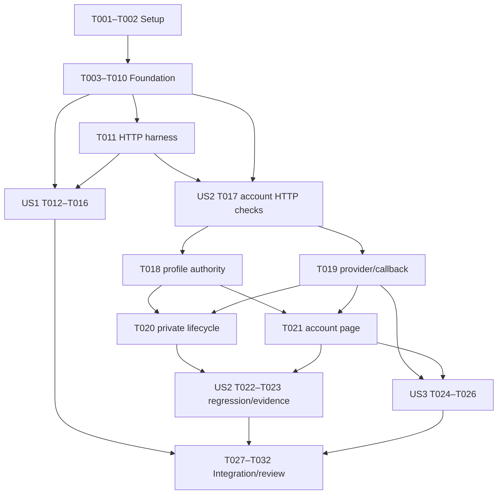

# Tasks: Public Landing Page and Separate Authentication Pages

**Input**: Design documents from `specs/001-landing-auth-pages/`.
**Prerequisites**: [plan.md](plan.md), [spec.md](spec.md), [research.md](research.md),
[data-model.md](data-model.md), [contracts](contracts/ui-and-navigation.md) and
[quickstart.md](quickstart.md).
**User direction**: Use **next-intl** for Arabic/English (“next-intel” in the request).
**Tests**: Include the spec's acceptance/security/accessibility cases and the focused checks
required by the plan. No new browser-test framework or blanket TDD workflow is required.
**Organization**: Shared prerequisites first, then the three P1 user stories, then final review.
All feature tasks remain pending until their full acceptance passes. The supplied theme is
already applied to shared CSS/showcase; this does not complete landing routes or install next-intl.

## Format: `[ID] [P?] [Story] Description`

- Every task has an unchecked box, sequential ID and exact repository-relative file paths.
- `[P]` means the task can overlap the explicitly listed different-file work once its
  prerequisites are complete. It does not authorize delegation.
- `[US1]`, `[US2]`, `[US3]` refer to the feature spec's prioritized stories.
- A phase checkpoint requires its evidence; an unavailable check remains a gap.

## Path Conventions

The app is rooted at `app/`, with existing `components/`, `lib/` and `scripts/`.
New next-intl configuration lives at `i18n/request.ts`, catalogs at `messages/en.json` and
`messages/ar.json`, and augmentation at `types/next-intl.d.ts`.
Dynamic folders in paths are literal Next.js route segments. Preserve canonical public URLs.

## Phase 1: Setup (Shared Infrastructure)

**Purpose**: Add the user-selected library safely to the existing project and establish test isolation.
Do not scaffold a new application, provision services or execute production fixtures.

- [X] T001 Review current next-intl registry version/peer metadata and fresh advisories, select a Next.js 16.4.3/React 19.3.0-compatible exact release, install only that requested direct dependency in `package.json` and `package-lock.json`, and record the resolved version, provenance and actual scan results/gaps in `specs/001-landing-auth-pages/research.md`.
- [X] T002 Add a fail-closed `SOLODESK_TEST_ENV=isolated` opt-in before any remote client/write initialization in `scripts/test-neon.mjs`; independently verify the actual test database/auth/Realtime target is an isolated synthetic environment and record its non-secret identity and unrun checks in `specs/001-landing-auth-pages/evidence.md`. A flag alone is not proof of isolation; if no isolated target exists, continue local work and leave remote checks blocked.

**Checkpoint**: The selected package is locked and test execution cannot silently use the current
production-targeting configuration. Actual remote fixtures remain unrun until isolation is verified.

---

## Phase 2: Foundational (Blocking Prerequisites)

**Purpose**: Provide common translation, routing, preference and existing-provider support needed
by every story. Complete this phase before user-story work; do not ship the intermediate state.

- [X] T003 [P] Create next-intl ICU namespaces Common, Navigation, Landing, Auth and Profile in `messages/en.json` and `messages/ar.json`; enforce “English and Arabic catalogs have the same key shape” and matching interpolation/plural parameters, cover pending/errors/preferences and synthetic-preview labels, and keep canonical identifiers, user content and provider names untranslated.
- [X] T004 [P] Implement pure allowlists/defaults and callback normalization in `lib/site.ts`: locale “`en`, `ar`” defaults to en, theme “`dark`, `light`, `system`” defaults to dark, and “`ar` alone maps to `rtl`; never client authority”; return paths are exactly `/`, `/sign-in`, `/sign-up`, `/app`; reject duplicate/conflicting authoritative fields and arbitrary destination URLs without importing auth or DB code.
- [X] T005 Configure `createNextIntlPlugin` in `next.config.ts`, `getRequestConfig` with fixed en/ar message loaders in `i18n/request.ts`, and Locale/Messages AppConfig augmentation in `types/next-intl.d.ts`; use a validated explicit locale or `next/root-params` locale, preserve existing rendering flags, avoid root cookie/header reads, and require explicit supported locale input for utility code outside the locale root. Depends on T001, T003 and T004.
- [X] T006 Move `app/layout.tsx` into site/utility root layouts at `app/(site)/[locale]/[theme]/layout.tsx` and `app/(utility)/layout.tsx`, move the current account home to `app/(site)/[locale]/[theme]/app/page.tsx`, and preserve callback/showcase URLs by moving their pages to `app/(utility)/auth/callback/page.tsx` and `app/(utility)/design-system/page.tsx`; enumerate six static locale/theme pairs, set initial html lang/dir/theme, remove the obsolete higher root/page while preserving existing Geist/Geist Mono loading, and scope next-intl client messages to interactive namespaces. Preserve existing account features and set the post-exchange callback destination to /app. Depends on T005.
- [X] T007 Compose `proxy.ts` with a callback-only, lazily loaded Neon verifier branch followed by exact canonical presentation rewrites; deny direct internal locale/theme aliases, allowlist preference cookies, preserve API/assets/icon/showcase paths and Next RSC/Vary headers, and ensure final canonical/account responses meet private/no-store policy without evaluating auth/DB configuration for the public home. Depends on T004 and T006.
- [X] T008 Implement bounded native POST/303 preferences in `app/api/preferences/route.ts`: “Reject duplicates, unexpected fields, invalid enum values, external paths and submissions over 2 KiB before setting either cookie”; validate exact same-origin Origin and URL-encoded input; implement 400/403/413/415 failures without writes; set `solodesk-locale`/`solodesk-theme` for one year with “SameSite=Lax, HttpOnly and Secure on HTTPS production; no Domain attribute” and Path=/, then redirect only to the allowed canonical return path. Use explicit locale/messages for localized safe errors, never root getters in the Route Handler. Depends on T004 and T005.
- [X] T009 Create real, separate entry compositions in `app/(site)/[locale]/[theme]/sign-in/page.tsx` and `app/(site)/[locale]/[theme]/sign-up/page.tsx` using the existing `components/sign-in.tsx`; provide distinct localized headings and cross/home links, fresh current-account redirects behind Suspense, and the existing approved provider journey. Constrain entry to “`sign-in`, `sign-up`”, provider to “`google`, `github`”, attempt state to “`idle`, `pending`, `failed`” and authError to “absent or generic `1`”; do not add passwords, linking or business onboarding. Depends on T005–T007.
- [X] T010 Add focused Node checks in `scripts/test-site.test.mjs` for `lib/site.ts`, `messages/en.json` and `messages/ar.json`: exercise defaults/denials, return/error allowlists, cookie/form bounds, matching keys and ICU arguments, and actual next-intl English/Arabic formatting. Verify different locales do not leak across concurrent renders and invalid locales cannot select arbitrary files. Depends on T003–T009.

**Checkpoint**: Canonical routing and usable provider entry destinations exist independently of the
landing. Locale/theme initial HTML and pure boundary checks pass. Later auth stories add complete
error, private-view and first-time-account acceptance coverage.

---

## Phase 3: User Story 1 - Discover SoloDesk on a Public Landing Page (Priority: P1) 🎯 MVP

**Goal**: Explain SoloDesk through the supplied visual direction, with clear, working account links.
**Independent Test**: Visit / without a session or working auth service; inspect product/preview
content, navigation and account destinations in both languages/themes without completing OAuth.

### Tests for User Story 1

- [X] T011 [P] [US1] Create local-only anonymous HTTP assertions in `scripts/test-site-http.mjs` for the landing/auth link destinations, section anchors, six presentation variants, canonical/private-cache headers, preference success/denial cases and internal alias rejection; reject non-loopback targets, create no account, and establish the missing landing assertions before implementing its page. Depends on Phase 2.

### Implementation for User Story 1

- [X] T012 [P] [US1] Implement paired semantic Light/Dark/System roles and finite panel/input radii in `app/globals.css`; align System-dark Tailwind variants with media-query tokens, preserve the supplied monochrome roles, chart-only amber/blue and Geist fallbacks, remove the forced-dark assumption, and measure real hover/focus/text contrast rather than copying existing ratio claims. Depends on Phase 2.
- [X] T013 [P] [US1] Update the shared large and large-icon action sizes in `components/ui/button.tsx` to at least 44px with the supplied 8px action radius while retaining existing compact sizes and accessible Base UI semantics; use semantic variants instead of per-page color overrides. Depends on Phase 2.
- [X] T014 [US1] Build `components/site-header.tsx` with the supplied public logo, brand/home, Features and How it works anchors, distinct Sign in/Sign up actions and separate native locale/theme toggle forms; use next-intl labels or server-translated props, native details/summary disclosure with Escape/focus return and close-on-selection, a skip link and RTL logical spacing. Keep navigation usable without JavaScript and avoid Radix asChild composition. Depends on T008, T009, T012 and T013.
- [X] T015 [US1] Implement `components/landing-page.tsx`, fixed preview facts in `lib/site-content.ts`, and the home at `app/(site)/[locale]/[theme]/page.tsx` with next-intl server translations/metadata; follow the required hero, large preview, three capability cards, two alternating workflow rows, closing CTA and footer order, mark previews illustrative/planned, and keep all copy/actions readable without imagery or auth/DB queries. No custom translation engine, live finance data, pricing or endorsements. Depends on T011–T014.
- [ ] T016 [US1] Execute US1 acceptance and SC-002/005/006/007 using `specs/001-landing-auth-pages/quickstart.md` and record exact results in `specs/001-landing-auth-pages/evidence.md`: confirm six visual traits, all links/anchors, font/image failure, anonymous auth-outage independence, responsive bilingual themes and measured loading; run the five-person/15-second comprehension check or leave its missing human evidence explicitly open. Depends on T015.

**Checkpoint**: Public discovery and existing account entry destinations are demonstrable without
inventing business capabilities. This is the first useful increment, not the full feature release.

---

## Phase 4: User Story 2 - Sign In on a Dedicated Page (Priority: P1)

**Goal**: Complete returning-member access and preserve only the currently authorized profile view.
**Independent Test**: Open /sign-in directly, complete an existing test identity's provider journey,
use the existing profile, then sign out/revoke/restore history without revealing the old name.

### Tests for User Story 2

- [X] T017 [US2] Extend `scripts/test-site-http.mjs` with direct /sign-in and signed-out /app checks, generic provider error normalization, fixed callback/return rejection and no private-data responses; cover the contract's account-service-unavailable behavior and streamed redirect destination semantics before changing those paths. Depends on Phase 2 and T011; serialize edits to this shared test file.

### Implementation for User Story 2

- [X] T018 [P] [US2] Extend `lib/profile.ts` and `app/api/profile/route.ts` with sessionExpiresAt as an “ISO instant; used to conceal/revalidate UI at expiry”, preserve fresh current-user/session matching and exclude expired sessions from the parameterized live query; keep profile id/name narrow, API 400/401/503 results and sealedQuery “Private transport only; never cookie/local storage/log/public preview”. Keep authorization and the 1–100 character name constraint in `app/actions.ts`, returning stable localizable error codes in the existing result shape. Depends on Phase 2 and T017.
- [X] T019 [P] [US2] Complete provider attempt/error handling in `components/sign-in.tsx`, `app/(site)/[locale]/[theme]/sign-in/page.tsx` and `app/(utility)/auth/callback/page.tsx`: guard immediately against duplicate starts, localize pending/retry errors via next-intl, retain fixed entry-specific callbacks, let Neon exchange the verifier before redirects, normalize raw technical query fields to generic authError=1 and route validated success/current accounts to /app; never swallow redirect exceptions or accept arbitrary returns. Preserve shared sign-up-mode support. Depends on Phase 2 and T017.
- [ ] T020 [P] [US2] Implement checking/authorized/unavailable/denied visibility and next-intl Profile messages in `components/live-profile.tsx`: revalidate via the no-store profile API before first reveal/history restore/foreground return, conceal synchronously on pagehide and sign-out, clear old name/draft/subscription state on identity loss/empty authorized rows, conceal at known expiry and recheck at most 60 seconds apart while active; retain valid unsaved input only for the same revalidated identity and cancel listeners/timers/subscriptions on teardown. Depends on T018 and T019.
- [X] T021 [P] [US2] Complete `app/(site)/[locale]/[theme]/app/page.tsx` with fresh scoped profile reads inside Suspense, anonymous/expired redirects to Sign in outside broad catch blocks, generic localized outage/retry content and narrowly scoped next-intl Profile client messages; retain name editing, Realtime and sign-out without adding a dashboard/workspace. Depends on T018 and T019; can overlap T020 using the agreed profile envelope.
- [ ] T022 [US2] Update `scripts/test-neon.mjs` to post saveProfile actions to canonical /app, assert stable error codes and session expiry, and preserve all existing real-PostgreSQL/cross-account/hostile-origin/revoked-cookie/live-query regression checks and run-scoped cleanup; execute only after T002's independently verified isolation gate. Depends on T018–T021.
- [ ] T023 [US2] Validate US2 and SC-001/003 through `specs/001-landing-auth-pages/quickstart.md`, recording Google/GitHub existing-account return, cancel/error/duplicate attempts, save/live updates, direct denial, 60-second revocation bound, known expiry, outage and concealed Back/Forward restoration in `specs/001-landing-auth-pages/evidence.md`; do not pass an unrun provider/database/browser case. Depends on T022.

**Checkpoint**: Returning accounts retain their existing behavior, service authority stays current,
and old private fields disappear from the visible app when authority is lost.

---

## Phase 5: User Story 3 - Start an Account on a Dedicated Sign-Up Page (Priority: P1)

**Goal**: Provide a distinct first-time account entry using existing provider policy, without new
workspace creation, password handling or account-linking rules.
**Independent Test**: Open /sign-up directly with an isolated new provider identity, reach its own
/app profile, then repeat with an existing identity and verify reuse rather than a duplicate.

### Tests for User Story 3

- [X] T024 [P] [US3] Extend `scripts/test-site-http.mjs` with the separate sign-up title/cross-links, absence of password/billing fields, sign-up-specific generic error return and safe invalid-entry fallback; keep distinct next-intl en/ar text expectations and no invented account-creation success on page load. Depends on T017 and T019; serialize against earlier edits to this test file.

### Implementation for User Story 3

- [X] T025 [P] [US3] Finish `app/(site)/[locale]/[theme]/sign-up/page.tsx` and its Auth copy in `messages/en.json` and `messages/ar.json` using the shared provider control and fresh current-account gate; ensure Create your SoloDesk account intent, localized cross/home links, originating sign-up retry, existing identity reuse and no workspace/trial promise; preserve catalog key/ICU parity and avoid duplicating provider logic. Depends on T019 and T021; can overlap T024.
- [ ] T026 [US3] Exercise Google/GitHub first-time and existing-identity sign-up, canceled/failed/slow returns, cross-links/history and signed-in redirects from `app/(site)/[locale]/[theme]/sign-up/page.tsx`; confirm only the intended own profile is shown and no duplicate/implicit merge occurs, and record observed results or managed-provider gaps in `specs/001-landing-auth-pages/evidence.md`. Depends on T024, T025 and the verified isolated environment.

**Checkpoint**: All three stories have independent entry-point checks. No task introduces a new
provider, linking behavior, password UI, business schema or legal/commercial promise.

---

## Phase 6: Polish & Cross-Cutting Concerns

**Purpose**: Verify the integrated feature and align current documentation with observed behavior.

- [ ] T027 Run lint, Next type generation, TypeScript, `scripts/test-site.test.mjs`, `scripts/test-site-http.mjs` and the production build per `specs/001-landing-auth-pages/quickstart.md`; verify all six shells with Cache Components/partial prefetching, correct next-intl server/hydrated output and no missing-message/context/ICU errors; record exact commands/results and any necessary repair/retest in `specs/001-landing-auth-pages/evidence.md`. Depends on T016, T023 and T026.
- [ ] T028 Complete the full English/Arabic × Light/Dark/System browser matrix, fluent Arabic and screen-reader review, 390×844/768×1024/1440×900 plus 320 CSS-pixel reflow/200% zoom, reduced motion, menu focus, failed media/fonts and /design-system regression using `specs/001-landing-auth-pages/quickstart.md`; run the applicable Impeccable UI checks and record build-specific artifacts and unavailable evidence in `specs/001-landing-auth-pages/evidence.md`. Depends on T027.
- [ ] T029 [P] Update `docs/README.md`, `docs/development/setup.md` and `docs/development/neon-setup.md` to describe final canonical routes, next-intl setup/catalogs, preference behavior, callback continuity and actual test commands/results; preserve historical evidence and production gaps rather than relabeling old tests. Depends on T028.
- [ ] T030 [P] Align changed semantic roles, finite radii, large-action sizing, actual measured contrast and RTL/System behavior in `DESIGN.md` and `docs/design/tokens.json` with the implemented shared components; update `docs/design/current-validation.md` with the real showcase regression result without an unrelated redesign. Depends on T028; files are disjoint from T029.
- [ ] T031 Verify affected SEC controls/actual ingress cookies, origins, private caching, secret-free bundles and new next-intl dependency provenance/advisories; record accountable owners, passed/failed/unavailable checks and existing release blockers in `docs/security/findings.md` and `specs/001-landing-auth-pages/evidence.md`. Do not deploy or waive Google-key, restricted-role, provider-return, managed-service or accessibility gaps. Depends on T027–T030.
- [ ] T032 Review all FR-001–016 and SC-001–007 against the final `specs/001-landing-auth-pages/spec.md`, `specs/001-landing-auth-pages/contracts/ui-and-navigation.md` and `specs/001-landing-auth-pages/evidence.md`; confirm valid task completion markers reflect actual work, unmet acceptance remains visible, and the feature contains only requested landing/account/i18n changes. Depends on T031.

---

## Dependencies & Execution Order

### Phase Dependencies

Setup T001–T002 → Foundational T003–T010 → user-story work → integrated polish T027–T032.
All three stories are P1. Shared entry routes/provider basics are foundation work because the
landing's links must lead to usable destinations even when provider completion is tested later.

### User Story Dependencies

- **US1**: Can implement after Phase 2 without completing OAuth; its two destination pages and
  current-account redirect already exist from T009. T016 validates the public journey.
- **US2**: Can start after Phase 2 and T011 creates the shared HTTP file. It does not depend on
  landing copy/layout. T023 validates its complete private-account journey.
- **US3**: Uses the shared provider/error/private-account work from T019/T021. T024/T025 may
  overlap after that work; T026 independently tests new-account intent and account reuse.
- Full feature acceptance requires all three; a landing-only demo is not completion of the request.

### Dependency Graph

The graph summarizes story flow; task-level prerequisites above determine actual start times.
US3 may start after T019/T021 without waiting for T023. Verification tasks that write the same
evidence file run sequentially; parallel implementation does not imply parallel evidence edits.

### Within Each Story

Add the listed requested contract checks before changing their relevant behavior. Complete
models/shared interfaces before consumers, preserve validation/error handling during moves and
run the story's independent acceptance check before marking that story complete.
Do not mark human/provider tests passed from source inspection.

### Parallel Opportunities

- Foundation: T003 catalogs and T004 pure boundary helpers, after Setup.
- US1: T011 HTTP assertions, T012 semantic CSS and T013 shared Button sizing, after Phase 2.
- US2: T018 service/envelope/actions and T019 provider/callback work, after T017; then T020
  private client lifecycle and T021 protected server page, after T018/T019.
- US3: T024 HTTP cases and T025 sign-up page/catalog refinement, after their stated prerequisites.
- Polish: T029 developer docs and T030 design docs, after T028.
- Never overlap T011/T017/T024 (same script), T019/T025 (shared provider contract) or tasks
  changing the same translation catalogs/evidence file. Parallel examples authorize no agents.

---

## Parallel Example: User Story 1

After Phase 2: run T011 (`scripts/test-site-http.mjs`), T012 (`app/globals.css`) and
T013 (`components/ui/button.tsx`) independently. Integrate with T014/T015, then validate T016.

## Parallel Example: User Story 2

After T017: run T018 (`lib/profile.ts`, API/action contract) and T019 (provider/callback files)
independently. After their agreed envelope/entry contracts are ready, T020 and T021 touch separate
client/server files and can overlap. Serialize the integration test/evidence work afterward.

## Parallel Example: User Story 3

After T019/T021: T024 edits only the existing HTTP assertion script, while T025 edits the sign-up
page and en/ar catalogs. Run T026 only after both finish and isolated providers are available.

---

## Implementation Strategy

### MVP First (User Story 1)

Complete Setup/Foundation, then US1 for a usable public discovery increment with working
account-entry destinations. Validate its anonymous journey before further polish.
The full requested MVP also needs US2 and US3's provider/private-account acceptance.
Demonstration is local; deployment requires separate authorization and release gates.

### Incremental Delivery

1. Lock next-intl and implement shared en/ar rendering, routing and safe provider entry.
2. Deliver and validate public discovery (US1).
3. Complete and validate returning-account/private-view safety (US2).
4. Complete and validate new-account intent/reuse (US3).
5. Execute integrated quality/security review, update docs and retain any unpassed release gates.

### Task Counts and Traceability

| Area       | Tasks     | Count |
| ---------- | --------- | ----- |
| Setup      | T001–T002 | 2     |
| Foundation | T003–T010 | 8     |
| US1        | T011–T016 | 6     |
| US2        | T017–T023 | 7     |
| US3        | T024–T026 | 3     |
| Polish     | T027–T032 | 6     |
| Total      | T001–T032 | 32    |

| Requirements | Principal tasks                                   |
| ------------ | ------------------------------------------------- |
| FR-001–002   | T006–T007, T009, T015, T021, T025                 |
| FR-003–007   | T012–T016                                         |
| FR-008–010   | T009, T017, T019, T024–T026                       |
| FR-011–013   | T004, T007, T009, T018–T023                       |
| FR-014–015   | T003–T006, T010, T012–T014, T019–T020, T025, T028 |
| FR-016       | T015–T016, T028                                   |
| SC-001–003   | T011, T016–T017, T022–T024, T026–T027             |
| SC-004–007   | T016, T028, T032                                  |

## Notes

- No application feature, dependency install, remote fixture or deployment runs during task creation.
- Keep runtime secret/session/service boundaries intact; preferences and locale never grant access.
- Use next-intl rather than an ad hoc translator; preserve single cookie/rewrite ownership.
- Quote-preserved field constraints above are binding. If a contract must change, update the model,
  affected consumers/tests and planning artifacts together before implementation.
- A failed dependency lookup/scan, absent isolated service or missing fluent/human reviewer is an
  explicit evidence gap. It does not block unrelated local implementation or count as a clean result.
