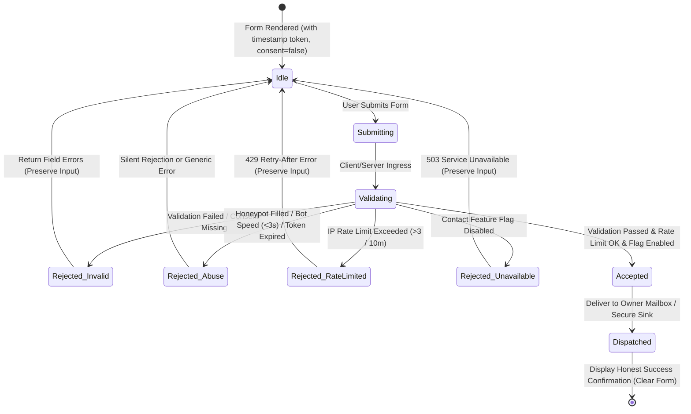

# Data Model: Detailed Public Landing Page Upgrade

**Date**: 2026-10-30 | **Spec**: [spec.md](spec.md) | **Research**: [research.md](research.md)

This feature introduces public presentation models, structural site content, and an isolated visitor
contact entity. No changes to the existing multi-tenant workspace or user account schemas are made.

---

## 1. CapabilityArea (Presentation Entity)

Represents a core product functional domain displayed in the interactive Product Tour.

| Field         | Type                 | Description                                                                        |
| ------------- | -------------------- | ---------------------------------------------------------------------------------- |
| `id`          | `string` (enum)      | Unique identifier: `"clients" \| "projects" \| "time" \| "invoices" \| "insights"` |
| `status`      | `AvailabilityStatus` | Current implementation status: `"available" \| "inDevelopment" \| "planned"`       |
| `icon`        | `LucideIcon`         | Visual semantic icon component                                                     |
| `titleKey`    | `string`             | Translation key for the area title (e.g. `Landing.tourClientsTitle`)               |
| `outcomeKey`  | `string`             | Translation key for the one-sentence outcome statement                             |
| `detailKeys`  | `string[]`           | Array of 3–5 translation keys for specific capability details                      |
| `previewType` | `string`             | Synthetic preview variant renderer identifier                                      |

---

## 2. FeatureItem (Presentation Entity)

Represents a discrete feature card within the Detailed Features Grid.

| Field      | Type                 | Description                                                                                                                         |
| ---------- | -------------------- | ----------------------------------------------------------------------------------------------------------------------------------- |
| `id`       | `string` (enum)      | Identifier: `"shortcuts" \| "timer" \| "saveStatus" \| "multiCurrency" \| "taxDiscount" \| "workspaces" \| "bilingual" \| "themes"` |
| `status`   | `AvailabilityStatus` | Synced with shared status source: `"available" \| "inDevelopment" \| "planned"`                                                     |
| `icon`     | `LucideIcon`         | Visual semantic icon                                                                                                                |
| `titleKey` | `string`             | Translation key for feature title                                                                                                   |
| `descKey`  | `string`             | Translation key for feature description                                                                                             |

---

## 3. JourneyStep (Presentation Entity)

Represents an ordered step in the "How it Works" product walkthrough.

| Field      | Type                 | Description                                                |
| ---------- | -------------------- | ---------------------------------------------------------- |
| `step`     | `number`             | Step sequence index (`1 \| 2 \| 3 \| 4`)                   |
| `id`       | `string`             | Identifier: `"account" \| "setup" \| "track" \| "invoice"` |
| `titleKey` | `string`             | Translation key for step title                             |
| `descKey`  | `string`             | Translation key for step explanation                       |
| `status`   | `AvailabilityStatus` | Associated capability availability status                  |

---

## 4. ProductPrinciple (Presentation Entity)

Represents one of the four foundational product commitments displayed in the "Why SoloDesk" section.

| Field      | Type            | Description                                                         |
| ---------- | --------------- | ------------------------------------------------------------------- |
| `id`       | `string` (enum) | Identifier: `"exactness" \| "speed" \| "transparency" \| "privacy"` |
| `icon`     | `LucideIcon`    | Semantic icon for the principle                                     |
| `titleKey` | `string`        | Translation key for principle name                                  |
| `bodyKey`  | `string`        | Translation key for detailed explanation                            |

---

## 5. FaqItem (Presentation Entity)

Represents a question and answer item in the FAQ accordion.

| Field  | Type            | Description                                                                                                                |
| ------ | --------------- | -------------------------------------------------------------------------------------------------------------------------- |
| `id`   | `string` (enum) | Identifier: `"availability" \| "dataOwnership" \| "privacy" \| "languages" \| "devices" \| "teams" \| "pricing" \| "auth"` |
| `qKey` | `string`        | Translation key for the question text                                                                                      |
| `aKey` | `string`        | Translation key for the answer text (plain text, no HTML injection)                                                        |

---

## 6. ContactMessage (Stored Personal Data & Submission Lifecycle)

Represents a visitor message submitted via the Contact section. Owned by SoloDesk staff, completely
isolated from tenant accounts, and gated by owner privacy/retention decisions.

### Schema Attributes

| Attribute     | Type                         | Validation Rules                                                               |
| ------------- | ---------------------------- | ------------------------------------------------------------------------------ |
| `id`          | `string` (UUID v7 or NanoID) | Generated server-side on acceptance                                            |
| `name`        | `string`                     | Required. 1–100 characters. Trimmed, control characters stripped.              |
| `email`       | `string`                     | Required. Valid RFC 5322 email format. 5–254 characters. Normalized lowercase. |
| `topic`       | `ContactTopic`               | Required enum: `"general" \| "team" \| "billing" \| "security" \| "feedback"`  |
| `message`     | `string`                     | Required. 10–2000 characters. Trimmed, treated as plain text only.             |
| `consent`     | `boolean`                    | Strictly `true`. Unticked by default on the client.                            |
| `locale`      | `SiteLocale`                 | `"en" \| "ar"` matching the submission page locale.                            |
| `submittedAt` | `string` (ISO 8601 UTC)      | Server timestamp of acceptance.                                                |
| `status`      | `ContactStatus`              | `"pending" \| "accepted" \| "rejected"`                                        |

### Anti-Abuse Attributes (Request-scoped, Not Persisted in Entity)

| Attribute        | Type     | Purpose                                                                    |
| ---------------- | -------- | -------------------------------------------------------------------------- |
| `honeypot`       | `string` | Hidden form field (`website_url`). Must be empty; if populated, rejected.  |
| `timestampToken` | `string` | Encrypted/HMAC token encoding form render time. Must be between 3s and 1h. |
| `clientIpHash`   | `string` | One-way HMAC hash of client IP for sliding-window rate limiting.           |

### Lifecycle State Transitions



---

## 7. AvailabilityStatus (Shared Enum)

Single source of truth enum definition:

```typescript
export type AvailabilityStatus = "available" | "inDevelopment" | "planned";

export interface CapabilityItem {
  readonly id: string;
  readonly status: AvailabilityStatus;
}
```
