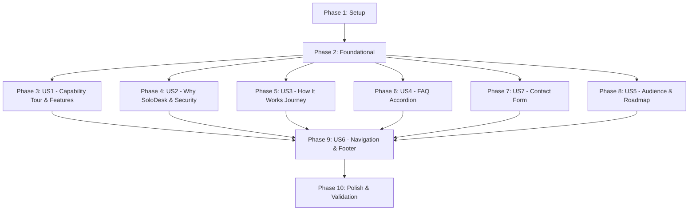

# Implementation Tasks: Detailed Public Landing Page Upgrade

**Feature**: Detailed Public Landing Page Upgrade\
**Spec**: [spec.md](spec.md) | **Plan**: [plan.md](plan.md) | **Contracts**: [contracts/landing-and-contact.md](contracts/landing-and-contact.md)

---

## Phase 1: Setup (Shared Infrastructure)

**Purpose**: Establish shared structural data definitions, status registries, and automated validation tooling.

- [X] T001 [P] Extend shared capability definitions, availability statuses (`"available" | "inDevelopment" | "planned"`), feature items, journey steps, principles, and FAQ items in `lib/site-content.ts`
- [X] T002 [P] Create translation key parity validation script in `scripts/check-translations.mjs` verifying identical key trees between `messages/en.json` and `messages/ar.json`

---

## Phase 2: Foundational (Blocking Prerequisites)

**Purpose**: Implement server-side contact validation, anti-abuse defenses, and API endpoint before assembling UI components.

**⚠️ CRITICAL**: No contact form UI or submission integration can proceed until this phase is complete.

- [X] T003 Implement contact schema validation, anti-abuse checks, and IP sliding-window rate limiting in `lib/contact.ts`:
  - `name`: Required string, 1–100 characters, trimmed, control characters stripped.
  - `email`: Required string, valid RFC 5322 email syntax, 5–254 characters, normalized lowercase.
  - `topic`: Required enum strictly allowlisted to `"general" | "team" | "billing" | "security" | "feedback"`.
  - `message`: Required string, 10–2000 characters, trimmed, plain text only.
  - `consent`: Required boolean, strictly `true`.
  - `website_url`: Honeypot field, must be empty; if populated, reject submission.
  - `_token`: Render timestamp token; reject submissions completed in < 3.0 seconds (bot speed) or > 3600 seconds (expired).
  - Rate limiting: Max 3 submissions per 10 minutes per client IP.
- [X] T004 Implement contact Route Handler in `app/api/contact/route.ts` handling `POST` for `application/json` and `application/x-www-form-urlencoded`:
  - Validate origin (`Sec-Fetch-Site: same-origin` or matching host).
  - Check feature flag `SOLODESK_CONTACT_ENABLED=true` (return HTTP 503 `serviceUnavailable` when disabled).
  - Sanitize operational logs: write only `{ event: "contact_submission", status, topic, ip_hash }`; NEVER log message text or full email addresses.
  - Return HTTP 200 `{ ok: true, status: "accepted" }` on success, HTTP 400 on validation failure, HTTP 429 on rate limit.
- [X] T005 [P] Setup page section wireframe layout with semantic anchor IDs (`#hero`, `#highlights`, `#tour`, `#features`, `#how-it-works`, `#why-solodesk`, `#security`, `#audience`, `#roadmap`, `#faq`, `#contact`, `#closing`) in `components/landing-page.tsx`

**Checkpoint**: Foundation ready — all data structures, validators, and route endpoints are operational.

---

## Phase 3: User Story 1 - Understand What SoloDesk Does in Depth (Priority: P1) 🎯 MVP

**Goal**: Visitors can explore the 5 core capability areas (Clients, Projects & tasks, Time tracking, Invoices & payments, Insights) with outcome statements, detailed bullets, synthetic mockups, and availability badges, plus an 8-item detailed feature grid.

**Independent Test**: Visit `/` signed out, navigate through all 5 product tour tabs with mouse and keyboard (arrow keys), verify display updates without page reload, and confirm all 8 feature cards render with accurate status badges.

### Implementation for User Story 1

- [X] T006 [P] [US1] Add English and Arabic translations for hero highlights, product tour (Clients, Projects, Time, Invoices, Insights), and 8 feature grid items in `messages/en.json` and `messages/ar.json`
- [X] T007 [P] [US1] Implement interactive keyboard-accessible capability tabs client component with `role="tablist"`, roving tabindex, `aria-selected`, and zero-JS linear fallback in `components/product-tour.tsx`
- [X] T008 [US1] Implement synthetic mockup previews for Clients, Time, Invoices, and Insights with `<bdi>` numeric isolation in `components/landing-page.tsx`
- [X] T009 [US1] Implement the 8-item detailed technical capability grid (shortcuts, timer, save status, multi-currency, tax/discount, workspaces, bilingual RTL, themes) in `components/landing-page.tsx`
- [X] T010 [US1] Integrate highlights strip beneath the hero title displaying key metrics and value statements in `components/landing-page.tsx`

**Checkpoint**: User Story 1 is complete. Visitors have a deep, interactive understanding of SoloDesk capabilities.

---

## Phase 4: User Story 2 - See Why SoloDesk Is Different and Trustworthy (Priority: P1)

**Goal**: Visitors understand SoloDesk's craft positioning through the 4 core principles (financial exactness, speed/low cognitive load, transparent save state, privacy & isolation) and plain-language security commitments.

**Independent Test**: Read `#why-solodesk` and `#security` sections; verify all 4 principles display concise explanations, and security commitments contain no unsupported certifications or compliance guarantees.

### Implementation for User Story 2

- [X] T011 [P] [US2] Add English and Arabic translations for the 4 product principles and privacy/security commitments in `messages/en.json` and `messages/ar.json`
- [X] T012 [US2] Implement the "Why SoloDesk" principles section with distinct icons and structured typography in `components/landing-page.tsx`
- [X] T013 [US2] Implement the plain-language privacy and security commitments section with boundary notes in `components/landing-page.tsx`

**Checkpoint**: User Story 2 is complete. Visitors can verify SoloDesk's principles and data-handling integrity.

---

## Phase 5: User Story 3 - Follow a Clear Path From First Visit to First Invoice (Priority: P2)

**Goal**: Prospective users see a 4-step journey from account creation to invoice delivery, understanding how quickly they can start working.

**Independent Test**: Inspect the `#how-it-works` section; verify 4 numbered, ordered steps with titles, descriptions, and illustrative visuals ending in a working Get Started CTA leading to `/sign-up`.

### Implementation for User Story 3

- [X] T014 [P] [US3] Add English and Arabic translations for the 4 journey steps (Account, Setup, Track, Invoice) in `messages/en.json` and `messages/ar.json`
- [X] T015 [US3] Implement the 4-step progressive journey cards with numbered step indicators and synthetic workflow badges in `components/landing-page.tsx`

**Checkpoint**: User Story 3 is complete. The path from visitor to active invoice creator is clear.

---

## Phase 6: User Story 4 - Get Answers to Common Questions (Priority: P2)

**Goal**: Prospective users resolve doubts through 6–10 collapsible FAQ items that work natively without JavaScript and confirm pricing is to be announced.

**Independent Test**: Disable JavaScript in browser DevTools, open `/`, click on question headers; verify native `<details>`/`<summary>` expand and collapse smoothly and all answers remain fully readable.

### Implementation for User Story 4

- [X] T016 [P] [US4] Add English and Arabic translations for 8 FAQ questions & answers (availability, data ownership, privacy, languages, devices, teams, pricing to be announced, account methods) in `messages/en.json` and `messages/ar.json`
- [X] T017 [US4] Implement accessible native `<details>` and `<summary>` FAQ accordion styled with Tailwind semantic tokens, focus rings, and animated chevron indicators in `components/landing-page.tsx`

**Checkpoint**: User Story 4 is complete. Common questions are answered with zero-JS resilience.

---

## Phase 7: User Story 7 - Contact the SoloDesk Team (Priority: P2)

**Goal**: Visitors with questions about team use, custom contracts, or timelines can send a secure message with explicit consent and honest delivery feedback.

**Independent Test**: Submit invalid fields to verify inline error labels; submit valid input with consent checked to verify pending state and success card; test rapid resubmission to verify rate-limiting response.

### Implementation for User Story 7

- [X] T018 [P] [US7] Add English and Arabic translations for contact form labels, field placeholders, topic options, consent text, and error states in `messages/en.json` and `messages/ar.json`
- [X] T019 [US7] Implement progressively enhanced client contact form component with inline field errors, consent checkbox, honeypot field, render timestamp token, and success card in `components/contact-form.tsx`
- [X] T020 [US7] Integrate contact section at `#contact` in `components/landing-page.tsx` connecting the form to `/api/contact`

**Checkpoint**: User Story 7 is complete. Visitors can send inquiries securely with full privacy protection.

---

## Phase 8: User Story 5 - Understand What Is Available Now and What Is Coming (Priority: P3)

**Goal**: Visitors inspect an honest, date-free roadmap matrix showing Available, In Development, and Planned capabilities, and review targeted engineer use cases.

**Independent Test**: Verify roadmap items align 100% with `lib/site-content.ts` status definitions, and review the 3 audience persona cards.

### Implementation for User Story 5

- [X] T021 [P] [US5] Add English and Arabic translations for 3 audience profiles and roadmap status columns in `messages/en.json` and `messages/ar.json`
- [X] T022 [US5] Implement the 3 audience persona cards (Freelance Software Engineer, Independent Technical Consultant, Boutique Engineering Agency) in `components/landing-page.tsx`
- [X] T023 [US5] Implement the 3-column roadmap matrix (Available, In Development, Planned) reading directly from `lib/site-content.ts` in `components/landing-page.tsx`

**Checkpoint**: User Story 5 is complete. Realistic roadmap expectations and audience use cases are established.

---

## Phase 9: User Story 6 - Navigate a Longer Page Comfortably (Priority: P3)

**Goal**: Visitors navigate the expanded page smoothly with a persistent header indicating the active section, section jump links, an expanded footer, and reduced-motion compliance.

**Independent Test**: Scroll down the page; verify the header gains backdrop blur and highlights the active section; open the mobile menu to confirm all section anchors are reachable; verify footer link groupings.

### Implementation for User Story 6

- [X] T024 [P] [US6] Add English and Arabic translations for section jump links and expanded footer link categories in `messages/en.json` and `messages/ar.json`
- [X] T025 [US6] Upgrade `components/site-header.tsx` with `IntersectionObserver` observing page section IDs to highlight the active section and apply sticky glassmorphism styling
- [X] T026 [US6] Implement expanded multi-column footer grouping links by Product, Company, Account, Preferences, and Legal/Privacy disclaimers in `components/landing-page.tsx`
- [X] T027 [US6] Apply `prefers-reduced-motion: reduce` overrides across all CSS scroll behaviors and disclosure animations in `app/globals.css`

**Checkpoint**: User Story 6 is complete. Page navigation is smooth, accessible, and comfortable on all devices.

---

## Phase 10: Polish & Cross-Cutting Concerns

**Purpose**: Execute automated verification scripts, accessibility auditing, and end-to-end quickstart checks.

- [X] T028 [P] Run `node scripts/check-translations.mjs` to verify 100% key parity between `messages/en.json` and `messages/ar.json`
- [X] T029 [P] Run strict TypeScript compilation (`npx tsc --noEmit`) and lint checks (`npm run lint`)
- [X] T030 Execute contact API curl assertions for honeypot rejection and rate limiting per `specs/002-landing-page-upgrade/quickstart.md`
- [X] T031 Perform manual accessibility and viewport audit across 320px reflow, 200% zoom, and Arabic RTL layout per `specs/002-landing-page-upgrade/quickstart.md`

---

## Dependencies & Execution Order

### Phase Dependencies



### User Story Dependencies

- **US1 (P1)**: Starts immediately after Phase 2 (Foundational). Delivers MVP!
- **US2 (P1)**: Starts after Phase 2. Can be implemented in parallel with US1.
- **US3 (P2)**: Starts after Phase 2. Independent of US1/US2.
- **US4 (P2)**: Starts after Phase 2. Independent of US1/US2/US3.
- **US7 (P2)**: Depends on T003/T004 (Contact validation & Route Handler in Phase 2).
- **US5 (P3)**: Starts after Phase 2. Reads `lib/site-content.ts`.
- **US6 (P3)**: Integrates after section IDs are established across US1–US7.
- **Polish**: Runs after all stories are in place.

---

## Parallel Execution Examples

### Parallel Track 1: Setup & Data Structures

```bash
# Developer / Subagent A:
Task: T001 "Extend shared capability definitions in lib/site-content.ts"
Task: T002 "Create translation key parity validation script in scripts/check-translations.mjs"
```

### Parallel Track 2: Backend & Security

```bash
# Developer / Subagent B:
Task: T003 "Implement contact schema validation and rate limiting in lib/contact.ts"
Task: T004 "Implement contact Route Handler in app/api/contact/route.ts"
```

### Parallel Track 3: Story Translations (can run concurrently per story)

```bash
# Parallel translation authoring:
Task: T006 [US1 translations in messages/en.json and messages/ar.json]
Task: T011 [US2 translations in messages/en.json and messages/ar.json]
Task: T014 [US3 translations in messages/en.json and messages/ar.json]
Task: T016 [US4 translations in messages/en.json and messages/ar.json]
Task: T018 [US7 translations in messages/en.json and messages/ar.json]
Task: T021 [US5 translations in messages/en.json and messages/ar.json]
Task: T024 [US6 translations in messages/en.json and messages/ar.json]
```

---

## Implementation Strategy

### MVP First (User Story 1 + Setup & Foundation)

1. Complete **Phase 1** (Setup) & **Phase 2** (Foundational wireframe).
2. Complete **Phase 3** (User Story 1: Highlights, Product Tour tabs, 8 Feature cards, Synthetic previews).
3. **Validate MVP**: Test product tour keyboard interaction and mobile responsiveness.

### Incremental Feature Expansion

1. Add **US2** (Why SoloDesk & Privacy commitments) → Enhances brand credibility.
2. Add **US3** (How it Works) & **US4** (FAQ) → Simplifies onboarding and resolves doubts without JS.
3. Add **US7** (Contact Form) → Enables visitor inquiries with privacy gating.
4. Add **US5** (Audience & Roadmap) & **US6** (Sticky Header & Footer) → Completes navigation experience.
5. Execute **Phase 10** (Polish, types, lint, translation parity, and curl verification).
