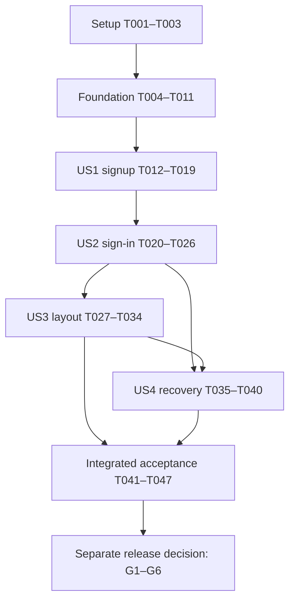

# Tasks: Enhanced Sign In and Sign Up

**Input**: Design documents in `specs/003-enhance-auth-pages/`.

**Prerequisites**: [plan.md](plan.md), [spec.md](spec.md), [research.md](research.md), [data-model.md](data-model.md), [auth contracts](contracts/auth-flows.md), [design.md](design.md), [quickstart.md](quickstart.md), and the [constitution](../../.specify/memory/constitution.md).

**Tests**: Included because the specification explicitly requires positive, denied, boundary, concurrency, accessibility and recovery checks, and the plan specifies transport and real-challenge harnesses. Add tests for missing behavior before implementation and observe their baseline failures. Existing protective cases may already pass; do not weaken them or force them to fail. No runtime test or implementation task is completed by generating this file.

**Organization**: Setup → shared foundation → US1/US2 (P1) → US3/US4 (P2) → integrated acceptance. Use existing components/services/dependencies; no new project scaffolding, identity store, auth server, form package, challenge table or deployment is requested.

## Format: `[ID] [P?] [Story] Description`

Every actionable task uses `- [ ] Tnnn [P?] [USn?] Description with exact repository-relative file paths`. `[USn]` appears only in story phases. `[P]` identifies an explicitly independent work item after its stated prerequisites are complete, not authorization to delegate or run remote actions.

## Path Conventions

Source paths below are relative to the repository root. Generated evidence lives in `specs/003-enhance-auth-pages/evidence.md`; create it in T001. Never place actual passwords, codes, cookies, recipients or raw signed payloads in evidence. Planned test files do not exist until their creation tasks are performed.

## Phase 1: Setup (Shared Infrastructure)

**Purpose**: Establish scope, evidence and safe verification infrastructure in this existing application.

- [x] T001 Record current Git/source/lock/runtime identities, existing uncommitted changes, account-route JavaScript/media baseline, allowed environment boundaries and FR/SC-to-evidence headings in `specs/003-enhance-auth-pages/evidence.md`; preserve unrelated changes in `components/landing-page.tsx`, `components/landing/` and `eslint.config.mjs` without resetting, committing or overwriting them.
- [x] T002 Confirm actual commands, dependencies, skill routing and installed Next guide compatibility in `specs/003-enhance-auth-pages/quickstart.md`; read `docs/development/agent-skills.md` and the applicable shadcn/Impeccable, React/composition, Better Auth/email-password, security and verification skills before their implementation steps, and read installed `node_modules/next/dist/docs/01-app/01-getting-started/05-server-and-client-components.md`, `15-route-handlers.md` in that directory and `node_modules/next/dist/docs/01-app/03-api-reference/04-functions/connection.md` before changing Next code.
- [x] T003 Implement the shared isolated-target/fixture handling in new `scripts/test-auth-flows.mjs`, following `scripts/test-neon.mjs` safeguards: require independently verified isolated configuration plus `SOLODESK_TEST_ENV=isolated`, reject unidentified/production targets, use only bounded randomly named synthetic identities, accept real signed codes only in memory, redact output, and clean only test-owned records after reconciliation; include assertion-based guard self-checks that can run without contacting a provider.

**Checkpoint**: Existing stack and changed-file boundaries are recorded; the new harness refuses unsafe targets. No remote service or mailbox action is authorized by a task description alone.

## Phase 2: Foundational (Blocking Prerequisites)

**Purpose**: Establish shared authority, delivery and capability assessments before story integration.

**Execution rule**: Complete these tasks before story work. A capability assessment may record `unavailable` or `failed` and an explicit blocker when access/approval is absent; that completes an honest assessment, never its gate. Local development may then use synthetic responses, but real credential activation and feature-complete claims remain prohibited until G1–G6 pass.

- [x] T004 Extend `scripts/test-auth-flows.mjs` with bounded G1/G3 capability scenarios and record actual results in `specs/003-enhance-auth-pages/evidence.md`: real signup/sign-in/verification/resend, preferred `/api/auth/email-otp/request-password-reset` versus the documented legacy request path selected once, `/api/auth/email-otp/reset-password`, fresh verified session after code acceptance, raw response enumeration, resend/verify races, two-session reset revocation, and social-only recovery adding no password credential; do not call the mis-mapped server reset API, read-back OTP endpoints or passwordless login, and record unavailable checks instead of inventing successful hosted behavior.
- [x] T005 Record the effective managed password min/max, six-digit code expiry/attempt ceiling, resend interval/rotation, shared account/network limits, factor/recovery behavior and hosted-version assurance in `specs/003-enhance-auth-pages/evidence.md`; link Q-08 in `docs/planning/decisions.md`, record approval there only when actually given, and keep G2/G3 blocked for unsupported/unapproved values rather than copying local SDK defaults or making remote policy changes without existing authorization.
- [x] T006 Add shared authority regression cases in `scripts/test-profile.test.mjs` for unverified, expired, revoked and foreign-user sessions and existing verified provider/password fixtures; extend `scripts/test-neon.mjs` with real database/live-subscription denial cases so verification changes cannot leave an open profile feed authorized, while keeping manual verified fixtures separate from the real-code signup proof.
- [x] T007 Enforce verified-email authority in `lib/auth/server.ts` and add `u."emailVerified" IS TRUE` to the existing parameterized live query in `lib/profile.ts`; retain session freshness/expiry, active session row, ban, expected-user-ID, field projection and `LIMIT 1` checks, and verify their callers in `app/(site)/[locale]/[theme]/app/page.tsx`, `app/(utility)/auth/callback/page.tsx`, `app/api/profile/route.ts` and `app/actions.ts` without provider/legacy bypasses or new workspace grants (depends on T006).
- [x] T008 [P] Add shared auth-email regressions in `tests/email.test.mjs` for bilingual escaped content, purpose-bound signed expiry, code direction/leading zeros, signature/stale/expired/altered-event rejection, completed-duplicate no-op and uncertain-send reconciliation; preserve existing contact-message and plain-text checks. Receipt constraints remain “`event_id` UUID primary key, SHA-256 `payload_hash`, `created_at`, nullable `sent_at`”; do not add secret payload columns.
- [x] T009 Implement bilingual auth subjects/body/help/expiry and auth-only layout language/direction support in `emails/auth-message.tsx` and `emails/components/email-layout.tsx`, adjusting `lib/auth/email-webhook.ts` only where required to pass that presentation through; preserve signature verification, signed recipient/purpose/expiry, existing `send.magic_link` compatibility, idempotent receipts, deterministic Message-ID, no blind retries and unchanged contact-email defaults (depends on T008).
- [x] T010 Validate the existing `migrations/001-email-deliveries.sql`, restricted runtime grants and concurrent receipt claims on an authorized isolated PostgreSQL target using `scripts/test-auth-flows.mjs`; record SMTP timeout/crash/unknown-outcome reconciliation and migration status in `specs/003-enhance-auth-pages/evidence.md`, apply the existing migration only if absent and authorized, and keep custom email subscription/activation blocked until the handler in `app/api/webhooks/neon-auth/route.tsx` and actual delivery are proven (depends on T003, T008–T009).
- [x] T011 Consolidate named owners, versioned ASVS mappings, G1–G6 status, applicable SEC tests, remaining findings and allowable local-development scope in `specs/003-enhance-auth-pages/evidence.md` against `docs/security/release-checklist.md`; stop credential activation for unsupported revocation, resend invalidation, no-linking, raw anti-enumeration or unapproved Q-08 policy, and retain failed/unavailable checks as gaps (depends on T004–T010).

**Checkpoint**: Shared session/email behavior has its implementation checks; hosted capability and policy status are explicit. Story UI can use deterministic fixtures when gates are open, but cannot claim secure live access or enable credentials based on mocks.

## Phase 3: User Story 1 — Create an Account with Email (Priority: P1) — Local MVP

**Goal**: A visitor creates an account with name/email/password and proves ownership with a code, without a social provider.

**Independent Test**: With a fresh synthetic destination and real delivered challenge, submit signup, assert pre-verification denial, verify once and reach only that user's profile. Wrong/expired/replayed/superseded codes, duplicate registration, concurrent submission and service/delivery failure must produce no unauthorized access, credential replacement or extra account.

### Tests for User Story 1

- [x] T012 [P] [US1] Create `scripts/test-auth-contract.test.mjs` with behavioral SDK transport checks for signup, `emailOtp.verifyEmail` and verification-purpose resend through the existing catchall; assert correct paths/payloads, no `email-otp/passcode`, no passwordless/read-back call and no app credential in URLs, using intercepted requests rather than source-text assertions.
- [x] T013 [P] [US1] Add real-code signup cases to `scripts/test-auth-flows.mjs` for single/Arabic names, validation boundaries, pre-verification direct denial, accepted code/fresh session, wrong/expired/used/wrong-recipient/wrong-purpose code, old-code invalidation and concurrent single-account creation; never set `emailVerified=true` to satisfy this journey (depends on T003–T005).

### Implementation for User Story 1

- [x] T014 [US1] Create `components/auth-email-form.tsx` using existing Field/Input/Button/Alert primitives, explicit `sign-up`/`sign-in` entry and “Each operation has `idle`, `pending` or `failed`” states, with registration fields and visibility/pending/error handling; enforce “Required after surrounding whitespace trim; permit single names, Arabic and internal punctuation/spacing.” for first name, “Optional; same character treatment as first name.” for last name, and “Plain escaped text only.” for names/feedback (depends on T012–T013).
- [x] T015 [US1] Implement registration boundary handling in `components/auth-email-form.tsx` with exact rules “Trim the two parts, join nonempty parts with one separating space, preserve internal text; final length 1–100 UTF-16 code units.”, “Required, at most 254 characters, surrounding whitespace removed, valid address per managed policy.” for email, and “Required opaque string; no trim/normalization/truncation; approved managed min/max displayed.” for password; submit existing display name/email/password through `lib/auth/client.ts`, prove trusted-boundary rejection, and add narrow bounded prevalidation in `app/api/auth/[...path]/route.ts` only for a demonstrated managed mismatch while preserving all SDK cookies/methods (depends on T014 and the T004–T005 contract).
- [x] T016 [US1] Implement verification entry, resend/cooldown, correction/restart, wrong/expired/exhausted-code feedback and fresh-session success in `components/auth-email-form.tsx`; enforce “Exactly six ASCII digits as a string, with leading zeros preserved.” with numeric input mode and one-time-code autofill, clear password/code on completed transitions, and permit `/app` navigation only after fresh verified authority (depends on T015).
- [x] T017 [US1] Integrate the email form into `components/auth-entry-page.tsx` and coordinate one synchronous in-flight guard with `components/sign-in.tsx`; retain narrow client boundaries, server `connection()`/Suspense, existing Google/GitHub callbacks, safe query normalization, Home/alternate-entry links, authenticated redirect and honest service-unavailable handling without adding routes, draft stores or an auth framework (depends on T016).
- [x] T018 [US1] Add equivalent signup/verification field labels, password rules, destination/correction/resend/reload guidance, pending/error messages and provider-intent copy in `messages/en.json` and `messages/ar.json`; use allowlisted error keys instead of raw provider text, no marketing/legal-checkbox additions, and isolate email/code direction (depends on T014's agreed form/message interface; serialize writes to these shared locale files).
- [x] T019 [US1] Run the US1 cases in `scripts/test-auth-contract.test.mjs`, `scripts/test-auth-flows.mjs` and `tests/email.test.mjs`, then verify browser double-submit, input preservation, code paste/leading zeros and clear/masked secret state on step change/reload/navigation; record SC-001/SC-003/SC-007 and FR-001–FR-007/FR-014–FR-016 results or explicit gaps in `specs/003-enhance-auth-pages/evidence.md` (depends on T012–T018).

**Checkpoint**: Signup/verification can be demonstrated independently with its protected-access proof. This is a local MVP only: publicly accepting password-only users still requires return sign-in, recovery and all activation gates.

## Phase 4: User Story 2 — Sign In Using a Password or Existing Provider (Priority: P1)

**Goal**: Returning verified password users and existing Google/GitHub users retain access through the matching sign-in page.

**Independent Test**: Use an existing verified password fixture without depending on a new signup run, then independently exercise each provider. Correct identity reaches only its own profile; unknown/wrong credentials, unverified identity, canceled/failed provider and already-authenticated entry follow the defined safe destinations.

### Tests for User Story 2

- [x] T020 [P] [US2] Extend `scripts/test-auth-contract.test.mjs` with password-login payload/path and unverified-response continuation checks, and provider callback/error-return contract checks preserving initiating entry and generic failure markers (depends on US1's merged transport file).
- [x] T021 [P] [US2] Update `scripts/test-site-http.mjs` to require email/password fields on healthy account pages, signup-only names and current/new-password autocomplete, while retaining the landing-page password exclusion, unavailable-service branch, canonical-route/private-header/query checks and internal-alias denial; preserve strict preference/callback assertions in `scripts/test-site.test.mjs`.

### Implementation for User Story 2

- [x] T022 [US2] Add password sign-in to `components/auth-email-form.tsx` with email and unchanged opaque password, `current-password` autofill, safe unknown/wrong-password feedback, unverified continuation using the existing verification view, and fresh-session document navigation; registration names must be absent and no password value may survive a successful step/navigation (depends on T020 and US1's shared form).
- [x] T023 [US2] Preserve Google/GitHub pending/cancel/failure/success behavior in `components/sign-in.tsx` and fresh verified destinations in `components/auth-entry-page.tsx` and `app/(utility)/auth/callback/page.tsx`; test current provider compatibility rather than silently marking legacy users verified or trusting a client provider claim (depends on T022 and T007).
- [x] T024 [US2] Add equivalent sign-in, invalid-credential, unverified-continuation and existing-account copy in `messages/en.json` and `messages/ar.json`, preserving presentation preferences and policy accuracy; retain the inline Forgot password integration point for US4 without shipping an inert/dead recovery action (depends on T018 and T022).
- [x] T025 [US2] Extend and run `scripts/test-auth-flows.mjs` for verified password access, unverified denial/resume, foreign-profile denial, already-authenticated entry, raw unknown/wrong-password response comparison and owned Google/GitHub consent/return/cancel/failure; use existing identities to prove this story independently and record initiation-only versus full provider evidence accurately in `specs/003-enhance-auth-pages/evidence.md` (depends on T020–T024).
- [x] T026 [US2] Run the revised healthy/unavailable account HTTP checks in `scripts/test-site-http.mjs` against the matching build and inspect actual URLs, private caching and back/forward/session-expiry behavior; record FR-005/FR-007/FR-009/FR-015/FR-016 and SC-003 results in `specs/003-enhance-auth-pages/evidence.md` (depends on T021–T025).

**Checkpoint**: Returning password/provider access is independently verified. The complete sign-in page's recovery action becomes functional in US4; do not publish a dead action between increments.

## Phase 5: User Story 3 — Use a Consistent, Accessible Account Layout (Priority: P2)

**Goal**: Both account pages follow the requested split-panel composition while preserving English/Arabic, themes, narrow layouts and accessible forms.

**Independent Test**: Inspect both entry pages with existing signed-out/verified/unverified fixtures at the specified viewports and preferences. Verify the six composition traits, form-first keyboard order, screen-reader feedback, 320px reflow, 200% zoom and photo-failure fallback without needing to create a new account. Recovery-state integration is rechecked after US4 in the final phase.

### Tests for User Story 3

- [x] T027 [P] [US3] Extend `scripts/test-site-http.mjs` with form-before-visual order, localized illustrative caption, expected locale/direction/theme, required labels and secret-free navigation checks for both account pages; keep behavior-based browser checks for focus/reflow/contrast rather than claiming HTTP markup proves accessibility (depends on T021).

### Implementation for User Story 3

- [x] T028 [P] [US3] Acquire the exact verified architecture source from `specs/003-enhance-auth-pages/design.md`, create the optimized local `public/auth/architecture.webp` derivative at ≤200 KiB, and update `specs/003-enhance-auth-pages/design.md` with actual author/source/license/date/dimensions/bytes/hash; do not use a search thumbnail, watermark or paid substitute, and record acquisition failure while retaining the designed CSS fallback instead of adding another asset dependency.
- [x] T029 [US3] Restructure `components/auth-entry-page.tsx` with form first and visual second in the DOM, original approved SoloDesk copy and reused labelled server-rendered `components/landing/work-preview.tsx`; keep page metadata/headings and current server boundaries intact, do not copy the reference testimonial/avatar/competitor screen, and preserve the existing preview export/data contract (depends on merged US1/US2 shell behavior; photo is optional).
- [x] T030 [US3] Update only account layout/art rules in `app/globals.css` for restrained 8px controls/12px panels, readable desktop columns, logical RTL spacing, stacked names/social actions when needed and single-column form below 768px; use semantic tokens and current typography, desktop-only local CSS background with a complete gradient/line fallback, no mobile photo request and no fixed-height clipping at 320px/200% zoom (depends on T029 and T028's image-or-fallback result).
- [x] T031 [US3] Complete keyboard/focus/assistive-technology behavior in `components/auth-email-form.tsx` and `components/sign-in.tsx`: linked Field labels/descriptions/errors, first-invalid/new-step focus, announced pending/error/resend state without per-second announcements, `type=button` visibility control with stable focus, reset-to-masked transitions, password-manager/code paste, 44px `lg`/`icon-lg` controls and readable mixed-direction values (depends on merged US1/US2 form behavior).
- [x] T032 [US3] Add/verify original panel copy, illustrative captions and every presentation/error/visibility label in `messages/en.json` and `messages/ar.json`, retaining Rugis/Sahabah and Arabic shaping without negative tracking; check policy links actually resolve to approved published content and add no subscription, consent requirement or unsupported claim (depends on T024 and T029–T031; serialize locale writes).
- [x] T033 [US3] Run translation parity using `scripts/check-translations.mjs`, the updated `scripts/test-site-http.mjs` checks and the bilingual renders in `tests/email.test.mjs`; observe preference changes during transient steps without restoring secrets from storage or URLs and record FR-010–FR-013/FR-017 results in `specs/003-enhance-auth-pages/evidence.md` (depends on T027–T032).
- [x] T034 [US3] Review/capture entry and verification layouts at 320×800, 390×844, 768×1024 and 1440×900 in English/Arabic and Light/Dark/System, with both OS schemes for System, 200% zoom, keyboard/screen reader, contrast, reduced motion and blocked-image/mobile-network checks; run the selected Impeccable detector once on the implemented surface, record its limitations and fluent-Arabic/manual findings in `specs/003-enhance-auth-pages/evidence.md`, and leave live recovery-state review for T045 rather than claiming it exists (depends on T033).

**Checkpoint**: The implemented account/verification presentation is independently reviewable; no screenshot/detector alone counts as WCAG or auth proof. Final acceptance also covers US4's eventual recovery states.

## Phase 6: User Story 4 — Recover Password Access (Priority: P2)

**Goal**: Existing password users recover by email code, replace their password and return to sign-in without retaining old session authority or changing social-only account methods.

**Independent Test**: Start with an existing password fixture and two live sessions; request a real recovery code, reset once and sign in with the new password. Old password/sessions, replayed/wrong-purpose challenges and social-only credential addition must fail. Unknown-address acknowledgement remains generic.

### Tests for User Story 4

- [x] T035 [P] [US4] Extend `scripts/test-auth-contract.test.mjs` and `tests/email.test.mjs` for the single selected reset-request path, `/api/auth/email-otp/reset-password`, distinct `forget-password` email purpose, bilingual recovery text, no preliminary OTP-authority check, safe error handling and no code/password/token in URLs (depends on the agreed T004 reset path and merged earlier tests).
- [x] T036 [P] [US4] Add real recovery scenarios to `scripts/test-auth-flows.mjs`: known/unknown request comparison, expired/used/altered/wrong-purpose and wrong-recipient denial, single credential replacement, old/new password behavior, rejection from two old sessions and live feeds, and direct social-only reset proving no new credential linkage; preserve all synthetic-target guards and explicitly fail/record the managed limitation if upstream behavior violates scope (depends on T004–T005).

### Implementation for User Story 4

- [x] T037 [US4] Implement inline Forgot password/request/acknowledgement and recovery-purpose resend in `components/auth-email-form.tsx`, wire the Sign in action and equivalent copy in `messages/en.json` and `messages/ar.json`, preserve only non-secret email, give the same public continuation for known/unknown addresses and use one capability-selected SDK request method without automatic endpoint fallback (depends on T035–T036 and merged US2/US3 form/message changes).
- [x] T038 [US4] Implement inline reset submission in `components/auth-email-form.tsx` using “Code and compliant new password submitted together for the same recipient.” and the shared exact six-digit/opaque-password rules from `data-model.md`; honor pending/limits/error/focus states, send the browser SDK reset endpoint, clear secrets and visibility, return to fresh Sign in without automatic protected access, and never use anonymous client session revocation or an account-existence lookup to hide a provider gap (depends on T037).
- [x] T039 [US4] Run the real reset/revocation/social-only cases in `scripts/test-auth-flows.mjs` and the updated email/transport tests, compare actual credential/session relationships only for test-owned identities, and record G1–G3 plus FR-006–FR-008/FR-014–FR-016 and SC-003/SC-007 results in `specs/003-enhance-auth-pages/evidence.md`; keep recovery activation blocked if the managed service adds password access to a social-only identity or fails required revocation (depends on T035–T038).
- [x] T040 [US4] Verify browser recovery retry/resend/back/reload/locale-theme-navigation behavior, leading-zero paste, password reveal/autofill, pending feedback, fresh sign-in and secret clearing against `components/auth-email-form.tsx` and `components/auth-entry-page.tsx`; record independent Story 4 results and any delayed/unavailable delivery gap in `specs/003-enhance-auth-pages/evidence.md` (depends on T039).

**Checkpoint**: Recovery has positive and negative evidence with a real provider, or remains explicitly blocked. A UI-only demo does not satisfy reset revocation or no-linking requirements.

## Phase 7: Polish & Cross-Cutting Concerns

**Purpose**: Complete integrated acceptance, current documentation and release-readiness evidence without implementing unrelated features or performing an unrequested deployment.

- [x] T041 Reconcile shipped account capability and policy copy in `messages/en.json`, `messages/ar.json`, `DESIGN.md`, `docs/development/email.md` and `docs/development/neon-setup.md`; update OAuth-only statements only for behavior actually enabled, preserve historical evidence and open-policy warnings, and document bilingual delivery, supported reset path, current setup/reconciliation and the asset receipt without modifying the stale `.impeccable/design.json` as incidental cleanup (depends on all story implementations).
- [x] T042 Run fresh read-only dependency/vendor/advisory review for `package-lock.json` and actual hosted/deployed versions when available, triage the recorded deepmerge chains and copied component provenance, and record command exits/feeds/ranges/reachability/owners in `specs/003-enhance-auth-pages/evidence.md`; no forced audit fix, guessed hosted patch status, broad suppression or clean result from an unavailable scan.
- [x] T043 Run `npm run test:full`, `python3 docs/design/validate.py` and the healthy/unavailable `scripts/test-site-http.mjs` scenarios against the resulting matching build; record actual source/build/lock hashes, outcomes and existing-versus-new contrast/doc gaps in `specs/003-enhance-auth-pages/evidence.md`, fixing affected failures without repeating broad checks after no further relevant change (depends on T041 and merged source/test changes).
- [X] T044 Run the full real-code and real-PostgreSQL scenarios in `scripts/test-auth-flows.mjs` plus the existing `scripts/test-neon.mjs` on an authorized isolated environment and verify actual bilingual inbox delivery/rendering for signup/recovery, signed webhook duplicates/uncertainty and provider consent/return; record forbidden-effect absence, real receipts/session races and isolated cleanup in `specs/003-enhance-auth-pages/evidence.md`, or leave unavailable checks and G1–G5 open (depends on T043; no production test/config mutation implied).
- [X] T045 Complete the final browser/accessibility matrix from `specs/003-enhance-auth-pages/quickstart.md` for both entry pages and every verification/recovery state across four viewports, two locales and three theme preferences, both OS schemes for System, Chromium/Firefox/WebKit critical interactions, zoom/focus/screen reader/contrast/reduced motion; run five-person SC-002 evaluation and record anonymized actual results plus SC-001–SC-006 evidence in `specs/003-enhance-auth-pages/evidence.md` rather than inventing human sign-off (depends on all stories and T043).
- [X] T046 Measure final account-route JS/image/feedback and web-vitals budgets against T001 under the same test profile, and inspect actual source/build/URLs/browser stores/logs/telemetry/cache behavior for secret and cross-account leakage; verify no photo request below 768px, one optimized local decorative asset or documented fallback, no blocking decoration and no persisted secret drafts, recording FR-014–FR-016/SC-007 results and gaps in `specs/003-enhance-auth-pages/evidence.md` (depends on T043 and uses T045's browser setup without repeating the full matrix).
- [X] T047 Complete the FR-001–FR-017/SC-001–SC-007/SEC traceability and G1–G6 owner review in `specs/003-enhance-auth-pages/evidence.md` against `docs/security/release-checklist.md`, update `specs/003-enhance-auth-pages/quickstart.md` to actual harness commands, verify the rollback retains password-only users' working sign-in/recovery and accepted receipts, and report remaining gates without deploying, disabling verification, deleting accounts or marking unperformed tasks complete (depends on T042–T046).

**Checkpoint**: Feature completion requires actual story acceptance and integrated evidence; public release additionally requires approved policy and all mandatory gates. No deployment task is included.

## Dependencies & Execution Order

### Phase dependencies

1. Setup T001–T003 establishes source/evidence and isolated harness boundaries.
2. Foundation T004–T011 assesses managed capabilities/policy and implements/verifies the shared session/email boundary. Record unavailable provider/policy facts explicitly; UI development may continue with synthetic responses after the assessment, but activation remains blocked.
3. US1 T012–T019 builds the shared form and a complete signup/verification demonstration.
4. US2 T020–T026 extends that shared form for returning access. It tests using independent existing identities rather than needing a fresh US1 signup.
5. US3 T027–T034 applies/reviews layout and interaction behavior on the existing shell/forms. Its image acquisition can proceed independently of auth form changes after foundation.
6. US4 T035–T040 extends the agreed Sign in surface with real recovery and session invalidation proof.
7. Final T041–T047 completes all-state/integration review and release evidence. All human/provider gaps remain explicit blockers, not checked-off acceptance.

### User story dependencies

Edges describe the chosen safe file-integration order, not a requirement that independent story tests create accounts through previous stories. US2/US3/US4 can be tested with their own existing synthetic identities. Because stories share `components/auth-email-form.tsx`, `components/auth-entry-page.tsx`, locale files and test harnesses, their implementation writes are deliberately serialized. Do not claim all stories can be implemented simultaneously without resolving those shared-file dependencies.

### Within each story

Contract/integration test additions precede feature code. Missing-behavior tests establish their red baseline; existing security invariants remain enforced. Implementation precedes live/in-browser acceptance. A story checkpoint records actual results and gaps, not a production release. No state/model/helper layer is added merely to fit a template.

## Parallel Execution Examples

Use these as independent work batches only after the listed prerequisites. They identify opportunities, not an instruction to spawn agents.

| Story | Independent batch                                                                                                                                  | Prerequisites and merge constraints                                                                                                                                                |
| ----- | -------------------------------------------------------------------------------------------------------------------------------------------------- | ---------------------------------------------------------------------------------------------------------------------------------------------------------------------------------- |
| US1   | T012 transport tests in `scripts/test-auth-contract.test.mjs` alongside T013 real-code cases in `scripts/test-auth-flows.mjs`.                     | Foundation complete; agreed capability contract. T014 starts only after both additions establish expected behavior.                                                                |
| US2   | T020 transport/provider contract tests alongside T021 HTTP/preference assertions in `scripts/test-site-http.mjs` and `scripts/test-site.test.mjs`. | US1's shared files merged. T022 consumes the agreed contract; later harness changes remain serialized.                                                                             |
| US3   | T027 HTTP layout assertions alongside T028 image acquisition/provenance.                                                                           | Existing T021 tests merged; asset source already selected. The asset task touches only its local derivative and `design.md`; it does not edit shell/styles or require credentials. |
| US4   | T035 transport/email recovery tests alongside T036 real managed recovery cases.                                                                    | Earlier suites merged and reset request contract selected. Different test files; no concurrent target mutations against the same synthetic identity.                               |

Foundation T008 email regression additions may proceed independently of T006–T007 profile/session work after setup. T009 waits for T008, T010 waits for its harness/email prerequisites, and all writers of `evidence.md` serialize or merge their redacted notes explicitly. Final audit/build/browser tasks are not marked parallel because they share the artifact/evidence state and require a matching source/build.

## Implementation Strategy

### MVP first

1. Complete setup and the foundation assessment with explicit gate status.
2. Implement US1 and demonstrate real signup/verification when an authorized isolated service is available; otherwise label synthetic demonstrations accurately.
3. Validate US1 independently before extending the shared component. This is the smallest local/demo increment, not a complete public credential release.
4. A public credential release needs US1 + US2 + US4, the required US3 accessible presentation, and G1–G6. Do not accept password-only users without working return access/recovery or roll back to a social-only interface that locks them out.

### Incremental delivery

Add US2, then US3, then US4 in the stated integration order; validate each using independent fixtures. Final acceptance rechecks recovery presentation and all interactions after the shared files have their final shape. Use existing runtime/services; preserve stable IDs and all accepted identity/receipt data. Mark task checkboxes only after their actual work/assessment is performed, and never equate a completed assessment with a passing activation gate.

### Coverage summary

| Requirements/outcomes | Tasks carrying implementation or proof            |
| --------------------- | ------------------------------------------------- |
| FR-001–FR-003         | T012–T019, T020–T026                              |
| FR-004–FR-008         | T004–T007, T012–T019, T022, T025, T035–T040, T044 |
| FR-009                | T017, T020, T023, T025, T044                      |
| FR-010–FR-013         | T008–T009, T027–T034, T045–T046                   |
| FR-014–FR-016         | T003–T011, T014–T026, T031, T037–T040, T043–T047  |
| FR-017                | T018, T024, T029, T032, T041, T047                |
| SC-001–SC-003         | T019, T025–T026, T039–T040, T044–T045             |
| SC-004–SC-006         | T027–T034, T045–T046                              |
| SC-007                | T004, T008–T010, T019, T039–T040, T044, T046–T047 |

## Notes

All 47 tasks start unchecked. Counts: setup 3, foundation 8, US1 8, US2 7, US3 8, US4 6, final 7. Nine tasks are marked `[P]`: T008, T012, T013, T020, T021, T027, T028, T035 and T036. Each marks independent file ownership within an explicit prerequisite window.

No pre/post task extension hook file was present at generation. Generating tasks does not perform implementation, obtain missing approvals, send email, acquire the photo, execute migrations, configure remote services, change credentials or deploy. The plan's provider-policy gaps and advisory findings remain visible in [research.md](research.md) until actual evidence resolves them.
