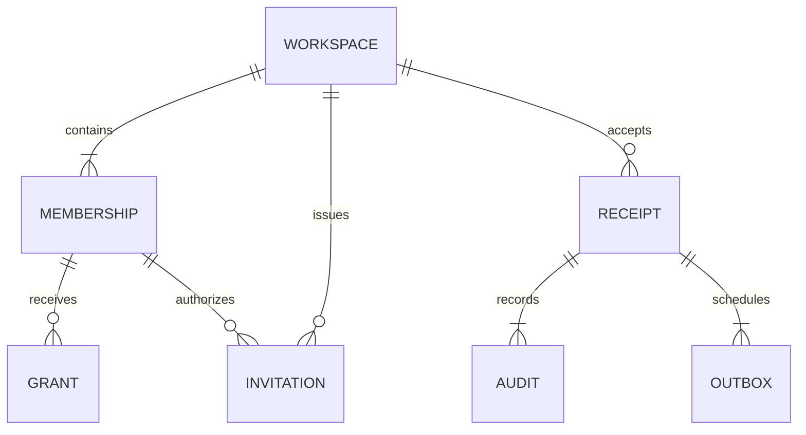

# Data Model: Workspace Platform and Authorization

Planned application-owned schema `solodesk`. Migration SQL is an implementation deliverable; this artifact is its review contract. Preserve `neon_auth` and existing `public.solodesk_email_deliveries` unchanged. Before migration, inspect actual PostgreSQL major, auth identifier types, applied migration history and permissions on an authorized isolated target.

## Shared type and validation rules

These numbered constraint groups are binding task references; entity tasks quote them to keep validation decisions explicit.

- **C01 — Identifiers/time/revisions**: `Identifiers are UUID; authoritative instants are TIMESTAMPTZ serialized as ISO-8601 UTC; revisions are BIGINT >= 1 serialized as decimal strings.` UUIDs are generated server-side with Node crypto and canonicalized to lowercase before digest/query use; never derive identity from slug/email. Revision inputs must be canonical positive decimal strings (no leading zero/sign/exponent) no greater than 9223372036854775807; compare using BigInt, never Number. Instants originate in PostgreSQL; use `clock_timestamp()` at expiry/side-effect boundaries so a long transaction cannot retain an old transaction-start time. No client timestamps determine acceptance. All updated entities increment revision and set updated_at in the same accepted command. No floats or money fields are added.
- **C02 — Workspace input**: `Name is trimmed 1–100 Unicode code points; slug is lowercase ASCII [a-z0-9]+(?:-[a-z0-9]+)* of length 3–63 and globally unique; timezone is a supported IANA identifier; locale is en or ar; currency is an approved ISO-4217 code.` Normalize slug by trim/lowercase; reject other characters instead of transliterating Arabic names. Validate exact currency against one reviewed server allowlist; browser string shape alone is insufficient. Currency is a default label with no precision/calculation promise. Reserve `app`, `api`, `auth`, `admin`, `sign-in`, `sign-up` as slugs. Duplicate names allowed; global slug collision returns only SLUG_UNAVAILABLE.
- **C03 — Membership/grants**: `Role is owner, admin or member; status is active or revoked; UNIQUE(workspace_id,user_id); grants use only the supported action allowlist and scope_type=workspace with scope_id=workspace_id.` Role ceilings and stored grants must both permit the action; no client-supplied role can set authority. Exact supported actions are defined in [workspace contract](contracts/workspaces.md). Reject unknown actions/non-workspace scopes; do not accept phantom project IDs. Active Owner invariants are database-backed, not a JSON flag.
- **C04 — Invitation**: `Recipient is one validated address of at most 254 bytes under the managed provider's verified-email normalization; invite role is admin or member; generation and revision are BIGINT >= 1; expiry is token_created_at + 72 hours; token is 32 CSPRNG bytes encoded base64url and only its SHA-256 digest is stored on the invitation.` Trim transport whitespace only; verify provider-compatible normalization on isolated fixtures; do not plus/dot-fold or domain-match. Invalid/unsupported international address forms are rejected consistently rather than guessed. Resend sets a new generation, token creation instant, expiry and token; original created_at is preserved; never changes the recipient or role. Owner invitations are not supported; promote an existing member with step-up instead.
- **C05 — Command**: `operation_id is UUID; command_version is 1; intent_digest is 64 lowercase hex SHA-256 characters; UNIQUE(actor_id,operation_id); expected revisions use decimal strings; input is at most 16 KiB.` Reusing one ID across different workspaces/kinds/versions/intents is a conflict. Canonicalize a fixed-order typed envelope after validation, including kind, version, explicit workspace/target IDs, expected revisions and every effect-bearing field; omit CSRF/cookie/correlation data and caller-claimed actor/roles. Token acceptance includes token digest, never plaintext. Use existing node crypto; no generic canonical-JSON dependency.
- **C06 — Query/work bounds**: `Page size defaults to 20 and is at most 50; cursor input is at most 512 bytes; each transaction is at most 5 seconds with lock_timeout 1 second; worker batch is at most 20 and retry attempts at most 5.` Preserve pool max 5 and connection timeout; set transaction-local statement timeout 5 seconds plus application deadline. Cursor uses deterministic UUID order and binds workspace/filter/version; malformed/mismatched cursor fails validation and never widens scope. Worker lease is 60 seconds; send timeout 15 seconds; retries after known safe transient failures use 1m/5m/30m/2h delays, stopping at token expiry. Ambiguous external acceptance enters unknown, not automatic retry.
- **C07 — Rate limits**: `Invite issue/resend is at most 20 per workspace per hour, 5 per recipient per workspace per hour and 100 per actor per day; acceptance is at most 10 attempts per session per 15 minutes.` Add network abuse limits only using a reviewed trusted-ingress address contract; public auth challenge limits remain Q-08 and managed-service gates. Rate buckets are database-shared, not in-process. Replayed accepted commands do not send mail or spend another invitation allowance. Hash recipient/network bucket keys with a separate server-only HMAC key; no raw addresses in operational keys. Buckets expire after their window plus 24h.

## Entities and persistence constraints

### Workspace — `solodesk.workspaces`

Fields: `id uuid PK`, `name text NOT NULL`, `slug text NOT NULL UNIQUE`, `owner_id uuid NOT NULL`, `timezone text NOT NULL`, `locale text NOT NULL`, `currency char(3) NOT NULL`, `legal_profile_status text NOT NULL DEFAULT 'unconfigured' CHECK = 'unconfigured'`, `revision bigint NOT NULL DEFAULT 1`, `created_at/updated_at timestamptz NOT NULL DEFAULT clock_timestamp()`.

Apply C01/C02. owner_id designates one active Owner membership; multiple Owner memberships are permitted. Deferred constraint triggers on workspace/membership changes require at least one active Owner and require owner_id to match one. Workspace creation inserts workspace then Owner membership/grants in one transaction; deferred checks run at commit. All membership/grant mutators first lock the same workspace row; the invariant trigger also obtains this row lock before count checks, defending alternate runtime DML paths. A foreign key alone cannot enforce a role/status predicate. No hard workspace deletion or rename/slug mutation UI is included; only supported presentation settings may update. A designated Owner cannot leave without choosing another active Owner atomically.

Indexes: unique slug; PK id. List joined memberships by current user; no global workspace browse. Name/slug are tenant-identifying information and are not returned before authorization.

### Membership — `solodesk.workspace_memberships`

Fields: `id uuid PK`, `workspace_id uuid NOT NULL FK workspaces ON DELETE RESTRICT`, `user_id uuid NOT NULL`, `role text NOT NULL`, `status text NOT NULL DEFAULT 'active'`, `revision bigint NOT NULL DEFAULT 1`, `created_by uuid NOT NULL`, `created_at/updated_at timestamptz NOT NULL`, `revoked_at timestamptz NULL`.

Apply C01/C03. CHECK revoked_at is null iff status=active. UNIQUE(workspace_id,user_id) and UNIQUE(workspace_id,id) enable scoped references. Revocation is a state change, never row deletion. A later valid invitation may reactivate a revoked membership at its current revision with explicit audit; existing active membership is left unchanged. Account IDs reference managed users by verified service lookup; add no FK/triggers/tables to managed schema, avoiding control of managed identity deletion. Historical actor UUIDs remain in audit if managed identity disappears. If managed lookup fails, deny access; no new shadow account is created.

Indexes: `(user_id,status,workspace_id)` for authorized workspace listing; `(workspace_id,status,role,id)` for owner checks/member pagination. Every tenant relationship uses workspace_id as part of its constraint/query.

### Membership grant — `solodesk.workspace_grants`

Fields: `workspace_id uuid NOT NULL`, `membership_id uuid NOT NULL`, `action text NOT NULL`, `scope_type text NOT NULL DEFAULT 'workspace'`, `scope_id uuid NOT NULL`, `created_at timestamptz NOT NULL`; PK `(workspace_id,membership_id,action,scope_type,scope_id)`; composite FK `(workspace_id,membership_id)` to memberships ON DELETE RESTRICT; CHECK scope_id=workspace_id and scope_type='workspace'.

Apply C03. Initial role grants are materialized at membership creation; role changes replace rows atomically, bump membership revision and audit the diff. Owner grants contain all supported actions; Admin/Member ceilings cannot be exceeded even by a malformed grant row. No public arbitrary-grant editor in this slice. Workspace-read grant is required for active-context reads. Revoked memberships cannot use retained grant rows.

### Invitation — `solodesk.workspace_invitations`

Fields: `id uuid PK`, `workspace_id uuid NOT NULL FK`, `recipient_email text NOT NULL`, `role text NOT NULL`, `scope_type='workspace'`, `scope_id=workspace_id`, `inviter_membership_id uuid NOT NULL`, `token_digest text NOT NULL UNIQUE`, `generation bigint NOT NULL DEFAULT 1`, `status text NOT NULL` in `pending|accepted|revoked`, `revision bigint NOT NULL DEFAULT 1`, `created_at/updated_at/token_created_at/expires_at timestamptz NOT NULL`, `accepted_at/revoked_at timestamptz NULL`, `accepted_by uuid NULL`, `accepted_membership_id uuid NULL`.

Apply C01/C04. Composite FKs for inviter and accepted membership include workspace_id. CHECK expires_at = token_created_at + interval '72 hours' and token_created_at >= created_at, coherent accepted/revoked fields and digest hex shape. Expired is a derived state `status=pending AND clock_timestamp() >= expires_at`; do not depend on a cleanup job or volatile partial-index predicate. Use a partial unique `(workspace_id,recipient_email)` WHERE status='pending'; reissue after expiry rotates the existing pending row rather than inserting a conflict. Terminal accepted/revoked rows retain history. Resend rotates token/generation on that pending row and cancels old delivery work; audit captures prior metadata without tokens/digests. Another account/alias or a current recipient mismatch denies acceptance generically.

Indexes: unique digest for acceptance lookup; `(workspace_id,status,id)` for management listing; composite FKs. Token lookup remains inside the special invitation-accept service: it reveals no workspace projection before recipient proof, locks the workspace first and then rechecks digest/generation/policy under lock. This bootstrap is the sole path that can create an invitee membership without a pre-existing one.

### Command receipt — `solodesk.command_receipts`

Fields: `actor_id uuid NOT NULL`, `operation_id uuid NOT NULL`, `workspace_id uuid NOT NULL FK`, `kind text NOT NULL` from contract, `command_version integer NOT NULL CHECK=1`, `intent_digest text NOT NULL`, `target_type text NOT NULL`, `target_id uuid NOT NULL`, `result_code text NOT NULL`, `result_revision bigint NOT NULL`, `result jsonb NOT NULL`, `correlation_id uuid NOT NULL`, `accepted_at timestamptz NOT NULL`; PK `(actor_id,operation_id)`; UNIQUE `(workspace_id,actor_id,operation_id)` for scoped references.

Apply C01/C05. Only accepted receipts persist: in-transaction receipt claim/effect either all commit or all roll back. Results are bounded allowlisted IDs/revisions/status, never full rows, tokens or recipient lists. Concurrency uses workspace row lock for existing teams; before creation, transaction advisory lock on actor+operation serializes retries. Lookup by current actor and operation, then authorize target under current policy before returning result. Receipt replay after self-leave/removal may return only a minimal actor-owned accepted acknowledgement, no workspace projection. An invitation-accept retry may use that same actor's receipt and token digest even though proof is consumed; a different operation ID cannot reuse proof. Failed validation/authorization does not create a business receipt. Receipts are not purged in this slice, preventing forgotten keys from creating duplicate effects.

### Audit — `solodesk.audit_events`

Fields: `id uuid PK`, `workspace_id uuid NOT NULL FK`, `actor_id/operation_id uuid NOT NULL`, `target_type text NOT NULL`, `target_id uuid NOT NULL`, `revision bigint NOT NULL`, `action text NOT NULL`, `occurred_at/received_at timestamptz NOT NULL`, `correlation_id uuid NOT NULL`, `reason text NULL` bounded to 500 code points, `change_summary jsonb NOT NULL` bounded to 4 KiB. Composite FK to receipt `(workspace_id,actor_id,operation_id)`.

Ordinary application users have INSERT/authorized SELECT only; no UPDATE/DELETE/TRUNCATE. This is access-protected audit, not independent tamper-evident storage. Grant/role summaries include safe before/after enums/IDs, never session cookies, codes, token digests, encrypted delivery material or raw mail contents. Index `(workspace_id,occurred_at,id)` and scoped operation ID.

### Outbox — `solodesk.outbox_events`

Fields: `id uuid PK`, `workspace_id uuid NOT NULL FK`, `actor_id/operation_id uuid NOT NULL`, `event_type text NOT NULL`, `target_id uuid NOT NULL`, `target_revision bigint NOT NULL`, `generation bigint NOT NULL DEFAULT 0 CHECK generation>=0`, `payload jsonb NOT NULL` bounded 4 KiB and free of bearer secrets, `encrypted_delivery bytea NULL`, `key_id text NULL`, `status text NOT NULL` in `pending|leased|sent|cancelled|unknown|dead`, `attempts integer NOT NULL CHECK 0..5`, `available_at/created_at timestamptz NOT NULL`, `lease_token uuid NULL`, `lease_until/sent_at timestamptz NULL`, `last_error_code text NULL` allowlisted.

Composite receipt FK; UNIQUE(workspace_id,actor_id,operation_id,event_type,target_id,generation) with explicit non-null generation=0 for non-invitation events (avoid NULL uniqueness holes). Envelope is AES-256-GCM ciphertext with nonce/tag plus key ID; authenticated data includes workspace/id/generation. Only restricted sender can read the secret field; ordinary UI/audit queries exclude it. Clear ciphertext on terminal sent/cancelled/dead and after expiry; unknown delivery retains it only until reviewed reconciliation or expiry. Key unavailable/wrong tag fails closed, never degrades to plaintext.

Every command writes an audit event and outbox event; only `workspace.invitation.delivery` invokes email. Other events are invalidation/audit notifications handled by the bounded worker without building a broker. Lease pending records using row locks with SKIP LOCKED and update token/expiry; finish requires matching lease token. Lease expiry after an attempted send is unknown, not assumed safe-to-retry. Index `(status,available_at,id)` and `(workspace_id,target_id,generation)`.

### Shared rate bucket — `solodesk.rate_limit_buckets`

Fields: `key_hash text NOT NULL`, `window_start timestamptz NOT NULL`, `count integer NOT NULL CHECK count>=0`, `expires_at timestamptz NOT NULL`; PK(key_hash,window_start). Apply C07. Atomically increment/check without select-then-write races; rejected acceptance attempts still consume budget in a small separate guard transaction, since rolling back the command must not reset abuse counts. Buckets are operational metadata, not accepted workspace commands. No per-request raw token/address is logged. Cleanup uses bounded batches and applies only to expired buckets, never receipts/audit.

## Lifecycle and transaction invariants

1. Create: verify session → actor/operation transaction lock → receipt replay check → insert workspace+initial membership/grants → receipt/audit/outbox → deferred owner checks → commit. No partial team if any insert fails.
2. Existing command: verify session → workspace lock → current session/membership/grants/selector → receipt/digest → target/revision → effect + revision → safe receipt + audit + outbox → final authority observation → commit. All grant mutations take the same workspace lock.
3. Invite: create pending → resend rotates pending generation/proof → accept once into accepted OR revoke into revoked. Derived expiry denies all further acceptance. Active recipient membership is unchanged; a valid acceptance can consume the invitation as `alreadyMember` without promotion.
4. Ownership: transfer promotes target to Owner, changes designated owner_id, demotes initiating designated Owner to Admin and replaces grants in one commit. Other Owners remain. Transfer/promotion uses a provider-supported step-up proof bound to the current account/session/action and at most 5 minutes old; unsupported proof disables the operation. Final Owner membership cannot be revoked/demoted. Direct account deletion/workspace closure is outside scope.
5. Select workspace: cookie-only browser preference is not a business command/receipt; service must verify current membership. Rejected or failed selection retains no newly privileged data. All actual team writes follow the command transaction above.

## Role/access and recovery classification

Workspace metadata is private team data; invitation recipient addresses are sensitive and returned only to permitted administrators. Token envelopes/session material are server secrets. Runtime application role receives schema USAGE plus the exact table/column privileges needed above; no schema ownership, DDL, BYPASSRLS or credential-table read. Migration role is separate and direct-only. Sender uses its own narrow role, has no membership/owner/auth mutation privilege, and dispatches only committed reviewed events. It may SELECT only the invitation id/workspace/recipient/role/scope/status/generation/expiry/digest, inviter membership user/role/status/revision, relevant action grants, workspace id, and managed user id/emailVerified/banned fields necessary to recheck delegated authority. It may SELECT/decrypt the restricted outbox envelope and UPDATE only lease/retry/status/ciphertext-clear fields. It cannot read credentials/session tokens or other profile fields. Use reviewed column grants and parameterized workspace/event-bound joins; test both the required reads and forbidden writes. Its entry point authenticates an operations service principal, then rechecks the original inviter's current account and delegated grants; it does not invent an interactive Better Auth session for a worker. Pooled connection reuse tests alternate tenants after successes, failures and aborted transactions. No session-level SET is used and no RLS guarantee is claimed.

Application schema expansion can precede workspace activation without profile migration. Accepted records forbid destructive down migration. Stop new writers/senders, keep compatible authorized readers and forward-repair. Restore in isolation must suppress old mail, reconcile accepted operations, invalidate restored auth material through supported managed controls and preserve invitation expiry/revocation. Q-13 owns future retention/tombstone decisions; no purge/backfill of personal data is introduced.
