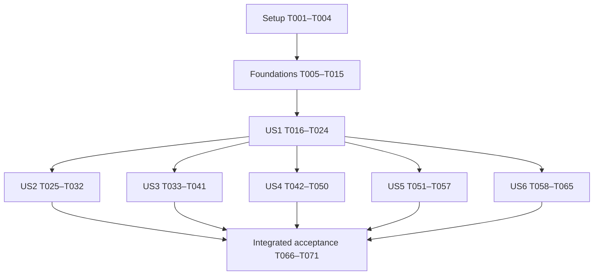

> **Correction — 2 November 2026, Feature 006:** Historical completion/browser/live/human/security claims below are STALE where unsupported. [Current correction evidence](../006-shell-verification-completion/evidence.md) and [completion audit](../006-shell-verification-completion/artifacts/completion-audit.md) supersede them. Local44Node+6email/build and controlled Chrome checks do not establish real auth/DB, production Next history, navigation timing or human acceptance. G1–G6/AP-01–05 remain open. Original prose is retained as provenance, not current approval.

Reopened unsupported tasks: T004, T006, T024, T031, T032, T040, T041, T048, T049, T056, T057, T064, T065, T067, T068, T069, T071. Remaining checked implementation tasks retain their local scope; no blanket story acceptance follows. T006 remains open for complete AP-02–05 coverage despite new focused removed-grant regressions.

---
description: "Dependency-ordered implementation tasks for the SoloDesk application shell"
---

# Tasks: Application Shell and Sidebar Navigation

**Input**: Design documents from `specs/005-application-shell-sidebar/`.
**Prerequisites**: [plan.md](plan.md), [spec.md](spec.md), [research.md](research.md), [data-model.md](data-model.md), [shell/navigation contract](contracts/shell-and-navigation.md), [runtime/authority contract](contracts/runtime-and-authority.md), [quickstart.md](quickstart.md), and the project constitution.
**Tests**: Required by the feature's acceptance/evidence requirements, particularly FR-031. Prepare meaningful contract/negative cases before their implementation; actual browser, isolated service/session/database and human reviews remain separate evidence classes.
**Organization**: Setup → shared foundations → US1–US4 (P1) → US5–US6 (P2) → cross-cutting verification. All six stories are required. Every task starts unchecked because this command generates work rather than implementing it.

## Format: `[ID] [P?] [Story] Description`

`[P]` identifies an explicitly released group of tasks that can proceed independently in different files. It does not authorize delegation or imply that every `[P]` task in the document can start together. Story labels appear only in story phases. All paths below are repository-relative and identify concrete edit, test or evidence targets.

## Path Conventions

Use the existing Next.js repository: `app/`, `components/`, `lib/`, `messages/`, `scripts/` and `specs/005-application-shell-sidebar/`. New evidence/provenance files named below are outputs for implementation, not claims that those checks have run. No new database schema, runtime dependency, auth factor, worker, protected browser persistence or business module is planned.

Current feature discovery uses `.specify/feature.json`; the actual Git branch is independent. Preserve concurrent workspace changes and existing command/result/error/transaction behavior. Test manifests, credentials, sessions and invitation proof stay outside version control and sanitized evidence.

## Phase 1: Setup (Shared Infrastructure)

**Purpose**: Establish the current baseline and prerequisites without scaffolding over the existing application.

- [X] T001 Record actual branch/HEAD, source and lockfile hashes, dirty-file inventory, Feature 005 pointer and current source differences in `specs/005-application-shell-sidebar/evidence.md`; re-read the changing `app/workspace-actions.ts`, `components/workspace-panel.tsx` and `lib/workspaces.ts`, preserve unrelated edits, and distinguish inspected code from Feature 004 historical summaries.
- [X] T002 [P] Read installed Next.js layout/template, Cache Components, auth, cookies and navigation guides; inspect `components.json` and existing UI, resolve official Base UI Sidebar/Sheet/Tooltip/Breadcrumb source with the compatible shadcn CLI, and record source/version/import/provenance review in `specs/005-application-shell-sidebar/artifacts/component-provenance.md`; do not apply a preset or install unneeded packages.
- [X] T003 [P] Reconcile AP-01–05 and canonical G1–G6 with current code, applicable SEC/ASVS controls and accountable roles in `specs/005-application-shell-sidebar/evidence.md`; record current advisory applicability and missing named sign-off as open gates without inheriting tooling-only acceptance or enabling any capability.
- [ ] T004 Verify available browser tools and independently verified synthetic app/auth/database/delivery-sink prerequisites, document two-team/non-member/Owner/Admin/Member/zero-choice/>20-choice/delayed-response fixtures and cleanup in `specs/005-application-shell-sidebar/quickstart.md`, and record missing targets/tooling as blockers in `specs/005-application-shell-sidebar/evidence.md`; do not provision, migrate, send mail or use production data.

**Parallel release**: After T001, T002 and T003 can run independently; T004 follows their prerequisite findings.

## Phase 2: Foundational (Blocking Prerequisites)

**Purpose**: Establish one safe shared account/context boundary before any new app destination uses it. These tasks correct bounded consumption prerequisites; they do not complete Feature 004's hosted policy, worker or release work. Unproven capabilities remain disabled, so independent shell/personal-account work does not wait for excluded provider features.

### Shared Contract and Negative Tests

- [X] T005 [P] Extend `scripts/test-profile.test.mjs` with exact current session/user, verified/banned/expiry, missing-session and authority-outage cases for AP-01; preserve `saveProfile(userId, name)` errors and sealed-query predicates, and prove generic shell reads require neither workspace membership nor a Realtime envelope.
- [ ] T006 [P] Extend `scripts/test-workspaces.test.mjs` for AP-02–05: persisted read/select/action grant removal without role change, narrower/global flags off before SQL and private replay, forged/foreign selectors, role ceilings, last-owner retention, revoked private receipt projections and unsupported/future-timestamp step-up; label mocked adapters as local evidence.
- [X] T007 [P] Add focused loader/transport contracts in `scripts/test-application.test.mjs` for narrow projections, 200/400/401/503 outcomes, independent workspace failure, no-query disabled paths and render-only deduplication; cover collection `"loading → ready | empty | disabled | unavailable"`, selection `"unselected | checking | ready | restricted | unavailable | disabled"`, and the rule `"The client generation counter only rejects old results; it grants no access."` from `data-model.md`.

### Shared Implementation

- [X] T008 Strengthen the existing current-account boundary in `lib/auth/server.ts` and preserve `lib/profile.ts`'s exact user/session SQL predicates, verification/banning/expiry checks, unavailable distinction and sealed-query contract; audit all callers and keep session/database secrets server-only without changing managed auth or its schema (T005; AP-01).
- [X] T009 Correct current workspace list/context/action projections in `lib/workspaces.ts`: require active same-workspace membership and actual persisted `workspace.read` for context, both read/select grants for selectable choices, and `workspace.select` for selection, all with matching workspace scope; intersect action grants with role ceilings and retain the constraints `"Names remain user text, bounded by existing validation."` and `"Revisions retain existing decimal-string representation."`; do not reconstruct authority from role defaults (T006; AP-02).
- [X] T010 Enforce existing global and narrower gates throughout consumed reads/mutations/replays in `lib/workspaces.ts` and `lib/auth/capabilities.ts`; use the existing workspace/invitation/ownership flag names, reject unsupported sensitive owner operations before effects, and do not treat `createdAt`/`updatedAt`, future timestamps or an opt-out flag as successful step-up proof (T006; AP-03/AP-05).
- [X] T011 Reauthorize private receipt replay and consumed command effects in `lib/workspaces.ts` and redact unexpected errors in `app/workspace-actions.ts`; retain original operation IDs, canonical intents, revisions, result fields, transaction/audit/outbox behavior, role ceilings and minimal own-leave acknowledgement rather than exposing revoked team metadata (T006; AP-04).
- [X] T012 Add server-only `lib/application.ts` with one uncached context loader plus a React render-pass wrapper; project account `id/name/sessionExpiresAt` and `"optional existing avatar reference"`, authorized choice `id/name` with `nextCursor`, and the existing selected context fields with the constraints "Never return session token, provider tokens, cookie secret or database credentials." and "UUID is a selector", and no role-template claims; implement truthful independent states and preserve `"Bootstrap makes one fresh identity read and at most one initial list plus one selected-context read."` and `"No selected cookie means no selected-context query; disabled workspaces means zero workspace queries."` (T007–T011).
- [X] T013 Add `app/api/app/context/route.ts` using the same uncached loader with no query fields, 200 ready-account/team-state envelope, 400 unexpected query, 401 denied account and 503 account outage; tighten `app/api/workspaces/route.ts` to reject duplicate/unknown/conflicting fields, partial integers and malformed UUIDs, preserve existing result shapes, private/no-store plus merged Cookie variation, and `"20 per page, maximum 50, one page per request"` while reusing the existing `"max: 5"` pool and read-only GET semantics (T012).
- [X] T014 Add `components/application-runtime.tsx` as the single private account/context owner, reusing/refactoring `components/live-profile.tsx`'s existing conceal/abort/generation/expiry/pagehide/pageshow/focus/visibility safeguards without a second session polling loop; preserve account states `"checking"`, `"ready"`, `"signing-out"`, `"denied"`, `"unavailable"`, one coalesced recheck, visible-tab 55-second checking, first-document versus cached-entry behavior, actor-matched profile renewal/cleanup and team-independent personal access (T008/T012/T013).
- [X] T015 Run the focused foundation tests and inspect direct disabled paths in `scripts/test-profile.test.mjs`, `scripts/test-workspaces.test.mjs` and `scripts/test-application.test.mjs`; record AP-01–05 source corrections, actual local results and still-required isolated proof in `specs/005-application-shell-sidebar/evidence.md`, and verify no new schema/dependency/persistence or capability activation has been introduced.

**Checkpoint**: Shared foundations are implemented and locally verified, with unsafe capabilities fail-closed. Missing hosted/isolated proof blocks affected activation, never becomes a passing result. All story implementation depends on this checkpoint.

## Phase 3: User Story 1 — Find a Working Destination in the Application (Priority: P1)

**Goal**: A dedicated shell and three useful destinations, preserving public/auth composition and ordinary browser navigation.
**Independent Test**: With valid account authority, navigate among Overview, Workspace and team, and Personal account; refresh, use direct links/back/forward, inspect title/active state, and compare public/sign-in/sign-up pages. Each enabled destination must contain actual existing functionality or a truthful actionable state.

### Tests for User Story 1

- [X] T016 [P] [US1] Extend `scripts/test-site.test.mjs` with exact `/app`, `/app/workspace`, `/app/account` route/return values, unsupported child/prefix/alias denials and compatible existing presentation defaults; prepare these failing finite-path cases before route changes.
- [X] T017 [P] [US1] Extend `scripts/test-site-http.mjs` with anonymous child-entry/private-header and public/auth-layout-separation cases across six locale/theme variants, retaining safe streaming-redirect handling and distinguishing anonymous HTTP assertions from authenticated browser acceptance.

### Implementation for User Story 1

- [X] T018 [US1] Extend the finite destination set and compatible presentation handling in `lib/site.ts`, `proxy.ts` and `app/api/preferences/route.ts`; preserve the existing exact-origin three-field/2048-byte preference contract, existing cookies/303 behavior and rejection of arbitrary URLs, query-bearing returns, fragments, duplicate fields and unsupported public aliases (T016/T017).
- [X] T019 [US1] Add only the needed reviewed official source in `components/ui/sidebar.tsx`, `components/ui/sheet.tsx`, `components/ui/tooltip.tsx` and `components/ui/breadcrumb.tsx` plus their concrete required helpers; reuse installed Base UI/Lucide and existing primitives, apply Base `render` link semantics, and record any unavoidable dependency justification in `specs/005-application-shell-sidebar/artifacts/component-provenance.md` instead of upgrading/regenerating the project (T002).
- [X] T020 [US1] Add nested `app/(site)/[locale]/[theme]/app/layout.tsx`, `app/(site)/[locale]/[theme]/app/template.tsx` and a non-private fallback in `app/(site)/[locale]/[theme]/app/loading.tsx`/`components/auth-skeleton.tsx`; keep presentation `"expanded=true"` and `"open=false"` outside private Suspense, share the render-pass loader with page guards, provide denied-template finite-path recovery when children are withheld, and mount `components/workspace-invitation.tsx` capture early with scrub-before-parse/history-state preservation and a `"4096-character fragment bound plus a 1024-character decoded-proof bound"` without persisting or auto-accepting proof (T014/T018/T019).
- [X] T021 [US1] Add `components/application-shell.tsx` with brand app-home link, working three-destination navigation, current workspace identity, compact title/header, real child breadcrumbs, account/public-site/sign-out controls, skip link/main landmarks and visible/programmatic active state; reuse existing semantic variants and supply initial English/Arabic navigation labels in `messages/en.json` and `messages/ar.json`, with no dead business/search/timer/notification controls (T020).
- [X] T022 [US1] Add `components/application-overview.tsx` and replace `app/(site)/[locale]/[theme]/app/page.tsx`'s public SiteHeader/account composition with truthful welcome/context and links to implemented functions; distinguish loading/unselected/disabled/unavailable/empty-choice states, say “no available workspaces” without inventing membership counts, and render no marketing sections, fictional metrics or completed-dashboard claim (T021).
- [X] T023 [US1] Add `app/(site)/[locale]/[theme]/app/workspace/page.tsx` and `app/(site)/[locale]/[theme]/app/account/page.tsx` with shared current page guards and real reuse of `components/workspace-panel.tsx` and `components/live-profile.tsx`; pass the one runtime context, load the existing actor-bound profile envelope only for Personal account, and preserve `"No workspace membership dependency."` without creating placeholder destinations (T022).
- [ ] T024 [US1] Run US1's independent authenticated route/direct-link/refresh/history and public/auth separation cases through available browser tooling, record all enabled links/title/active-state results and SC-001/SC-002 evidence in `specs/005-application-shell-sidebar/evidence.md`, and keep absent tools/fixtures as gaps instead of promoting HTTP/source checks to browser proof (T016–T023).

**Checkpoint**: US1 is a useful internal MVP after foundations: three working destinations share the shell and public/auth pages remain separate. Full feature/release acceptance still requires the other stories.

## Phase 4: User Story 2 — Change Workspace Without Mixing Team Data (Priority: P1)

**Goal**: One workspace owner, complete bounded choices, serialized selection and zero old-team UI leakage.
**Independent Test**: Use distinct A/B teams, >20 choices, delayed reads and commands, failed switches and revoked access; run at least 20 alternating switches including rapid reversals, and verify displayed records/actions and original command targets.

### Tests for User Story 2

- [X] T025 [P] [US2] Extend `scripts/test-application.test.mjs` with successful-empty versus failed/disabled/restricted context, late-page failure, generation/actor mismatch and no automatic fallback cases; prepare controllable delayed-response/rapid-switch browser cases in `scripts/test-app-shell-browser.md` without inventing a new state abstraction just for tests.
- [X] T026 [P] [US2] Extend `scripts/test-workspaces.test.mjs` for direct select-grant denial, original command targets and required expected-selector clearing; test request-cookie comparison and mismatch recovery while explicitly rejecting a cross-tab compare-and-swap guarantee.

### Implementation for User Story 2

- [X] T027 [US2] Add the shared workspace selector and on-demand next-page control to `components/application-shell.tsx` using `components/application-runtime.tsx` and the existing `/api/workspaces` list interface; preserve the model's `"Subsequent pages append by stable ID/cursor only for the same actor/generation."`, retain `nextCursor`, and keep current selection discoverable without a parallel selector authority (T025).
- [X] T028 [US2] Tighten selection/conditional-clear handling in `app/workspace-actions.ts` and serialize selection requests in `components/application-runtime.tsx`; require current select authority and the expected stale selector, conceal before the request, re-read context before success, and on response-cookie races stay concealed/unselected until an explicit validated choice rather than retargeting commands (T026/T027).
- [X] T029 [US2] Adapt `components/workspace-panel.tsx` to consume the shared owner, key team views by actor/workspace, and guard every initial/manual-refresh/mutation-follow-up result; preserve `"idle/loading/ready/empty/unavailable/restricted"`, dispose old arrays/dialogs/revisions/messages and existing subscriptions if any, and never mount stale members/invitations/privileged actions after a context change (T028).
- [X] T030 [US2] Add dirty-team-form cancel/discard registration to `components/workspace-panel.tsx` and the switch path in `components/application-runtime.tsx`; preserve `"cancel retains input/context"` and `"Discard clears only after explicit confirmation."`, clear team input only after discard, and retain captured original targets for already-submitted operations (T029).
- [ ] T031 [US2] Execute the delayed-response, >20-choice, failed-switch, revoked-selection and cross-tab-cookie scenarios in `scripts/test-app-shell-browser.md` with actual authenticated browser tools; record at least 20 switches and zero prior-team records/actions or retargeted commands in `specs/005-application-shell-sidebar/evidence.md` for SC-003, including truthful retry/explicit-return behavior (T027–T030).
- [ ] T032 [US2] Extend and run relevant real-service read/select/grant-removal/pool-reuse cases in `scripts/test-workspaces-postgres.mjs` against only the verified isolated fixture; preserve restricted runtime credentials and actual query-plan evidence, and record unavailable real-session/database prerequisites as activation blockers in `specs/005-application-shell-sidebar/evidence.md` rather than using migration-source self-checks as proof (T031; AP-01/AP-02).

**Checkpoint**: US2 switching is testable through the common shell without any unfinished business modules. A mocked or refused isolated run does not accept enabled tenant journeys.

## Phase 5: User Story 3 — Continue Account, Team and Invitation Journeys (Priority: P1)

**Goal**: Preserve implemented personal/team functions and explicit invitation acceptance while truthful disabled/failure states protect independent personal access.
**Independent Test**: Read/update a personal profile with no team, disabled teams and a team-service outage; exercise permitted creation/settings/member/invitation/leave journeys and explicit recipient acceptance, including malformed/lost/signed-out proof and recoverable form errors.

### Tests for User Story 3

- [X] T033 [P] [US3] Extend `scripts/test-profile.test.mjs` for Personal account's unchanged own-user validation/error/sealed-query contract under zero memberships, workspace disablement/failure and actor changes; verify no profile envelope is loaded for Overview or Workspace and no workspace switch gives access to another profile.
- [X] T034 [P] [US3] Extend `scripts/test-workspaces.test.mjs` for preserved invitation/member actions, recipient/expiry/resend/revoke/replay/last-owner/role-ceiling safeguards and retained operation IDs after unknown outcomes; prepare actual invitation arrival/fragment/privacy cases in `scripts/test-app-shell-browser.md`, not source-regex substitutes.

### Implementation for User Story 3

- [X] T035 [US3] Finish permitted creation/settings/member/leave and invitation-management integration in `components/workspace-panel.tsx`; consume effective capabilities, retain existing validation/confirmations/transaction-result/revision handling, expose recoverable list errors separately from empty lists, and respect `"Existing member/invitation services cap results at 50"` with honest bounded-list messaging (T033/T034).
- [X] T036 [US3] Complete Personal account integration in `app/(site)/[locale]/[theme]/app/account/page.tsx` and `components/live-profile.tsx`; preserve `userId/sessionExpiresAt/initialData/sealedQuery`, the configured public Realtime URL only where needed, `saveProfile` errors and own-user renewal/cleanup, and conceal/refresh on runtime actor mismatch without coupling profile access to workspace availability (T033).
- [X] T037 [US3] Finish explicit invitation acceptance in `components/workspace-invitation.tsx` using the shared runtime authority and existing action; preserve the model's `"absent → captured | malformed → awaiting-authority → actionable | disabled | unavailable → accepting → accepted | rejected"`, gated recipient checks, safe malformed/oversized handling, initial/hash/navigation capture, dismissal/flow-exit/identity-loss clearing, no proof forwarding/persistence and `"Acceptance retains the same operation ID while its outcome is uncertain"` (T020/T034).
- [X] T038 [US3] Correct success/unavailable feedback for existing invitation and team operations in `components/workspace-panel.tsx`, `components/workspace-invitation.tsx`, `messages/en.json` and `messages/ar.json`; distinguish accepted/queued work from actual inbox delivery, retain private generic recovery, and never enable a worker, credential flow or ownership capability just to make controls appear functional (T035/T037).
- [X] T039 [US3] Extend dirty-input coordination to profile/team forms, app links and appearance submissions in `components/application-runtime.tsx`, `components/application-shell.tsx`, `components/live-profile.tsx` and `components/workspace-panel.tsx`; offer cancel/discard before in-app loss, retain normal modified-click/new-tab behavior and recoverable in-memory input, and preserve `"No proof survives sign-in, preference full navigation, reload or account change."` without lifting private drafts into persistent layout state (T030/T036–T038).
- [ ] T040 [US3] Run the signed-out/loading/disabled/unavailable/malformed/oversized/new-hash invitation cases from `scripts/test-app-shell-browser.md`, including a full/streaming redirect beating hydration; inspect sanitized storage/return/log results and explicit accept/dismiss/reopen behavior, and record SC-009 evidence/gaps in `specs/005-application-shell-sidebar/evidence.md` (T037–T039).
- [ ] T041 [US3] Run the allowed profile/create/select/settings/member/invitation/leave journeys with enabled, independently verified isolated capabilities and repeat profile access when only teams fail; record SC-004/SC-005 outcomes, disabled ownership behavior and still-open G1–G6 dependencies in `specs/005-application-shell-sidebar/evidence.md` without claiming delivery/hosted proof from mocked tests (T035–T040).

**Checkpoint**: US3 is independently demonstrated through personal/single-team/invitation journeys; final multi-team integration also uses US2's completed switch behavior. Excluded provider/worker work stays gated.

## Phase 6: User Story 4 — Retain Privacy Through Denied Access and Session Changes (Priority: P1)

**Goal**: Safe child-destination resumption, direct authorization, private lifecycle/history handling and truthful sign-out.
**Independent Test**: Use non-member/lower-role/expired/revoked/banned identities against direct pages/reads/actions, enter both children signed out, and exercise sign-out success/failure, identity changes, old tabs and browser history/BFCache.

### Tests for User Story 4

- [X] T042 [P] [US4] Extend `scripts/test-site.test.mjs` and `scripts/test-auth-contract.test.mjs` for the finite app-return subset, one optional return and known unique auth fields, 2048-byte query ceiling, hostile/duplicate/query/fragment returns, counterpart entry links and every supported enabled authentication completion path before changing the auth pipeline.
- [X] T043 [P] [US4] Extend `scripts/test-profile.test.mjs` with current authority/unavailable/identity-mismatch and failed-sign-out outcomes, and prepare direct-denial/foreground/history/BFCache/expiry cases in `scripts/test-app-shell-browser.md`; retain separate browser and real-session proof requirements rather than treating markup/session mocks as acceptance.

### Implementation for User Story 4

- [X] T044 [US4] Extend auth-return parsing/failure/normalization helpers in `lib/site.ts` with only `/app`, `/app/workspace`, `/app/account`, default `/app`, bounded known unique fields and safe invalid-return fallback; retain empty-fragment exits, never accept an arbitrary prefix/external URL/query/fragment or invitation proof, and preserve existing default entry flows (T042).
- [X] T045 [US4] Propagate only validated returns through `components/auth-entry-page.tsx`, `components/auth-interactive-panel.tsx`, `components/sign-in.tsx`, `components/auth-email-form.tsx`, `app/(utility)/auth/callback/page.tsx` and `proxy.ts`; cover already-signed-in entry, counterpart links, social callback/error and enabled email/verification completion, while password recovery preserves a bounded subsequent sign-in destination without claiming a new session (T044).
- [X] T046 [US4] Complete cached-route/pre-paint navigation, synchronous pagehide concealment, pageshow/focus/visibility/expiry and identity/grant-loss handling in `components/application-runtime.tsx`; validate the browser's finite pathname for denied-template recovery even when children never render, discard old proof/team/profile state, and revalidate/refresh actor-bound private children before reveal without trusting each template mount as a fresh request (T043/T045).
- [X] T047 [US4] Complete shared sign-out/account-menu handling in `components/application-shell.tsx` and `components/application-runtime.tsx`, preserving the stronger existing `components/live-profile.tsx` failure semantics; stop private subscriptions/state before request, redirect only after confirmed success, report retry on failure and revalidate before revealing anything, with no public-header `finally` success assumption (T046).
- [ ] T048 [US4] Extend real-session/direct-read/action/replay/tenant-pool denial cases in `scripts/test-auth-flows.mjs` and `scripts/test-workspaces-postgres.mjs` for AP-01–05, including exact session revocation, grant removal without role change, unsupported ownership proof, original command targets and zero forbidden fields/effects; use only independently verified synthetic targets and record missing challenges/assertions as blockers (T045–T047).
- [ ] T049 [US4] Execute actual signed-out child resumption, direct restricted navigation, session expiry/revocation/banning, account change, successful/failed sign-out and cached history/old-tab cases in `scripts/test-app-shell-browser.md`; record private-header/return/fragment behavior and SC-005/SC-009 outcomes in `specs/005-application-shell-sidebar/evidence.md` (T045–T048).
- [X] T050 [US4] Reconcile effective gates and all claimed exposed identity/team operations against AP-01–05 and canonical G1–G6 in `specs/005-application-shell-sidebar/evidence.md`; identify current source/build/capability/test evidence and remaining activation owners, and leave unsupported credentials/invitations/owner elevation service-disabled rather than marking those dependencies complete (T048/T049).

**Checkpoint**: US4 can be tested with the shell plus authority fixtures independently of unfinished business modules. Direct execution and lifecycle privacy must pass for every enabled journey; layout/sidebar admission alone is insufficient.

## Phase 7: User Story 5 — Navigate Comfortably on Desktop, Tablet and Phone (Priority: P2)

**Goal**: Persistent desktop navigation/icon rail and a usable modal mobile drawer with predictable focus and no presentation persistence.
**Independent Test**: Use keyboard and pointer at wide/short desktop, phone/tablet, 320 CSS-pixel reflow and 200% zoom; collapse/expand, scroll long navigation, open/dismiss/navigate the drawer and cross the breakpoint while it is open.

### Tests for User Story 5

- [X] T051 [US5] Prepare the actual keyboard/pointer/short-screen/resize/focus/background-interaction scenarios in `scripts/test-app-shell-browser.md` before responsive changes, covering 768 CSS-pixel CSS/JS agreement, initial memory-only state, internal-navigation retention/new-document reset, no cookie/storage writes and missing/unavailable storage; use available browser tooling rather than installing a second test/UI framework.

### Implementation for User Story 5

- [X] T052 [US5] Complete controlled desktop/mobile presentation in `components/ui/sidebar.tsx` and its resolved mobile helper, retaining `"expanded=true"` initially and `"open=false"`, exactly aligned 768 CSS-pixel behavior and memory-only expansion across app routes; inspect/remove generated cookie writes and the unrequested Ctrl/Cmd+B shortcut, and ensure mobile state closes on navigation, dismissal, authority loss and breakpoint change (T051).
- [X] T053 [P] [US5] Complete Base UI modal/focus behavior in `components/ui/sheet.tsx`: localized title/close affordance, focus containment, blocked background/scroll, Escape/dismissal and compatible `initialFocus`/`finalFocus` handling; restore opener focus on dismissal, allow committed-navigation destination focus instead, and keep dirty-discard cancellation operable (T052).
- [X] T054 [P] [US5] Add only required shell responsive/logical layout rules in `app/globals.css`, preserving existing semantic tokens/fonts, main-content width, readable narrow forms and short-screen navigation scroll; keep essential controls reachable at 320 CSS pixels/200% zoom without page-level overflow, and introduce no new palette or marketing effects (T052).
- [X] T055 [US5] Integrate expanded/icon/mobile controls in `components/application-shell.tsx` and `app/(site)/[locale]/[theme]/app/layout.tsx`; use existing 44px touch variants, accessible toggle/link names and hover/focus tooltips, keep workspace/account controls discoverable in every mode, close drawer after navigation and handle focus when resize removes a focused navigation surface (T053/T054).
- [ ] T056 [US5] Execute the prepared automated browser collapse/expand, short-screen scrolling, drawer keyboard/pointer/Escape/navigation/background-blocking/resize and memory-only state cases from `scripts/test-app-shell-browser.md`; record SC-002/SC-006 results and any tool gaps in `specs/005-application-shell-sidebar/evidence.md` without treating source patterns as interaction proof (T055).
- [ ] T057 [US5] Perform and separately record manual focus containment/restoration, unobscured focus, touch targets, short viewport, 320 CSS-pixel reflow and 200% zoom review in `specs/005-application-shell-sidebar/evidence.md`, using the implemented build/browser/device; record unavailable reviewers/devices as open acceptance items and retain full bilingual matrix review for US6 (T056).

**Checkpoint**: US5's navigation behavior is independently testable through any working destination. `[P]` T053/T054 are separate-file work only after T052 establishes the provider contract.

## Phase 8: User Story 6 — Work in Either Language and Every Supported Theme (Priority: P2)

**Goal**: Complete English/Arabic, RTL, Light/Dark/System and accessible readable shared appearance for all shipped states and journeys.
**Independent Test**: Repeat primary routes/state journeys across all six locale/theme combinations, long mixed-direction fixtures, keyboard/screen readers, reduced motion, device System changes and the specified viewport/zoom matrix; require separate fluent-Arabic review.

### Tests for User Story 6

- [X] T058 [P] [US6] Extend locale/ICU/presentation contracts in `scripts/test-site.test.mjs` for all shipped shell/menu/state/accessible-label messages and destination-preserving appearance values, retaining `scripts/check-translations.mjs`'s key/structure checks without presenting them as fluent-language or rendering approval.
- [X] T059 [P] [US6] Prepare actual six-variant System/OS-change, RTL portal/sidebar/drawer, mixed-name/email/identifier, reading-order/focus/reduced-motion and viewport fixtures in `scripts/test-app-shell-browser.md`, including 390×844, 768×1024, 1280×800, 1440×900, 1280×480, 320 CSS-pixel reflow and 200% zoom.

### Implementation for User Story 6

- [X] T060 [US6] Complete every shipped navigation/menu/heading/loading/error/empty/restricted/disabled/retry/unsaved/accessible label in `messages/en.json` and `messages/ar.json`, replace remaining hardcoded shell/reused workspace copy in `components/application-shell.tsx`, `components/application-overview.tsx`, `components/workspace-panel.tsx` and `components/workspace-invitation.tsx`, and keep “no available workspaces” distinct from unproven no-membership claims (T058/T059).
- [X] T061 [US6] Correct only observed shared appearance gaps in `app/globals.css` and the actually reused `components/ui/dropdown-menu.tsx`/`components/ui/sidebar.tsx` variants; retain monochrome semantic tokens, Rugis/Sahabah heading and Geist body/navigation roles, shared borders/radii/focus and reduced motion, and do not claim known contrast gaps resolved or replace supplied tokens without evidence (T060).
- [X] T062 [US6] Complete app language/theme controls in `components/application-shell.tsx` using the existing three-field preference transport and current exact destination, preserving authorized workspace and dirty-input confirmation; verify Light/Dark/System and device-following System behavior without returning through public home or retaining invitation proof (T018/T039/T060).
- [X] T063 [US6] Complete document/Base UI/portal direction in `app/(site)/[locale]/[theme]/app/layout.tsx`, `components/application-shell.tsx`, `components/ui/sidebar.tsx`, `components/ui/sheet.tsx` and `components/ui/dropdown-menu.tsx`; place Arabic navigation on the right, use logical spacing and appropriate arrow mirroring, preserve unmirrored brand/mixed-direction names and coherent reading/keyboard order, and retain landmarks/skip link/active-page/destination-focus semantics (T061/T062).
- [ ] T064 [US6] Execute the full automated locale/theme/OS-preference/viewport/reduced-motion and mixed-direction primary-journey matrix in `scripts/test-app-shell-browser.md`; record SC-007/SC-008 results, zero clipped essential controls/page overflow and actual accessible state/name observations in `specs/005-application-shell-sidebar/evidence.md`, with unsupported tools/device coverage explicitly unavailable (T063).
- [ ] T065 [US6] Obtain and separately record fluent-Arabic wording/shaping/bidi review and manual keyboard/screen-reader/contrast/zoom/reduced-motion acceptance in `specs/005-application-shell-sidebar/evidence.md`; identify reviewer/build/browser/device and unresolved issues, and keep missing human acceptance open rather than substituting translation parity or screenshots (T064).

**Checkpoint**: US6's own controls/appearance can be developed after the US1 shell; final six-variant acceptance follows integration of US2–US5. All bilingual/accessibility outcomes remain required.

## Phase 9: Polish & Cross-Cutting Concerns

**Purpose**: Verify the complete bounded feature and record what can actually be accepted. No merge, deployment, production provisioning or external message is authorized by these tasks.

- [X] T066 Run the applicable lint, Next type generation, TypeScript, translation, Node/email and production-build commands from `specs/005-application-shell-sidebar/quickstart.md`; record exact command/exit/build/source/lock identities and any sandbox refusal/retry in `specs/005-application-shell-sidebar/evidence.md`, fixing only feature-caused regressions and never inheriting earlier pass counts.
- [ ] T067 Run the integrated direct page/API/action, real-session/tenant/grant/replay/pool and authenticated browser regressions required by `specs/005-application-shell-sidebar/contracts/runtime-and-authority.md` after all stories; reconcile existing `scripts/test-workspaces-browser.mjs` labels/assertions so anonymous HTTP/source checks cannot masquerade as browser acceptance, and record actual results/missing prerequisites in `specs/005-application-shell-sidebar/evidence.md` without repeating unchanged tests unnecessarily.
- [ ] T068 [P] Measure SC-010's at least 20 warm-session destination changes with the actual reviewed build/device/network and preserve at least 95% within two seconds to usable content or accurate actionable unavailability; record timings, fixtures and honest limitations in `specs/005-application-shell-sidebar/artifacts/navigation-performance.md` without turning failures into successful navigation or claiming production capacity (T066/T067).
- [ ] T069 [P] Refresh exact installed/lockfile/build/runtime/tooling advisory matching and copied-component provenance, retain the resulting sanitized report in `specs/005-application-shell-sidebar/artifacts/npm-audit-implementation.json`, and update applicable findings in `docs/security/findings.md`; keep deployed versions unassessed unless actually verified, review the existing 27 package-entry signal, and apply no forced downgrade, blanket tooling-only acceptance or unreviewed dependency change (T066/T067).
- [X] T070 Update `specs/005-application-shell-sidebar/evidence.md`, `specs/005-application-shell-sidebar/quickstart.md` and affected current architecture/setup/design documentation to match the implemented artifact, then update root `plan.md` only for behavior actually implemented and verified; retain open G1–G6/AP/human/release findings and do not mark the business dashboard, full NEXT-04, worker or protected drafts complete (T068/T069).
- [ ] T071 Review all six stories, 31 FRs, ten SCs, applicable SEC/ASVS items and the `docs/security/release-checklist.md` gates against current evidence; record exposed/disabled capabilities, named activation ownership, compatible unchanged-schema rollback and remaining blockers in `specs/005-application-shell-sidebar/evidence.md`, leaving feature/release acceptance incomplete where required proof is missing and performing no deployment (T070).

## Dependencies & Execution Order

### Phase Dependencies

Setup T001–T004 → shared foundations T005–T015 → user-story slices → integrated verification T066–T071. Local source corrections and fail-closed gates are foundational; excluded hosted capabilities do not become hidden prerequisites for independently testable disabled-shell/personal-account work. Missing required real evidence still blocks the affected enabled acceptance.

### User Story Dependencies

| Story | Required implementation base                                | Independent acceptance scope                                                                                                        |
| ----- | ----------------------------------------------------------- | ----------------------------------------------------------------------------------------------------------------------------------- |
| US1   | Setup and foundations                                       | Working shell/three destinations, route history and public/auth separation with valid account fixtures.                             |
| US2   | US1 shell and foundational authorized services              | Fixed A/B teams, pagination and delayed/failing/revoked selection; no unfinished modules or completed invitation delivery required. |
| US3   | US1 routes and foundational service gates                   | Personal/single-team/explicit-invitation journeys; final multi-team regression also follows US2.                                    |
| US4   | US1 shell and foundational account/runtime/service boundary | Direct denials, safe auth returns, expiry/sign-out/history; final integration repeats affected cases after US2/US3.                 |
| US5   | US1 shell and stable presentation APIs                      | Desktop/icon/mobile navigation using fixed context; does not depend on new domain modules.                                          |
| US6   | US1 shell and finite preferences                            | Bilingual/direction/appearance controls; final primary-journey matrix follows US2–US5.                                              |

This is logical story dependency, not permission for conflicting edits. Prefer sequential story implementation in the listed priority order because runtime/shell/panel/message/test files are shared. Parallelize only the released distinct-file groups below, or explicitly allocate disjoint ownership after prerequisites are complete. No task depends on a future-numbered implementation; references to later final acceptance describe validation, not a circular build dependency.

### Within Each User Story

Prepare meaningful contract/negative/browser cases first, then implement shared-boundary consumers/services/endpoints and integrate existing controls. Confirm a failure for the intended behavior when a runnable pre-change check is available; unavailable tools/fixtures are gaps, never fabricated red results. Contract tests may initially fail because the new boundary is absent; they must not merely mirror source text. Preserve mandatory validation, authorization, error handling, accessibility and existing transaction behavior.

## Parallel Examples Per Story

These are future scheduling examples, not dispatched agents or executed commands.

| Story / release condition           | Independent work A                              | Independent work B                                                          |
| ----------------------------------- | ----------------------------------------------- | --------------------------------------------------------------------------- |
| Setup, after T001                   | T002 component/docs provenance file             | T003 authority/evidence review file                                         |
| Foundations, after setup            | T005 profile/session tests                      | T006 workspace service tests; T007 application-loader tests in a third file |
| US1, after foundations              | T016 finite-path unit contracts                 | T017 anonymous HTTP/layout contracts                                        |
| US2, after US1                      | T025 application-state/browser-case preparation | T026 workspace action/selector contracts                                    |
| US3, after US1 and shared fixtures  | T033 own-profile contracts                      | T034 workspace/invitation contracts and browser-case preparation            |
| US4, after US1 and shared fixtures  | T042 finite auth-return/SDK contracts           | T043 profile/lifecycle cases and browser-case preparation                   |
| US5, after T052                     | T053 Sheet modal/focus adaptation               | T054 shared responsive CSS                                                  |
| US6, after US1                      | T058 locale/ICU unit contracts                  | T059 actual-browser variant fixture preparation                             |
| Final verification, after T066/T067 | T068 navigation-performance artifact            | T069 advisory report/findings review                                        |

Do not run parallel story examples together when they target the same test/runtime/evidence file. Tasks not marked `[P]` require the ordered predecessor work even when the individual file edits look small.

## Requirement and Outcome Coverage

| Requirements / contract                                                                      | Implementation and validation tasks                                    | Acceptance outcomes                                                                                    |
| -------------------------------------------------------------------------------------------- | ---------------------------------------------------------------------- | ------------------------------------------------------------------------------------------------------ |
| FR-001–007: shell/routes/working destinations; shell/navigation contract                     | T016–T024, T042–T045, T062                                             | US1; SC-001/SC-002/SC-007                                                                              |
| FR-008–010: desktop/mobile/reflow                                                            | T019–T021, T051–T057, T063–T065                                        | US5; SC-002/SC-006/SC-008                                                                              |
| FR-011–014: language/themes/identity/accessibility                                           | T058–T065                                                              | US6; SC-007/SC-008                                                                                     |
| FR-015–019: context/choices/switch/state boundaries; data model                              | T006–T015, T025–T032                                                   | US2; SC-003/SC-004                                                                                     |
| FR-020–023: existing account/team/invitation journeys                                        | T008–T011, T020/T023, T033–T041                                        | US3; SC-004/SC-005/SC-009                                                                              |
| FR-024–028: current direct authority/private session/sign-out; runtime contract              | T005–T015, T042–T050, T067                                             | US4; SC-005/SC-009                                                                                     |
| FR-029–030: memory input/discard and presentation-only state                                 | T020/T030/T039, T051–T056                                              | US2/US3/US5; SC-003/SC-006/SC-009                                                                      |
| FR-031: attributable distinct evidence and release boundaries                                | T001–T004, T015/T024/T031–T032/T040–T041/T048–T050/T056–T057/T064–T071 | All stories; SC-001–SC-010                                                                             |
| SC-010: measured navigation target                                                           | T068                                                                   | At least 20 recorded warm attempts, at least 95% within two seconds with truthful failure distinction. |
| AP-01–05: exact authority, real grants, effective gates, private replay and supported reauth | T005–T015, T032/T048/T050/T067/T071                                    | Direct local and isolated proof required for affected enabled capabilities; no inferred activation.    |

Data-model constraints are quoted in the relevant tasks, including finite state variants, projection/secret restrictions, decimal-string revisions, no workspace prerequisite for profile, 20/max-50 query bounds, pool bound, memory defaults and 4096/1024 proof ceilings. Existing schema/domain validation is reused rather than redefined.

## Implementation Strategy

### MVP First

Complete setup and foundations, then US1. This is an internal reviewable shell increment with working destinations and essential authority/privacy safeguards, not a release of the whole feature. Keep unsupported team/auth capabilities disabled. Do not demonstrate unfinished functions with dead links or fabricated business data. US2–US6 and required human/integration evidence remain mandatory for full acceptance; no automatic deployment follows an MVP checkpoint.

### Incremental Delivery

Implement stories in order with their independent checks, reusing completed earlier code rather than rebuilding services or selectors. Shared foundations supply the baseline privacy mechanisms; later story tasks finish their particular journeys and negative/lifecycle cases. Integrate current grants/context before relying on enabled team behavior, preserve personal access during workspace failure, and finish responsive/bilingual acceptance before claiming Feature 005 complete.

### Completion Semantics and Counts

There are **71 tasks**, all initially unchecked: Setup **4**, Foundational **11**, US1 **9**, US2 **8**, US3 **9**, US4 **9**, US5 **7**, US6 **8**, and cross-cutting verification **6**. The story total is **50**; shared/setup/final work totals **21**. There are **19 `[P]` tasks** in the released groups above.

A task that records an unavailable check does not close the corresponding story, success criterion or release gate. Update implementation checkboxes only on attributable completed work; do not mark the task list complete merely because a run was attempted. No application behavior, test execution or release acceptance is performed by generating this document.

## Notes

The tasks-generation workflow rechecked `.specify/extensions.yml`; it is absent, so no pre/post tasks hooks apply. Only this task document is intended to change. The active Feature 005 pointer and the spec/plan/quality-checklist state are preserved; branch creation/switching, commits, implementation, deployment and external messages are outside this command.
