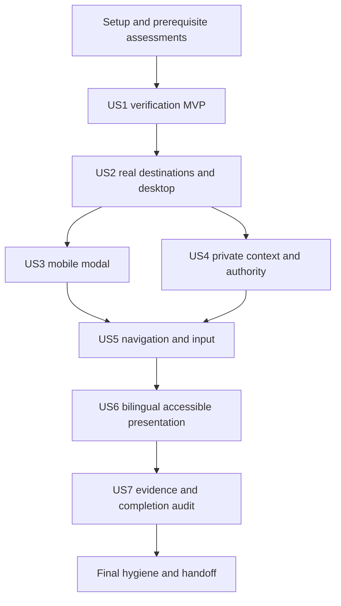

# Tasks: Application Shell Completion and Verification

**Input**: [spec.md](spec.md), [plan.md](plan.md), [research.md](research.md), [data-model.md](data-model.md), [runtime/navigation contract](contracts/runtime-and-navigation.md), [verification contract](contracts/verification-and-evidence.md) and [quickstart](quickstart.md).

**Prerequisites**: Read the constitution, current documentation and Feature 005 contracts referenced by the plan. This is a correction increment for the existing shell; preserve Feature 005 stable IDs/contracts and unrelated edits. Git checkout was `main` at task generation; the active feature directory is independent of branch naming.

**Tests**: Explicitly required by this feature. Add meaningful tests at actual imported boundaries and mounted browser assertions, not source-regex or imitation-state tests as substitutes. Capture the failing case before correcting it; if a required execution prerequisite is unavailable, record BLOCKED and leave the acceptance task unchecked. A historical failure is not a current reproduction.

**Status — 2026-11-02**: Local source corrections and evidence reconciliation complete; 50/65 tasks checked. Broad live/framework/browser/human acceptance remains BLOCKED/partial and unchecked. Current scope/results are in [evidence](evidence.md) and [completion audit](artifacts/completion-audit.md).

## Format: `[ID] [P?] [Story] Description`

- Every checkbox is one executable task with a stable sequential ID and concrete repository-relative file paths.
- `[P]` marks only the specific independent pairs described below. It is not permission to delegate, mutate shared files concurrently or run unverified targets.
- `[US1]`–`[US7]` map to the specification stories. Setup/foundation/final tasks have no story label.
- Each task uses the linked design's exact contracts, inputs and expected outcomes; implementation stays within the named existing owners.

## Path Conventions and Execution Rules

Paths below are relative to the repository root. Resolve filesystem operations against that root. `specs/006-shell-verification-completion/evidence.md` and named result artifacts are created during execution, not asserted to exist now. Browser working captures belong under `output/playwright/006/`; retain only inspected/sanitized evidence in the feature artifacts. Credential-bearing manifests/cookie jars/proof URLs remain outside the repository.

Use existing Next.js/React/shadcn/Base UI/next-intl/Neon/Better Auth and semantic tokens. Preserve `cacheComponents: true`, `partialPrefetching: true`, current private response/origin policy, service grants and capability gates. No new dependency, database schema/index/migration, navigation framework, protected browser persistence or auth/step-up capability is planned. Do not deploy, access production, send external messages or start client management.

**Evidence rule**: Every attempted command or interaction records exact source/build/lock/environment, tool/browser version, isolated fixture prerequisites, locale/theme/viewport/motion, actual exit/assertion outcome, evidence class and sanitized capture reference. PASS/FAIL/BLOCKED/SKIPPED/STALE stay distinct. Test completion requires an actual result; a completed preflight assessment may document missing prerequisites without approving dependent checks.

**Sequencing rule**: Setup/foundation are read-only assessment and evidence preparation. US1 diagnosis precedes application corrections. Later source work may proceed when an independent live/human acceptance task is blocked; leave that task and the story acceptance open. Shared-file implementation dependencies still apply. Final full-suite evidence is collected after source corrections; repeat only checks invalidated by a later change or unresolved failure.

## Phase 1: Setup (Shared Infrastructure)

**Purpose**: Establish the exact corrective scope without rebuilding existing infrastructure.

- [X] T001 Record checkout/HEAD, dirty-file hashes, package/lock/runtime identities and the active pointer from `.specify/feature.json` in `specs/006-shell-verification-completion/evidence.md`; read `specs/005-application-shell-sidebar/spec.md`, its plan/tasks/contracts/evidence/artifacts and root `plan.md`, preserve unrelated edits and classify old completion marks as unverified claims.
- [X] T002 Map actual callers, fixtures/config/exports and applicable skills in `specs/006-shell-verification-completion/evidence.md` using `AGENTS.md`, `docs/development/agent-skills.md`, `DESIGN.md` and the plan's source map; before framework edits read installed `node_modules/next/dist/docs/01-app/02-guides/preserving-ui-state.md`, `node_modules/next/dist/docs/01-app/02-guides/authentication-with-cache-components.md`, and installed template/Link/router guides. Preserve their Activity/remount/prefetch behavior rather than assuming older Next.js conventions.

## Phase 2: Foundational (Blocking Prerequisite Assessments)

**Purpose**: Establish safety and evidence rules for every story. Complete these assessments before story changes; missing live prerequisites block dependent checks rather than unrelated local work.

- [X] T003 Assign accountable execution owners and negative cases for the SEC groups in `specs/006-shell-verification-completion/contracts/verification-and-evidence.md`, recording the assessment in `specs/006-shell-verification-completion/artifacts/security-prerequisites.md`; review `docs/security/README.md`, the catalogue and release gate, match exact installed/lock/runtime/tooling versions to fresh advisories, and record unavailable scans/unknown managed or deployed versions as owned gaps without querying production or weakening activation gates.
- [X] T004 Inventory browser/fixture prerequisites in `specs/006-shell-verification-completion/artifacts/fixture-prerequisites.md`: check the existing user Playwright CLI wrapper/help/engine launch per `specs/006-shell-verification-completion/quickstart.md`, independently bind any authorized app/auth/database/runtime-role/synthetic-sink target, and identify A/B accounts/teams, non-member, Owner/Admin/Member, revoked grants/sessions and zero/one/>20 choices. Keep credentials/manifests outside the repo; missing tools/targets are named blockers, not proof from cache directories or an “isolated” manifest string.

**Checkpoint**: Baseline/evidence policy and prerequisite assessment exist. No application code or capability has changed. Do not require production access, new infrastructure or gate enablement to proceed with US1.

## Phase 3: User Story 1 — Trust Local Verification Before Continuing (Priority: P1, MVP)

**Goal**: Establish truthful verification and correct process diagnostics while preserving migration safety.

**Independent Test**: Run the actual full baseline and bounded synthetic help/invalid probes, then the focused migration tests in a supported execution context. Help/invalid selections have zero database access/effects or credential disclosure; process failures are explicit and existing safety assertions remain.

### Diagnosis and Tests

- [X] T005 [US1] Reproduce `npm run test:full` from the recorded source and retain actual command/exit/stage results in `specs/006-shell-verification-completion/artifacts/us1-baseline.log` and `specs/006-shell-verification-completion/evidence.md`; compare with planning logs without inheriting a pass, and mark stages after any early failure unexecuted.
- [X] T006 [US1] Run the bounded synthetic `spawnSync` diagnostic from `specs/006-shell-verification-completion/research.md` against `scripts/migrate.mjs`, recording child `error`, `signal`, `status`, stdout/stderr and execution boundary in `specs/006-shell-verification-completion/artifacts/us1-cli-diagnosis.md`; distinguish diagnostic-parent exit from child behavior, use the normal approval workflow for sandbox restrictions, and establish the root cause before changing source or assertions.

### Correction and Verification

- [X] T007 [US1] Harden all three child probes in `scripts/test-migrations.test.mjs` with a 10,000 ms per-child timeout and assertions for absent process error/unexpected signal before unchanged exit/output assertions; check every stdout/stderr stream for the synthetic secret and retain all existing ordering/checksum/direct-TLS/locking/transaction/rollback assertions. EPERM/timeout must fail truthfully, never skip or manufacture help.
- [X] T008 [US1] Resolve the demonstrated CLI or execution cause across `scripts/migrate.mjs`, `scripts/test-migrations.test.mjs` and its `package.json` callers: preserve the runner when supported same-source probes pass; only if a separate product defect reproduces, make the smallest root fix while preserving ordered/history-checked/locked execution, transactional rollback/cleanup and direct verified connections. Record either the verified correction or why no runner/package change is warranted in `specs/006-shell-verification-completion/artifacts/us1-cli-diagnosis.md`; never apply migrations to test help.
- [X] T009 [US1] Run `node --test scripts/test-migrations.test.mjs` after the correction in the supported execution context, retain meaningful before/after outcomes and all migration-safety results in `specs/006-shell-verification-completion/artifacts/us1-verification.md`, and update `specs/006-shell-verification-completion/evidence.md` with any remaining execution gap. The final full-suite rerun belongs to T056 after application changes.

**Checkpoint**: Verification cause and actual result are known; no weakened assertions or database mutation. This is the suggested MVP and does not approve shell behavior.

## Phase 4: User Story 2 — Reach Working Destinations in a Distinct App (Priority: P1)

**Goal**: Keep real destinations, truthful context and usable desktop navigation separate from public/authentication composition.

**Independent Test**: Open all three app destinations plus public/auth pages; traverse expanded/icon navigation by keyboard/pointer at desktop and short height; exercise personal profile without workspace availability and time visible navigation.

### Tests

- [X] T010 [P] [US2] Extend actual imported loader/context-handler tests in `scripts/test-application.test.mjs` for valid/expired/absent/unavailable identity, narrow projections, disabled/empty/restricted/unavailable workspace states and bounds; quote and assert “Current trusted session only; expiry finite and future.”, “Never project tokens/secrets.”, “One page, default 20/max 50.” and “Context is non-null only for a verified ready selection matching account/requested UUID.” Preserve `ApplicationAccount` `id/name`, optional `avatar`, `sessionExpiresAt`, existing choice fields and optional stable-code `error` without broadening private projections.
- [ ] T011 [P] [US2] Attempt mounted desktop/public/auth route and personal-account baseline cases from V2 using the verified fixture/tool, recording assertions and captures in `specs/006-shell-verification-completion/artifacts/us2-desktop.md`; cover active location, real content, no marketing/dead/fictional controls, expanded/rail/short-height access and workspace-independent own-profile read/update/live behavior. Record BLOCKED prerequisites without claiming HTTP/source checks proved interaction.

### Implementation and Verification

- [X] T012 [US2] Correct demonstrated projection/state/response gaps in `lib/application.ts` and `app/api/app/context/route.ts` using existing trusted services: retain the three capability booleans under “Derived from current server gates/support; not permission grants supplied by browser.”; disabled means zero workspace queries; preserve 200 valid-account context including workspace-only failure, 400 unexpected query, 401 invalid account and 503 account-authority outage, generic safe codes and private/no-store with merged `Vary: Cookie`. Preserve “Error is a stable code mapped to localized copy, not exception text.” and “Empty means successful zero authorized choices, not proven zero memberships.” Context GET performs no selection/domain effect.
- [X] T013 [US2] Correct only reproduced composition/truthfulness defects in `app/(site)/[locale]/[theme]/app/page.tsx`, `app/(site)/[locale]/[theme]/app/workspace/page.tsx`, `app/(site)/[locale]/[theme]/app/account/page.tsx`, `components/application-shell.tsx` and `components/application-overview.tsx`; keep Overview/Workspace/Personal account real, active title/breadcrumbs consistent and selected context hidden unless ready, while retaining public/auth layouts, existing services and own-profile independence.
- [X] T014 [US2] Correct expanded/icon rail and short-height desktop reachability in `components/application-shell.tsx`, `components/ui/sidebar.tsx`, `components/nav-user.tsx` and `components/workspace-switcher.tsx`; preserve accessible icon names/focus-hover tooltips, working toggle, skip/main/navigation landmarks and shared shell control variants, with destinations reachable in at most three activations. Reuse current localization keys and semantic tokens; no redesign or unfinished-module controls.
- [X] T015 [US2] Correct misleading anonymous-HTTP/source “browser” claims and stale procedures in `scripts/test-workspaces-browser.mjs`, `scripts/test-workspaces-browser.md` and `scripts/test-app-shell-browser.md` while preserving their CLI compatibility; label actual evidence scope and align expected layout, invitation privacy and explicit workspace selection with current contracts. Keep real mounted assertions and real authority checks separate.
- [ ] T016 [US2] Run the focused loader/site/profile tests and repeat the actual V2 desktop/personal journeys after corrections; collect at least 20 warm navigation samples through visible usable content or accurate actionable unavailable state, requiring at least 95% within two seconds, in `specs/006-shell-verification-completion/artifacts/us2-desktop.md` and `specs/006-shell-verification-completion/artifacts/navigation-performance.md`. Attribute source/device/network and preserve blocked checks; T056 revalidates results invalidated by later source changes.

**Checkpoint**: The desktop/destination slice has attributable results or explicit acceptance gaps; source presence, translation parity and an HTTP 200 do not check off the story.

## Phase 5: User Story 3 — Use Mobile Navigation Without Losing Control (Priority: P1)

**Goal**: Preserve modal focus/background behavior, useful dismissal and committed-navigation focus across layout changes.

**Independent Test**: Keyboard/pointer opening, Tab/Shift+Tab containment, background interaction/scroll attempts, Escape/visible close, successful navigation and breakpoint crossing leave no hidden focus/scroll locks.

### Tests

- [ ] T017 [US3] Attempt the actual mounted drawer cases before correction using `scripts/test-app-shell-browser.md`, recording focused assertions in `specs/006-shell-verification-completion/artifacts/us3-drawer.md`: opening, focus containment/restoration, visible close, background scroll/interaction, successful/cancelled navigation and 767/768/769 CSS-pixel resizing. Describe the failing observable case or blocked fixture rather than testing a standalone imitation modal.

### Implementation and Verification

- [X] T018 [US3] Correct modal composition and a visible accessible dismissal control in `components/ui/sidebar.tsx` and `components/ui/sheet.tsx` using existing Base UI behavior/focus APIs; preserve utility consumers with safe default labels and app-supplied localization, focus containment, inert/background blocking and scroll handling. Do not replace or regenerate the primitive framework.
- [X] T019 [US3] Correct layout-state cleanup and visible focus transfer in `components/ui/sidebar.tsx` and `hooks/use-mobile.ts`, preserving “Breakpoint stays 768 CSS pixels.” and “Expanded/collapsed state is memory-only; no authority/proof/private record is stored with it.” Resizing must close obsolete mobile state, release locks and reach an equivalent visible control; dismissal returns to the visible opener.
- [X] T020 [US3] Tie drawer closure and heading/main focus to observed successful finite-path commit in `components/application-shell.tsx`; distinguish dismissal from committed navigation, do not close merely because navigation was scheduled, and preserve current drawer/focus on same-path or cancelled transitions. Recheck authority-loss closure after US4 and dirty-navigation behavior after US5 without duplicating their coordinators.
- [X] T021 [US3] Make only reproduced narrow/short-viewport fitting and focus-visibility corrections in `components/application-shell.tsx`, `components/ui/sidebar.tsx` and `app/globals.css`, retaining shared tokens/variants and accessible essential controls; no invisible overlay, essential-control clipping or page-level horizontal overflow is allowed.
- [ ] T022 [US3] Repeat the mounted drawer suite in `specs/006-shell-verification-completion/artifacts/us3-drawer.md`, asserting actual active element, background inertness/scroll and post-dismiss/commit/resize cleanup; record source/build/browser/viewport and gaps. Revisit authority/cancel cases at T046/T053 when those later owners are corrected, leaving final acceptance open until that integration proof exists.

**Checkpoint**: Mobile primitives can be tested independently of business writes. Final authority/dirty-navigation integration remains explicitly dependent on US4/US5.

## Phase 6: User Story 4 — Keep Private Context Correct Across Transitions (Priority: P1)

**Goal**: Make the existing runtime the sole private-context owner, preserve current service grants and prevent stale data/actions/proof from crossing lifetimes.

**Independent Test**: Use distinguishable A/B synthetic workspaces/accounts, non-member and removed-grant fixtures; exercise delayed reads/mutations, at least 20 switches, direct denial, expiry/restore/sign-out and bounded explicit invitation acceptance. Zero forbidden fields/effects or stale private reveal.

### Tests

- [X] T023 [P] [US4] Add failing actual action/service/HTTP-boundary cases in `scripts/test-application.test.mjs` and `scripts/test-workspaces.test.mjs` for select/clear validation, current identity/grants, original-target/replay safeguards and disabled entry points; clear input is required, nonempty and at most 4096 UTF-8 bytes, accepts a bounded malformed stale selector, leaves mismatched cookies untouched and requires a fresh account. Mocked adapters prove only these imported contracts, not real isolation or browser lifetime.
- [ ] T024 [P] [US4] Prepare and attempt deterministic mounted race/lifecycle/proof regressions in `specs/006-shell-verification-completion/artifacts/us4-private-context.md` using the existing CLI/procedure: delayed initial/manual/page/mutation results, actor/requested-team mismatch, unchanged expiry, returned/thrown sign-out errors, Activity/Back/Forward restore and invitation hashchange/redirect races. Record controlled-transport scope and missing prerequisites; never substitute the generation-counter model from `scripts/test-application.test.mjs`.

### Implementation

- [X] T025 [US4] Tighten selectors/clearing in `app/workspace-actions.ts` and the selected-context path in `lib/application.ts` using exported `validateUUID` from `lib/workspaces.ts`; make `clearWorkspaceSelectionAction(expectedWorkspaceId: string)` authenticated and bounded to nonempty/4096 UTF-8 bytes, conditionally delete only the matching cookie and keep existing ActionResult/cookie policy. Runtime must re-read context after every result; do not promise atomic cross-tab response-cookie comparison or grant authority through an echoed selector.
- [X] T026 [US4] Correct private lifecycle/recovery ownership in `components/application-runtime.tsx`: request generation remains “Monotonic in-memory invalidation for reads/completions; grants no authority.”; add separate `teamEpoch`, which is “Distinct from request generation: an ordinary successful same-actor/same-team recheck must not erase valid unsaved input.” Conceal/inert before uncertain authority or restored paint, invalidate/abort on Activity/pagehide/cleanup, coalesce one recheck with 15-second timeout, rearm unchanged expiry and retain one 55-second visible-tab account loop; render non-private progress/retry outside hidden content under “Contains no private account/workspace records.” and never reveal stale server children solely from cached bootstrap or a context response.
- [X] T027 [US4] Correct `switchWorkspace`, `clearSelection` and choice pagination in `components/application-runtime.tsx`: retain collection states `loading/ready/empty/disabled/unavailable` and selection states `unselected/checking/ready/restricted/unavailable/disabled`; acquire one select/clear write guard before awaiting under “No concurrent select/clear writes from shell/panel; additional requests while busy return false without starting another write.”, clear old `context` while checking and accept only mounted/current-generation, matching-actor/future-expiry/requested-workspace context. Scope page completions to actor/generation/cursor, deduplicate IDs, prevent overlapping page reads and preserve valid choices with localized retry on page failure; no silent retarget or false empty/success.
- [X] T028 [US4] Connect `components/workspace-panel.tsx` and its sole caller `app/(site)/[locale]/[theme]/app/workspace/page.tsx` to verified runtime selection/capabilities/choices rather than independently seeded private state; key the team-private subtree by actor/verified workspace/teamEpoch and route every create/select follow-up through runtime switching. Preserve existing forms/services, “Current membership/grants intersect role ceilings and gates; display role is never authority.”, and explicit restricted/unavailable/disabled/no-selection outcomes.
- [X] T029 [US4] Guard every initial/manual/mutation-follow-up member/invitation read and private completion in `components/workspace-panel.tsx` by captured actor/workspace/teamEpoch, clearing obsolete lists/dialogs/targets and disposing existing subscriptions where applicable. Preserve each command's operation ID, original workspace/resource target, expected revisions and canonical intent under “Retain through retries/unknown outcomes; selection cannot retarget it.” Keep valid dirty settings on ordinary revision changes for existing conflict handling; revoke authority without a discard prompt overriding security.
- [X] T030 [US4] Share runtime account readiness/lifecycle in `components/live-profile.tsx` and `app/(site)/[locale]/[theme]/app/account/page.tsx`, preserving existing `Envelope` fields `userId/sessionExpiresAt/initialData/sealedQuery`, `Draft` fields `userId/name/dirty`, and “Exactly one own row and current actor/seal checks. Workspace state does not gate personal access.” Remove only the duplicate general account loop; keep profile-specific seal renewal, same-actor recoverable input and subscription cleanup before private reveal, with no workspace dependency.
- [X] T031 [US4] Correct runtime sign-out and reuse it from `components/live-profile.tsx` and `components/nav-user.tsx`: one in-flight request, conceal/dispose first, inspect both resolved `result.error` and thrown failure, clear fragment on confirmed success, and show localized retry/revalidation outside hidden private content on failure. Do not set ready or redirect as a false success; keep failure input/privacy behavior truthful in `components/application-runtime.tsx`.
- [X] T032 [US4] Export the early invitation provider from `components/workspace-invitation.tsx` and mount it in `app/(site)/[locale]/[theme]/app/layout.tsx` before private template loading; retain the states `absent/captured/malformed/awaiting-authority/actionable/disabled/unavailable/accepting/accepted/rejected`, at most one bounded memory-only proof and no private workspace DTO. Preserve history state, scrub before decode and apply “reject >4096 raw or >1024 decoded characters and malformed encoding safely.”
- [X] T033 [US4] Correct explicit gated acceptance, malformed/lost-proof guidance and cleanup in `components/workspace-invitation.tsx`, with current actor/workspace/invitation capability required and server recipient authority unchanged. Preserve “Acceptance captures proof and operation ID once; new hash cannot replace an in-flight operation.” Clear proof on dismissal/consumption/denial/identity/route/preference exit, dispose timers/listeners and retain original intent for supported uncertain-result reconciliation; no autojoin, speculative private detail, persistence, delivery or new-ID retry.
- [X] T034 [US4] Preserve and correct any reproduced early/streamed fragment-clearing exit gaps in `app/(site)/[locale]/[theme]/app/template.tsx`, `components/application-runtime.tsx`, `components/workspace-invitation.tsx` and `app/(utility)/auth/callback/page.tsx`; keep current finite return validation and explicit empty-fragment redirects when hydration loses the race. Proof must never reach query/return/callback data, persistent stores, logs, analytics or captures, and disabled credentials/invitations/ownership/unsupported step-up remain enforced directly as well as in UI.

### Verification

- [ ] T035 [US4] Run focused actual application/profile/workspace tests for T025–T034 and extend only missing real authority cases in `scripts/test-workspaces-postgres.mjs`; inspect the restricted-role/target guard before live execution, preserve existing transaction/receipt/audit/outbox safeguards and distinguish source self-check, adapters, direct SQL probes and actual session/service proof in `specs/006-shell-verification-completion/artifacts/us4-service-contracts.md`.
- [ ] T036 [US4] Execute mounted V4/V6 regressions from T024, including at least 20 alternating A/B switches with reversals, cross-tab selector changes, delayed page/list/mutation completions, removed grants, identity replacement, expiry, foreground/pagehide/pageshow/Activity/history and returned/thrown sign-out failure; record zero stale/forbidden reveal and original targets in `specs/006-shell-verification-completion/artifacts/us4-private-context.md`. Include proof redirect/hashchange/invalid-recipient cases and independent personal read/update/live under workspace-only failure; leave unexecuted cases open.
- [ ] T037 [US4] Against only the independently verified authorized synthetic target, execute actual direct session/service/action denial, revoked-grant/membership/replay, lower-role/foreign-ID, final-owner, transaction/rollback/role/pool-isolation and enabled recipient-acceptance cases through the reviewed `scripts/test-workspaces-postgres.mjs`/existing service boundaries; record actual effects/results or exact blocked coverage in `specs/006-shell-verification-completion/artifacts/us4-isolated-authority.md`. A manifest/schema self-check, local mock or disabled unsupported flow is not a passing live journey; no gate activation, production or external mail.

**Checkpoint**: One private-context owner and current service authority are corrected at their boundaries. Real isolated acceptance and mounted privacy checks remain separate; missing prerequisites do not certify G1–G6/AP-01–05.

## Phase 7: User Story 5 — Preserve Destination and Unsaved Input (Priority: P1)

**Goal**: Cancel before any destructive transition, then resume exactly once only after confirmation while preserving finite safe destinations.

**Independent Test**: Edit actual profile/team forms; cancel and confirm link/selection/preferences, including two dirty forms and modified clicks; exercise direct/refresh/Back/Forward/auth/presentation/hostile returns with sensible focus and no proof forwarding.

### Tests

- [X] T038 [P] [US5] Extend actual finite-return/preference/auth contract tests in `scripts/test-site.test.mjs` and `scripts/test-auth-contract.test.mjs` for all three app destinations, external/duplicate/query/fragment/malformed returns, exact unique fields, 2048-byte preference/query bounds and empty-fragment sign-in resumption; retain same-origin protection and do not broaden public aliases or add arbitrary return URLs.
- [ ] T039 [P] [US5] Attempt mounted failing cancel/discard/resume cases against existing forms/links in `specs/006-shell-verification-completion/artifacts/us5-navigation.md`, asserting unchanged URL/selection/preferences/input/drawer/focus, zero preference POST after cancel, no first-form discard when the second cancels, single confirmed resume and normal modified/new-tab behavior. Use real rendered controls and current browser refs, not source-text timing assertions.

### Implementation and Verification

- [X] T040 [US5] Extend the existing runtime dirty coordinator in `components/application-runtime.tsx` with the required handler `discard(): void` alongside `isDirty()` and optional `confirmDiscard(): Promise<boolean>`, preserving “Confirm every affected form before discarding any.” Add `navigate(destination: AppDestination | "/"): Promise<boolean>` with finite validation, synchronous caller cancellation, one confirmed resume and explicit public fragment clearing; false means cancelled/rejected, true means scheduled rather than committed. Do not introduce a navigation wrapper/package or discard any form before all confirmations agree.
- [X] T041 [US5] Register actual profile/create/settings/invite dirty forms in `components/live-profile.tsx` and `components/workspace-panel.tsx` with the existing runtime; preserve the required handler/cleanup contract “Register actual current forms; unregister on hide/unmount.” Clear on save/explicit discard, preserve valid same-actor input on recoverable failure and reset Activity-retained drafts after confirmed discard without overriding authority-loss disposal.
- [X] T042 [US5] Route every shell/breadcrumb/account-menu/overview/switcher exit in `components/application-shell.tsx`, `components/nav-user.tsx`, `components/application-overview.tsx` and `components/workspace-switcher.tsx` through shared `navigate` using synchronous `Link.onNavigate` prevention and one explicit resume; keep modified/new-tab browser behavior, same-path handling and disabled private speculative prefetch. Preference forms must prevent default and capture the form before awaiting, then natively submit once only after confirmation, with no requestSubmit recursion or preference POST on cancel.
- [X] T043 [US5] Correct only reproduced finite-return/auth/preference propagation defects across `lib/site.ts`, `proxy.ts`, `app/api/preferences/route.ts`, `components/auth-entry-page.tsx`, `components/auth-interactive-panel.tsx`, `components/auth-email-form.tsx`, `components/sign-in.tsx` and `app/(utility)/auth/callback/page.tsx`; preserve the exact existing route sets, unique/2048-byte bounds, origin/cookies/303 contracts, authorized workspace revalidation and proof-free empty-fragment exits. Passing existing behavior needs no rewrite.
- [X] T044 [US5] Integrate current-authority browser/history restoration with committed-navigation drawer closure/heading focus in `components/application-runtime.tsx` and `components/application-shell.tsx`; preserve direct/refresh/Back/Forward destination and sensible keyboard focus under production Cache Components/Activity. Do not infer fresh authority from template remount or expose stale private children after a route-context recheck.
- [X] T045 [US5] Preserve in-memory failed-save input and add only needed localized reload/closure-loss guidance/best-effort dirty warning in `components/live-profile.tsx`, `components/workspace-panel.tsx`, `components/application-runtime.tsx`, `messages/en.json` and `messages/ar.json`; do not claim durable browser saves or guaranteed close prompts, and clear dirty state before a confirmed native preference/public exit to avoid duplicate prompts.
- [ ] T046 [US5] Run the focused return/auth tests and mounted V5 cases from T039, then recheck US3 drawer cancellation/commit and US4 proof/authority integration in `specs/006-shell-verification-completion/artifacts/us5-navigation.md`; prove every cancelled transition retains input/context and every confirmed authorized transition resumes once with correct destination/focus. Record actual Back/Forward/auth/language/theme results and precise blocked cases.

**Checkpoint**: All shell-owned transition callers share one real cancellation/resume contract. Merely showing a confirmation or matching return-path source text cannot complete this story.

## Phase 8: User Story 6 — Work in Either Language Across Screen and Theme Changes (Priority: P2)

**Goal**: Complete accessible visible text, RTL and theme/viewport behavior without replacing shared design conventions.

**Independent Test**: Exercise every shell state in English/Arabic × Light/Dark/System, System changes/reduced motion, long/mixed-direction data, all required viewport/reflow/zoom cases, plus separately attributable human accessibility and fluent-Arabic review.

### Tests

- [X] T047 [P] [US6] Inventory rendered/source shell-owned visible/accessibility strings and failing state fixtures in `specs/006-shell-verification-completion/artifacts/us6-presentation.md`, including runtime/template outage/retry, discard, role/status, Sidebar/Sheet toggle/title/description/close and loading/empty/restricted/disabled/unavailable states. Preserve canonical IDs; record mounted coverage gaps instead of equating source inventory with language acceptance.
- [X] T048 [P] [US6] Extend actual message-format/ICU tests in `scripts/test-site.test.mjs` and the relevant checks in `scripts/check-translations.mjs` for every added shell key and parameters in both catalogs, running them before copy integration to expose missing coverage; retain stable IDs and existing plural/parameter conventions, and label these checks as formatting/parity rather than mounted or fluent-language proof.

### Implementation and Verification

- [X] T049 [US6] Localize all identified shell text through existing message namespaces in `messages/en.json`, `messages/ar.json`, `components/application-runtime.tsx`, `components/application-shell.tsx`, `components/application-overview.tsx`, `components/workspace-switcher.tsx`, `app/(site)/[locale]/[theme]/app/template.tsx`, `components/ui/sidebar.tsx` and `components/ui/sheet.tsx`; map role/status/error codes to labels instead of raw canonical values/server exceptions and keep primitive utility defaults compatible. Cover every inventory state, not only happy-path navigation.
- [X] T050 [US6] Correct reproduced Arabic side/portal direction, logical spacing/alignment, appropriate chevrons/menu opening and long/mixed-direction name/identifier isolation in `components/application-shell.tsx`, `components/nav-user.tsx`, `components/workspace-switcher.tsx`, `components/application-overview.tsx` and `components/ui/sidebar.tsx`; retain shared DirectionProvider/token conventions and canonical identifiers, with coherent DOM/keyboard/reading order rather than ad hoc reversed tab order.
- [X] T051 [US6] Verify and correct only reproduced Light/Dark/System live device-theme and reduced-motion defects in `app/(site)/[locale]/[theme]/layout.tsx`, `app/globals.css` and the shell primitives, using existing theme policy rather than adding another theme controller; explicit themes stay selected, System follows device changes and validated destination/workspace are preserved. Record source/device/media observations in `specs/006-shell-verification-completion/artifacts/us6-presentation.md`.
- [ ] T052 [US6] Correct measured clipping/overflow/obscured focus/affected contrast in `components/application-shell.tsx`, `components/ui/sidebar.tsx`, `components/ui/sheet.tsx` and `app/globals.css` using shared semantic tokens/variants and 44px shell controls; preserve the supplied palette and disclose remaining design gaps. Check phone/tablet/desktop/short height, 320 CSS-pixel reflow and actual 200% browser zoom without treating deviceScaleFactor as zoom.
- [ ] T053 [US6] Run mounted V2/V3/V5/V7 primary-state journeys in both languages × all three themes at 390×844, 768×1024, 1280×800, 1440×900, short 1280×480, 320 CSS-pixel reflow and actual 200% zoom; exercise live System changes/reduced motion and core journeys in available Chromium/Firefox/WebKit. Record actual readable text/RTL/focus/overflow/controls and sanitized captures in `specs/006-shell-verification-completion/artifacts/us6-presentation.md`; engine/device/matrix reductions remain named gaps, not inferred passes.
- [ ] T054 [US6] Obtain actual human keyboard/screen-reader/focus/contrast/zoom review of the corrected journeys against the shared WCAG 2.2 AA target, recording reviewer, assistive technology/browser/device, source, observations and unresolved defects in `specs/006-shell-verification-completion/artifacts/accessibility-review.md`; automation/screenshots do not complete this task, which remains unchecked if a required human review is unavailable.
- [ ] T055 [US6] Obtain actual fluent-Arabic review of visible/accessibility states, confirmations, roles/statuses, mixed-direction names and keyboard/reading order, recording reviewer/source/coverage/corrections in `specs/006-shell-verification-completion/artifacts/arabic-review.md`; machine translation/parity cannot sign off, and unavailable review stays unchecked with an exact gap.

**Checkpoint**: Automated presentation results and human approvals have separate evidence. The story stays partially accepted while required human, engine/device or state coverage is missing.

## Phase 9: User Story 7 — Trust Completion Records and the Next-Work Decision (Priority: P2)

**Goal**: Attribute every completion claim to the final source and unchanged feature/dependency contract.

**Independent Test**: Audit V1–V9 and original/root records against actual command/interaction/reviewer artifacts; partial parents stay open, stable IDs/totals agree and NEXT-05 readiness is explicit without starting clients.

### Tests and Final Evidence

- [ ] T056 [P] [US7] After relevant application corrections settle, run `npm run test:full`, scoped running-target HTTP supplements and final mounted acceptance/timing checks that were not yet run or were invalidated, retaining source/build identity and exact stage/exit outcomes in `specs/006-shell-verification-completion/artifacts/final-verification.md`; require current ≥20 warm visible-content samples with ≥95% within two seconds, and distinguish controlled transport/anonymous HTTP/local mocks from real isolated authority and human results. Do not repeat already-current checks merely to increase test volume.
- [X] T057 [P] [US7] Finalize exact-version advisory/component/SEC/release-gate review in `specs/006-shell-verification-completion/artifacts/security-review.md`, reusing T003 scans only when still current/applicable and rerunning only invalidated review; match package/lock/runtime/tooling and known managed/deployed scope without production access. Keep failed/unavailable scans, unknown applicability and unverified G1–G6/AP-01–05 as owned findings; any necessary source correction invalidates affected T056 evidence before a completion claim.

### Reconciliation and Verification

- [X] T058 [US7] Reconcile `specs/006-shell-verification-completion/evidence.md` and dated corrective entries in `specs/005-application-shell-sidebar/plan.md`, `specs/005-application-shell-sidebar/tasks.md` and `specs/005-application-shell-sidebar/evidence.md` from actual artifacts, preserving stable IDs/history and reopening unsupported completion. Use “PASS”, “FAIL”, “BLOCKED”, “SKIPPED” and “STALE” distinctly; each record names requirement/SC/SEC IDs, owner, source/build/lock/environment/fixture identities, command/interaction/result/class, sanitized capture and exact gap. Preserve “Never store credential-bearing manifests, cookie jars, auth headers, invitation URLs or unsanitized traces in the repository.”
- [X] T059 [US7] Refresh root `plan.md` inventory, completion ledger, completed subtasks, totals and immediate next-work section together using T056–T058 evidence; check full features only against their complete unchanged contract/dependencies, leave partial parents and unmet human/live/release acceptance open, preserve all stable feature/requirement IDs/unrelated edits and do not shrink F04.01/NEXT-04 to fit the shell.
- [X] T060 [US7] Write the explicit client-management readiness assessment and exact changed feature/subtask IDs in `specs/006-shell-verification-completion/artifacts/completion-audit.md`, comparing root `plan.md` NEXT-01–04 gates and NEXT-05 dependency with remaining dashboard/search/timer/notices, command/recovery, authorization/delivery and release work. Report unverified prerequisites as unestablished readiness, not completed by shell implication; do not implement clients or new business controls.
- [X] T061 [US7] Audit all 33 FRs/12 SCs, V1–V9 evidence classes, Feature 005 task claims and root `plan.md` counts/dependencies against attributable results in `specs/006-shell-verification-completion/artifacts/completion-audit.md`; reject screenshot/HTTP/parity/model summaries as substitutes and human passes without actual review, then correct unsupported records while preserving provenance. Every remaining gap names scope/reason/owner; no duplicate shell completion is counted for Feature 006.

**Checkpoint**: Completion records are trustworthy even when incomplete. A passing local suite or a finished corrective task list does not approve broader product/release gates.

## Phase 10: Polish & Cross-Cutting Concerns

**Purpose**: Validate the final records and handoff without speculative refactors or unnecessary repeated test runs.

- [X] T062 Validate local links, task/requirement IDs, source-path references, exact field/enum/limit contracts, totals and downstream feature resolution across `specs/006-shell-verification-completion/tasks.md`, its design/evidence artifacts and updated root/Feature 005 records; run `git diff --check` plus explicit untracked-document checks and record actual documentation results in `specs/006-shell-verification-completion/artifacts/task-validation.md`.
- [X] T063 Inspect all retained working captures/traces and committed references in `output/playwright/006/`, `specs/006-shell-verification-completion/artifacts/` and `specs/005-application-shell-sidebar/artifacts/` for credentials, invitation proof, auth headers/cookie jars and unnecessary private data; retain only sanitized minimum evidence, keep credential manifests outside the repo and record inspection scope/gaps in `specs/006-shell-verification-completion/artifacts/completion-audit.md` without copying secret values into findings.
- [X] T064 If the final audit exposes a source correction or an invalidated check, resolve it at its existing owning task/file and rerun only affected focused/integration/full gates, then reconcile `specs/006-shell-verification-completion/evidence.md`, Feature 005 records and root `plan.md`; otherwise record that current accepted checks remain valid rather than rerunning them. No unresolved failure/unavailable prerequisite may become a pass to close the list.
- [X] T065 Produce the final self-contained handoff from `specs/006-shell-verification-completion/artifacts/completion-audit.md`: corrected behavior, actual passed/failed/blocked checks, exact root feature/subtask marks, remaining acceptance gaps/reasons and NEXT-05 readiness; confirm preserved stack, gated capabilities and absence of deployment/production access/external messages/client implementation. Leave unfinished task boxes unchecked and state any remaining risk.

## Dependencies & Execution Order

### Phase and Story Dependencies

Setup T001–T002 → prerequisite assessments T003–T004 → US1 diagnosis/correction T005–T009. No application correction precedes US1 diagnosis. US2 establishes corrected loader/destination/desktop contracts; US3's modal changes can be verified without business writes. US4 establishes the private-lifetime interfaces consumed by US5. US6 follows functional source owners; US7 follows all available corrected-source evidence. Final records/handoff follow US7.

| Story | Required entry state                                                                    | Independent acceptance and later integration                                                                                               |
| ----- | --------------------------------------------------------------------------------------- | ------------------------------------------------------------------------------------------------------------------------------------------ |
| US1   | Setup/foundation assessments                                                            | CLI/help/invalid/no-DB/safety tests; MVP. No other story needed.                                                                           |
| US2   | US1 diagnosis and supported local verification                                          | Actual loader/route/desktop/profile scope; final source timing recaptured only if invalidated.                                             |
| US3   | US2 working destinations                                                                | Modal/focus/scroll/resize independent of team writes; authority/cancel integrations completed at T046/T053.                                |
| US4   | US1 plus US2 loader/projection contracts; serialize edits after US3 for shared UI files | Controlled mounted context/lifecycle cases plus separately authorized real service evidence; no US5 dependency for core private lifetime.  |
| US5   | US4 runtime/panel/profile ownership and US3 commit/dismiss semantics                    | Real form cancel/discard/return/history cases; no new private state engine.                                                                |
| US6   | Functional US2–US5 interfaces integrated                                                | Bilingual/theme/responsive cases and separate human approvals; missing live/human checks do not forbid independent copy/style corrections. |
| US7   | All relevant source changes settled and available story evidence collected              | Full-contract completion audit; unavailable acceptance stays open in records.                                                              |

The graph shows logical source interfaces, not blanket permission to run every branch concurrently. Default execution follows ascending task IDs because runtime/shell/panel/profile files recur. Story verification tasks can remain BLOCKED while an independent source correction proceeds; no blocked story is marked accepted. T056/T057 depend on settled source, not a fictional human/live pass.

### Within Each Story

Read its goal/independent test and linked contract, reproduce its actual failing case or document prerequisite failure, implement at existing owners, then run its verification task. Preserve relevant validation/error handling and every affected caller/fixture. Avoid changes justified only by a source assertion or previously checked task. Never queue/mutate another workspace to make a UI test succeed.

### Parallel Opportunities and Examples per Story

Only these ten marked tasks form five safe pairs, after the pair's phase-entry prerequisites are complete. Each pair writes disjoint files; do not run implementation alongside a probe that relies on unchanged source.

| Story | Safe example / constraint                                                                                                                                                                                                                                          |
| ----- | ------------------------------------------------------------------------------------------------------------------------------------------------------------------------------------------------------------------------------------------------------------------ |
| US1   | No parallel pair: T005 baseline → T006 process diagnosis → T007–T008 correction → T009 focused proof share the CLI cause/test boundary.                                                                                                                            |
| US2   | T010 imported Node loader/handler tests in `scripts/test-application.test.mjs` alongside T011 mounted baseline journal in `artifacts/us2-desktop.md`; both precede T012 corrections.                                                                               |
| US3   | No parallel pair: T017 mounted failing case precedes T018–T021 shared Sidebar/Sheet/shell changes; T022 validates their combined behavior.                                                                                                                         |
| US4   | T023 direct action/service tests in the application/workspace test files alongside T024 mounted fault journal in `artifacts/us4-private-context.md`; both precede runtime/service changes.                                                                         |
| US5   | T038 finite auth/preference tests in site/auth test files alongside T039 mounted cancellation journal in `artifacts/us5-navigation.md`; both precede shared coordinator/caller changes.                                                                            |
| US6   | T047 text/state inventory in `artifacts/us6-presentation.md` alongside T048 message-format tests in site/translation scripts; both precede catalog/UI changes.                                                                                                     |
| US7   | T056 current-source validation artifacts alongside T057 read-only advisory/release review in `artifacts/security-review.md`; neither may mutate source while final evidence is collected. A discovered fix pauses reconciliation and invalidates affected results. |

No cross-story parallel mutation of `components/application-runtime.tsx`, `components/application-shell.tsx`, profile/panel files or locale catalogs is safe without an explicit disjoint ownership review. Tool concurrency is not delegation authorization; follow the current session's permission rules.

## Requirement and Outcome Coverage

| Spec requirements                 | Owning tasks                                           | Acceptance outcome                                                      |
| --------------------------------- | ------------------------------------------------------ | ----------------------------------------------------------------------- |
| FR-001                            | T001–T006                                              | Baseline/source preservation; SC-001/012                                |
| FR-002                            | T006–T009                                              | No-DB help/invalid and disclosure denial; SC-001                        |
| FR-003                            | T007–T009                                              | Migration safety/assertions retained; SC-001                            |
| FR-004                            | T009/T016/T022/T035–T037/T046/T053/T056/T064           | Focused and final current checks; SC-001–012 as applicable              |
| FR-005–006                        | T010–T013/T015–T016                                    | Real destinations/layout/truth; SC-002                                  |
| FR-007                            | T014/T016/T052–T053                                    | Desktop labels/short-height ≤3 activations; SC-003                      |
| FR-008–009                        | T017–T022/T031/T044/T046/T053                          | Modal/focus/resize/authority/cancel; SC-004                             |
| FR-010–011                        | T034/T038/T043–T044/T046                               | Finite browser/auth/presentation return; SC-007                         |
| FR-012–013                        | T039–T042/T045–T046                                    | All-or-nothing cancel/discard and memory recovery; SC-007               |
| FR-014–015                        | T010–T013/T027–T030/T036–T037                          | Profile independence and truthful bounded workspace states; SC-006      |
| FR-016–017                        | T025–T030/T036–T037                                    | No stale team/account reveal or retargeted command; SC-005/006/008      |
| FR-018                            | T023/T025/T029/T035/T037                               | Current direct authorization and replay denial; SC-006                  |
| FR-019–020                        | T024/T026/T030–T031/T036/T044                          | Expiry/history/identity/sign-out; SC-008                                |
| FR-021–023                        | T003–T004/T032–T034/T036–T037/T063                     | Bounded explicit proof, privacy and effective gates; SC-006/009         |
| FR-024–027                        | T047–T055                                              | Complete languages/themes/motion/RTL/reflow/zoom/human review; SC-010   |
| FR-028–029                        | T004/T011/T016–T017/T022/T024/T035–T039/T046/T053/T056 | Mounted vs real-service evidence kept distinct; SC-002–011              |
| FR-030–031                        | T003/T054–T058/T061/T063                               | Current attributable evidence/human/advisory gaps; SC-010/012           |
| FR-032–033                        | T058–T065                                              | Full unchanged contract/ledger/readiness audit; SC-012                  |
| SC-011 retained navigation target | T016/T056                                              | ≥20 visible-content samples, ≥95% ≤2 seconds on final applicable source |

V1–V9 suite ownership: V1 US1/T056; V2 US2/T053; V3 US3/T046/T053; V4 and V6 US4/T046; V5 US5; V7 US6; V8 T016/T056; V9 US7/final audit. Selected SEC ownership and exact negative cases remain in the verification contract and T003/T057 results.

## Implementation Strategy

### MVP First — US1 Only

Complete T001–T009. Deliver trustworthy current local verification with bounded process diagnostics and preserved migration safeguards. Stop for this scope's independent verification if needed; this MVP does not establish browser/tenant/release acceptance, enable capabilities or authorize deployment.

### Incremental Delivery

Continue through existing desktop destinations, mobile modal, private lifecycle, input/navigation, bilingual presentation and completion records. Correct only reproduced gaps, using current house components/services. New runtime contracts are introduced at their owning story before consumers. Record story-specific actual results continuously; postpone full-current-source gate to T056 rather than repeating it after every small edit.

If isolated fixtures, a browser engine or a human reviewer is unavailable, continue independent corrections, name precise gaps and retain incomplete task/story acceptance. When source changes after an accepted result, rerun the affected checks and refresh provenance before using that result. Finishing this corrective increment never silently completes broader root contracts or NEXT-05 prerequisites.

### Task Counts and Generation Validation

| Group      | Tasks     | Count |
| ---------- | --------- | ----- |
| Setup      | T001–T002 | 2     |
| Foundation | T003–T004 | 2     |
| US1        | T005–T009 | 5     |
| US2        | T010–T016 | 7     |
| US3        | T017–T022 | 6     |
| US4        | T023–T037 | 15    |
| US5        | T038–T046 | 9     |
| US6        | T047–T055 | 9     |
| US7        | T056–T061 | 6     |
| Final      | T062–T065 | 4     |
| Total      | T001–T065 | 65    |

Generation checks must verify 65 unique sequential unchecked IDs, story labels only in story phases, ten `[P]` markers restricted to the five disjoint pairs, exact paths/contracts, coverage of all seven stories/33 FRs/12 SCs, required template sections, no unresolved placeholders, valid local document links, unchanged input/source files and active Feature 006 resolution. Before/after task hook configuration is absent at generation; recheck before completion. No runtime/application tests are rerun solely to generate this document.

**Generation result — 2026-11-02**: Setup/template resolution, inline format/path/coverage/preservation assertions and downstream `check-prerequisites.sh --require-tasks --include-tasks --json` completed with exit 0. All 65 tasks remain unchecked; their required labels, file paths, five parallel pairs and seven independent acceptance criteria validate. Existing source, design inputs, Feature 005/root records and active pointer are preserved byte-for-byte. Post-generation `.specify/extensions.yml` check found no registered hooks. This records task-document quality only; no implementation, runtime, live-database or human acceptance was performed.
