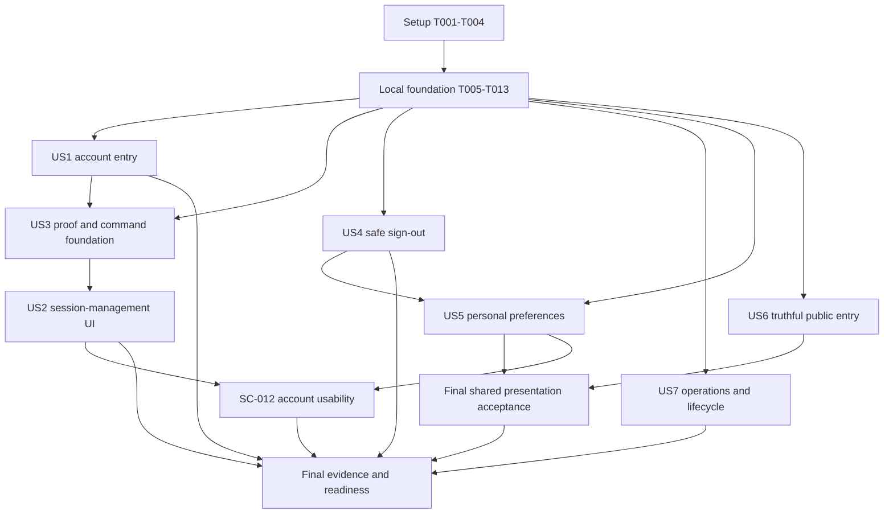

# Tasks: Phase One Account and Public Entry Completion

**Input**: [spec.md](spec.md), [plan.md](plan.md), [research.md](research.md), [data-model.md](data-model.md), [account contracts](contracts/account-services.md), [presentation contract](contracts/presentation-and-public.md), [security contract](contracts/security-and-release.md), [quickstart.md](quickstart.md) and the project constitution.

**Scope**: Only current root-plan Phase 01: 11 product and 14 scoped supporting entries, 35 functional requirements, 12 success criteria and the five confirmed decisions. Preserve existing user work, selected stack and valid implementation; do not scaffold, add dependencies, activate later features or reinterpret unchecked parents as missing foundations.

**Tests**: Included because the specification explicitly requires positive, denied, failure, race, real-provider, real-PostgreSQL, browser and human acceptance. Add meaningful regression assertions before changing nontrivial behavior, observe the relevant failure, then fix the shared cause. A mock/source result cannot satisfy a real-service or human task. All tasks start unchecked.

## Current implementation checkpoint — 3 November 2026

This continuation completed T038, T046, T048, T082, T083, T084 and T085. See [implementation-resume.md](artifacts/implementation-resume.md) for scope, source identity, actual checks and blockers. T047/T049–T052/T086 have partial local changes/evidence and remain unchecked; provider, full framework/browser and human acceptance are not inferred.

Earlier marks for T016, T017, T018, T019, T020, T023, T024, T028, T030, T031, T035 and T036 were reopened because their required approval, G1 or live G5 evidence is absent. Existing code, migration drafts and historical local evidence were preserved. Checked local code/investigation tasks do not pass G1–G6 or story acceptance. The user confirmed no owner-verified target/evidence is available in this chat. No checklist markers were changed.

The next continuation completed local preference tests T068 and corrected the existing T070 service draft's authority, creation-conflict, revision and unknown-commit handling. T070 remains unchecked for gated persistence/acceptance. See [preferences-local.md](artifacts/preferences-local.md): 104 Node tests plus six email tests pass; the full lint gate still fails and existing workspace type errors remain. No preference endpoint/UI or collection was activated.

## Format and execution rules

Task paths are repository-relative; the feature directory is `specs/007-phase-one-completion`. `Depends:` names code/evidence prerequisites, not blanket permission to access a live environment. Every story also requires the common local foundation T001–T013. `[P]` marks disjoint-file work runnable together once its named prerequisites are complete; it does not authorize delegation or simultaneous edits to shared files.

Quoted schema constraints below are copied verbatim from the data model. New files are planned outputs, not existing commands or working services. Verify the next free migration prefix before creating 003/004/005/006; never alter an already applied migration or assume later migrations can be appended to its applied file. Proposed test scripts need a bounded no-network self-check and isolated-target guard before live modes.

### Readiness gates

| Gate | Blocking rule for execution and completion                                                                                                                                                                                                                                                                                      |
| ---- | ------------------------------------------------------------------------------------------------------------------------------------------------------------------------------------------------------------------------------------------------------------------------------------------------------------------------------- |
| G1   | Actual managed protocol/listing bounds, original-session preservation, password/Google/GitHub fresh proof and direct-origin enforcement require isolated evidence. Unsupported proof leaves sensitive tasks blocked, not accepted with a disabled button. Ordinary sign-in support and sensitive proof are assessed separately. |
| G2   | Managed name conditional-write support must be proven before claiming stale-name correctness. Preserve separate name/preferences outcomes; no hidden name mirror or authority migration.                                                                                                                                        |
| G3   | Product/security own remaining account activation, challenge/reset/invalidation, exact abuse caps/windows, network normalization and recovery policies. Synthetic fixture values do not approve production.                                                                                                                     |
| G4   | Product/operations/legal own inventory, schedules, hold authority and external provider/mailbox/backup enforcement. Unknown policy blocks affected collection/deletion/acceptance, not safe document preparation or synthetic local tests.                                                                                      |
| G5   | Live calls/migrations/campaigns require independently verified isolated app/auth/DB/runtime roles/provider configuration/synthetic sink and current authorization. Never infer safety from `.env.local` or a manifest alone; no production access/provisioning/sends are authorized by task generation.                         |
| G6   | Actual source/build/runtime/advisory, ingress, browser/human, restore/rotation and findings review are mandatory. The planning audit has 27 affected entries; no risk exception or tooling-only conclusion exists.                                                                                                              |

Record a blocker with owner/evidence when a prerequisite is unavailable and leave dependent implementation/acceptance tasks unchecked. A task documenting an unavailable capability may finish its investigation, but that never passes the capability gate. Gates are scoped: G1/G2 do not prevent independent local sign-out/public corrections. No automatic commit, deployment or external message is part of this list.

## Phase 1: Setup — preserve the existing application

**Goal**: Establish current inputs, ownership and safe execution before product edits. No new project setup is needed.

- [x] T001 Capture current source/lock/installed-version/Git identity and existing dirty paths in `specs/007-phase-one-completion/artifacts/implementation-source-identity.json`; read `AGENTS.md`, routed skills and the applicable installed Next guides before code edits, preserving earlier planning evidence and user changes.
- [x] T002 [P] Create the implementation gate/control ledger in `specs/007-phase-one-completion/artifacts/readiness.md`, mapping G1–G6 and selected SEC/versioned ASVS controls to named owners, required evidence and dependent task IDs; preserve BLOCKED states instead of inventing approvals. Depends: T001.
- [x] T003 [P] Run the existing relevant no-network guard/source/mock baseline from `specs/007-phase-one-completion/quickstart.md` and record exact commands, source hashes, failures and missing tools in `specs/007-phase-one-completion/artifacts/local-baseline.md`; distinguish sandbox launch errors from assertion failures. Depends: T001.
- [x] T004 Harden isolated-target and redaction guards in `scripts/test-auth-flows.mjs` and their existing guard self-checks so inherited `.env.local`, mismatched app/auth/DB/sink identities, missing authorization or missing challenges cannot silently select a live target or produce a passing integration summary. Depends: T002, T003; no live execution yet.

## Phase 2: Foundational — shared local contracts and persistence design

**Goal**: Reuse the pool, request validation, account authority, events and shared admission needed by multiple stories. Complete this common local foundation before story implementation; applying migrations or enabling collection still requires the relevant gates.

- [x] T005 [P] Add meaningful imported account-boundary tests in `scripts/test-account.test.mjs` for fresh verified/unbanned/unexpired identity, no membership requirement, bounded allowlisted input, no private cache, missing-row defaults, foreign targets and event redaction; create synthetic fixtures only. Depends: T004.
- [x] T006 Draft the next `migrations/003-account-completion.sql` with preference columns constrained as `user_id`: "UUID primary key, current verified account only"; `locale`: "`en` or `ar`; saved account preference, not an implicit browser choice"; `timezone`: "Recognized IANA zone, nonempty bounded text, proposed maximum 100 characters; validate server runtime support"; `optional_account_email`: "Required boolean, default false; excludes required security/verification/recovery mail"; `revision`: "Positive bigint, returned as canonical decimal string"; `created_at`, `updated_at`: "Server/database instants", the account-event fields constrained as "Fields: random `id`, `occurred_at`, closed `event_type`/`outcome`, nullable known `actor_id`, `correlation_id`, optional safe action/opaque target reference, and `policy_version`; optional pseudonymous signals only when approved. Do not accept arbitrary request/provider JSON or raw untrusted log fields. Failed public entry uses no asserted authenticated actor.", PUBLIC revocation/narrow runtime grants and the reused bucket expiration index; keep managed tables and applied 001/002 unchanged. Depends: T005; review before any G5 application.
- [x] T007 Implement only the shared server-only account/session guard, read-only own-preference/default projection and transactional redacted-event helpers actually needed in `lib/account.ts`, reusing `lib/db.ts`/`lib/profile.ts` patterns; no workspace coupling, read-side insert, managed name mirror or provider network call inside a long DB transaction. Depends: T005, T006.
- [X] T008 [P] Add independently committed admission tests in `scripts/test-rate-limit.test.mjs` for fixed-window boundaries/database time, ordered multi-key races, saturated denied counters, downstream rollback not refunding attempts, Retry-After, unknown commit and outage/sign-out exceptions. Depends: T004.
- [X] T009 Implement shared admission in `lib/rate-limit.ts`, reusing bucket fields "Existing fields: `(key_hash, window_start)` primary key, integer `count`, `expires_at`. New work hardens admission and adds a reviewed expiration index; it does not introduce a second counter store." and enforcing purpose/environment/policy-separated HMAC keys, deterministic locking, database-time windows, saturated counters and independently committed success/denial; 429 means capped, 503 means unavailable/no effect, with no per-process fallback. Depends: T006, T008; G3 controls actual activation values.
- [X] T010 Add reviewed trusted-ingress signal normalization and bounded policy-input validation to `lib/rate-limit.ts`; never trust arbitrary forwarding headers, expose raw email/IP, reset protection through unreviewed key rotation or describe fixed windows as rolling-window guarantees. Depends: T002, T009; keep absent/unapproved configuration fail-closed under G3.
- [X] T011 Reuse `lib/request-body.ts` and the existing account service boundary in `lib/account.ts` for exact origin/content-type/extra-field validation, proposed 4 KiB JSON limits, stable localized error codes and private/no-store results; exclude ordinary identity reads/sign-out from the new-attempt limiter. Depends: T007, T010.
- [X] T012 Extend `scripts/test-migrations.test.mjs` and `migrations/README.md` for the new immutable migration, least-privilege app objects, one-client transaction/default-read compatibility and explicit application prerequisites; do not provision roles or apply SQL in a unit test. Depends: T006.
- [X] T013 Run the imported account/rate-limit/migration guard tests and reconcile the common local foundation in `specs/007-phase-one-completion/artifacts/foundation.md`; record role/real-DB gaps as G5 blockers and require owner-approved inventory before actual collection. Depends: T007, T009, T010, T011, T012.

**Checkpoint**: Common local contracts are testable. This checkpoint does not pass G1–G6 or require their unrelated live tasks before a safe public correction.

## Phase 3: User Story 1 — Enter and recover the correct account (P1)

**Goal**: Complete real approved account entry, verification, recovery and provider failure/return behavior using the existing forms and managed identity.

**Independent test**: With a verified isolated target, complete password registration/verification/reset plus each approved social success/cancel/failure journey; prove correct identity, finite returns, language precedence, old-session reset denial and no account disclosure without creating a workspace. Requirements FR-001–006, FR-020–022, FR-026–030; outcomes SC-001–002, SC-008–009.

- [X] T014 [P] [US1] Extend `scripts/test-auth-contract.test.mjs` for method/path allowlisting, disabled/unverified identities, leading-zero/superseded/consumed/wrong-account challenges, unknown/social-only recovery, non-disclosing responses and bounded return/error transport. Depends: T013.
- [X] T015 [P] [US1] Repair the real-flow scenario accounting and ephemeral captured-challenge bridge in `scripts/test-auth-flows.mjs`; missing evidence must exit BLOCKED/nonpassing, never skip into PASS, and challenge material must not reach logs/artifacts. Depends: T004, T013; live bridge use requires G5.
- [ ] T016 [US1] Obtain and record the remaining scoped Q-08 account/challenge/reset/invalidation/abuse policy approvals in `docs/planning/decisions.md` with a versioned summary in `specs/007-phase-one-completion/artifacts/identity-policy.md`; do not alter the five confirmed decisions or treat fixture values as approval. Depends: T002; unresolved G3 leaves activation blocked.
- [ ] T017 [US1] Independently verify the isolated app/auth/database/schema/runtime/migration-role/provider/synthetic-sink mapping and allowed campaign scope in `specs/007-phase-one-completion/artifacts/isolated-target.md`, keeping credentials only in secret storage and refusing default production-derived targets. Depends: T004, T016; pass G5 only with real owner evidence, no implicit provisioning.
- [ ] T018 [US1] Reconcile the missing request-password-reset operation and exact permitted HTTP method/path pairs in `lib/auth/capabilities.ts` and `app/api/auth/[...path]/route.ts` against demonstrated managed protocol; remove broad unknown forwarding and prove direct-origin disabled-method enforcement before enabling credentials. Depends: T014, T016, T017; relevant G1/G3/G5 protocol controls must pass.
- [ ] T019 [US1] Complete verification/resend/correction and password reset handling in `components/auth-email-form.tsx` and the existing managed-auth boundary in `lib/auth/server.ts`, preserving purpose/single-use/expiry and social-only behavior; no custom hashes, account linking, false delivery or automatic protected access after reset. Depends: T015, T018; G3/G5.
- [ ] T020 [US1] Apply shared admission before new registration/sign-in/verification/resend/recovery/reset forwarding in `app/api/auth/[...path]/route.ts` and any affected server-helper entry in `lib/auth/server.ts`; independently verify equivalent managed-origin limits, with outage 503/no new effect and ordinary session/sign-out exceptions. Depends: T009, T010, T018; G3/G5 and relevant G1 provider enforcement.
- [X] T021 [US1] Complete localized accessible pending/error/cooldown/retry states in `components/auth-interactive-panel.tsx`, `components/auth-entry-page.tsx`, `messages/en.json` and `messages/ar.json`, preserving safe input and using actual enforced guidance. Depends: T019, T020; serialize catalog edits with other stories.
- [X] T022 [US1] Complete same-account callback/cancel/failure transport and browser → account → English fallback in `app/(utility)/auth/callback/page.tsx`, `components/sign-in.tsx`, `lib/site.ts`, `proxy.ts` and the narrow `lib/account-locale.ts` resolver; use the installed request-context SDK in Proxy, preserve renewal/deletion cookies, avoid recursive app fetches and keep presentation hints non-authoritative. Depends: T007, T018, T021.
- [ ] T023 [US1] Apply the reviewed base application migration only to the verified synthetic G5 target, then test direct protected identity/session/role denial and default/account-locale reads in `scripts/test-account-postgres.mjs` with bounded guard self-checks; record actual grants/pool reuse/rollback results in `specs/007-phase-one-completion/artifacts/us1-authority.md`. Depends: T006, T012, T017, T020, T022; approved synthetic inventory and G5 required.
- [ ] T024 [US1] Execute the repaired isolated password flows and actual Google/GitHub success/cancel/failure/browser returns from `scripts/test-auth-flows.mjs` and record all US1 acceptance scenarios in `specs/007-phase-one-completion/artifacts/us1-identity.md`; require real delivery, proof expiry/reuse denial, unknown/social-only non-disclosure, reset invalidation and current-source language/theme results. Depends: T015–T023; unavailable method/provider/approval remains BLOCKED, never counted passed.

**Checkpoint**: US1 accepts only the real supported journeys with current evidence. A disabled credential method or local transport mock is insufficient.

## Phase 4: User Story 3 — Prove current control before sensitive actions (P1)

**Goal**: Provide the action-bound confirmation/command foundation before the session-management UI, using real revocation as its consumer. Same-priority US3 precedes US2 to avoid a dependency cycle.

**Independent test**: Against known own-session targets in the isolated fixture, verify existing-method password/social confirmation and real exact-target revocation; test wrong identity/session/action/target, cached-session-only proof, 299999/300000 ms expiry, concurrent use, partial/unknown results and ordinary sign-out without step-up. Requirements FR-010–012, FR-020–022, FR-027–030; outcomes SC-003–004, SC-008–009.

- [X] T025 [P] [US3] Add intent/operation state and concurrent-proof regression cases in `scripts/test-account-security.test.mjs`, covering immutable targets, expiry, stale original session, reservation/consumption, definitive no-effect release and unknown outcome locks; mocks establish app invariants only. Depends: T013.
- [X] T026 [P] [US3] Create bounded guarded real-DB/protocol scenarios in `scripts/test-account-security-postgres.mjs` for original-session/target binding, concurrent claim, commit ambiguity and provider dispatch boundaries; include a no-network self-check before any G5 mode. Depends: T013.
- [X] T027 [US3] Resolve G1 evidence for managed list/revoke-all-versus-other routing, sessionId/token shape, listing age/bounds, cookie-preserving password verification, Google/GitHub same-account freshness and direct-origin bypass denial in `specs/007-phase-one-completion/artifacts/managed-capabilities.md`; if unsupported, record owners and leave dependent real implementation blocked without substituting getSession/email codes/auth-table SQL. Depends: T016, T017, T018.
- [ ] T028 [US3] After G1 is demonstrated, draft the next `migrations/004-account-security.sql` for intents constrained as `id`: "Random opaque UUID/reference; no bearer authority by itself"; `user_id`, `original_session_id`: "Bound current account/session; never inferred from submitted actor IDs"; `action`: "Closed enum `revoke_session` or `revoke_other_sessions`"; `target_snapshot` and `target_digest`: "Canonical server-owned session IDs/set, excluding current session for other-session actions; immutable after confirmation"; `method`: "Existing enabled `password`, `google` or `github`, verified for this account"; `challenge_state_digest`, `challenge_expires_at`: "Purpose-bound pending challenge correlation; actual lifetime follows approved provider/Q-08 policy, not a made-up default"; `verified_at`, `expires_at`: "Trusted fresh authentication time and exactly `verified_at + 5 minutes`; nullable before verification"; `state`: "`pending`, `verified`, `reserved`, `consumed`, `cancelled`, `expired`, `unavailable`"; `reserved_operation_id`: "At most one claiming revocation command"; `created_at`, `updated_at`: "Database instants" and operations constrained as `operation_id`: "Random stable command ID reused for the same intent/retry"; `user_id`, `original_session_id`, `intent_id`: "Original account/session and owning proof"; `payload_digest`: "Digest of canonical action and immutable target snapshot"; `state`: "`prepared`, `executing`, `accepted`, `rejected`, `partial`, `unknown`"; `target_results`: "Bounded closed-shape per-target status; no provider bearer material or arbitrary payload JSON"; `created_at`, `updated_at`, `completed_at`: "Database instants; completion only when known", with unique `(user_id, original_session_id, operation_id)`, scoped indexes and narrow grants; do not store provider tokens or mutate managed tables. Depends: T025, T026, T027; G1/G5 for application.
- [X] T029 [US3] Implement the intent/proof/operation state machine in `lib/auth/account-security.ts`, preserving immutable action/target snapshots, exactly five-minute trusted freshness, one-success consumption, atomic reservation, conflict-safe command IDs and separately observed provider outcomes. Depends: T025, T028; G1 must pass for real proof storage/minting.
- [ ] T030 [US3] Implement only the demonstrated existing-method server adapters in `lib/auth/account-security.ts`, verifying freshness tied to this intent and the same original account/session without replacing cookies/identity; unsupported methods stay unavailable, and callback arrival, consent, account picker, token issuance time and cached sessions never count as proof. Depends: T027, T029; G1/G3/G5.
- [ ] T031 [US3] Implement exact-target revocation dispatch/reconciliation in `lib/auth/account-security.ts`, rechecking original current authority and proof expiry before every new/resumed target; commit local reservation before provider I/O, preserve frozen bulk scope and unknown/partial states, and never release proof on timeout alone or dispatch new work after expiry. Depends: T029, T030.
- [X] T032 [US3] Add thin bounded own-account GET/POST handlers in `app/api/account/reauthentication/route.ts`, `app/api/account/session-revocations/route.ts` and `app/api/account/session-revocations/[operationId]/route.ts` with exact contract fields, origin checks, private/no-store errors, safe receipts and admission for new confirmation attempts. Depends: T011, T031; no browser-supplied verifiedAt/fresh flags.
- [X] T033 [US3] Build the inline existing-method confirmation flow in `components/account-reauthentication.tsx` and compose its revoke-others entry on `app/(site)/[locale]/[theme]/app/account/page.tsx`; reuse shared fields/buttons, keep ordinary current-session sign-out available and report unavailable methods/partial/unknown outcomes honestly. Depends: T032.
- [X] T034 [US3] Bind confirmation departure/return to existing dirty-form and account-generation owners in `components/application-runtime.tsx`, `components/account-reauthentication.tsx` and `app/(utility)/auth/callback/page.tsx`; keep original session/target state server-owned, preserve finite returns, suppress late completions and add paired copy in `messages/en.json`/`messages/ar.json`. Depends: T022, T033.
- [ ] T035 [US3] Execute current-source imported/real-PostgreSQL proof tests from `scripts/test-account-security.test.mjs` and `scripts/test-account-security-postgres.mjs`, including original-session revocation between bulk targets, no new dispatch at expiry, changed-intent replay, late replies and one successful action under races. Depends: T026, T028–T034; real runs require G1/G3/G5 and applied reviewed schema.
- [ ] T036 [US3] Demonstrate each supported confirmation method with actual revocation effects and cancellation/failure recovery in `specs/007-phase-one-completion/artifacts/us3-reauthentication.md`; record provider freshness/cookie evidence, expiry/concurrency results and no email-code fallback/credential enrollment/linking. Depends: T027, T035; a test-only action, unsupported method or mock cannot complete US3.

## Phase 5: User Story 2 — Inspect and revoke sessions (P1)

**Goal**: Add the own-session list and usable individual/other-session controls over US3's verified action/command boundary.

**Independent test**: Three sessions for account A plus account B: safe own listing/current identification, individual and frozen-target other-session revocation, current-session end, first subsequent protected-operation denial and safe failure/retry. Requirements FR-007–010, FR-027–030; outcomes SC-003–005, SC-008.

- [ ] T037 [P] [US2] Add endpoint/DTO/foreign-reference tests in `scripts/test-account-sessions.test.mjs` for complete/current markers, safe unknown metadata, page/cursor limits, listing freshness failure and zero raw bearer fields. Depends: T013.
- [X] T038 [P] [US2] Write the US2 actual-browser fixture/steps in `scripts/test-account-browser.md` for the three-session/two-account matrix, session-list empty/unavailable/error states and current-session sign-out; distinguish controlled mocks from real provider proof. Depends: T013.
- [ ] T039 [US2] Add bounded own-session list/reference projection to `lib/auth/account-security.ts`, resolving provider tokens transiently server-side only and refusing incomplete/unbounded revoke-others snapshots; verify current identity before metadata/count/cursor exposure. Depends: T027, T031, T037; G1.
- [ ] T040 [US2] Implement `app/api/account/sessions/route.ts` GET with the contract DTO, proposed page size 20/max100, account-bound cursors, current-session identity and private/no-store errors; do not bypass upstream freshness failures or expose native revocation forwarding. Depends: T011, T039.
- [ ] T041 [US2] Build `components/account-sessions.tsx` and integrate it on `app/(site)/[locale]/[theme]/app/account/page.tsx`, reusing `components/account-reauthentication.tsx` for individual/bulk confirmation and the existing ordinary current-session sign-out instead of duplicating state or adding routes/tabs. Depends: T033, T040.
- [ ] T042 [US2] Join session list/command results and any private overlays to generation/expiry/concealment in `components/application-runtime.tsx` and `components/account-sessions.tsx`; aborted or delayed A-account results must never appear after switching to B or history restore. Depends: T034, T041.
- [ ] T043 [US2] Add complete session metadata/current/unknown/loading/error/partial/retry/confirmation labels in `messages/en.json` and `messages/ar.json`, preserving LTR identifiers, logical RTL layout, keyboard focus and current theme semantics. Depends: T041, T042; serialize shared catalog edits.
- [ ] T044 [US2] Run direct API/service and real open-tab revocation denial scenarios using `scripts/test-account-sessions.test.mjs`, `scripts/test-account-security-postgres.mjs` and existing profile/context contracts; prove the first new protected read/mutation fails after revoke, with current session preserved for revoke-others. Depends: T035, T039–T043; G1/G5.
- [ ] T045 [US2] Execute US2's real browser matrix from `scripts/test-account-browser.md` and store current-source evidence in `specs/007-phase-one-completion/artifacts/us2-sessions.md`, including foreign IDs, duplicate/unknown replies, honest partial results and ordinary current-session end without step-up. Depends: T036, T044; G1/G5 and required browser tooling.

## Phase 6: User Story 4 — Leave or switch accounts safely (P1)

**Goal**: Correct all public/private sign-out failure paths and protect account lifetime without waiting for optional session-management provider support.

**Independent test**: Both public header variants and the account surface handle confirmed success, returned error, thrown failure and lost reply; A→B changes, expiry, Back/Forward/BFCache and delayed updates reveal no old private data or false success. Requirements FR-013–015, FR-027–030; outcomes SC-005, SC-008.

- [X] T046 [P] [US4] Extend `scripts/test-header-auth.test.mjs` with both header variants' returned/thrown/unknown sign-out outcomes and definitive anonymous session overriding stale initialUser; prove the current finally-navigation behavior fails. Depends: T013.
- [ ] T047 [P] [US4] Extend `scripts/test-application.test.mjs` and `scripts/test-profile.test.mjs` for expiry/account changes, delayed results, history restoration, private overlay/subscription disposal and account-owned unsaved input. Depends: T013.
- [X] T048 [US4] Fix desktop/mobile public sign-out and stale identity fallback in `components/site-header-auth.tsx`, checking actual outcomes, concealing while uncertain and exposing retry/reconciliation before navigation without requiring private-runtime context. Depends: T046.
- [ ] T049 [US4] Reuse and correct only affected shared account-lifetime/sign-out logic in `components/application-runtime.tsx` and `components/application-shell.tsx`, keeping valid current-session/sign-out operations independent of limiter health and reauthentication. Depends: T047, T048; coordinate with T034/T042 if already implemented.
- [ ] T050 [US4] Preserve own-name draft ownership, Realtime teardown and late-result suppression in `components/live-profile.tsx` and private overlay consumers, with honest expiry/departure loss guidance and no protected persistent storage. Depends: T047, T049; no unrelated profile authority change.
- [ ] T051 [US4] Localize public-header loading/menu/avatar and all sign-out pending/failed/unknown/retry labels in `components/site-header-auth.tsx`, `messages/en.json` and `messages/ar.json`; retain accessible shared controls and focus behavior. Depends: T048–T050.
- [ ] T052 [US4] Run mounted/current-production-Next local sign-out/history/lifetime scenarios from `scripts/test-account-browser.md` and record precisely mocked versus actual framework coverage in `specs/007-phase-one-completion/artifacts/us4-local-lifetime.md`. Depends: T046–T051; do not require a real provider for controllable error fixtures.
- [ ] T053 [US4] Verify actual isolated sign-out success, old-session denial, account switching and browser history with G5-authorized synthetic identities, recording `specs/007-phase-one-completion/artifacts/us4-sign-out.md`; preserve unresolved provider/browser scenarios as BLOCKED. Depends: T017, T051, T052; G5, not a blanket G1 reauthentication prerequisite.

## Phase 7: User Story 7 — Assess and operate the account slice honestly (P1)

**Goal**: Finish shared public admission, attributable security events, inventory/retention/hold controls and truthful operational evidence.

**Independent test**: Verify two app instances share one capped admission store; outage blocks new auth/contact work but not valid-session/sign-out checks; approved held/unheld cleanup is race-safe, events are redacted and missing evidence prevents acceptance. Requirements FR-020–022, FR-026–027, FR-030–035; outcomes SC-009–011.

- [ ] T054 [P] [US7] Add imported hold/cleanup/event/partial-send fault tests in `scripts/test-account-lifecycle.test.mjs` for placement races, reference protection, restricted operator authority, redaction and inbox-success/receipt-failure/unknown SMTP outcomes. Depends: T013.
- [ ] T055 [P] [US7] Inventory every collected managed-account/provider/session/challenge, app preference/proof/operation/event/bucket, auth delivery/contact/mailbox/log/backup class in `docs/security/account-data-inventory.md`, with purpose, fields, provider/location/subprocessor, access, named owner, retention basis and opt-in analytics separation. Depends: T002, T013; G4 approval still required before actual collection.
- [ ] T056 [US7] Obtain scoped retention/hold/backup-expiry approvals and record versioned schedules, cleanup triggers and hold/release authority in `docs/operations/account-data-lifecycle.md` and `docs/planning/decisions.md`; unknown schedules disable affected deletion and remain G4 blockers, with no universal purge interval or indefinite-retention claim. Depends: T055.
- [ ] T057 [US7] Draft the next `migrations/005-account-data-holds.sql` with holds constrained as "Where needed, `solodesk.account_data_holds` stores random hold ID, exact class/subject/provider scope, restricted reason reference, placing authority/time and current status; append-only hold events record placement and release authority/time/reason. No public member endpoints or unrestricted hold editor. Operator and cleanup roles are explicit least-privilege roles; generic app members cannot authorize holds/releases.", append-only placement/release history, restricted operator/cleanup grants and bounded indexes; do not create member-facing hold endpoints or modify applied migration files. Depends: T054, T056; G4/G5 before application.
- [ ] T058 [US7] Implement reviewed hold placement/release and bounded cleanup in `lib/account-data-lifecycle.ts` and guarded `scripts/cleanup-account-data.mjs`, serializing the same stable class/subject lock even for absent records, rechecking holds/references/policy and recording outcomes in one transaction; proposed batches max100, disabled if policy/authority is absent. Depends: T054, T057; script includes bounded no-network self-check; G4/G5 for effects.
- [ ] T059 [US7] Replace process-local public contact admission in `lib/contact.ts` and `app/api/contact/route.ts` with `lib/rate-limit.ts`, preserving body/honeypot/signature/input checks and trusted-ingress signal policy; an outage must stop new inbox/receipt effects with localized retry guidance. Depends: T009–T011, T016, T017; G3/G5 for actual submissions.
- [ ] T060 [US7] Make existing email/contact partial/unknown outcomes retry-safe at `lib/email.tsx`, `lib/auth/email-webhook.ts` and `components/contact-form.tsx`: preserve `public.solodesk_email_deliveries`, keep auth dedupe horizon, add only required per-send claim/status/digest schema in the next `migrations/006-contact-send-claims.sql` if retries need it, and never blindly resend the inbox message after receipt failure or claim exactly-once SMTP. Depends: T054, T056, T059; G4/G5 before persistence/sends.
- [ ] T061 [US7] Integrate allowlisted account entry/reset/revoke/reauthentication/abuse outcomes with `lib/account.ts` event helpers and their affected service/callback callers; constrain fields as "Fields: random `id`, `occurred_at`, closed `event_type`/`outcome`, nullable known `actor_id`, `correlation_id`, optional safe action/opaque target reference, and `policy_version`; optional pseudonymous signals only when approved. Do not accept arbitrary request/provider JSON or raw untrusted log fields. Failed public entry uses no asserted authenticated actor.", recording started/confirmed/denied/unknown without passwords, challenge links/codes, cookies, provider payloads or raw network/account signals. Depends: T007 and relevant implemented story callers; keep provider effects distinct from local event transactions.
- [ ] T062 [US7] Prove shared caps, exact fixed-window/cooldown boundaries, denied-counter commits, trusted network signals, key/cardinality bounds and outage/recovery against two isolated instances in `scripts/test-rate-limit-postgres.mjs`, with bounded target-guard self-checks and evidence in `specs/007-phase-one-completion/artifacts/us7-admission.md`. Depends: T017, T020, T059–T061; G3/G5 and approved synthetic policy.
- [ ] T063 [US7] Execute restricted-role real-PostgreSQL held/unheld cleanup, simultaneous placement/release, reference protection and unknown-commit scenarios in `scripts/test-account-lifecycle-postgres.mjs`; independently verify provider/mailbox/backup hold/retention enforcement in `specs/007-phase-one-completion/artifacts/us7-lifecycle.md`. Depends: T017, T056–T058, T060, T061; G4/G5 and guarded no-network self-check first.
- [ ] T064 [US7] Re-inventory exact current lock/components/Node/native/managed/deployed versions against fresh primary advisories and triage all 27 planning-audit entries in `docs/security/findings.md` and `specs/007-phase-one-completion/artifacts/dependency-review.md`; keep unavailable/reachability gaps owned and make no tooling-only, clean or risk-accepted inference. Depends: T001, T002; G6, no automatic major upgrade or exception.
- [ ] T065 [US7] Execute the authorized isolated direct-entry, origin/CSRF/cookie/redirect/CSP/framing/private-cache/forwarded-header/runtime-role negative checks from `specs/007-phase-one-completion/contracts/security-and-release.md`, recording actual ingress/source/build evidence in `specs/007-phase-one-completion/artifacts/us7-security.md`. Depends: T017, T018, T062, relevant implemented endpoints; G5/G6, no unauthorized public penetration exercise.
- [ ] T066 [US7] Under separately verified isolated drill scope, rehearse compatible migration/stale-tab/unknown-commit recovery, auth/proof invalidation after restore, provider-effect reconciliation and secret rotation/revocation procedures from `docs/operations/account-data-lifecycle.md` and `migrations/README.md`, recording measured results/gaps in `specs/007-phase-one-completion/artifacts/us7-recovery.md`; never restore production or replay sends/revocations blindly. Depends: T056, T063–T065; G4/G5/G6 and explicit drill authorization.
- [ ] T067 [US7] Reconcile G1–G6 and every US7 acceptance scenario in `specs/007-phase-one-completion/artifacts/us7-operations.md`, linking exact source/schema/policy/environment/fixtures, findings and named reviewers; failed/skipped/unavailable cases block affected acceptance and cannot be replaced by planning checklists or historical claims. Depends: T054–T066; review later story changes again before final acceptance.

## Phase 8: User Story 5 — Save personal preferences (P2)

**Goal**: Save account-owned language/timezone/optional email safely beside separately acknowledged managed name updates, preserving browser intent and all existing account surfaces.

**Independent test**: Two people/two sessions each exercise defaults, valid/invalid/foreign/stale saves, one-winner CAS, lost-response reconciliation, name concurrency, language precedence/theme-only intent and optional-vs-required mail without a new delivery platform. Requirements FR-016–019, FR-027–029; outcomes SC-006/008/012.

- [X] T068 [P] [US5] Extend `scripts/test-account.test.mjs` for exact preference fields/default-vs-saved locale, revision `"0"` creation, invalid timezone/locale/boolean/extra fields, two-person isolation, stale conflicts and uncertain-commit reconciliation. Depends: T013.
- [ ] T069 [P] [US5] Add managed-name conditional-write preservation tests in `scripts/test-profile.test.mjs` and record exact provider concurrency evidence in `specs/007-phase-one-completion/artifacts/managed-name-concurrency.md`; unsupported CAS keeps G2 blocked and must not be disguised as an app-row name mirror. Depends: T013; any live provider test additionally requires T017/G5.
- [ ] T070 [US5] Implement revisioned preference create/update in `lib/account.ts`, preserving schema constraints `user_id`: "UUID primary key, current verified account only"; `locale`: "`en` or `ar`; saved account preference, not an implicit browser choice"; `timezone`: "Recognized IANA zone, nonempty bounded text, proposed maximum 100 characters; validate server runtime support"; `optional_account_email`: "Required boolean, default false; excludes required security/verification/recovery mail"; `revision`: "Positive bigint, returned as canonical decimal string"; `created_at`, `updated_at`: "Server/database instants", no insert on GET, exact expected revision, own-only 409 projection, accepted-value preservation and settings/event transaction integrity; do not silently overwrite stale edits or combine provider name and app storage. Depends: T006, T007, T068; G4/G5 for actual collection/persistence.
- [ ] T071 [US5] Add `app/api/account/preferences/route.ts` GET/PUT with exact `{expectedRevision,locale,timezone,optionalAccountEmail}` writes, 4 KiB bounds, current own authority/origin checks, safe no-store errors and lost-result GET reconciliation; no client user/workspace target or browser-cookie save. Depends: T011, T070.
- [ ] T072 [US5] Only after G2 passes, apply supported managed-name conditional update semantics in `app/actions.ts`, `lib/profile.ts` and `components/live-profile.tsx`, retaining current validation/live projection and independent acknowledgement; absent support leaves stale-name acceptance unchecked pending a reviewed authority design. Depends: T069; G2/G5, no password/hash/auth-table workaround.
- [ ] T073 [US5] Build `components/account-preferences.tsx` with saved/default labels, accepted revision, supported language/timezone/optional-email controls, pending/conflict/failed/unknown/retry states and account-owned in-memory edits; use shared components and existing dirty-form registration, never browser persistence. Depends: T071.
- [ ] T074 [US5] Update explicit changed-field parsing and every browser preference caller in `lib/site.ts`, `app/api/preferences/route.ts`, `components/site-header.tsx`, `components/auth-entry-page.tsx` and `components/application-shell.tsx`, adding `kind=locale|theme` to the validated 2 KiB form contract; set only the selected cookie, return localized 409/no cookie changes for ambiguous old forms and preserve finite 303 returns. Depends: T022, T073; update all discovered callers/fixtures atomically.
- [ ] T075 [US5] Revalidate saved-preference transitions in `lib/account-locale.ts` and `proxy.ts`, skipping account lookup for valid browser choice, retaining absent/default distinction, current original identity, same-request SDK renewal/deletion cookies and safe outage/expiry behavior; never persist account fallback as explicit browser intent or use presentation headers as authority. Depends: T022, T070, T074.
- [ ] T076 [US5] Add all preference/default/conflict/stale-form/optional-security-mail distinctions to `messages/en.json` and `messages/ar.json` and corresponding native form error rendering, preserving IANA/identifier isolation and actual RTL readability. Depends: T073–T075; serialize shared catalogs.
- [ ] T077 [US5] Compose separate name/preferences/session sections on `app/(site)/[locale]/[theme]/app/account/page.tsx`, retaining request-time Suspense boundaries, membership-independent profile access and runtime generation/dirty-form protections without a second global state owner. Depends: T041 if session UI is available, otherwise retain its gated state; T072 where supported, T073–T076; no full-US5 acceptance while G2 remains blocked.
- [ ] T078 [US5] Extend and execute `scripts/test-account-postgres.mjs` against the approved isolated schema/runtime role for two-account/two-session read/write denial, competing create/update, event rollback, unknown commit and pool reuse; record `specs/007-phase-one-completion/artifacts/us5-preferences.md`. Depends: T017, T068, T070, T071; G4/G5 and reviewed migration applied.
- [ ] T079 [US5] Extend `scripts/test-site-http.mjs`, `scripts/test-site.test.mjs`, `scripts/test-application.test.mjs` and `scripts/test-account-browser.md` to prove browser → saved account → English, invalid/missing choices, A→B/sign-out/expiry, Proxy cookie renewal/deletion, theme-only nonpollution, old-form 409 and native dirty-navigation behavior through actual production Next. Depends: T074–T077; record tool/provider gaps rather than source-only PASS.
- [ ] T080 [US5] Verify optional account-email default false/consent persistence never suppresses mandatory verification/recovery/security mail in `tests/email.test.mjs`, `lib/email.tsx` and affected auth delivery projections; preserve existing delivery/abuse controls and add neither a newsletter nor notification engine. Depends: T060 where delivery behavior changed, T070, T076.
- [ ] T081 [US5] Run SC-012's named review with at least five participants after current session/preference UI is ready and record `specs/007-phase-one-completion/artifacts/account-usability.md`: at least four find session controls, revoke a prepared other session and save timezone without assistance within three minutes excluding provider wait. Depends: T045, T077–T080 and real G1/G2/G5 readiness; a scripted operator run is not this result.

## Phase 9: User Story 6 — Read a truthful localized public website (P2)

**Goal**: Correct current public claims, links and rendered copy without adding later public pages or subscription infrastructure.

**Independent test**: Review every rendered landing/header/footer/account-entry string and destination in both languages/themes; verify zero simulated subscription/live-health/unverified legal/social claims, accurate illustrative status and usable keyboard/RTL/zoom/motion states. Requirements FR-023–025, FR-028–029; outcomes SC-007–008.

- [X] T082 [P] [US6] Extend actual rendered-content/HTTP regressions in `scripts/test-site.test.mjs` and `scripts/test-site-http.mjs` for truthful claims, correctly labelled destinations, hardcoded-label coverage and absence of timer-driven subscribed/operational success. Depends: T013.
- [X] T083 [P] [US6] Inventory every current public link/claim and its verified destination/source in `specs/007-phase-one-completion/artifacts/public-content-review.md`, identifying removals and required disclosure-owner gaps without inventing legal text, public social accounts or Phase 62 pages. Depends: T013.
- [X] T084 [US6] Remove simulated subscription usage from `components/landing/footer-section.tsx` and delete `components/footer-newsletter-form.tsx` only after checking all imports/callers; add localized informational unavailability only if useful, with zero email collection, false acknowledgement or delivery-frequency promise. Depends: T082, T083.
- [X] T085 [US6] Correct/remove unrelated footer anchors, unsupported operational/Inc./generic-social claims and inaccurate capability language in `components/landing/footer-section.tsx`, `components/landing-page.tsx`, affected `components/landing/` sections and `lib/site-content.ts`; preserve explicit planned/synthetic previews and real account entry. Depends: T083, T084.
- [ ] T086 [US6] Move remaining public/header/footer labels and accessible names to `messages/en.json`/`messages/ar.json` and their actual components, preserving semantic tokens, finite links, bidi and existing theme behavior; structural key parity alone must not conceal English-only rendered copy. Depends: T051 where header corrections exist, T085; coordinate catalog ownership.
- [ ] T087 [US6] Check localized account-entry/public returns and language/theme preservation in `components/auth-entry-page.tsx`, `components/site-header.tsx` and current production-Next routes, preserving the active capability matrix and no-private-data/no-phantom-workspace states. Depends: T086; full account-language integration additionally requires T074–T079, otherwise record that acceptance gap.
- [ ] T088 [US6] Execute public-slice keyboard/focus/screen-reader/RTL/contrast/reduced-motion/320px/actual-200%-zoom and both-language × three-theme checks from `scripts/test-account-browser.md`, recording current-source results and required fluent/human gaps in `specs/007-phase-one-completion/artifacts/us6-public.md`. Depends: T084–T087; local public testing need not wait for G1/G2.
- [ ] T089 [US6] Obtain the reviewed required public-disclosure/link/content decision and reconcile all US6 findings in `specs/007-phase-one-completion/artifacts/public-content-review.md`; remove misleading links without treating their removal as waiver of mandatory disclosure, and keep unreviewed legal obligations blocked for release. Depends: T083, T088; G4/G6 where applicable.

## Phase 10: Polish and cross-cutting acceptance

**Goal**: Validate the actual final source, current controls and exact accepted scope; do not use this phase to postpone story-specific security/accessibility.

- [ ] T090 Run the final appropriate imported/HTTP/guard tests and existing `npm run test:full` after the last code change, recording source/build identities, exact commands and failures in `specs/007-phase-one-completion/artifacts/final-local-verification.md`; do not rerun unchanged suites or count unavailable live cases as clean.
- [ ] T091 [P] Complete/reuse current-source actual production-Next browser evidence for every implemented journey across the supported engine/viewport/language/theme matrix in `scripts/test-account-browser.md` and `specs/007-phase-one-completion/artifacts/final-browser-verification.md`, including shared dirty-navigation/Activity/BFCache/account-switch races and current original-session denial; obsolete/mock evidence is labelled separately. Depends: T090 and relevant story implementation, G5 for real identities.
- [ ] T092 [P] Obtain named fluent-Arabic, keyboard/screen-reader/focus, rendered contrast, reduced-motion and actual-200%-zoom reviews in `specs/007-phase-one-completion/artifacts/accessibility-review.md`, preserving supplied tokens and tracking unresolved applicable contrast gaps instead of claiming automated conformance. Depends: T090 and current story surfaces; separate reviews from T091 capture files.
- [ ] T093 Add guarded, bounded self-checkable load scenarios in `scripts/test-account-load.mjs` and measure the proposed preference p95 ≤1 second at 20 concurrent synthetic sessions and shared admission p95 ≤100 ms at 50 requests/second across two instances, preserving pool max5 per process; record owner-reviewed budgets, region/fixtures and observed limits in `specs/007-phase-one-completion/artifacts/performance.md`. Depends: T062, T078, T090; G3/G5/G6, no invented launch/uptime promise.
- [ ] T094 Review and close only evidenced secret/ingress/restricted-role/migration/stale-client/restore/provider-reconciliation gaps in `specs/007-phase-one-completion/artifacts/us7-security.md`, `specs/007-phase-one-completion/artifacts/us7-recovery.md` and `docs/security/findings.md`; repeat affected campaigns only if final source invalidates their evidence, and retain G6 blockers/owned exceptions correctly. Depends: T064–T067, T090 and final affected changes.
- [ ] T095 Build the final 35-FR/12-SC/25-feature evidence ledger in `specs/007-phase-one-completion/evidence.md`, linking current source/build/schema/policy/environment/fixtures/results/artifacts/reviewers and explicit partial supporting scope; reconcile `plan.md` root feature marks only for fully accepted contracts and leave later phases untouched. Depends: T024, T036, T045, T053, T067, T078–T081, T089–T094; missing prerequisites stay unaccepted.
- [ ] T096 Reconcile changed API/data/lifecycle/setup/browser instructions and provenance in `specs/007-phase-one-completion/quickstart.md`, `specs/007-phase-one-completion/contracts/`, `migrations/README.md`, affected `docs/`, `docs/design/current-validation.md` and reviewed artifacts; update `components/design-system-showcase.tsx` only for shared component states actually changed; scan new logs/captures for secrets and preserve original historical records with explicit superseding context rather than unsupported completion edits. Depends: T094, T095.
- [ ] T097 Record the final release/readiness decision with named owners in `specs/007-phase-one-completion/artifacts/completion-audit.md`, confirming all five decisions, G1–G6 status, scoped parent marks, disabled/unavailable capabilities and remaining findings; no branch commit, deployment, external message or production activation follows automatically. Depends: T095, T096; full Phase 01 stays open unless every included contract passes.

## Dependencies and execution order

Setup T001 precedes the disjoint T002/T003 work, then T004. The common local foundation T005–T013 precedes story code. T005 and T008 can start together after T004; their implementation successors wait for the relevant failing tests. Drafting a migration is distinct from applying it under G5. Policy/target owners may work on requested evidence independently, but no later capability is enabled by a checked investigation task.

The primary P1 sequence is US1 → US3's proof/command service → US2's session-management UI. US4 sign-out/lifetime and US7 inventory/shared-admission work can progress from the common foundation without waiting for unrelated G1/G2 results; their full live checks retain their own gates. P2 US5 app preferences can be implemented with synthetic fixtures while G2 name acceptance remains blocked. US6 public corrections are a safe independent path once common foundation and their own inputs are ready. All feature acceptance joins at T095–T097.

The diagram shows integration/acceptance joins, not a requirement to hold all US4/US6 source fixes until identity is accepted. US3 is implemented before US2 within the same priority, because US2 requires real proof-backed mutations. US3 has a real revoke-others consumer and exact-target service tests; it does not count a mock-only proof as independently accepted.

### Shared-file serialization

`lib/account.ts`, `lib/auth/account-security.ts`, `lib/rate-limit.ts`, the account page, callback, `proxy.ts`, `lib/site.ts`, message catalogs, `scripts/test-auth-flows.mjs`, profile tests, `scripts/test-account-browser.md` and shared fixtures each have one edit owner at a time. Tasks in different story phases are not automatically parallel. Read current source before each change; run affected caller tests after extraction. Do not apply a migration until all its intended objects are reviewed; later story changes use new immutable files.

### Parallel examples per story

These are scheduling examples, not instructions to spawn agents or run live services:

| Story | Disjoint work after prerequisites                                                   | Join before implementation/acceptance                               |
| ----- | ----------------------------------------------------------------------------------- | ------------------------------------------------------------------- |
| US1   | T014 auth contract cases and T015 isolated-harness scenario accounting              | T018–T024 require policy/target and actual supported protocol       |
| US3   | T025 local state/concurrency cases and T026 guarded real-DB scenario harness        | T027 must establish G1 before T028–T036 real work                   |
| US2   | T037 safe DTO tests and T038 browser procedure/fixture cases                        | T039–T045 consume the completed US3 core                            |
| US4   | T046 public-header failures and T047 profile/runtime lifetime cases                 | T048–T053 share runtime/catalog integration serially                |
| US7   | T054 lifecycle/fault tests and T055 inventory document                              | T056–T067 retain policy/external-enforcement/real-target gates      |
| US5   | T068 preference service cases and T069 managed-name concurrency investigation/tests | T070–T081 distinguish app-row readiness from G2 name readiness      |
| US6   | T082 rendered regressions and T083 public claim/link inventory                      | T084–T089 correct the current public slice; catalog edits serialize |

T091 browser capture and T092 human review can also run separately after current-source build readiness, using different output artifacts and no shared product edits. A missing named reviewer is an acceptance gap, not an automated substitute.

## Implementation strategy and MVP

The first full account MVP is **US1** after its method/policy/target gates pass: correct account entry, verification/recovery and safe provider return without workspace creation. A completed login form or disabled credential flag does not satisfy that MVP.

While provider readiness is blocked, the smallest useful safe increment is **US4's sign-out correction plus US6's truthful/localized public content**, with their appropriate local checks and separately labelled live/human gaps. It does not close Phase 01. App-owned preference work may proceed independently with G2 name coverage explicitly incomplete. Never bypass G1 to provide a demo revocation or mark unavailable controls complete.

Implement tests → minimal model/service → thin handler → existing-component integration → actual boundary proof for each selected slice. Preserve all five decisions, existing roles/security/data-loss protections and supported routes. Use the current [quickstart](quickstart.md) for exact existing commands; proposed scripts must exist and pass their guards before invocation. Reuse current evidence where unchanged instead of repeating campaigns for paperwork. Full acceptance requires the final dependency joins and G1–G6, not merely checked source tasks.
