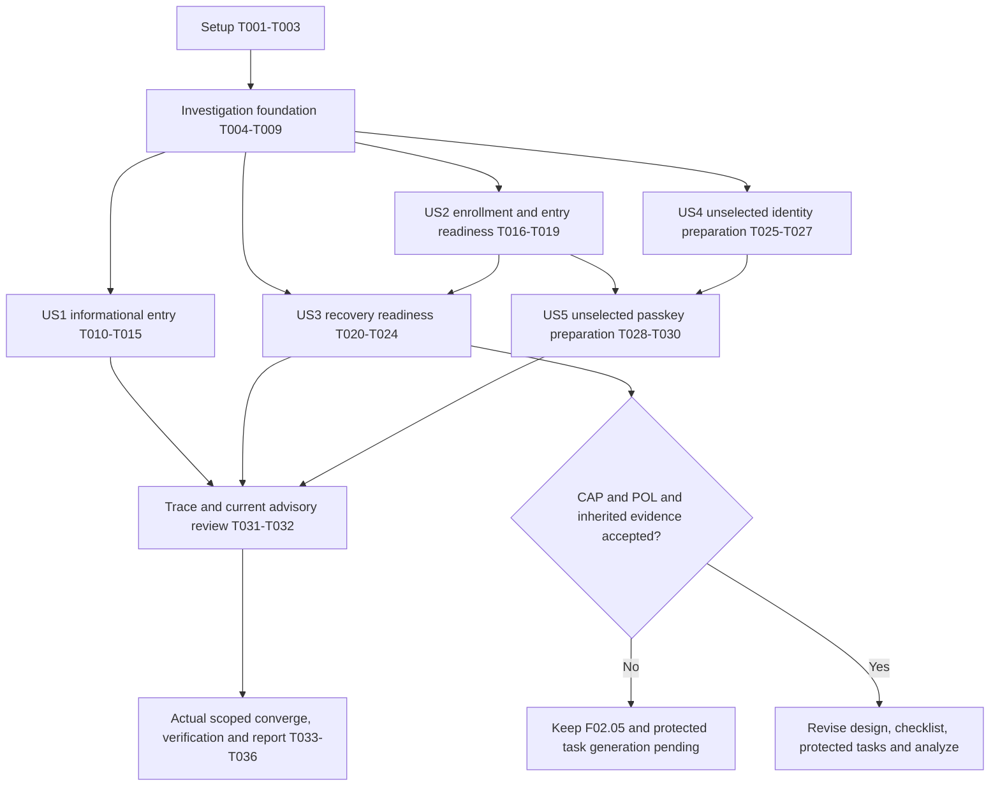

# Tasks: Protect an Account with Stronger Sign-in Controls

**Input**: [spec.md](spec.md), [plan.md](plan.md), [research.md](research.md), [data-model.md](data-model.md), [operation contract](contracts/account-security.md), [presentation contract](contracts/presentation.md), [security/evidence contract](contracts/security-and-evidence.md), [quickstart.md](quickstart.md) and the constitution.

**Execution scope**: Bounded gate-resolution, acceptance preparation and the independently useful US1 informational entry. This is **not** a complete protected-effect implementation backlog. The plan/spec explicitly prohibit generating dependent MFA/recovery/identity/passkey implementation tasks before managed support and POL-03 are resolved. Those tasks must be generated later against finalized supported contracts; no speculative endpoints, action enums, proof lifetimes, code counts, migrations or plugins are introduced here.

**Current readiness**: Execution scan reads **16/16**, but checklist notes/spec still defer POL-03 (planning recorded 14/16); P2-CAP, P2-POL and applicable P2-IDENTITY/P2-ENV/P2-DATA/P2-RELEASE remain blocked. F02.05 remains specified functionality; F02.12/F02.13 remain unselected optional expansions. Completing an investigation or this bounded list does not complete those contracts. All task boxes began open; generation executed none of them. Current completion marks identify only the delivered bounded task outputs.

**Tests**: Included because the spec explicitly requires positive/negative/concurrent/recovery, local/real-provider and bilingual/accessibility evidence. Only bounded current denial/presentation tests are scheduled for code changes here. Positive provider tests are campaign preparation until their support/policy/target gates pass. Do not write a homemade authentication harness to simulate missing provider capability.

## Format and path conventions

Paths are repository-relative. Task IDs are local to Feature 008; `007:T...` identifies an owning prerequisite in Feature 007 and is never a task to reimplement here. `[P]` means disjoint-file work after every named dependency completes, not authorization for delegation or live operations. Read current source before edits and serialize catalogs/shared contracts/tests.

Before implementation, run the required requirements/security checklist and `$speckit-analyze` over current artifacts. This list does not waive the implementation tool's checklist gate or authorize changing checklist markers. Existing authorization permits independent document/capability investigation; product edits require the applicable reviewed execution gate. Preserve the pending quality items until actual approval/evidence resolves them.

### Gate semantics

| Gate             | Required disposition                                                                                                                                                                                                                                                    |
| ---------------- | ----------------------------------------------------------------------------------------------------------------------------------------------------------------------------------------------------------------------------------------------------------------------- |
| **LOCAL**        | T001–T009 investigation/foundation outputs complete, current-source checklist/analyze review permits the exact non-mutation slice, and local fixture/runtime prerequisites verified. No live target required for document work or mocks. No checklist bypass is implied |
| **CAP/POL**      | Actual managed operation support and complete enabled-entry/direct-origin policy demonstrated; exact POL-03 approved in spec/register; both open quality items resolved before protected-effect task regeneration                                                       |
| **IDENTITY/ENV** | Relevant 007-owned trusted verification/fresh-proof/revocation/ingress corrections accepted; independently verified authorized isolated app/auth/DB/roles/OAuth/sink mapping. Available env values or manifest alone do not pass                                        |
| **DATA/RELEASE** | Applicable inventory/access/retention, current advisory/build/ingress/recovery, browser/human and security acceptance. An unavailable scan/reviewer is an owned gap                                                                                                     |
| **OPTIONAL**     | Explicit future subflow selection plus CAP/POL/IDENTITY/ENV/DATA/RELEASE. Current unselected scope permits denial/investigation preparation only                                                                                                                        |

A task whose deliverable is a documented finding may complete with an unsupported/unproven result, but that **never** passes its capability gate. An approval, successful campaign or acceptance task stays unchecked when evidence is absent. Never contact a provider, provision a target, apply SQL, send mail, install a package or deploy just because a task mentions it.

## Phase 1: Setup — preserve the existing project

**Purpose**: Establish current inputs and safe evidence without scaffolding or changing the selected stack.

- [X] T001 Capture current Git/source/lock/installed versions, input hashes and dirty paths in `specs/008-strengthen-account-security/artifacts/execution-source-identity.json`; read AGENTS, constitution, current skill routing and relevant installed Next guides before any application code, preserving the existing branch and prior evidence. No dependency installation or environment-secret output.
- [X] T002 [P] Inventory existing runnable guards/imported tests and reuse unchanged planning results, or run only invalidated local checks from `specs/008-strengthen-account-security/quickstart.md`; record commands/results and mocked/source-only versus real evidence in `specs/008-strengthen-account-security/artifacts/execution-baseline.md`. Do not run a live integration mode or unchanged full suite for paperwork. Depends: T001.
- [X] T003 [P] Create the requirement/story/evidence trace in `specs/008-strengthen-account-security/artifacts/requirement-trace.md` for all 34 FRs, 10 SCs, 29 scenarios and three retained feature IDs, with mandatory/conditional selection, accountable roles and current unmet evidence explicitly identified. Depends: T001.

## Phase 2: Foundational — disposition the shared blockers

**Purpose**: Complete the shared investigation records before story work. This phase establishes truthful readiness, not provider support. A blocked finding can satisfy a documentation task while leaving protected work blocked.

- [X] T004 [P] Revalidate the installed Neon wrapper/upstream package surfaces against fresh official managed documentation and record a per-operation supported/unsupported/unproven matrix in `specs/008-strengthen-account-security/artifacts/managed-capability-investigation.md`; cover MFA setup/confirmation/challenge/disable/recovery, every enabled primary entry, code read-back/consumption/replacement, passkeys, email/link/unlink, same-session reauth, session outcomes and direct-origin enforcement. Record versions/URLs and no target acceptance from SDK types; do not install plugins or probe a hosted target. Depends: T003.
- [X] T005 [P] Record exact prerequisite ownership/evidence in `specs/008-strengthen-account-security/artifacts/prerequisite-status.md`, linking 007:T016/T018–T020/T024, T027–T036, T037/T039–T045, T047/T049–T053, T017/T023, T055–T058/T063 and T064–T067/T090–T097 to the owning `specs/007-phase-one-completion/artifacts/readiness.md`; distinguish source defects, mocks and actual acceptance. Keep unrelated G2/name/preferences/public corrections in 007; no blanket Phase 01 rewrite or inherited checkbox approval. Depends: T003.
- [X] T006 [P] Prepare `specs/008-strengthen-account-security/artifacts/action-policy-matrix.md` with one row per enrollment/confirmation/challenge/disable/replace/code-generation/replacement/recovery and future conditional identity/passkey action, listing confirmation method, intended account/session, exact proof lifetime/consumption, challenge clock/replay/expiry/retry/admission/bounds and session/reconciliation outcomes. Mark unknown values pending named product/security review; preserve recovery revoke-all-prior-sessions and Q1 A/Q2 A/Q3 A. Do not copy revocation's five minutes or upstream/fixture defaults. Depends: T003.
- [X] T007 [P] Record ownership/persistence decisions and field constraints in `specs/008-strengthen-account-security/artifacts/data-design-review.md`, quoting the logical model verbatim: authority is “Derived from trusted request/provider state; never asserted through submitted actor/role/session claims. Recheck before effects. Public challenge/recovery has provider-bound limited authority, not an ordinary session substitute”; capability fields retain “Operation, selected scope, supported/unavailable/unproven disposition, safe reason code, reviewed policy/evidence version”; capability assessment is “Not a provider-plugin detector or new database table. False/unavailable action permission does not mean the account has no factor; unknown provider state stays unknown. Return only safe selection/availability/reason to UI”; protection-change fields retain “Original intent, account-owned intended transition, accepted/rejected/pending/unknown outcome, accepted-state observation and safe correlation”; protection-change metadata is “App metadata is conditional on demonstrated cross-request reconciliation need. Never authoritative for factor/identity acceptance if provider state is unknown. Keep external and local commitment distinct”; event validation is “Use the existing reviewed account-event boundary; extend closed types/constraints only if required. No raw provider JSON, proof, code, email destination or user-controlled log text. Retention/access/hold approval is a collection prerequisite”. Map every named logical field to its owner; select no new table/migration without demonstrated need and reviewed applied history. Depends: T003.
- [X] T008 [P] Prepare the scoped requirements/security review in `specs/008-strengthen-account-security/artifacts/security-control-review.md` mapping SEC-001–008/009–012/014/017/019/022–032/041–056/060–064 to actual trust boundaries, concrete denied/race/outage/secret checks and accountable reviewers; verify exact applicable ASVS 5.0.0 L2 references from primary authority or leave that mapping explicitly pending. Record allowed live-test scope and unavailable roles/tools/humans as gaps, never exceptions. Depends: T003.
- [X] T009 Join T004–T008 into `specs/008-strengthen-account-security/artifacts/execution-readiness.md` with current LOCAL/CAP/POL/IDENTITY/ENV/DATA/RELEASE/OPTIONAL states, named resolution owners, required artifacts and next permitted action. Confirm no protected task generation or product mutation is unlocked by an investigation checkbox; preserve `specs/008-strengthen-account-security/checklists/requirements.md` at its evidence-supported state and require checklist/analyze review before code execution. Depends: T002, T004, T005, T006, T007, T008.

**Checkpoint**: Foundation investigation can be complete while actual identity/policy/provider/release gates remain blocked. All story work uses this disposition; no blocked live scenario becomes PASS.

## Phase 3: User Story 1 — Understand account protection (P1; bounded informational increment)

**Goal**: Add a truthful, localized security-settings entry within the current personal account shell, without new protected mutations or invented method status.

**Independent Test**: Two-account/local fixtures cover unknown/unavailable/pending/known-enabled distinctions, direct unsupported-operation denial and profile/Realtime failure. The actual entry is keyboard/mobile/bilingual usable and cannot expose prior-owner data. Supported own-method listing and full US1 acceptance remain pending wherever real provider authority is unproven. This increment is not F02.05 delivery.

**Coverage**: FR-001–003/007–008/013/030–034; US1.1–4; relevant SC-002/007/010. SC-008 enrollment usability cannot pass from entry visibility.

- [X] T010 [P] [US1] Add meaningful rendered/imported regressions in `scripts/test-site.test.mjs` for the actual account security section, unknown versus disabled protection, no setup/remove placeholder action, no foreign method projection and truthful unavailable/pending copy; use controlled fixtures without enabling a provider method. Observe the missing/incorrect presentation failure before its edit. Depends: T009; gate LOCAL.
- [X] T011 [P] [US1] Extend `scripts/test-account-browser.md` with explicit local versus real fixture procedures for security entry findability, profile/Realtime failure, keyboard focus/status, both languages/all themes, mobile/320px/actual zoom, account switch/history/late replies and ordinary sign-out. Name unsupported/provider/human cases as unaccepted. Depends: T009.
- [X] T012 [US1] Compose the smallest informational security entry in `app/(site)/[locale]/[theme]/app/account/page.tsx` using existing shadcn/Base UI semantic primitives and the current shell/authority boundary; assess existing profile/Realtime failure behavior before claiming independent access. State managed/policy unavailability without claiming no factor is configured, adding a new API, capability flag, store, mutation button or account hierarchy. Preserve current profile and revocation ownership. Depends: T010; gate LOCAL and applicable implementation checklist/analyze review.
- [X] T013 [US1] Add equivalent security-entry explanations, unavailable/unknown distinctions and recovery-limit labels in `messages/en.json` and `messages/ar.json`, wire them into the existing account section and run relevant rendered/translation assertions; retain browser/account locale precedence, logical RTL and readable mixed-direction identifiers without promising working MFA. Depends: T012; gate LOCAL.
- [X] T014 [US1] Extend `scripts/test-application.test.mjs` for the actual new section's account-generation concealment, delayed/history results and ordinary sign-out/unavailable-authority behavior; correct only a demonstrated shared-lifetime regression in `components/application-runtime.tsx` if caused by this slice, otherwise reuse it unchanged. No credentials, proof or protected form persistence. Depends: T013; gate LOCAL.
- [ ] T015 [US1] Execute the implemented local entry checks and applicable actual-browser/bilingual/keyboard/mobile review from `scripts/test-account-browser.md`; record `specs/008-strengthen-account-security/artifacts/us1-entry.md` with source/build/fixtures, exact observations, human-review gaps and supported-method cases still blocked. Mark only accepted informational sub-scope; absent runtime/reviewer evidence leaves this acceptance task open, never F02.05 complete. Depends: T011, T014; gate LOCAL plus actual browser/human prerequisites.

## Phase 4: User Story 2 — Enroll and sign in with an approved factor (P1; readiness work only)

**Goal**: Establish a conforming managed enrollment/challenge contract and test obligations before protected-effect implementation is taskable. No application MFA backend/UI/harness is created in this phase.

**Independent Test required for eventual story acceptance**: On an authorized isolated target, complete confirmed TOTP plus one-time recovery setup, then sign in through every enabled entry; deny invalid/expired/consumed/wrong-account/session/purpose/origin proof, cancellation, races and cache/direct-origin bypass. Current unsupported capability leaves the story blocked.

**Coverage**: FR-003–016/019/030–033; US2.1–6; SC-001–002/006–009. These tasks prepare evidence; they do not satisfy those positive journeys.

- [X] T016 [P] [US2] Define the exact expected/no-effect/failure observations for US2.1–6 in `specs/008-strengthen-account-security/artifacts/us2-campaign.md`, covering confirmed versus incomplete recovery setup, enrollment cancellation/supersession/expiry/concurrency, wrong proof, leading-zero input, ordinary session/cache denial and every enabled direct managed/app path. Parameterize only explicitly pending POL-03 values; do not create a runnable fake MFA test. Depends: T009.
- [X] T017 [P] [US2] Trace installed email/social/reset/recovery/passwordless callback and cached-session entry behavior in `specs/008-strengthen-account-security/artifacts/us2-entry-coverage.md`, with exact source locations and current managed evidence. Explicitly record upstream two-factor's limited hook/trusted-device coverage versus the selected every-entry rule, and the absence of accepted managed original-session proof; preserve existing approved social entry and deny speculative fixes. Depends: T009.
- [X] T018 [US2] Review logical access-method and intent fields in `specs/008-strengthen-account-security/artifacts/us2-data-contract-review.md`, quoting access-method fields “Owned opaque reference, kind and authentication role, safe label, pending/active/removed state, optional safe timestamps” and their validation “Factor seeds, private keys, credential tokens/challenges and verifier records remain managed. Own-only bounded safe projection; provider payload/IDs that carry bearer authority never reach general client state” and intent fields “Original account/session, supported action/purpose, immutable authoritative targets and digest, method, trusted issue/verification/expiry, pending/cancelled/verified/reserved/consumed state and original operation correlation”, constrained by “Reference alone grants no authority. Existing revocation tables encode revocation-only actions/five-minute proof and cannot be silently broadened. POL-03 supplies each new action's exact proof/challenge rules”. Map each owned reference/kind/role/label/state/timestamp and original-account/session/action/target/digest/method/time/state/correlation to actual supported evidence, or mark its protocol/schema unproven. No new table, enum, wire path or app-owned factor state. Depends: T004, T007, T017.
- [X] T019 [US2] Record `specs/008-strengthen-account-security/artifacts/us2-readiness.md` with the enrollment/challenge support decision, remaining POL-03/007/target evidence and complete US2 acceptance gap list. If unsupported, explicitly keep the story open; if support later becomes demonstrated, resume the existing spec/plan/checklist regeneration workflow using that evidence before protected-effect tasks can be appended to `specs/008-strengthen-account-security/tasks.md`. The investigation record can finish; it cannot pass CAP/POL or accept US2. Depends: T016, T017, T018.

## Phase 5: User Story 3 — Recover or change protection without lockout (P1; readiness work only)

**Goal**: Resolve supported limited-recovery/disablement semantics and their policy prerequisites, preserving single use, all-prior-session invalidation and last-route safety. No homemade recovery/session protocol or credential-store implementation is scheduled.

**Independent Test required for eventual story acceptance**: Multiple sessions/accounts recover with a code once, invalidate all pre-existing sessions including the initiator, confirm replacement factor/current recovery material and freshly sign in. Competing recovery/removal, last-code exhaustion, invalid proof and unknown provider outcomes cannot bypass protection or resurrect revoked authority. Live acceptance remains blocked until supported/authorized.

**Coverage**: FR-003–013/017–019/030–033; US3.1–7; SC-002–004/006–009.

- [X] T020 [P] [US3] Define `specs/008-strengthen-account-security/artifacts/us3-campaign.md` for one-time code presentation/custody acknowledgement/no read-back, consumption/replacement races, wrong/expired/replayed proof, lost response, recovery-only authority, all-prior-session invalidation, confirmed replacement/fresh sign-in, last-code exhaustion, voluntary disablement and concurrent cross-family last-route removal. Include zero ordinary access and no automatic/support-assisted bypass when all methods/codes are lost. No live call or invented protocol. Depends: T009.
- [X] T021 [P] [US3] Inspect actual managed documentation and installed recovery/disablement/session source into `specs/008-strengthen-account-security/artifacts/us3-provider-review.md`; distinguish upstream normal-session backup success and server-only read-back helper from the selected limited-recovery/no-read-back contract. Identify proof needed after initiating-session revocation and provider atomic last-route guarantees; app locks, local SQL and a manifest validation cannot satisfy them. Depends: T009.
- [X] T022 [US3] Review every recovery-set field/state in `specs/008-strengthen-account-security/artifacts/us3-data-contract-review.md`, quoting “No app code/verifier mirror, no secret read-back, no logs/browser persistence. Code count, format/entropy, lifetime, attempt rules and supported secure storage require provider/security review. Custody acknowledgement does not prove an external backup exists” and “Usable enrolled configuration means an accepted supported primary method + confirmed TOTP + at least one unused acknowledged current recovery code. A pending/removed/unsupported credential or existing session does not count.” Document supported or blocked generation/consumption/acknowledgement/replacement/exhaustion/reconciliation transitions and restore constraints without guessing code limits or creating storage. Depends: T007, T020, T021.
- [ ] T023 [US3] Obtain the actual managed capability evidence and named product/security approvals required to fill `specs/008-strengthen-account-security/artifacts/action-policy-matrix.md`, then record approved values/references in `docs/planning/decisions.md` and `specs/008-strengthen-account-security/spec.md`; retain enrollment/disable/replace/code regeneration and recovery confirmation/clock/expiry/retry/admission/session rules per action, original-session preservation and the fixed recovery revocation rule. Revalidate the two open quality items only from real resolution. Without supported behavior or approval, record the blocker but leave this approval task unchecked; no provisional values, target provisioning or external message is authorized. Depends: T006, T017, T021, T022; gates CAP/POL/IDENTITY/ENV for relied-upon actual evidence.
- [X] T024 [US3] Join US2/US3 outcomes in `specs/008-strengthen-account-security/artifacts/us3-readiness.md`, recording exact supported versus blocked recovery/disablement, approved/pending policy rows, current provider/session/target limits and the required next design revision. Any future executable enrollment/recovery model/service/route/UI/real-test tasks must first be generated through revised `specs/008-strengthen-account-security/plan.md`, `data-model.md` and `contracts/` after CAP/POL and applicable inherited gates pass; do not append generic “implement supported MFA” placeholders. A blocked readiness record is not story acceptance. Depends: T019, T020, T021, T022; inspect T023's actual state without assuming approval.

## Phase 6: User Story 4 — Change a verified identity safely (P2; unselected optional F02.12)

**Goal**: Preserve conditional identity-change contracts and current application denial, without selecting/implementing expansion.

**Independent Test required for eventual story acceptance**: Two accounts/multiple sessions complete verified email and explicit social link/unlink after fresh proof, while collision, matching-email-only merge, cancellation/unknown commit, stale/wrong proof and last-route races fail without ownership transfer. Current task scope proves only denial/preparation, never these positive flows.

**Coverage**: FR-020–024 plus common FR-003–013/030–034; US4.1–6; SC-002/004–007/010.

- [X] T025 [US4] Record current unselected email/link/unlink disposition in `specs/008-strengthen-account-security/artifacts/us4-scope.md`, citing exact source/managed support and future inclusion, approval, original-session proof, collision/session/last-route evidence gates. Preserve F02.12's optional label and all conditional requirements; neither ask for activation nor mark unavailability accepted. Depends: T009.
- [X] T026 [US4] Prepare `specs/008-strengthen-account-security/artifacts/us4-campaign.md` for every US4 scenario and required denied foreign/stale/consumed/wrong-purpose proof, preserving the identity-field constraint verbatim: “No accepted identity update until required verification/commit. Matching email never merges account identity; no business/workspace foreign-key rewrites. Extra identity metadata collection needs inventory approval”. Map accepted/pending destination/link, provider verification/outcome and session states to evidence requirements without finalizing routes or enabling a flow. Depends: T025, T007.
- [X] T027 [US4] Extend imported allowlist/proxy denial regressions in `scripts/test-auth-contract.test.mjs` for currently disabled email-change/link/unlink method/path combinations, unexpected authority fields and unchanged existing sign-in/callback behavior; use the current actual allowlist, not a simulated provider. Record local-only results in `specs/008-strengthen-account-security/artifacts/us4-scope.md`; keep real direct-provider policy unproven and positive tasks deferred to explicit selection plus finalized contracts. Depends: T026; gate LOCAL for test-file changes.

## Phase 7: User Story 5 — Use and manage passwordless access (P3; unselected optional F02.13)

**Goal**: Preserve passkey/passwordless conditional requirements and direct application denial; no plugin, browser authenticator UI, new factor role or dependency is selected.

**Independent Test required for eventual story acceptance**: A supported isolated device/provider registers and lists an owned labelled credential, authenticates the intended account, removes it safely and handles device loss; cancellation/unsupported devices, expired/replayed/origin/account mismatch and foreign/last-route removal fail safely. Current denial/preparation work is not that acceptance.

**Coverage**: FR-025–029 plus common FR-003–013/030–034; US5.1–6; SC-001–004/006–007/010.

- [X] T028 [US5] Record unselected passkey/other-passwordless/hardware-backed disposition and upstream-versus-managed evidence in `specs/008-strengthen-account-security/artifacts/us5-scope.md`; map kind/role/owned reference/label/pending-active-removed state to the same managed access-method constraints reviewed in T018. No private-key/challenge mirror, extra auth backend, guessed support or passkey-as-second-factor assumption. Depends: T009, T018.
- [X] T029 [US5] Prepare `specs/008-strengthen-account-security/artifacts/us5-campaign.md` with US5.1–6 expectations for explicit owner registration, safe labels/listing/removal, authenticator cancellation, unsupported browsers/devices, origin/account/expiry/replay denial, loss/recovery and cross-family last-route races in English/Arabic keyboard/mobile flows. Identify which actual browser/provider/device evidence future selection requires; add no fake authenticator or missing-method harness. Depends: T028.
- [X] T030 [US5] Extend `scripts/test-auth-contract.test.mjs` for current disabled passkey and separately unselected passwordless operations without widening the catch-all or changing ordinary supported sign-in/callbacks; record imported local denial results and unsupported positive coverage in `specs/008-strengthen-account-security/artifacts/us5-scope.md`. Explicit future selection/support/policy/design revision is required before positive implementation tasks. Depends: T027, T029; gate LOCAL for test-file changes, serialize the shared auth test file.

## Phase 8: Polish and cross-cutting readiness — scope stays truthful

**Purpose**: Reconcile the bounded work and execution evidence. This phase cannot turn incomplete MFA or unselected expansions into accepted features.

- [ ] T031 Reconcile every FR/SC/scenario to its task/output and actual evidence category in `specs/008-strengthen-account-security/artifacts/requirement-trace.md`, accounting for US1 informational coverage, US2/US3 gate-resolution only and unselected US4/US5. Record absent protected-effect implementation tasks as an intentional regeneration blocker, not complete requirement coverage; include SC-008's five-person enrollment review and SC-009's actual two-instance tests as unaccepted until executable supported behavior exists. Depends: T015, T019, T024, T027, T030.
- [X] T032 Review exact current local/bundled/managed/deployed versions against fresh primary advisories and available scans into `specs/008-strengthen-account-security/artifacts/security-control-review.md`; distinguish the existing 27-entry audit, public 1.7.15 follow-up findings and unknown hosted applicability from a fresh clean result. Assign owned gaps, no automatic dependency upgrade or exception, and keep necessary actual ingress/role/data/restore/human review pending. Depends: T008, T024; live scans require separately verified authorized scope.
- [ ] T033 After an actual permitted informational implementation exists, run the requested converge workflow on that exact scope and record unmet requirements, generated remediation and observed completion in `specs/008-strengthen-account-security/artifacts/convergence.md`; finish only authorized scoped fixes and leave unsupported/optional feature requirements open. Do not count this tasks-generation step, a document-only investigation or mock MFA as post-implementation convergence. Depends: T015, T031; gate LOCAL and actual implementation evidence.
- [ ] T034 Run final appropriate imported/rendered/translation/guard checks for changed code and the required `npm run test:full` only after reviewed isolated runtime configuration; record source/commands/results in `specs/008-strengthen-account-security/artifacts/final-verification.md`, distinguishing first-stage lint failure from unrun chained checks. Verify current browser/Arabic/assistive evidence for the delivered slice and report actual provider/DB/direct-origin/shared-instance checks not run; do not repair unrelated 007 scope or rerun unchanged suites for documents. Depends: T032, T033; applicable DATA/RELEASE and runtime prerequisites.
- [ ] T035 Create the final scoped implementation/readiness report in `specs/008-strengthen-account-security/evidence.md` with actual supported implemented capabilities, commands/results, disabled/unselected IDs, unresolved prerequisites and provider/environment/human limitations. Explicitly state whether supported enrollment → factor sign-in → approved recovery → stale identity-change proof denial passed; an informational increment or unselected F02.12 means no full Phase 02 demonstration/acceptance. Absent implementation gets a readiness report only, never a fabricated implementation report. Depends: T031, T034.
- [ ] T036 Reconcile `specs/008-strengthen-account-security/quickstart.md`, `plan.md`, relevant `contracts/` and root `plan.md` with final evidence/remaining work; update feature/subtask marks, phase status and totals only for fully accepted contracts after actual implementation/verification. Preserve pending F02.05/F02.12/F02.13 and later-feature marks; record the required next checklist/design/task/analyze step when gate resolution is incomplete, without committing, deploying or sending external messages. Depends: T035.

## Dependencies & Execution Order

### Common and story dependencies

T001 precedes T002/T003. T003 unlocks disjoint T004–T008 investigations; T009 joins their records and the local baseline. A completed foundation records gate dispositions; it cannot pass blocked capabilities.

After T009, US1's informational slice and US2/US3 investigation preparation may proceed independently under their applicable gates. US1 code work also requires the current checklist/analyze execution review; generation grants no waiver. US2's entry/method review precedes US3's final approval/design join. US4/US5 remain unselected; their denial tests are local only and share one serialized test file. US5's method ownership uses T018's review, not an implemented MFA dependency.

The graph shows joins and taskable readiness work, not permission to implement missing auth behavior. There is no dependency cycle: T024 observes T023's real state without requiring an invented approval. If T023 is blocked, record readiness without checking that approval task or claiming US3 complete. Actual protected implementation requires the separate revised backlog after the gate branch succeeds; it is deliberately absent here.

### Parallel opportunities per story

Examples assume all named prerequisites and applicable execution gates have passed. They are scheduling examples, not instructions to spawn agents or contact providers.

| Story | Disjoint work                                                            | Serialized join                                                                                      |
| ----- | ------------------------------------------------------------------------ | ---------------------------------------------------------------------------------------------------- |
| US1   | T010 rendered tests and T011 browser procedure after T009                | T012 page → T013 shared catalogs → T014 lifetime tests → T015 observations                           |
| US2   | T016 campaign and T017 source/entry review after T009                    | T018 field/ownership review → T019 readiness disposition                                             |
| US3   | T020 campaign and T021 provider-source review after T009                 | T022 field/state review → T023 real approval if available → T024 truthful readiness join             |
| US4   | T025/T026 have a scope dependency, so no internal task parallelism       | T027 edits the shared auth-contract test; may overlap US2/US3 document work only with separate files |
| US5   | T028/T029 have a model/scope dependency, so no internal task parallelism | T030 must wait for T027; campaign preparation can overlap unrelated US1 browser work                 |

`messages/en.json`, `messages/ar.json`, account page/runtime, `scripts/test-auth-contract.test.mjs`, the policy matrix, spec/register, shared contracts and trace/readiness artifacts each have one edit owner at a time. `[P]` markers never waive a prerequisite or gate.

## Implementation Strategy

The smallest useful product increment is **US1's truthful informational security entry**, after applicable quality/analyze review and its local/browser/human validation. It has no enrollment/challenge/recovery mutations and cannot close US1's real supported-method coverage, F02.05 or Phase 02.

The immediate executable preparation is **T001–T009 plus disjoint story investigation/campaign documents**, preserving every blocked gate. No extra project setup, backend, auth tables, generic adapter/store, dependency or optional selection is needed. Reuse valid earlier evidence only for unchanged source/category.

The first full protection increment must ultimately combine **US2 + US3**: working confirmed enrollment, every-enabled-entry challenge, supported recovery, fresh disablement and last-route safety. These are security-coupled; enrollment without accepted recovery is not a usable MFA MVP. Only after support/POL-03 and owning prerequisites pass should the supported design be finalized, protected model/service/route/UI/test tasks generated with exact constraints, analyzed and implemented. Preserve completed IDs when appending/revising the backlog.

F02.12/F02.13 require separate explicit future selection, capability/policy revision and full positive/negative acceptance. Keep their conditional requirements without silently requiring them for an approved smaller launch. Full Phase 02 completion still requires all included contracts and the complete demonstration.

All 36 tasks begin unchecked. No feature parent, acceptance criterion, quality-check marker or release gate is completed by generating this file. There is no automatic commit, target creation, live campaign, provider mutation, migration, deployment or external message.

## Execution checkpoint — 3 November 2026

29/36 bounded tasks completed; see [current scoped evidence](evidence.md). T015/T023/T031/T033–T036 remain open for actual acceptance, approval, convergence and complete verification dependencies. Full gate failed at inherited lint; no protected story/feature accepted. Checklist markers remain untouched at their externally changed 16/16 state, while notes/spec still defer POL-03. Historical planning captures preserved. No completion claim for MFA, identity changes, passkeys or Phase 02.

## Phase 9: Authorized complete implementation

User authorization supersedes the earlier managed-only/no-optional implementation limit. These tasks require real app-operated Better Auth behavior and isolated PostgreSQL evidence; no positive result is inferred from a mock.

- [X] T037 Implement the app-operated Better Auth 1.7.15 factory, selected plugins, schema migration and isolated PostgreSQL tests in lib/auth/app-auth.ts, migrations/005-app-auth.sql and scripts/test-app-auth.mjs. Keep existing production auth available until migration is tested. See the 4 November checkpoint; remaining security/provider/browser acceptance belongs to T038–T042.
- [ ] T038 Enforce all-entry TOTP, one-use recovery, restricted recovery authority, acknowledged material and exact action-bound fresh proof in the application auth boundary; deny foreign/stale/replayed/direct calls with real PostgreSQL concurrency/outage tests.
- [ ] T039 Integrate the existing auth/session/profile/workspace/callback boundaries with the new authority, preserving stable account ownership and ordinary sign-out; verify every affected caller and migration path.
- [ ] T040 Replace the explanation with functional bilingual security settings and challenge/recovery UI, including verified identity maintenance and passkeys, using existing shared primitives and runtime lifetime ownership; test keyboard/RTL/mobile and loss/late-result behavior.
- [ ] T041 Prepare and test additive account migration/cutover/rollback with existing user IDs, explicit session invalidation and provider/password compatibility. Apply only verified isolated test migrations before a reviewed live cutover.
- [ ] T042 Complete appropriate source/build/advisory/database/browser verification, scoped convergence and honest final feature/plan/evidence reconciliation. Retain any actual external-provider/device/human acceptance gaps without calling them passed.
